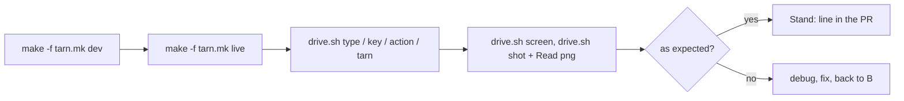

# Stand: live checks of tarn by the agent

The stand is a copy of a built Tarn.app with its own bundle id and home, so its socket, settings and
AppleScript target never touch the user's Tarn. The agent drives it through Ghostty's AppleScript
dictionary (`macos/Ghostty.sdef`) with `tools/stand/drive.sh`.

## Steps

1. Build: `make -f tarn.mk dev` in the checkout of the change (a worktree from `make -f tarn.mk worktree`
   links the built core). Run it in the background; it takes minutes. Output:
   `macos/build/Debug/Tarn.app`, log `macos/build/dev.log`.
2. Start: `make -f tarn.mk live` (default app is the Debug one; `STAND_APP=<path>` for another).
   It prints `HOME` and `TARN_SURFACE`; `drive.sh tarn` sets them itself.
3. Drive, one action per call. Before typing into a fresh pane wait for its prompt
   (`drive.sh wait '>'`): text sent earlier runs late. After a command wait for its output with
   `wait <text>`; after a UI action give the app 0.5-1 s (`/bin/sleep 1`) to draw:

   | What | Command |
   | --- | --- |
   | paste text | `sh tools/stand/drive.sh type 'ls -la'` |
   | press a key | `sh tools/stand/drive.sh key enter`, `key t command` |
   | Ghostty action | `sh tools/stand/drive.sh action new_split:right` (names: `ghostty +list-actions`) |
| other pane | `sh tools/stand/drive.sh action goto_split:previous` |
   | agent CLI | `sh tools/stand/drive.sh tarn open README.md`, `tarn ls --json`, `tarn notify hi` |
   | screen text | `sh tools/stand/drive.sh screen` |
| wait for output | `sh tools/stand/drive.sh wait 'ok' 10` (fails after 10 s) |
   | screenshot | `sh tools/stand/drive.sh shot <scratchpad>/name.png`, then Read the png |

4. Read: screen text first, it is cheap and exact for terminal output. A screenshot for what text
   does not show: sidebar, viewer pane, cards, badges, layout. Read only the screenshots you need:
   each one costs context.
5. Record: the PR gets one line next to `Review:`:
   `Stand: <short commit>, <steps>, <what was seen>, ok|failed`. Screenshots stay in the scratchpad.
6. Stop: `sh tools/stand/stand.sh stop` at the end of the session.

## Dev build check

After merges into `dev` (several PRs or on request): pull `dev`, `make -f tarn.mk check`, then
`make -f tarn.mk dev` and the stand. Walk the user paths the merged PRs changed, plus the smoke path:

1. The window opens with the sidebar and workspace `~`.
2. `wait '>'`, `type 'echo ok-$((1+1))'`, `key enter`, `wait ok-2`.
3. `action new_split:right`, `action new_tab`: the screenshot shows the split and the new sidebar row.
4. `tarn ls --json` lists the panes; `tarn open README.md` opens the viewer without moving focus.
5. `tarn notify hi` marks the row.

The report goes to the tix task of the batch: what was checked, what failed, screenshot paths.
The user still checks by hand once per batch; the agent's check comes first and names what to look at.

## Limits

- `shot` needs Screen Recording for the terminal the agent runs in (System Settings, Privacy and
  Security, Screen and System Audio Recording), then a restart of that terminal.
- `key` and mouse events reach the terminal surface only. A click on the sidebar or a card needs
  Accessibility for the host terminal and System Events; without it use a key binding or an action.
- `screen` goes through the clipboard: text is restored, an image on the clipboard is lost.
- `make -f tarn.mk dev` right after a build with other settings (`build.nu`, coverage on) once failed
  with `Unable to resolve module dependency: 'GhosttyKit'`; the rerun passed.
- The stand window opens on the user's screen. `live` gives focus back to the app that was in front:
  keys the user types must not land in the stand. Never `focus` or `activate` the stand window from a
  check; `drive.sh` targets the focused pane without bringing it to the front. Do not ask the user to
  keep the window; restart it with `live`.
