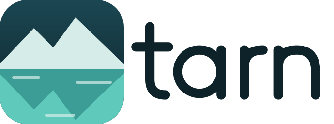
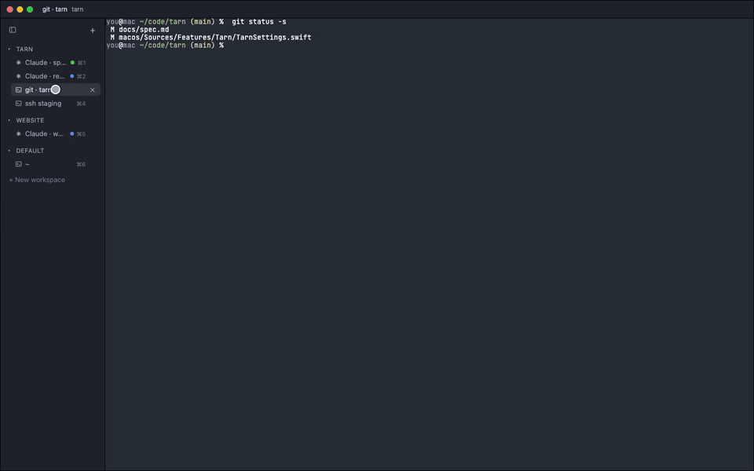
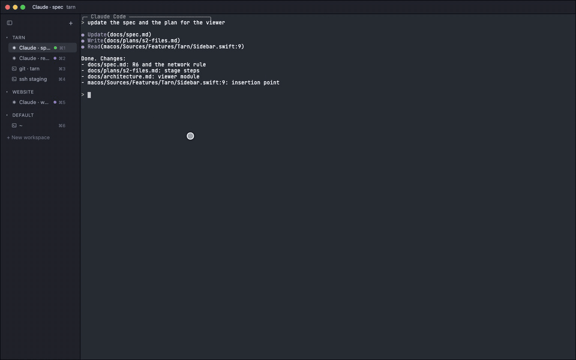
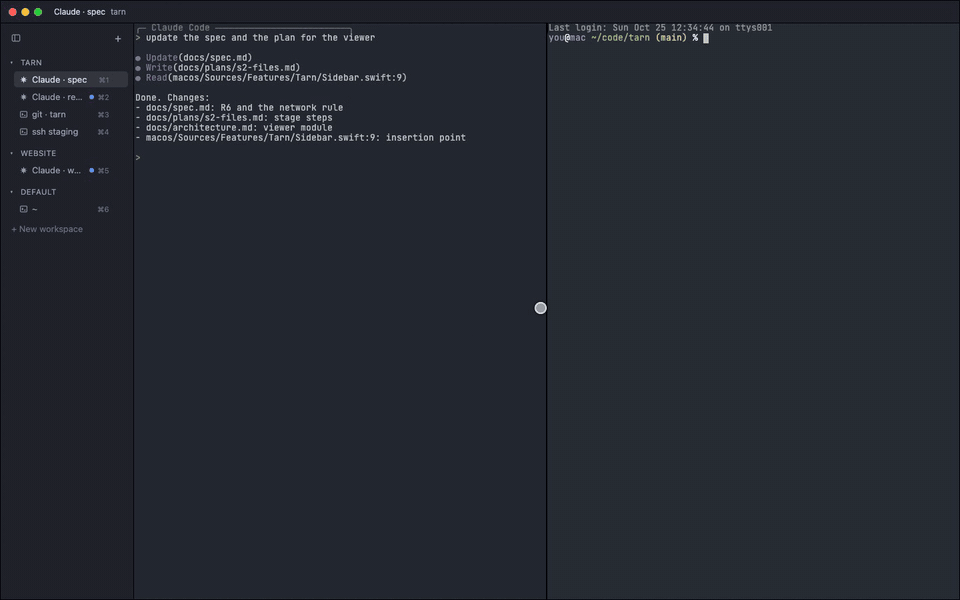
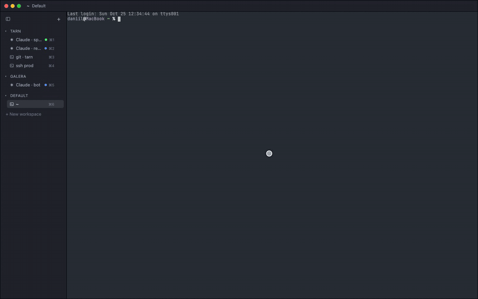

<p align="center">
  <picture>
    <source media="(prefers-color-scheme: dark)" srcset="docs/assets/logo-wordmark-dark.svg">
    
  </picture>
</p>

<p align="center"><b>An agent-first terminal for macOS, built on <a href="https://ghostty.org">Ghostty</a>.</b><br>
Every tab in a sidebar, grouped by project, with the state of each Claude Code session at a glance.</p>

tarn is an unofficial fork of Ghostty and is not affiliated with the Ghostty project; see
[NOTICE.md](NOTICE.md).

## What it adds to Ghostty

Ghostty keeps rendering, input, splits and config. tarn adds:

- **Sidebar.** A vertical tab list in place of the tab bar, with tabs grouped in workspaces. A tab
  running `claude`, `codex` or `opencode` joins the group of its project.
- **File viewer.** A click on a path in the terminal opens the file in a pane beside it: markdown
  rendered, mermaid diagrams, highlighted code, an editor with save, live reload when an agent
  rewrites the file.
- **Window layout.** Drag a terminal or a viewer to a zone: under another pane, beside it, or at
  the window edge.
- **Agent status and card.** Claude Code state shows as a colored dot: working, needs permission,
  asks a question, done, error. Hover a row: the card shows the request and answers it with one
  click (Allow, Deny, or a numbered option).

Local only: no account, cloud, telemetry or built-in AI model.

## Features in motion

Taken from the [browser demo](#try-the-demo) of the tarn window (dark theme).

| Sidebar | File viewer |
|---|---|
|  |  |
| **Window layout** | **Agent status and card** |
|  |  |

## Try the demo

`demo/` is a static page that shows the tarn window in a browser: a real terminal emulator per pane,
a simulated shell and a scripted `claude` session. It is a preview of the interface, not the app;
it also holds the planned `tarn` commands, marked as planned. Nothing is published or hosted. Run it
locally:

```sh
python3 -m http.server 8000 --directory demo
```

Open http://localhost:8000 in current Chrome or Edge. Details, tests and the list of built and
planned parts: [demo/README.md](demo/README.md).

## Stage

`tarn-v1.0.0`: the first wave. What works:

- a vertical sidebar with workspaces and agent groups: a tab running `claude`, `codex` or `opencode`
  joins the group of its project, with Claude Code state as a colored dot and a card that answers a
  permission request or a question with one click;
- a file viewer next to the terminal: markdown with mermaid, source view, editing, a files tree;
- a settings window with Ghostty options and a Help page of keys;
- one notification per need of an agent, and cmd+U to jump to the session that waits for you;
- the `tarn` command for agents: `tarn open`, `tarn ls`, `tarn notify`;
- its own app, `Tarn.app`, next to Ghostty.

Next: the second wave of `docs/spec.md` (hand-over between sessions, `tarn run`, subagents).

## Install

```sh
curl -fsSL https://raw.githubusercontent.com/daniil4545/tarn/main/install.sh | sh
```

The script downloads the latest release, checks its checksum and puts `Tarn.app` into
`/Applications`. The build is ad-hoc signed, not notarized; installing by hand needs one `xattr`
command, see the guide. Tarn installs next to Ghostty and reads the same config. Full steps, the Claude Code plugin, zsh
setup and upgrades: [docs/install.md](docs/install.md).

## Build from source

Requirements: macOS, Xcode and Zig as listed in [HACKING.md](HACKING.md), [Nushell](https://www.nushell.sh)
for the build script, Claude Code for agent state.

`zig build run` is not used on macOS (it looks for `Ghostty.app`).

1. Build the app: `macos/build.nu --configuration Debug --action build`
2. Open `macos/build/Debug/Tarn.app`.
3. Add the plugin: `claude plugin marketplace add <path to this repo>/plugin`, then
   `claude plugin install tarn@tarn`.
4. Start `claude` in a tab of the app: its dot turns blue while it works.

Tests: `macos/build.nu --action test`; hook contract: `python3 -I plugin/test/hook_test.py`.

## Documents

| Question | Where |
|---|---|
| what tarn is for and why it is built this way | [docs/spec.md](docs/spec.md) |
| how it is built and where things live | [docs/architecture.md](docs/architecture.md) |
| what changed in each release | [CHANGELOG.md](CHANGELOG.md) |
| ported code and its licenses | [THIRD_PARTY.md](THIRD_PARTY.md) |
| building and hacking on the Ghostty base | [HACKING.md](HACKING.md) |

## License

MIT, as Ghostty: [LICENSE](LICENSE).
