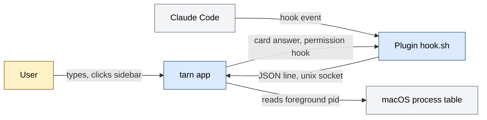
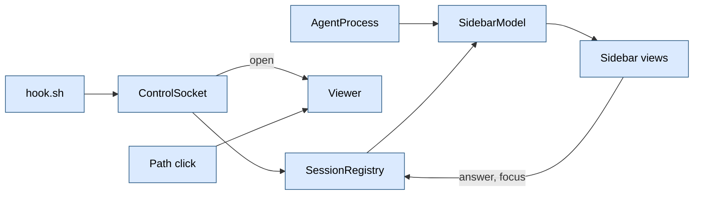
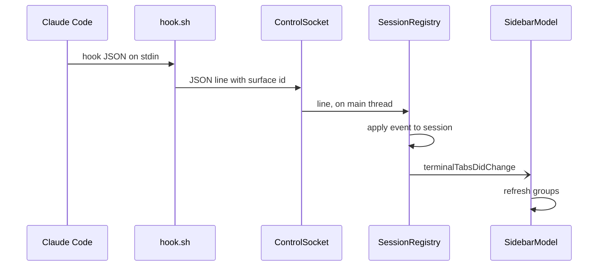

# Architecture of tarn

tarn is an agent-first macOS terminal, a fork of Ghostty. For people who run CLI coding agents (Claude Code first) in several tabs, it shows each tab's agent state in a sidebar and opens the files agents mention in a viewer pane. Input: Claude Code hook events over a unix socket, the foreground process of each terminal surface, path clicks. Output: a sidebar with workspaces, state badges, a hover card with quick answers to permission prompts, a viewer pane. One process (the Ghostty macOS app); state lives in memory; our code makes no network calls.

How to read: the overall picture is section 1, the module documents are in `docs/modules/`, where to change is section 9. Why it is decided so: section 12 of `docs/spec.md`.

State of this document: it describes `tarn-v1.0.0`. Sections 3 to 7 of the first version (processes, data and states, trust boundaries, failures, observability) live in the module documents.

## Contents

1. Map
2. Main flow
3-7. Processes, data and states, trust boundaries, failures, observability: in the module documents (`docs/modules/`), "Place in the system", "Invariants and failure rules"
8. Environments and configuration
9. Where to change
10. Limits and open items

## 1. Map

### Purpose

Show, next to the terminal, which tabs run an agent, what each agent does (working, waiting for the user, asking permission) and let the user answer or jump there; show the files agents point at. Success: the user sees from the sidebar which session needs them without opening tabs.

### Context

Blue: our code. Gray: external system. Yellow: person. Source: `plugin/hooks/hook.sh`, `plugin/hooks/permission.sh`, `ControlSocket.swift`, `AgentProcess.swift`.

### Modules

| Module | Responsibility | Document | Status |
|---|---|---|---|
| Viewer | file tabs, files tree, markdown view and editor, code view, watcher, unsaved-edit questions; a WKWebView draws, Swift holds state | [viewer.md](modules/viewer.md) | works |
| Control socket | binds the unix socket, reads one JSON line per connection, keeps a connection open for an answer | [control-socket.md](modules/control-socket.md) | works |
| Sessions | agent state machine, liveness, pending answers, agent naming, plugin hooks | [sessions.md](modules/sessions.md) | works |
| Sidebar | groups tabs per window, rows, hover card, quick answers | [sidebar.md](modules/sidebar.md) | works |
| Settings | settings window, tarn options file `ghostty.conf`, Ghostty options, key reference, load order | [settings.md](modules/settings.md) | works |
| Workspaces | workspace set per window, restore, undo tombstone, sidebar headers | [workspaces.md](modules/workspaces.md) | works |
| Layout | area tree, drop zones, grips, viewer host layout | [layout.md](modules/layout.md) | works |
| Browser demo | static page that mimics the window; not part of the app | [demo.md](modules/demo.md) | works |
| Attention, `tarn` CLI | notifications (one per need), jump (Cmd+U), socket command `notify`, the `tarn` shell client | [attention.md](modules/attention.md) | works |
| Agent commands | socket commands on panes of the caller's workspace: `ls` | [agent-commands.md](modules/agent-commands.md) | works |

Tests live in `macos/Tests/Tarn/` and `plugin/test/`; each module document names its suites.

### Invariants

| Invariant | Where enforced | Checked by |
|---|---|---|
| `src/` (Zig core) is not modified | no file under `src/` in the branch diff | review of `git diff --stat` |
| Swift changes outside `Features/Tarn/` only for identity and at insertion points of section 9: a call into our code with no logic; Ghostty's behavior changes by our layer on top, never inside its file (boundary in `.claude/CLAUDE.md`) | section 9 lists all of them | review of `git diff upstream/main...HEAD` |
| The registry is the only writer of session state | `SessionRegistry.sessions` is `private(set)`; sidebar only reads | review (not verified by a test) |
| `hook.sh` never blocks or fails the agent: exit 0, no output; `permission.sh` waits only while the app holds the connection | `exit 0` on every path; the agent's pipes are released first; `nc` runs in the background, the hook waits for it about 40 ms and then stops it | `python3 -I plugin/test/hook_test.py`: no surface, no app, an app that accepts and never reads, garbage input, a 200 KB event |
| Nothing edits `~/.claude/settings.json` | hooks ship as a plugin | review |
| No agent command moves focus or presses Enter for the user | no key is sent; `answer` writes the hook decision after a user click; socket `open` restores the first responder | review; run: responder unchanged after `open` |
| No network calls in our code | the viewer page loads only `tarn-md://` (rule list, CSP, navigation policy) | `ViewerRulesTests`; page run under the rule list |
| The updater never contacts a server | `feedURLString` is nil, `startUpdater` is not called, the menu item is hidden (row 27); the release target checks the bundle id | `UpdaterOffTests`, `make -f tarn.mk release` |

## 2. Main flow

The surface gets `TARN_SURFACE=<surface uuid>` in its shell environment (insertion point 7). Steps in detail: the socket in [control-socket.md](modules/control-socket.md), the event and the state machine in [sessions.md](modules/sessions.md), grouping and the card in [sidebar.md](modules/sidebar.md). A path click or `tarn open` takes a second route into [viewer.md](modules/viewer.md).

## 8. Environments and configuration

One environment: the local macOS app. One config file of ours: `~/.config/tarn/ghostty.conf` ([settings.md](modules/settings.md)).

| Variable or mode | What it enables | Where set |
|---|---|---|
| `TARN_SURFACE` | tells hooks which surface they run in | the app, for each surface shell |
| socket path | `~/Library/Application Support/tarn/tarn.sock` | constant in `ControlSocket.path` |
| sidebar width, collapsed | layout | `UserDefaults` (`TarnSidebarWidth`, `TarnSidebarCollapsed`) |
| tab style `TarnTabStyle`: `sidebar` (default) or `top` | sidebar or native tab bar | settings window, `UserDefaults` |
| `TarnFileViewer` | the file viewer on or off, default on | settings window, `UserDefaults` |
| plugin install | `plugin/.claude-plugin/marketplace.json`, `plugin.json` (name `tarn`, version 0.2.0) | `claude plugin marketplace add <repo>/plugin`, then `claude plugin install tarn@tarn` (`docs/install.md`) |

Logs: `os_log`, subsystem `tarn`, categories `registry`, `socket`, `viewer`, `attention`, `settings`, `workspace`; view in Console.app. Hooks registered in `plugin/hooks/hooks.json`, each with timeout 2 s except `PermissionRequest` (3600 s).

Identity: product `Tarn.app` (display name Tarn, bundle id `com.daniil4545.tarn`, Debug `.debug`), executable `ghostty`, Swift module `Ghostty`, Xcode target and scheme `Ghostty`. The executable keeps its name because the `tarn` CLI sits in `Contents/MacOS` and APFS is case-insensitive: an executable named `tarn` or `Tarn` would collide with it; the name also keeps `TEST_HOST` and the core's `ghostty +action` path valid. Cost: `ps` shows `ghostty`; Dock and Activity Monitor show `Tarn`. Left as Ghostty's on purpose: the core `bundle_id` (`src/build_config.zig:58`), so the config search paths and the cache folder `~/Library/Caches/com.mitchellh.ghostty` are shared with an installed Ghostty and core logs go under `com.mitchellh.ghostty` while Swift logs use `tarn`; the selection pasteboard `com.mitchellh.ghostty.selection`; `TERM=xterm-ghostty` and `TERM_PROGRAM=ghostty`; the AppleScript dictionary; in-process notification names. Release: `make -f tarn.mk release` builds `ReleaseLocal`, the configuration upstream uses for a local release: Xcode signs ad-hoc with `disable-library-validation`, so the embedded Sparkle loads and no second `codesign` is needed. Sparkle stays as a dependency with no feed and no started updater.

## 9. Where to change

### Insertion points in upstream files

Diff against the merge base with `upstream/main`. Every Swift change outside `macos/Sources/Features/Tarn/` is in this table.

| # | File | What was inserted | Why |
|---|---|---|---|
| 1 | `macos/Sources/Features/Terminal/TerminalController.swift` | property `private let sidebarModel = SidebarModel()` | one sidebar model per window |
| 2 | same | in the content view setup: `sidebarModel.window = window`; `NativeTabMark.install`; `TerminalView` wrapped in `SidebarLayout(model:ghostty:)`; initial content width plus `Sidebar.occupiedWidth` | draws the sidebar beside the terminal and keeps the terminal's requested size |
| 3 | same | at the end of the tab relabel function: post `.terminalTabsDidChange` | refresh the sidebar when tabs are relabeled |
| 4 | same | after a tab move: `relabelTabs()` | the window is already key, so nothing else relabels moved tabs |
| 5 | `macos/Sources/Features/Terminal/Window Styles/TerminalWindow.swift` | post `.terminalTabsDidChange` in the `tabColor` and `title` observers | sidebar shows color and title |
| 6 | same | when the native tab bar controller is added: controller and view hidden while the tab style is `sidebar` | the sidebar replaces the native tab bar |
| 7 | `macos/Sources/Ghostty/Surface View/SurfaceView.swift` | `environmentVariables["TARN_SURFACE"] = view.id.uuidString` before the variables are converted to arrays; replaces an inherited value | hooks learn their surface |
| 8 | `macos/Assets.xcassets/TarnAgentClaude.imageset`, `TarnAgentCodex.imageset`, `TarnAgentOpenCode.imageset` | new image sets with SVG (`claude.svg`, `openai.svg`, `opencode.svg`) | agent badges |
| 9 | `macos/Sources/App/MainMenu.xib` | menu item "Preferences…" renamed "Settings…", action `showTarnSettings:` | cmd+, opens the tarn settings window; its button opens the Ghostty config file |
| 10 | `macos/Sources/Features/Terminal/TerminalController.swift` | `let viewerHost = ViewerHost()`; `viewerHost.window = window`; `TerminalView` wrapped in `ViewerLayout` inside the `SidebarLayout` content (extends row 2) | viewer pane right of the terminal area |
| 11 | `macos/Sources/Ghostty/Ghostty.App.swift` | `openURL` takes the action `target`; a block at its top offers a clicked path (kind `unknown`) to `ViewerRouter`, which returns false for what it does not take | path click opens in the viewer; OSC 8 and URLs keep the upstream path |
| 12 | `macos/Sources/Features/Terminal/TerminalController.swift` | in `closeTab`, `closeOtherTabs`, `closeTabsOnTheRight`, `closeWindow`, static `closeAllWindows` and `closeSurface` (root, no confirmation: process exit); `ScriptWindow` and `ScriptTab` close handlers: one `if ViewerClose.intercept(...) { return }` line before the process check | unsaved viewer edits are asked (Save, Don't Save, Cancel) before a tab or window closes; the red X and Cmd+W reach these functions |
| 13 | `macos/Sources/App/AppDelegate.swift` | in `applicationShouldTerminate`: a `ViewerClose.interceptQuit` block before the `needsConfirmQuit` check; replies `.terminateLater`, then continues with Ghostty's own quit flow | one sheet lists the dirty files of all windows on quit |
| 14 | `macos/Sources/Ghostty/Ghostty.Config.swift` | `loadConfig` loads `TarnConfigFile.defaultsURL` (bundled `tarn-defaults.conf`) right after `ghostty_config_new`, before the user's files; takes `tarnFile: URL? = nil`; after `ghostty_config_load_recursive_files` it calls `TarnConfigFile.load(into:from:)`; `init(at:finalize:)` passes `TarnConfigFile.activeURL()` | tarn's options file loads after the user's config and its includes, before `finalize`; tests and `TemporaryConfig` pass nothing |
| 15 | `macos/Sources/Features/Terminal/TerminalController.swift` | in `willEncodeRestorableState`: `WorkspaceRestore.encode(window, into: state)` | the workspace table is saved beside Ghostty's state under the key `tarn.workspaces`, `TerminalRestorableState` stays at version 7 |
| 16 | `macos/Sources/Features/Terminal/TerminalRestorable.swift` | in `restoreWindow`: `let workspaceCoder = state` before the `guard let state` that shadows it; `WorkspaceRestore.decode(workspaceCoder, for: window)` after the window exists | the restored tab gets its table and key back |
| 17 | `macos/Sources/Ghostty/Ghostty.App.swift` | `gotoSplit`: `isSplit` and `focusTarget` joined in one `guard`; when it fails, `ViewerRouter.focusNeighbor(from:direction:)` is the result | Ghostty's split keys cross from the terminal block into a viewer (D8) |
| 18 | `macos/Sources/Ghostty/Surface View/SurfaceGrabHandle.swift` | dot opacity 0.3 and 0.8 become 0.6 and 1.0, comment `tarn:` | the grab handle is easier to see (D16) |
| 19 | `macos/Sources/App/MainMenu.xib` | View menu: item "Toggle File Viewer", key equivalent `b`, action `toggleViewer:` to the first responder | Cmd+B from the terminal opens, shows or hides the viewer pane; the action is in `ViewerHost.swift` |
| 20 | `macos/Sources/App/MainMenu.xib` | Window menu: item "Jump to Waiting Session", key equivalent `u`, action `jumpToWaitingSession:` to the first responder, after "Show/Hide All Terminals" | Cmd+U jump; the action is in `AttentionJump.swift` |
| 21 | `macos/Sources/Ghostty/Ghostty.App.swift` | in `showDesktopNotification(_ app:target:n:)` surface case: `if MainActor.assumeIsolated({ Attention.suppresses(surfaceView) }) { return }`; `private` removed from `showDesktopNotification(_ surfaceView:title:body:requireFocus:)` | OSC 9/777 of a live agent session is dropped; our notification goes through Ghostty's route |
| 22 | `macos/Ghostty.xcodeproj/project.pbxproj` | shell phase "Install tarn CLI" in the app target: installs `cli/tarn` into `Contents/MacOS` and signs it | the CLI ships in the bundle; the core puts that folder on `PATH` |
| 23 | `macos/Ghostty.xcodeproj/project.pbxproj`, `Ghostty.xcscheme` | bundle ids `com.daniil4545.tarn[.debug|-dock-tile|.tests|.uitests]`, `PRODUCT_NAME = Tarn` with `PRODUCT_MODULE_NAME = Ghostty`, display name, usage strings, `MARKETING_VERSION = 1.0.0`, icon name `AppIcon`, `Tarn.app` in `TEST_HOST`; `images/Ghostty.icon` out of Resources | the app installs next to Ghostty |
| 24 | `macos/Ghostty-Info.plist`, `SurfaceView+Transferable.swift` | UTI `com.daniil4545.tarn.surfaceId`; `GhosttyCommit` from `$(GHOSTTY_COMMIT)` | two apps never export one type id |
| 25 | `DockTilePlugin.swift`, `Notification+AppIcon.swift` | defaults suite and notification name use `com.daniil4545.tarn` | the dock tile reads tarn's defaults, not Ghostty's |
| 26 | `MainMenu.xib`, five window-style xibs, `QuickTerminal.xib`, `AppDelegate.swift`, `AboutView.swift`, `UntrustedURLAlert.swift`, `IntentPermission.swift`, `GhosttyIntentError.swift`, `ErrorView.swift`, `SecureInputOverlay.swift`, `main.swift`, `AppDelegate+AppleScript.swift`, two titlebar window files | the name `Tarn` in menus, alerts and titles; Help and About link to the tarn repository; About shows the app icon and "Based on Ghostty <core version>" | user-visible name |
| 27 | `UpdateDelegate.swift`, `UpdateController.swift`, `AppDelegate.swift` | `feedURLString` returns nil; `checkForUpdates` stops at `isEnabled = false`; `startUpdater` not called; the menu item hidden | Sparkle never offers a Ghostty build |
| 28 | `macos/Tests/Update/UpdaterOffTests.swift` | tests: the feed is empty, checking for updates leaves the state idle | the invariant of row 27 stays checked |
| 29 | `macos/Assets.xcassets/AppIcon.appiconset`, the PNG files of `AppIconImage.imageset` | tarn icon replaces Ghostty's | the app has its own icon |
| 30 | `macos/Sources/App/MainMenu.xib` | File menu: item "New Workspace", key equivalent `T` (Shift+Cmd+T), action `newWorkspace:` to the first responder, after "New Tab" | Shift+Cmd+T opens a new workspace; `tarn-defaults.conf` unbinds Ghostty's `super+shift+t=undo`, so the key reaches the menu, and undo keeps Cmd+Z; a user `keybind` on the key wins |
Rows 1 to 4, 10, 12 and 15 are in `TerminalController.swift`. Rows are numbered in the order they were added, and the table is sorted by number. Line numbers are not recorded: they shift with upstream; search by the names above.

Upstream merge rule: a merge touching a row above gets its own commit (`.claude/CLAUDE.md`).

### Typical changes

| Change | Module document |
|---|---|
| Add or rename an agent; change a state transition; add a hook event; change quick answers | [sessions.md](modules/sessions.md) |
| Change the socket path or protocol; add a socket command | [control-socket.md](modules/control-socket.md) |
| Change grouping, order, layout or width of the sidebar | [sidebar.md](modules/sidebar.md) |
| Change the viewer pane, its file rules or close questions | [viewer.md](modules/viewer.md) |
| Change workspaces, their rules or order; change what an undo brings back | [workspaces.md](modules/workspaces.md) |
| Change the viewer layout, drop zones or grips | [layout.md](modules/layout.md) |

## 10. Limits and open items

- Not supported: agents inside tmux or over ssh (the shell in tmux inherits `TARN_SURFACE` from the tmux server, so events would hit the wrong surface; spec section 12); wrapper scripts that hide the agent name; codex and opencode get an icon but no state, because they send no hooks here.
- Sessions in tabs without hooks stay `idle`: the state needs the plugin; detection alone only shows the agent's icon.
- Liveness depends on Claude Code title prefix `✳`, "Interrupted" and "1. Yes": a UI change breaks it silently.
- Detection latency: up to 2 s on a visible window; hidden windows refresh on notifications only.
- Viewer: many viewers per window tab around the terminal block (`ViewerHost`, `AreaTree`); not restored after a relaunch, restored by an undo of the tab (tombstone); unsaved edits are asked on every close of a tab, window, all windows, an AppleScript close and on quit, but not on a system shutdown or an update install. `ViewerModelTests.directClosesAreAllReviewed` fails when a new direct close call appears.
- Attention: the notification banner and its click were not run in a live app (the check would replace the user's control socket file); the gate, jump order, socket replies and CLI are tested. The CLI has no hook command: the plugin keeps `hook.sh`. A `tarn` earlier in `PATH` hides ours (the core appends the app folder). After `/clear` the session id is kept, so a shell notification in that surface stays suppressed.
- Both dock-tile plugins carry the class name `DockTilePlugin`; with both apps in the Dock macOS may log "implemented in both" (not changed, not observed).
- Not built: `docs/api/` cards.
- CI (`.github/workflows/tarn-*.yml`) runs the hook test with the hung-app cases at 800 ms: the 3-core runner starts a process in 30-40 ms. The 100 ms limit of those cases is checked on the Mac only.
