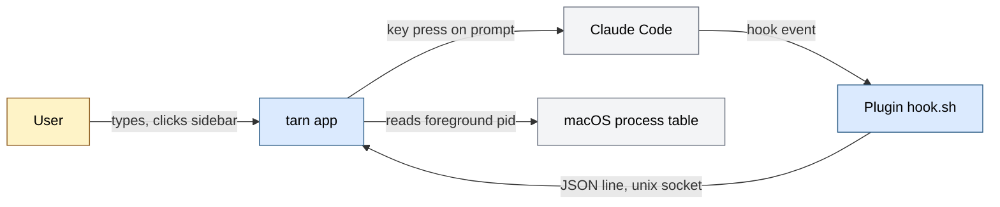
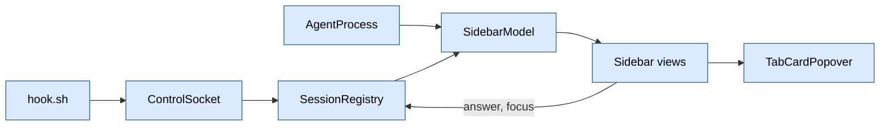
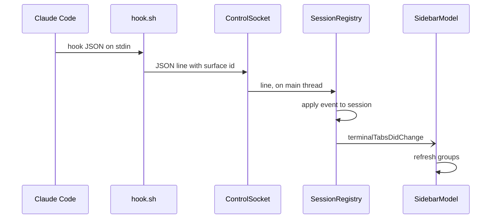
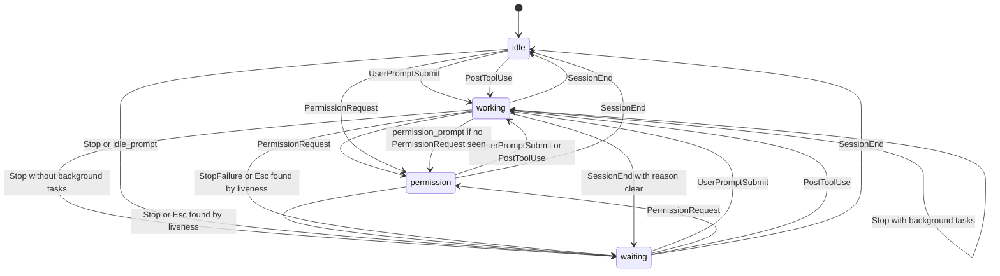

# Architecture of tarn

tarn is an agent-first macOS terminal, a fork of Ghostty. For people who run CLI coding agents (Claude Code first) in several tabs, it shows each tab's agent state in a sidebar. Input: Claude Code hook events over a unix socket, and the foreground process of each terminal surface. Output: a sidebar with agent and terminal groups, state badges, a hover card with quick answers to permission prompts. One process (the Ghostty macOS app); state lives in memory; our code makes no network calls.

How to read: the overall picture is section 1, how work flows is sections 2 and 3, where to change is section 9. Why it is decided so: section 12 of `docs/spec.md`. Domain documents: none.

State of this document: it describes branch `s1-sidebar`. The `tarn` CLI, `tarn.mk` and the markdown panel from the spec do not exist on this branch (not verified on other branches).

## Contents

1. Map
2. Main flow
3. Processes
4. Data and states
5. External systems and trust boundaries
6. Failures and retries
7. Observability
8. Environments and configuration
9. Where to change
10. Limits and open items

## 1. Map

### Purpose

Show, next to the terminal, which tabs run an agent, what each agent does (working, waiting for the user, asking permission) and let the user answer or jump there. Success: the user sees from the sidebar which session needs them without opening tabs.

### Context

Blue: our code. Grey: external system. Yellow: person. Source: `plugin/hooks/hook.sh`, `ControlSocket.swift`, `AgentProcess.swift`.

### Modules

| Module | Responsibility | Location | Status |
|---|---|---|---|
| Plugin | forwards each hook event to the socket, never fails | `plugin/` (`hooks/hooks.json`, `hooks/hook.sh`, `.claude-plugin/`) | works |
| ControlSocket | binds the unix socket, reads one JSON line per connection | `macos/Sources/Features/Tarn/ControlSocket.swift` | works |
| SessionRegistry | owns session state, state machine, liveness check, answers, jump order | `macos/Sources/Features/Tarn/SessionRegistry.swift` | works |
| AgentProcess | names the agent from a surface's foreground process | `macos/Sources/Features/Tarn/AgentProcess.swift` | works |
| SidebarModel, SidebarLayout, Sidebar | builds groups per window, draws the sidebar | `macos/Sources/Features/Tarn/Sidebar.swift` | works |
| AgentViews | agent badge, quick actions, card content | `macos/Sources/Features/Tarn/AgentViews.swift` | works |
| TabCardPopover | popover with the card beside a row | `macos/Sources/Features/Tarn/TabCardPopover.swift` | works |
| Tests | process detection and session state machine | `macos/Tests/Tarn/` (`AgentProcessTests.swift`, `AgentSessionTests.swift`) | works |
| Icons | template images for claude, codex, opencode | `macos/Assets.xcassets/TarnAgent*.imageset` | works |
| `tarn` CLI, markdown panel, notifications | spec sections 2.5, 2.4 | none | not on this branch |

### Invariants

| Invariant | Where enforced | Checked by |
|---|---|---|
| `src/` (Zig core) is not modified | no file under `src/` in the branch diff | review of `git diff --stat` |
| Swift changes outside `Features/Tarn/` only at insertion points of section 9 | section 9 lists all of them | review of `git diff origin/main...HEAD` |
| The registry is the only writer of session state | `SessionRegistry.sessions` is `private(set)`; sidebar only reads | review (not verified by a test) |
| `hook.sh` never blocks or fails the agent: exit 0, no output | `exit 0` on every path; `nc` runs in the background and the hook waits for it about 50 ms; output to `/dev/null` | `python3 -I plugin/test/hook_test.py`: no surface, no app, an app that accepts and never reads, garbage input |
| Nothing edits `~/.claude/settings.json` | hooks ship as a plugin | review |
| No agent command moves focus or presses Enter for the user | `answer` only sends a key for a visible prompt after a user click | review |
| No network calls in our code | none present | review |

Invariants without a test are candidates for tracker tasks.

## 2. Main flow

Hook event to the sidebar row.

| Step | Module | What it does |
|---|---|---|
| 1 | Surface creation | the app puts `TARN_SURFACE=<surface uuid>` in the shell environment (insertion point 3 in section 9) |
| 2 | `hook.sh` | exits at once if `TARN_SURFACE` or the socket is missing; else wraps stdin as `{"version":1,"surface":...,"event":...}` and sends it with `nc -U -w 1` in the background, waiting for it about 50 ms; a live app reads the line in a few ms, so events keep their order |
| 3 | ControlSocket | accepts, reads until newline, 1 s receive timeout, drops lines over 4 MB, passes the line to the main actor |
| 4 | SessionRegistry | drops malformed lines (version must be 1) and events for unknown surfaces; applies `AgentSession.handle`; if state changed, resets `since` and sets `seen` from focus |
| 5 | SessionRegistry | stores the session and posts `terminalTabsDidChange` |
| 6 | SidebarModel | observer calls `refresh()` (twice: now and on the next run loop turn); groups are rebuilt; a changed list republishes |
| 7 | Views | SwiftUI redraws rows; the card shows the request |

Second flow, agent detection and grouping (no hook needed):

1. `refresh()` walks the tabs of the window's tab group.
2. For each tab it reads `foregroundPID` of every split and asks `AgentProcess.agent(pid:)`. The first split with an agent decides.
3. Agent found: group `agents`, key = project root of that surface's `pwd` (nearest parent with `.git`, else the `pwd` itself), full path. No agent: group `terminals`, empty key.
4. Groups are ordered: agents first, then terminals; inside a section by first tab; header shows the folder name, or `parent/folder` when two roots share a name.

Third flow, answering from the card: click on a quick action calls `SessionRegistry.answer`. For a tool request, option 0 sends key `1` (only if "1. Yes" is on screen), option 1 sends Escape. For a question, option n sends digit n+1 (only if the option text is on screen, up to 9 options). If the dialog is not visible, the surface is focused instead.

## 3. Processes

| Process | Start | Interval or event | What it does |
|---|---|---|---|
| ControlSocket reader | `SessionRegistry.start()`, first `SidebarModel` init | connection on the socket | reads one line on queue `tarn.socket`, hands it to the main actor |
| Registry liveness timer | `SessionRegistry.start()` | every 1 s | for sessions in `working` or `permission`, checks the surface's own signals (see section 4) |
| Sidebar refresh on notification | `SidebarModel.init` | `terminalTabsDidChange` | rebuilds groups |
| Sidebar process timer | `SidebarModel.init`, one per window | every 2 s, tolerance 0.5 s, only when the window is visible | rebuilds groups to catch agent start and exit |
| Focus observers | on first update of a session | `focusInstant` of the surface | marks the session `seen` |

`terminalTabsDidChange` is posted by: the registry, `TerminalController` (end of tab relabeling), and `TerminalWindow` (tab color change, title change). The name is `com.daniil4545.tarn.terminalTabsDidChange`.

## 4. Data and states

| Entity | Source of truth | Who changes it | Key or constraint |
|---|---|---|---|
| `AgentSession` | `SessionRegistry.sessions`, memory only | the registry: hook events, liveness timer, focus observer | surface UUID; removed when its surface is gone (found by the liveness check, only for `working` and `permission`) |
| Sidebar groups | `SidebarModel.groups`, derived | `refresh()` | section plus project root path |
| Project root cache | `SidebarModel.projects` | `projectRoot(for:)` | `pwd`; never invalidated (not verified elsewhere) |
| Sidebar layout | `UserDefaults` keys `TarnSidebarCollapsed`, `TarnSidebarWidth`, `TarnSidebarFoldedRoots` | `Sidebar` view | width 120 to 400, default 200 |

Nothing is persisted across restarts: sessions rebuild from new hook events.

Agent state machine (`AgentSession.handle`):

Reading: the full transition table, with the corrections of the hook research of 2026-10-23, is `docs/spec.md` section 8; `AgentSession.handle` in `SessionRegistry.swift` implements it and `AgentSessionTests.swift` covers it.

Not in the code but in spec section 8: the `note` field of `tarn notify`; child-exit as an input (the registry removes a session only when its surface is gone).

Liveness: Claude Code sends no event on Esc. For `working`: no progress report on the surface and title starts with `✳` for 2 s continuous gives `waiting`, `seen = true`. For `permission`: the last 12 visible lines contain "Interrupted" for 2 s gives `waiting`. A surface that no longer exists is removed.

`seen` is true at start; on a state change it is set to whether the surface is focused in the key window of the active app. `isUnseenDone` is `waiting` and not seen.

Jump order (`focusNextWaiting`): failed and unseen first, then `permission`, then unseen finished; inside a group the oldest `since`.

## 5. External systems and trust boundaries

| System or input | What we give and take | Where input is checked | Card |
|---|---|---|---|
| Claude Code hooks | take event JSON (`hook_event_name`, `notification_type`, `tool_name`, `tool_input`, `agent_id`, `background_tasks`, `reason`) | `SessionRegistry.receive`: JSON object, `version == 1`, UUID surface, known surface, event name string | none (`docs/api/` does not exist) |
| Unix socket | any local process of the user can write to it (mode 0600, same user) | same as above; line cap 4 MB; 1 s read timeout | none |
| macOS process table | read foreground pid, kernel name, argv (`proc_pidinfo`, `KERN_PROCARGS2`) | `AgentProcess.match`; argv read only for versions or interpreters | none |
| Claude Code dialogs | we send digit or Escape keys | screen text must show the option before a key is sent | none |
| Screen text and title | read to find Esc and dialogs | string match; fragile to Claude Code UI changes | none |

## 6. Failures and retries

| Failure | Handling | Result |
|---|---|---|
| App not running or no socket | `hook.sh` exits 0 at once | event lost, agent unaffected |
| Socket bind fails | logged, app runs without the socket (`fail`) | no hook states; process detection still works |
| Malformed line, wrong version, unknown surface | logged at info, state unchanged | dropped |
| Oversized line (over 4 MB) | dropped, logged | event lost |
| Lost `Stop` or Esc without event | liveness timer after 2 s | `waiting` |
| User approves a permission | no event from Claude Code | `permission` stays until `PostToolUse` (known limit) |

No retries exist: hooks are fire-and-forget. Idempotency: a repeated event that changes nothing is dropped (`session != old`).

## 7. Observability

- Correlation id: the surface UUID (`TARN_SURFACE`), in every registry log line.
- Logs: `os_log`, subsystem `tarn`, categories `registry` and `socket`. Transitions are logged with old state, new state and event name. Errors: socket setup failures. Event bodies (commands, questions) are not logged.
- Metrics: none.
- Where to look: Console.app or `log stream --predicate 'subsystem == "tarn"'` (command not run here, not verified).

## 8. Environments and configuration

One environment: the local macOS app. No config file of ours.

| Variable or mode | What it enables | Where set |
|---|---|---|
| `TARN_SURFACE` | tells hooks which surface they run in | the app, for each surface shell |
| socket path | `~/Library/Application Support/tarn/tarn.sock` | constant in `ControlSocket.path` |
| sidebar width, collapsed, folded roots | layout | `UserDefaults` |
| plugin install | `plugin/.claude-plugin/marketplace.json`, `plugin.json` (name `tarn`, version 0.1.0) | `claude plugin marketplace add <repo>/plugin`, then `claude plugin install tarn@tarn` (`CHANGELOG.md`, Setup) |

Hooks registered in `plugin/hooks/hooks.json`, each with timeout 2 s: `UserPromptSubmit`, `PermissionRequest`, `PostToolUse`, `PostToolUseFailure`, `Notification`, `Stop`, `StopFailure`, `SessionEnd`.

## 9. Where to change

### Insertion points in upstream files

Branch diff against `origin/main`. Every Swift change outside `macos/Sources/Features/Tarn/` is in this table.

| # | File | What was inserted | Why |
|---|---|---|---|
| 1 | `macos/Sources/Features/Terminal/TerminalController.swift` | property `private let sidebarModel = SidebarModel()` | one sidebar model per window |
| 2 | same | in the content view setup: `sidebarModel.window = window`; `TerminalView` wrapped in `SidebarLayout(model:ghostty:)`; initial content width plus `Sidebar.occupiedWidth` | draws the sidebar beside the terminal and keeps the terminal's requested size |
| 3 | same | at the end of the tab relabel function: post `.terminalTabsDidChange` | refresh the sidebar when tabs are relabeled |
| 4 | same | after a tab move: `relabelTabs()` | the window is already key, so nothing else relabels moved tabs |
| 5 | `macos/Sources/Features/Terminal/Window Styles/TerminalWindow.swift` | post `.terminalTabsDidChange` in the `tabColor` and `title` observers | sidebar shows color and title |
| 6 | same | when the native tab bar controller is added: `childViewController.isHidden = true` and its view hidden | the sidebar replaces the native tab bar |
| 7 | `macos/Sources/Ghostty/Surface View/SurfaceView.swift` | `environmentVariables["TARN_SURFACE"] = view.id.uuidString` before the variables are converted to arrays; replaces an inherited value | hooks learn their surface |
| 8 | `macos/Assets.xcassets/TarnAgentClaude.imageset`, `TarnAgentCodex.imageset`, `TarnAgentOpenCode.imageset` | new image sets with SVG (`claude.svg`, `openai.svg`, `opencode.svg`) | agent badges |

Rows 1 to 4 are in `TerminalController.swift`. Line numbers are not recorded: they shift with upstream; find the places by the `tarn:` comments and the names above (rows 2 to 4 have no `tarn:` comment on the changed lines, search by the names).

Upstream merge rule: a merge touching a row above gets its own commit (`.claude/CLAUDE.md`).

### Typical changes

| Change | Module | Also check |
|---|---|---|
| Add or rename an agent | `AgentProcess.names`, `displayNames`, `icons`; new image set | `AgentProcessTests`; note: only `claude` has hooks |
| Change a state transition | `AgentSession.handle` | `docs/spec.md` section 8, `AgentSessionTests` |
| Add a hook event | `plugin/hooks/hooks.json`, `handle` | hook timeout, the invariant on `hook.sh` |
| Change grouping or order | `SidebarModel.refresh`, `arrange`, `projectRoot` | group key is the full root path |
| Change detection triggers | `SidebarModel.init` timer and observer | idle CPU (bench in spec; `tarn.mk` absent here) |
| Change quick answers | `SessionRegistry.answer`, `AgentViews.swift` | depends on Claude Code dialog text ("1. Yes") |
| Change the socket path or protocol | `ControlSocket`, `hook.sh`, registry `receive` | `version` field |
| Change layout or width | `Sidebar.swift` | `Sidebar.occupiedWidth` used by the insertion point 2 |

## 10. Limits and open items

- Not supported: agents inside tmux or over ssh (the shell in tmux inherits `TARN_SURFACE` from the tmux server, so events would hit the wrong surface; spec section 12); wrapper scripts that hide the agent name (detection reads the foreground process name, with argv only for versions and interpreters); codex and opencode get an icon and a group but no state, because they send no hooks here.
- Sessions in tabs without hooks stay `idle`: the state needs the plugin; detection alone only groups the tab.
- `permission` after the user approves a prompt stays until `PostToolUse`.
- Liveness depends on Claude Code title prefix `✳`, "Interrupted" and "1. Yes": a UI change breaks it silently.
- The session record is keyed by surface; two agents in one surface are not distinguished (not verified).
- Detection latency: up to 2 s on a visible window; hidden windows refresh on notifications only.
- Not on this branch: notifications, `tarn` CLI (`hook`, `open`, `ls`, `notify`), markdown panel, `tarn.mk`, `docs/api/` cards, CI.
