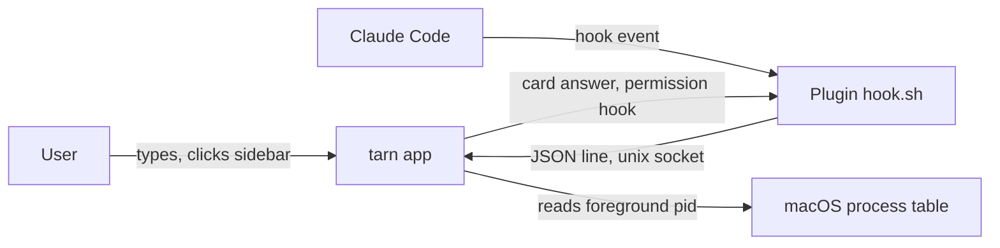
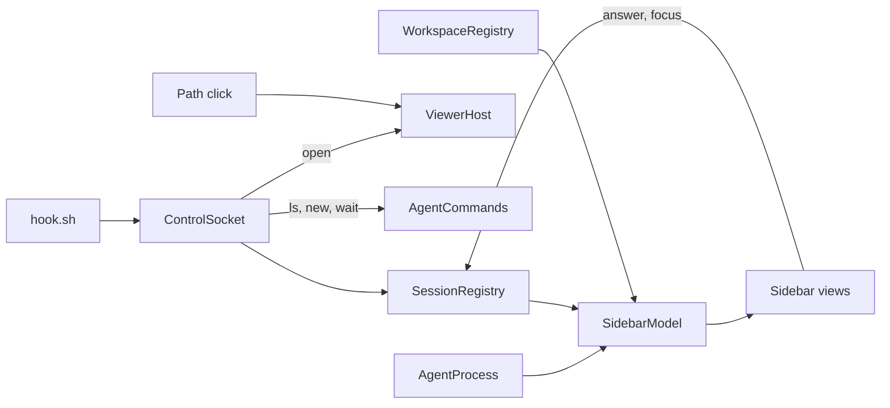
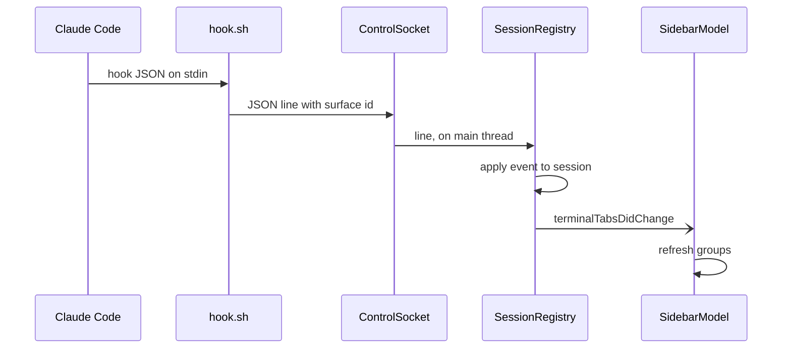

# Architecture of tarn

tarn is an agent-first macOS terminal, a fork of Ghostty. For people who run CLI coding agents (Claude Code first) in several tabs, it shows each tab's agent state in a sidebar and opens the files agents mention in a viewer pane. One process (the Ghostty macOS app); state lives in memory; our code makes no network calls. Behavior is in `docs/spec.md` and `docs/spec/`; why it is decided so: section 12 of `docs/spec.md`. This file describes structure: where code lives, what it hooks into, what it must never do.

## 1. Map

### Context

Source: `plugin/hooks/hook.sh`, `plugin/hooks/permission.sh`, `ControlSocket.swift`, `AgentProcess.swift`.

### Modules

All code is in `macos/Sources/Features/Tarn/`, tests in `macos/Tests/Tarn/` and `plugin/test/`.

| Module | Folder or files | Behavior |
|---|---|---|
| Control socket, attention, sessions | `ControlSocket`, `SessionRegistry`, `Attention*`, `AgentProcess`, `plugin/hooks/`, `cli/tarn` | `docs/spec/sessions.md` |
| Agent commands | `AgentCommands/` (one handler file per command) | `docs/spec/agent-cli.md` |
| Workspaces (groups) | `Workspace/` | `docs/spec/workspaces.md` |
| Sidebar | `Sidebar.swift`, `WorkspaceHeader.swift`, `TabDragSource.swift` | `docs/spec/workspaces.md` section 4 |
| Viewer and layout | `ViewerHost.swift`, `ViewerModel.swift`, `Viewer/`, `viewer-web/` | `docs/spec/viewer.md`, `docs/spec/workspaces.md` section 5 |
| Settings, modules | `TarnSettings.swift`, `TarnModules.swift`, `GhosttyOption*`, `TarnConfigFile` | `docs/spec/modules.md` |
| Browser demo | `demo/` (contracts `demo/js/CONTRACT.md`, run `demo/README.md`); mirrors the app by shape, the viewer bundle is shared by copy (`tools/sync-viewer.sh`) | `demo/README.md` |

### Invariants

| Invariant | Where enforced | Checked by |
|---|---|---|
| `src/` (Zig core) is not modified | no file under `src/` in the branch diff | review of `git diff --stat` |
| Swift changes outside `Features/Tarn/` only for identity and at insertion points of section 4: a call into our code with no logic; Ghostty's behavior changes by our layer on top, never inside its file (boundary in `.claude/CLAUDE.md`) | section 4 lists all of them | review of `git diff upstream/main...HEAD` |
| The registry is the only writer of session state | `SessionRegistry.sessions` is `private(set)`; sidebar only reads | review (not verified by a test) |
| `hook.sh` never blocks or fails the agent: exit 0, no output; `permission.sh` waits only while the app holds the connection | `exit 0` on every path; the agent's pipes are released first; `nc` runs in the background, the hook waits for it about 40 ms and then stops it | `python3 -I plugin/test/hook_test.py`: no surface, no app, an app that accepts and never reads, garbage input, a 200 KB event |
| Nothing edits `~/.claude/settings.json` | hooks ship as a plugin | review |
| No agent command moves focus or presses Enter for the user | no key is sent; `answer` writes the hook decision after a user click; socket `open` restores the first responder | review; run: responder unchanged after `open` |
| No network calls in our code | the viewer page loads only `tarn-md://` (rule list, CSP, navigation policy) | `ViewerRulesTests`; page run under the rule list |
| The updater never contacts a server | `feedURLString` is nil, `startUpdater` is not called, the menu item is hidden (row 27); the release target checks the bundle id | `UpdaterOffTests`, `make -f tarn.mk release` |

### Main flow

The surface gets `TARN_SURFACE=<surface uuid>` in its shell environment (insertion point 7). A path click or `tarn open` takes a second route into the viewer.
## 2. Internals worth knowing

Workspaces (`Workspace/`). `WorkspaceBook` holds the rules without AppKit, `WorkspaceRegistry` maps them onto windows, `WorkspaceSet` is the per-window table (groups, membership `TabKey` to group id for grouped tabs only, revision). A `TabKey` is a UUID of ours per tab window, saved in the snapshot. `sync` runs on every tab notification: gone windows leave their set; each native tab group follows the set that holds most of its tabs (ties: more settled tabs, then the smallest key); an unseen tab is ungrouped; changed sets are published. `publish` posts `terminalTabsDidChange`; a publish made while observers run asks for one more round (at most 3, then an error is logged). `move_tab` acts on the selected tab: the registry selects, moves, restores the selection and marks the hops (`KeyHops`). A group move uses `removeWindow` and `addTabbedWindowSafely` in a zero-duration animation group, then `relabelTabs` (T-308). Restore: each window saves `{version, setID, revision, tabKey, workspaces[{id, name, collapsed, folder?, tabKeys}]}` under `tarn.workspaces` (rows 15, 16); windows with one `setID` join, the higher revision wins. Undo: the tombstone joins Ghostty's undo group (a second action would sit on top and need a second Cmd+Z); on `willClose` the registry notes set, group, place, surface ids and the viewer snapshot; undo arms it, Ghostty recreates the window, `claimTombstones` matches it by surface ids (cached on every sync, because closing a window empties the trees first) and restores group and viewers; unclaimed tombstones are dropped and logged. No timer of ours.

Sidebar. One `SidebarModel` per window controller derives `groups` from the registry's runs; `refresh` runs on `terminalTabsDidChange` and on a 2 s timer while visible. `AgentProcessCache` keeps each foreground pid read for one run loop turn (T-106). The sidebar never writes session state or tab order; its startup cost is inside benchmark noise (`docs/bench.md`, T-149).

Viewer and layout. `ViewerHost` owns one `AreaTree` (`SplitTree<AreaLeaf>`, leaf kind `block` or `viewer`; leaves are placeholders never put in a window) per window tab and one model plus web controller per viewer. Swift owns tabs, documents, tree and watchers; the page is replaceable. Drops are pure math in `AreaDrop`; `AreaDropOverlay` answers hit tests only inside our zones and only during a drag, elsewhere the drop falls to Ghostty. A viewer detaches through `TerminalController.newWindow(_:tree:position:)`, which sets the frame before presenting (the plain `newWindow` cascades one turn later, bug 5 of 1.0.0). Every direct close of a window or tab is behind `ViewerClose.intercept`; `ViewerModelTests.directClosesAreAllReviewed` fails on a new close call.

Settings. `Ghostty.Config.loadConfig` order: `load_file` or default files; CLI args (unless in Xcode); recursive `config-file` includes; the tarn file (only `Config.init(at:finalize:)` passes `TarnConfigFile.activeURL()`; `TemporaryConfig` and tests pass nothing); finalize. `GhosttyOptionStore` writes the file, calls `reloadConfig()` and reads the effective values back from the change notification (only `object == nil`, so a single terminal's reload is not taken as the app config). `TarnModuleWatcher` applies module changes (tab style, waiting hooks, viewer focus, menu items, then `terminalTabsDidChange`).

Control socket and registry: queues `tarn.socket` (accept, reply) and `tarn.socket.read` (one read per client); `Reply` closes on deinit and ignores SIGPIPE. Agent commands: `process` is the foreground group leader's kernel name (login's child when the leader is `/usr/bin/login`); `wait` is not a `Handler`, its reply is held in `PaneWaits`; `NewPane.split` inserts with `SplitTree.inserting` and assigns `surfaceTree` directly (Ghostty's `newSplit` focuses and registers undo) then returns the first responder; `read` is a fresh `ghostty_surface_read_text`.

Failure rule: an uncovered workspace case logs `workspace: <reason> window=<key> set=<id>` and leaves the tab ungrouped; a second `reconcile` over the same groups changes nothing. Logs: `os_log`, subsystem `tarn`, categories `registry`, `socket`, `viewer`, `attention`, `settings`, `workspace`.

## 3. Environments and configuration

One environment: the local macOS app. One config file of ours: `~/.config/tarn/ghostty.conf` (`docs/spec/modules.md`).

| Variable or mode | What it enables | Where set |
|---|---|---|
| `TARN_SURFACE` | tells hooks which surface they run in | the app, for each surface shell |
| socket path | `~/Library/Application Support/tarn/tarn.sock` | constant in `ControlSocket.path` |
| sidebar width, collapsed | layout | `UserDefaults` (`TarnSidebarWidth`, `TarnSidebarCollapsed`) |
| module switches | keys `TarnTabStyle`, `TarnFileViewer`, `TarnModule.*`, default on; launch arguments win without writing | `docs/spec/modules.md` |
| plugin install | `plugin/.claude-plugin/marketplace.json`, `plugin.json` (name `tarn`, version 1.3.0) | `claude plugin marketplace add <repo>/plugin`, then `claude plugin install tarn@tarn` (`docs/install.md`) |

Hooks registered in `plugin/hooks/hooks.json`, each with timeout 2 s except `PermissionRequest` (3600 s).

Identity: product `Tarn.app`, bundle id `com.daniil4545.tarn` (Debug `.debug`), executable `ghostty`, Swift module `Ghostty`. The executable keeps its name because the `tarn` CLI sits in `Contents/MacOS` and APFS is case-insensitive; it also keeps `TEST_HOST` and the core's `ghostty +action` path valid. Cost: `ps` shows `ghostty`. The core `bundle_id` (`src/build_config.zig:58`) stays Ghostty's on purpose: config paths and the cache folder are shared with an installed Ghostty.

## 4. Insertion points in upstream files

Diff against the merge base with `upstream/main`. Every Swift change outside `macos/Sources/Features/Tarn/` is in this table.

| # | File | What was inserted | Why |
|---|---|---|---|
| 1 | `macos/Sources/Features/Terminal/TerminalController.swift` | property `private let sidebarModel = SidebarModel()` | one sidebar model per window |
| 2 | same | in the content view setup: `sidebarModel.window = window`; `NativeTabMark.install`; `TerminalView` wrapped in `SidebarLayout(model:ghostty:)`; initial content width plus `Sidebar.occupiedWidth` | draws the sidebar beside the terminal and keeps the terminal's requested size |
| 3 | same | at the end of the tab relabel function: post `.terminalTabsDidChange` | refresh the sidebar when tabs are relabeled |
| 4 | same | after a tab move: `relabelTabs()` | the window is already key, so nothing else relabels moved tabs |
| 5 | `macos/Sources/Features/Terminal/Window Styles/TerminalWindow.swift` | post `.terminalTabsDidChange` in the `tabColor` and `title` observers | sidebar shows color and title |
| 6 | same | when the native tab bar controller is added: controller and view hidden while the tab style is `sidebar` | the sidebar replaces the native tab bar |
| 7 | `macos/Sources/Ghostty/Surface View/SurfaceView.swift` | `environmentVariables["TARN_SURFACE"] = view.id.uuidString` before the variables are converted to arrays; replaces an inherited value | hooks learn their surface |
| 8 | `macos/Assets.xcassets/TarnAgentClaude.imageset`, `TarnAgentCodex.imageset`, `TarnAgentOpenCode.imageset` | new image sets with SVG (`claude.svg`, `openai.svg`, `opencode.svg`) | agent badges |
| 9 | `macos/Sources/App/MainMenu.xib` | menu item "Preferences…" renamed "Settings…", action `showTarnSettings:` | cmd+, opens the tarn settings window; its button opens the Ghostty config file |
| 10 | `macos/Sources/Features/Terminal/TerminalController.swift` | `let viewerHost = ViewerHost()`; `viewerHost.window = window`; `TerminalView` wrapped in `ViewerLayout` inside the `SidebarLayout` content (extends row 2) | viewer pane right of the terminal area |
| 11 | `macos/Sources/Ghostty/Ghostty.App.swift` | `openURL` takes the action `target`; a block at its top offers a clicked path (kind `unknown`) to `ViewerRouter`, which returns false for what it does not take | path click opens in the viewer; OSC 8 and URLs keep the upstream path |
| 12 | `macos/Sources/Features/Terminal/TerminalController.swift` | in `closeTab`, `closeOtherTabs`, `closeTabsOnTheRight`, `closeWindow`, static `closeAllWindows` and `closeSurface` (root, no confirmation: process exit); `ScriptWindow` and `ScriptTab` close handlers: one `if ViewerClose.intercept(...) { return }` line before the process check | unsaved viewer edits are asked (Save, Don't Save, Cancel) before a tab or window closes; the red X and Cmd+W reach these functions |
| 13 | `macos/Sources/App/AppDelegate.swift` | in `applicationShouldTerminate`: a `ViewerClose.interceptQuit` block before the `needsConfirmQuit` check; replies `.terminateLater`, then continues with Ghostty's own quit flow | one sheet lists the dirty files of all windows on quit |
| 14 | `macos/Sources/Ghostty/Ghostty.Config.swift` | `loadConfig` loads `TarnConfigFile.defaultsURL` (bundled `tarn-defaults.conf`) right after `ghostty_config_new`, before the user's files; takes `tarnFile: URL? = nil`; after `ghostty_config_load_recursive_files` it calls `TarnConfigFile.load(into:from:)`; `init(at:finalize:)` passes `TarnConfigFile.activeURL()` | tarn's options file loads after the user's config and its includes, before `finalize`; tests and `TemporaryConfig` pass nothing |
| 15 | `macos/Sources/Features/Terminal/TerminalController.swift` | in `willEncodeRestorableState`: `WorkspaceRestore.encode(window, into: state)` | the workspace table is saved beside Ghostty's state under the key `tarn.workspaces`, `TerminalRestorableState` stays at version 7 |
| 16 | `macos/Sources/Features/Terminal/TerminalRestorable.swift` | in `restoreWindow`: `let workspaceCoder = state` before the `guard let state` that shadows it; `WorkspaceRestore.decode(workspaceCoder, for: window)` after the window exists | the restored tab gets its table and key back |
| 17 | `macos/Sources/Ghostty/Ghostty.App.swift` | `gotoSplit`: `isSplit` and `focusTarget` joined in one `guard`; when it fails, `ViewerRouter.focusNeighbor(from:direction:)` is the result | Ghostty's split keys cross from the terminal block into a viewer (D8) |
| 18 | `macos/Sources/Ghostty/Surface View/SurfaceGrabHandle.swift` | dot opacity 0.3 and 0.8 become 0.6 and 1.0, comment `tarn:` | the grab handle is easier to see (D16) |
| 19 | `macos/Sources/App/MainMenu.xib` | View menu: item "Toggle File Viewer", key equivalent `b`, action `toggleViewer:` to the first responder | Cmd+B from the terminal opens, shows or hides the viewer pane; the action is in `ViewerHost.swift` |
| 20 | `macos/Sources/App/MainMenu.xib` | Window menu: item "Jump to Waiting Session", key equivalent `u`, action `jumpToWaitingSession:` to the first responder, after "Show/Hide All Terminals" | Cmd+U jump; the action is in `AttentionJump.swift` |
| 21 | `macos/Sources/Ghostty/Ghostty.App.swift` | in `showDesktopNotification(_ app:target:n:)` surface case: `if MainActor.assumeIsolated({ Attention.suppresses(surfaceView) }) { return }`; `private` removed from `showDesktopNotification(_ surfaceView:title:body:requireFocus:)` | OSC 9/777 of a live agent session is dropped; our notification goes through Ghostty's route |
| 22 | `macos/Ghostty.xcodeproj/project.pbxproj` | shell phase "Install tarn CLI" in the app target: installs `cli/tarn` into `Contents/MacOS` and signs it, and `cli/SKILL.md` with the app version into `Contents/Resources/tarn` | the CLI ships in the bundle; the core puts that folder on `PATH` |
| 23-26, 28, 29 | project settings and Info.plist (bundle ids `com.daniil4545.tarn[.debug|-dock-tile|.tests|.uitests]`, `PRODUCT_NAME = Tarn` with `PRODUCT_MODULE_NAME = Ghostty`, `MARKETING_VERSION`, `Tarn.app` in `TEST_HOST`), the UTI `com.daniil4545.tarn.surfaceId`, defaults suite and notification names, the name `Tarn` in xibs, menus, alerts and About, the app icon, `UpdaterOffTests` | identity: the app installs next to Ghostty, two apps never export one type id |
| 27 | `UpdateDelegate.swift`, `UpdateController.swift`, `AppDelegate.swift` | `feedURLString` returns nil; `checkForUpdates` stops at `isEnabled = false`; `startUpdater` not called; the menu item hidden | Sparkle never offers a Ghostty build |
| 30 | `macos/Sources/App/MainMenu.xib` | File menu: item "New Group...", key equivalent `T` (Shift+Cmd+T), action `newWorkspace:` to the first responder, after "New Tab" | Shift+Cmd+T opens the New Group sheet; `tarn-defaults.conf` unbinds Ghostty's `super+shift+t=undo`, so the key reaches the menu, and undo keeps Cmd+Z; a user `keybind` on the key wins |
| 31 | `macos/Sources/Ghostty/Ghostty.App.swift` | in `commandFinished`, after the surface is resolved and before the `notify-on-command-finish` guard: `PaneWaits.commandFinished(pane:exitCode:durationNs:)` | `tarn wait` ends on a shell command that finished, whatever the notify setting |
| 32 | `macos/Sources/Ghostty/Ghostty.App.swift` | in `showChildExited`, after the surface is resolved and before the guard: `PaneWaits.childExited(pane:)` | `tarn wait` on a `new` pane ends with its process |
| 33 | `macos/Sources/Features/Terminal/BaseTerminalController.swift` | at the end of `surfaceTreeDidChange`: `PaneWaits.surfaceTreeChanged()` | `tarn wait` answers `closed` when its pane closes |
| 34 | `macos/Sources/App/AppDelegate.swift` | in `ghosttyNewTab`: the controller that `TerminalController.newTab` returns goes to `MainActor.assumeIsolated { WorkspaceRegistry.shared.opened(_:from:) }` with the parent window | a new tab takes the workspace of the tab it was opened from (`docs/spec/workspaces.md` M1) |
| 35 | `macos/Sources/Ghostty/Surface View/SurfaceView_AppKit.swift` | at the end of `menu(for:)`: `FinderReveal.add(to:surface:)` | an existing selected path can be shown in Finder without opening the viewer |
Rows 1 to 4, 10, 12 and 15 are in `TerminalController.swift`. Line numbers are not recorded: they shift with upstream; search by the names above.

Upstream merge rule: a merge touching a row above gets its own commit (`.claude/CLAUDE.md`).

## 5. Limits and open items

- Not supported: agents inside tmux or over ssh (the shell in tmux inherits `TARN_SURFACE` from the tmux server, so events would hit the wrong surface; spec section 12); wrapper scripts that hide the agent name; opencode gets an icon but no state, because it sends no hooks here; codex without `--no-daemon` reports to the wrong tab (spec 2.3).
- Sessions in tabs without hooks stay `idle`: the state needs the plugin; detection alone only shows the agent's icon.
- Liveness depends on Claude Code title prefix `✳`, "Interrupted" and "1. Yes": a UI change breaks it silently.
- Viewer: not restored after a relaunch, restored by an undo of the tab; unsaved edits are asked on every close and on quit, not on a system shutdown or update install.
- Attention: the banner and its click were not run in a live app (the check would replace the user's socket file); gate, jump order, socket replies and CLI are tested.
