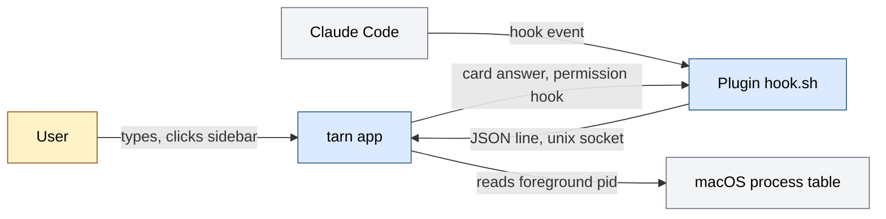
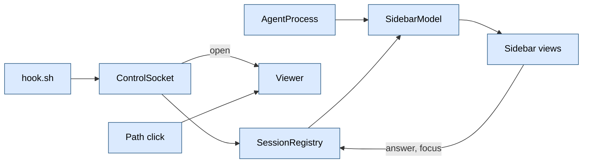
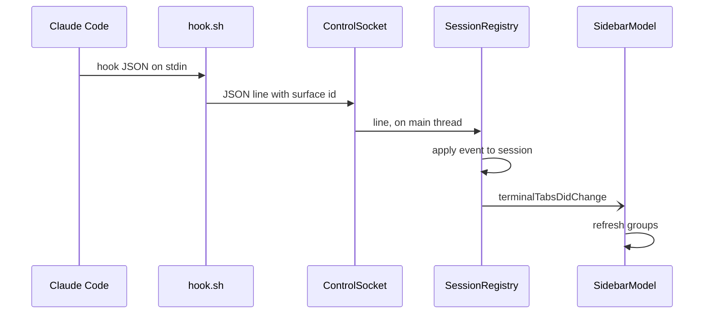

# Architecture of tarn

tarn is an agent-first macOS terminal, a fork of Ghostty. For people who run CLI coding agents (Claude Code first) in several tabs, it shows each tab's agent state in a sidebar and opens the files agents mention in a viewer pane. Input: Claude Code hook events over a unix socket, the foreground process of each terminal surface, path clicks. Output: a sidebar with agent and terminal groups, state badges, a hover card with quick answers to permission prompts, a viewer pane. One process (the Ghostty macOS app); state lives in memory; our code makes no network calls.

How to read: the overall picture is section 1, the module documents are in `docs/modules/`, where to change is section 9. Why it is decided so: section 12 of `docs/spec.md`.

State of this document: it describes branch `s2-files` (PR #3). Module documents marked "with PR #N" arrive with that PR. The `tarn` CLI and `tarn.mk` do not exist here (not verified on other branches). Sections 3 to 7 of the earlier version (processes, data and states, trust boundaries, failures, observability) now live in the module documents.

## Contents

1. Map
2. Main flow
8. Environments and configuration
9. Where to change
10. Limits and open items

## 1. Map

### Purpose

Show, next to the terminal, which tabs run an agent, what each agent does (working, waiting for the user, asking permission) and let the user answer or jump there; show the files agents point at. Success: the user sees from the sidebar which session needs them without opening tabs.

### Context

Blue: our code. Gray: external system. Yellow: person. Source: `plugin/hooks/hook.sh`, `plugin/hooks/permission.sh`, `ControlSocket.swift`, `AgentProcess.swift`.

### Modules

| Module | Responsibility | Document | Status |
|---|---|---|---|
| Viewer | file tabs, files tree, markdown view and editor, code view, watcher, unsaved-edit questions; a WKWebView draws, Swift holds state | [viewer.md](modules/viewer.md) | works on `s2-files` |
| Control socket | binds the unix socket, reads one JSON line per connection, keeps a connection open for an answer | [control-socket.md](modules/control-socket.md) | works |
| Sessions | agent state machine, liveness, pending answers, agent naming, plugin hooks | [sessions.md](modules/sessions.md) | works |
| Sidebar | groups tabs per window, rows, hover card, quick answers | [sidebar.md](modules/sidebar.md) | works |
| Settings | settings window, tarn options file `ghostty.conf`, Ghostty options, key reference, load order | [settings.md](modules/settings.md) | with PR #4 |
| Workspaces | workspace set per window, restore, undo tombstone, sidebar headers | [workspaces.md](modules/workspaces.md) | with PR #5 |
| Layout | area tree, drop zones, grips, viewer host layout | [layout.md](modules/layout.md) | with PR #5 |
| Demo | demo mode | [demo.md](modules/demo.md) | works on `s5-demo` |
| `tarn` CLI, notifications | spec sections 2.4, 2.2 | none (the socket accepts `{"cmd":"open"}`; no binary) | not on this branch |

Tests live in `macos/Tests/Tarn/` and `plugin/test/`; each module document names its suites.

### Invariants

| Invariant | Where enforced | Checked by |
|---|---|---|
| `src/` (Zig core) is not modified | no file under `src/` in the branch diff | review of `git diff --stat` |
| Swift changes outside `Features/Tarn/` only at insertion points of section 9 | section 9 lists all of them | review of `git diff origin/main...HEAD` |
| The registry is the only writer of session state | `SessionRegistry.sessions` is `private(set)`; sidebar only reads | review (not verified by a test) |
| `hook.sh` never blocks or fails the agent: exit 0, no output; `permission.sh` waits only while the app holds the connection | `exit 0` on every path; the agent's pipes are released first; `nc` runs in the background, the hook waits for it about 40 ms and then stops it | `python3 -I plugin/test/hook_test.py`: no surface, no app, an app that accepts and never reads, garbage input, a 200 KB event |
| Nothing edits `~/.claude/settings.json` | hooks ship as a plugin | review |
| No agent command moves focus or presses Enter for the user | no key is sent; `answer` writes the hook decision after a user click; socket `open` restores the first responder | review; run: responder unchanged after `open` |
| No network calls in our code | the viewer page loads only `tarn-md://` (rule list, CSP, navigation policy) | `ViewerRulesTests`; page run under the rule list |

## 2. Main flow

The surface gets `TARN_SURFACE=<surface uuid>` in its shell environment (insertion point 7). Steps in detail: the socket in [control-socket.md](modules/control-socket.md), the event and the state machine in [sessions.md](modules/sessions.md), grouping and the card in [sidebar.md](modules/sidebar.md). A path click or `tarn open` takes a second route into [viewer.md](modules/viewer.md).

## 8. Environments and configuration

One environment: the local macOS app. No config file of ours on this branch.

| Variable or mode | What it enables | Where set |
|---|---|---|
| `TARN_SURFACE` | tells hooks which surface they run in | the app, for each surface shell |
| socket path | `~/Library/Application Support/tarn/tarn.sock` | constant in `ControlSocket.path` |
| sidebar width, collapsed, folded roots | layout | `UserDefaults` (`TarnSidebarWidth`, `TarnSidebarCollapsed`, `TarnSidebarFoldedRoots`) |
| tab style `TarnTabStyle`: `sidebar` (default) or `top` | sidebar or native tab bar | settings window, `UserDefaults` |
| plugin install | `plugin/.claude-plugin/marketplace.json`, `plugin.json` (name `tarn`, version 0.2.0) | `claude plugin marketplace add <repo>/plugin`, then `claude plugin install tarn@tarn` (`CHANGELOG.md`, Setup) |

Logs: `os_log`, subsystem `tarn`, categories `registry`, `socket`, `viewer`; view in Console.app. Hooks registered in `plugin/hooks/hooks.json`, each with timeout 2 s except `PermissionRequest` (3600 s).

## 9. Where to change

### Insertion points in upstream files

Branch diff against `origin/main`. Every Swift change outside `macos/Sources/Features/Tarn/` is in this table.

| # | File | What was inserted | Why |
|---|---|---|---|
| 1 | `macos/Sources/Features/Terminal/TerminalController.swift` | property `private let sidebarModel = SidebarModel()` | one sidebar model per window |
| 2 | same | in the content view setup: `sidebarModel.window = window`; `NativeTabMark.install`; `TerminalView` wrapped in `SidebarLayout(model:ghostty:)`; initial content width plus `Sidebar.occupiedWidth` | draws the sidebar beside the terminal and keeps the terminal's requested size |
| 3 | same | at the end of the tab relabel function: post `.terminalTabsDidChange` | refresh the sidebar when tabs are relabeled |
| 4 | same | after a tab move: `relabelTabs()` | the window is already key, so nothing else relabels moved tabs |
| 5 | `macos/Sources/Features/Terminal/Window Styles/TerminalWindow.swift` | post `.terminalTabsDidChange` in the `tabColor` and `title` observers | sidebar shows color and title |
| 6 | same | when the native tab bar controller is added: controller and view hidden while the tab style is `sidebar` | the sidebar replaces the native tab bar |
| 9 | `macos/Sources/App/MainMenu.xib` | menu item "Preferences…" renamed "Settings…", action `showTarnSettings:` | cmd+, opens the tarn settings window; its button opens the Ghostty config file |
| 10 | `macos/Sources/Features/Terminal/TerminalController.swift` | `let viewerHost = ViewerHost()`; `viewerHost.window = window`; `TerminalView` wrapped in `ViewerLayout` inside the `SidebarLayout` content (extends row 2) | viewer pane right of the terminal area |
| 11 | `macos/Sources/Ghostty/Ghostty.App.swift` | `openURL` takes the action `target`; a block at its top offers a clicked path (kind `unknown`) to `ViewerRouter`, which returns false for what it does not take | path click opens in the viewer; OSC 8 and URLs keep the upstream path |
| 12 | `macos/Sources/Features/Terminal/TerminalController.swift` | in `closeTab`, `closeOtherTabs`, `closeTabsOnTheRight`, `closeWindow`, static `closeAllWindows` and `closeSurface` (root, no confirmation: process exit); `ScriptWindow` and `ScriptTab` close handlers: one `if ViewerClose.intercept(...) { return }` line before the process check | unsaved viewer edits are asked (Save, Don't Save, Cancel) before a tab or window closes; the red X and Cmd+W reach these functions |
| 13 | `macos/Sources/App/AppDelegate.swift` | in `applicationShouldTerminate`: a `ViewerClose.interceptQuit` block before the `needsConfirmQuit` check; replies `.terminateLater`, then continues with Ghostty's own quit flow | one sheet lists the dirty files of all windows on quit |
| 7 | `macos/Sources/Ghostty/Surface View/SurfaceView.swift` | `environmentVariables["TARN_SURFACE"] = view.id.uuidString` before the variables are converted to arrays; replaces an inherited value | hooks learn their surface |
| 8 | `macos/Assets.xcassets/TarnAgentClaude.imageset`, `TarnAgentCodex.imageset`, `TarnAgentOpenCode.imageset` | new image sets with SVG (`claude.svg`, `openai.svg`, `opencode.svg`) | agent badges |

Rows 1 to 4, 10 and 12 are in `TerminalController.swift`. Line numbers are not recorded: they shift with upstream; search by the names above.

Upstream merge rule: a merge touching a row above gets its own commit (`.claude/CLAUDE.md`).

### Typical changes

| Change | Module document |
|---|---|
| Add or rename an agent; change a state transition; add a hook event; change quick answers | [sessions.md](modules/sessions.md) |
| Change the socket path or protocol; add a socket command | [control-socket.md](modules/control-socket.md) |
| Change grouping, order, layout or width of the sidebar | [sidebar.md](modules/sidebar.md) |
| Change the viewer pane, its file rules or close questions | [viewer.md](modules/viewer.md) |

## 10. Limits and open items

- Not supported: agents inside tmux or over ssh (the shell in tmux inherits `TARN_SURFACE` from the tmux server, so events would hit the wrong surface; spec section 12); wrapper scripts that hide the agent name; codex and opencode get an icon and a group but no state, because they send no hooks here.
- Sessions in tabs without hooks stay `idle`: the state needs the plugin; detection alone only groups the tab.
- Liveness depends on Claude Code title prefix `✳`, "Interrupted" and "1. Yes": a UI change breaks it silently.
- Detection latency: up to 2 s on a visible window; hidden windows refresh on notifications only.
- Viewer: one pane per window tab (temporary host `ViewerHost.swift`); unsaved edits are asked on every close of a tab, window, all windows, an AppleScript close and on quit, but not on a system shutdown or an update install. `ViewerModelTests.directClosesAreAllReviewed` fails when a new direct close call appears.
- Not on this branch: notifications, `tarn` CLI binary (`hook`, `open`, `ls`, `notify`), `tarn.mk`, `docs/api/` cards, CI.
