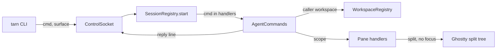

# Module: agent-commands

## Purpose

The socket commands an agent calls on terminal panes: `ls`, `new`, `run`, `wait`, `read` and `close`, and `modules` for `tarn module ls`. Every command names its caller by `TARN_SURFACE` and reaches only the panes of the caller's workspace. Spec: `docs/specs/agent-cli.md`.

## Place in the system

Reading: `AgentCommands` builds the rows of every pane, resolves the caller and its workspace, and hands the scope to the handler of the command. Source: `AgentCommands/AgentCommands.swift`.

## Inputs and outputs

| Direction | What | Where |
|---|---|---|
| In | `{"version":1,"cmd":"ls","surface":<uuid>,"json":bool}` | `AgentCommands.handle` |
| Out | `{"ok":true,"text":...}` or `{"ok":true,"panes":[...]}` | `ListPanes.run` |
| In | `{"version":1,"cmd":"new"\|"run","surface":<uuid>,"right":bool,"cwd":<absolute, optional>,"argv":[...]}` | `AgentCommands.handle` |
| Out | `{"ok":true,"pane":<uuid>}` | `NewPane.open` |
| In | `{"version":1,"cmd":"read","surface":<uuid>,"pane":<uuid>,"lines":<positive, optional>}` | `AgentCommands.handle` |
| Out | `{"ok":true,"text":...}` | `ReadPane.run` |
| In | `{"version":1,"cmd":"close","surface":<uuid>,"pane":<uuid>}` | `AgentCommands.handle` |
| Out | `{"ok":true}` | `ClosePane.run` |
| In | `{"version":1,"cmd":"modules","surface":<uuid>,"json":bool}` | `AgentCommands.handle` |
| Out | `{"ok":true,"text":...}` or `{"ok":true,"modules":[{"module","state"}]}` | `ListModules.run` |
| Out | `{"ok":false,"code":<n>,"error":...}`; the CLI prints `tarn: <error>` and exits with `code` | `AgentCommands.answer` |

## How it works

Rows (`AgentCommands.livePanes`): every surface of every terminal window in screen order (`SessionRegistry.orderedWindows`), hidden splits of a zoomed tab included. `tab` is the window's `TabKey`, `workspace` its workspace id from `WorkspaceRegistry`, nil for the quick terminal. `process` is the kernel name (`AgentProcess.comm`) of the foreground group's leader, or, when the leader is `/usr/bin/login` (a command Ghostty starts, as `new` does), of login's child in the group (`AgentProcess.foreground`); `cwd` is `workingDirectory`: OSC 7, else the cwd of that process (`ViewerPaths.cwd`, as WezTerm `divine_current_working_dir`), `branch` from `ProjectInfo`, `state` `AgentSession.listState` or empty.

Scope (`AgentScope.resolve`): an unknown caller is `not in a tarn tab`, a caller outside the workspaces `not in a workspace`, both code 1. The scope holds the panes of the caller's workspace only (B3). `AgentScope.pane` refuses an id outside the scope with `no pane matched: <id>`, code 4, and never falls back to another pane (B5).

`ls` text: the form of WezTerm `cli list`, a header `PANE  TAB  TITLE  CWD  PROCESS  BRANCH  STATE`, columns padded to the widest cell, `-` for an empty cell, a title kept to one line. JSON entries: `pane`, `tab`, `workspace`, `title`, `cwd`, `process`, `branch`, `state`.

`new` (`NewPane`): the arguments become one shell string by the rules of Python `shlex.join` (`ShellQuote`); an argument with a newline or a carriage return is refused, `command must be one line`, in the CLI and in the app (B2). The surface gets the command and the cwd (`--cwd`, else the caller's `workingDirectory`); Ghostty turns on `wait-after-command` for it, so the last screen stays after exit. `NewPane.split` inserts it below the caller (`--right`: to the right) with `SplitTree.inserting`, which clears a zoom, and assigns `surfaceTree` directly: Ghostty's `newSplit` would focus the new pane and register an undo. The window's first responder is given back after the tree change (`Ghostty.moveFocus` for a surface), so the key window, the active app and the focus stay (B1). `--tab` and `--title` come with the tab placement (`docs/specs/agent-cli.md` 11, PR 7).

`run` (`RunPane`): the same path, `NewPane.open` with kind `run`. The surface gets no command, so Ghostty starts the user's login shell, and the line as `initialInput` with no newline: Ghostty writes it to the pty before any other input, the shell reads it as typeahead and shows it at the first prompt, unsubmitted. Typed text reaches the line editor as keys, so any C0 control character or DEL is refused in the app: a newline or a carriage return as `command must be one line`, any other (Ctrl+O submits in zsh and bash, Tab completes) as `command has a control character`. The pane gets a `run` mark, so `wait` waits for the command the user submits. A slow rc file does not lose the line (O2, checked on the stand).

A new command is one handler file in `AgentCommands/`, one row in `AgentCommands.handlers`, one case in `cli/tarn`, one test and one section of the skill (`docs/specs/agent-cli.md` 10).

`wait` (`WaitPane`, `PaneWaits`): `{"version":1,"cmd":"wait","surface":<uuid>,"pane":<uuid>,"timeout":<seconds, optional>}`. It is not a `Handler`: the reply is held until the pane reports an end. `WaitRule.start` decides at once: a `new` pane (run mark) whose process exited is exit 6 `exit code unknown`, a live one waits for `show_child_exited` (U4, U8); a pane at a prompt (`!needsConfirmQuit`, read only when `confirm-close-surface` is `true`, otherwise the wait never answers early) answers `succeed` with `exit_code` null, even after an earlier finish; a pane where Ghostty injects no OSC 133 integration and that sent no OSC 133 yet is exit 6 `no shell integration` at once, `run` pane or not (`ShellIntegration.injects`: `shell-integration` is not `none`, and a forced value injects; the pane's shell is bash except `/bin/bash`, zsh, fish, elvish or nu, read from the child of `login`, `exec -l` wrapper resolved; `src/termio/shell_integration.zig:43-167`; a pane with no process yet waits); any other waits for `command_finished`. A pane with a `run` mark waits for the next `command_finished` even at a prompt. The ends arrive through three insertion points (`docs/architecture.md` 9): `command_finished`, `show_child_exited`, `surfaceTreeDidChange`; the last one sweeps on the next tick and answers `closed` for panes that left every tree; a closing window (`NSWindow.willCloseNotification`) answers `closed` for all its panes. The `run` mark is spent by the finish it waited for. Reply fields: `state` (`succeed`, `error`, `closed`), `exit_code` (null when none), `command`, `duration_ms`, `text`. `--timeout` (`^[0-9]+(\.[0-9]+)?$`, else `bad timeout`) is kept by the app, capped at one year (exit 9). A cancelled CLI is found by `ControlSocket.Reply.watchPeer` (POLLHUP polled every 0.5 s: `nc` half-closes after the request) and its wait is dropped.

`read` (`ReadPane`): `--lines` must be a positive integer, else `bad lines` (code 1), in the CLI before anything is sent and in the app; default 80 (herdr `pane read`). The text is a fresh `ghostty_surface_read_text` of the whole screen and scrollback (`GHOSTTY_POINT_SCREEN`), not `cachedScreenContents` (500 ms cache). It comes from the cell grid, so it has no escape sequences. Trailing blanks of each line and the empty rows below the last output are cut, then the last `lines` lines are kept, each ending in a newline; a soft-wrapped row comes back as one line.

`close` (`ClosePane`): Ghostty `closeSurface(_:withConfirmation: false)`: no alert whatever runs, an undo entry as for Cmd+W, the last pane of a tab closes the tab. The last pane of a tab whose viewer has unsaved edits is refused with `unsaved viewer edits` (code 1): its close would put the Save sheet (`ViewerClose.intercept`) on the user's window. Ghostty refocuses its last focused surface in that window; the first responder the window had before the close is given back (`NewPane.keep`) unless it was the closed pane (B1). A wait on the pane answers `closed` through the `surfaceTreeDidChange` insertion point or the window close. The app does not refuse the caller's own pane: which panes to close is a rule of the skill (`docs/specs/agent-cli.md` 4.8).

`modules` (`ListModules`): one row per `TarnModule`, `MODULE  STATE`, the id in kebab case (`permission-card`); state `off` when stored off, `unavailable` when stored on but a needed module is off (`TarnModules.isOn`), else `on`. Read only; the caller check of every command applies.

`tarn skill` needs no socket: the CLI prints `Contents/Resources/tarn/SKILL.md`, which the build phase "Install tarn CLI" copies from `cli/SKILL.md` with `@VERSION@` in the first line replaced by `MARKETING_VERSION`; in a checkout it prints `cli/SKILL.md`. The plugin stub skill `plugin/skills/tarn/SKILL.md` only tells the agent to run `tarn skill` (`docs/specs/agent-cli.md` U2). How the agent uses the commands is an edit of `cli/SKILL.md`, no code.
