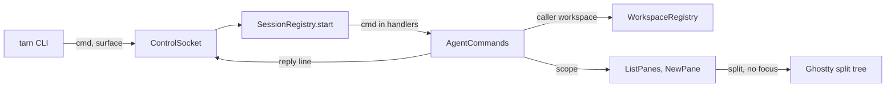

# Module: agent-commands

## Purpose

The socket commands an agent calls on terminal panes: `ls` and `new`. Every command names its caller by `TARN_SURFACE` and reaches only the panes of the caller's workspace. Spec: `docs/specs/agent-cli.md`.

## Place in the system

Reading: `AgentCommands` builds the rows of every pane, resolves the caller and its workspace, and hands the scope to the handler of the command. Source: `AgentCommands/AgentCommands.swift`.

## Inputs and outputs

| Direction | What | Where |
|---|---|---|
| In | `{"version":1,"cmd":"ls","surface":<uuid>,"json":bool}` | `AgentCommands.handle` |
| Out | `{"ok":true,"text":...}` or `{"ok":true,"panes":[...]}` | `ListPanes.run` |
| In | `{"version":1,"cmd":"new","surface":<uuid>,"right":bool,"cwd":<absolute, optional>,"argv":[...]}` | `AgentCommands.handle` |
| Out | `{"ok":true,"pane":<uuid>}` | `NewPane.run` |
| Out | `{"ok":false,"code":<n>,"error":...}`; the CLI prints `tarn: <error>` and exits with `code` | `AgentCommands.answer` |

## How it works

Rows (`AgentCommands.livePanes`): every surface of every terminal window in screen order (`SessionRegistry.orderedWindows`), hidden splits of a zoomed tab included. `tab` is the window's `TabKey`, `workspace` its workspace id from `WorkspaceRegistry`, nil for the quick terminal. `process` is the kernel name (`AgentProcess.comm`) of the foreground group's leader, or, when the leader is `/usr/bin/login` (a command Ghostty starts, as `new` does), of login's child in the group (`AgentProcess.foreground`); `cwd` is `workingDirectory` (OSC 7), else the cwd of that process (`AgentProcess.cwd`, as WezTerm `divine_current_working_dir`), `branch` from `ProjectInfo`, `host` empty until #39, `state` `AgentSession.listState` or empty.

Scope (`AgentScope.resolve`): an unknown caller is `not in a tarn tab`, a caller outside the workspaces `not in a workspace`, both code 1. The scope holds the panes of the caller's workspace only (B3). `AgentScope.pane` refuses an id outside the scope with `no pane matched: <id>`, code 4, and never falls back to another pane (B5).

`ls` text: the form of WezTerm `cli list`, a header `PANE  TAB  TITLE  CWD  PROCESS  BRANCH  HOST  STATE`, columns padded to the widest cell, `-` for an empty cell, a title kept to one line. JSON entries: `pane`, `tab`, `workspace`, `title`, `cwd`, `process`, `branch`, `host`, `state`.

`new` (`NewPane`): the arguments become one shell string by the rules of Python `shlex.join` (`ShellQuote`); an argument with a newline or a carriage return is refused, `command must be one line`, in the CLI and in the app (B2). The surface gets the command and the cwd (`--cwd`, else the caller's `workingDirectory`); Ghostty turns on `wait-after-command` for it, so the last screen stays after exit. `NewPane.split` inserts it below the caller (`--right`: to the right) with `SplitTree.inserting`, which clears a zoom, and assigns `surfaceTree` directly: Ghostty's `newSplit` would focus the new pane and register an undo. The window's first responder is given back after the tree change (`Ghostty.moveFocus` for a surface), so the key window, the active app and the focus stay (B1). `--tab` and `--title` come with the tab placement (`docs/specs/agent-cli.md` 11, PR 7).

A new command is one handler file in `AgentCommands/`, one row in `AgentCommands.handlers`, one case in `cli/tarn`, one test and one section of the skill (`docs/specs/agent-cli.md` 10).
