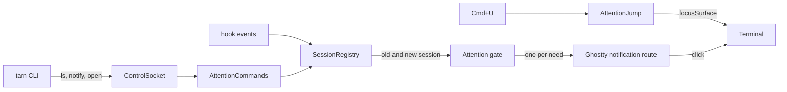

# Module: attention

## Purpose

Tells the user once that a session needs them, jumps to that session with Cmd+U, and gives agents the `tarn` CLI to open files, list sessions and ask for attention without moving focus. Spec: `docs/spec.md` R4, R8, sections 2.2, 8, 10, 11, 12.

## Place in the system

Reading: the registry feeds every state change to the gate; the gate decides, Ghostty shows and handles the click. Source: `Attention.swift`, `AttentionJump.swift`, `AttentionCommands.swift`, `cli/tarn`.

## Inputs and outputs

| Direction | What | Where |
|---|---|---|
| In | a state change of a session (old, new, focused) | `SessionRegistry.receive` -> `Attention.consider` |
| In | `{"version":1,"cmd":"ls","json":bool}` | `AttentionCommands.handle` |
| In | `{"version":1,"cmd":"notify","surface":<uuid>,"text":...}` | same, `SessionRegistry.notify` |
| In | OSC 9/777 of a surface | `Ghostty.App.showDesktopNotification` -> `Attention.suppresses` |
| Out | a notification: title = project, body from `docs/spec.md` 11 | `Ghostty.App.showDesktopNotification(_:title:body:)` |
| Out | `ls` reply: `text` rows, or `sessions` with the `Session` fields | `AttentionCommands` |

## How it works

Gate (`Attention.body`): a body is raised when the new session has a need (`permission`, `waiting`, `failed`) the old one did not, the surface is not focused and `seen` is false. A repeated state raises nothing. A new permission request in `permission` counts as a new need, because approving in the terminal sends no event. The Esc path stores `seen = true` and raises nothing. A change of `failed` alone resets `since` and `seen`, like a state change.

`tarn notify`: the text is trimmed and cut at 500 characters. If the surface is focused, nothing is stored and nothing is raised; the reply is ok. The same text as the current note raises nothing. Otherwise the note and `noteSince` are stored and one notification with the text as body is raised. Focusing the surface clears the note, also on a seen session (`AgentSession.markFocused`).

Suppression: a terminal notification from a surface whose record has a non-empty `agentSessionID` is dropped. The id comes from `session_id` of hook events; `SessionEnd` clears it except after `/clear` (the agent keeps running, so a second banner would appear).

Jump (`AttentionJump`, after Limpid `AttentionState.swift`): candidates are live sessions with a need or a note. Order: `failed`, `permission`, `waiting` or note; inside a group unseen first (a note counts as unseen), then the longest wait (`since`, or `noteSince` for a note without state). The cursor goes to the entry after the focused session and wraps, so repeated presses cycle through seen sessions too; when the focused session is the only candidate, or there is none, the menu action beeps. `SessionRegistry.liveSessions` drops records whose surface is gone. Focus uses `BaseTerminalController.focusSurface`, which also shows a hidden quick terminal.

`tarn ls` rows: `n  project  branch  state  age`, `n` is the position in screen order (windows in tab groups, tabs, splits); `-` for no branch; `failed` shows for a failed waiting session; `project` and `branch` come from `ProjectInfo` (git root folder name, `HEAD`); `cwd` is the surface `pwd`.

CLI (`cli/tarn`, POSIX sh with `nc -U`, `awk`, `tr`): builds the request line, escapes text into JSON, prints the decoded `text` field or the whole reply for `--json`. Errors go to stderr as `tarn: <text>` with exit 1: the app's `error`, or `tarn is not running`, `no answer from tarn` (5 s, `TARN_TIMEOUT`), `bad answer from tarn`, `TARN_SURFACE is not set`. The reply `version` is not checked. `open` resolves a relative path against `$PWD`. The app puts the CLI folder on `PATH`: the core appends the folder of the app executable (`src/termio/Exec.zig:681-710`), here `Contents/MacOS`.

## Files

| Path | Role |
|---|---|
| `macos/Sources/Features/Tarn/Attention.swift` | `AgentNeed`, gate, suppression, delivery |
| `macos/Sources/Features/Tarn/AttentionJump.swift` | order, cursor, menu action |
| `macos/Sources/Features/Tarn/AttentionCommands.swift` | `ls`, `notify`, reply format |
| `macos/Sources/Features/Tarn/ProjectInfo.swift` | project name and branch |
| `macos/Sources/Features/Tarn/SessionRegistry.swift` | fields, `notify`, `liveSessions` |
| `cli/tarn` | the client |

## Ghostty mechanisms used

| Mechanism | Where |
|---|---|
| Show a notification for a surface (authorization, `showUserNotification`) | `Ghostty.App.swift` `showDesktopNotification(_ surfaceView:...)`, `SurfaceView_AppKit.swift` `showUserNotification` |
| Show only when not focused | `Ghostty.App.shouldPresentNotification`, `AppDelegate.userNotificationCenter(_:willPresent:)` |
| Click focuses the surface | `AppDelegate.userNotificationCenter(_:didReceive:)` -> `Ghostty.App.handleUserNotification` -> `SurfaceView.handleUserNotification` |
| Focus a surface | `BaseTerminalController.focusSurface` |
| `tarn` on `PATH` | `src/termio/Exec.zig:681-710` |

## Insertion points in upstream files

Rows 20, 21 and 22 of [architecture.md](../architecture.md) section 9.

## Invariants and failure rules

| Rule | Enforced by |
|---|---|
| Agents never move focus: `notify` and `open` only mark or open | no focus call in `AttentionCommands`; `AttentionTests` |
| One notification per need | `Attention.body`; `AttentionTests` |
| No dead session in the jump or in `ls` | `SessionRegistry.liveSessions` |
| Errors: log line, `{"ok":false,"error":...}`, CLI exit 1, state unchanged | `AttentionCommands.answer`; `AttentionCommandsTests`, `cli_test.py` |
| A second app never takes over a live socket | `ControlSocket.hasListener`; `ControlSocketOwnershipTests` |
| Denied notification permission: sidebar still marks; one log line | `Attention.raise` |

## Tests

`AttentionTests` (order, cursor, gate, notes, session id), `AttentionCommandsTests` (rows, ages, JSON fields, reply format, refusals), `ProjectInfoTests`, `ControlSocketOwnershipTests`; `python3 -I cli/test/cli_test.py` (CLI against a fake socket); `shellcheck cli/tarn`. Not tested: a real banner and its click; `tarn` on `PATH` in a live surface.

## Extending it

| Change | Goes to |
|---|---|
| New need or text | `AgentNeed`, `AgentSession.need`, `AttentionJump.group` |
| New CLI command | `cli/tarn` and a case in `AttentionCommands.perform` |
| Change the key | `MainMenu.xib` item "Jump to Waiting Session" |
