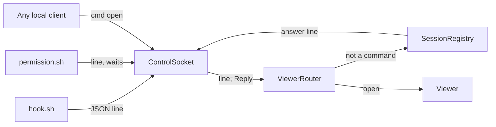

# Module: control-socket

## Purpose

The control socket is the one unix socket through which local processes talk to the running app: agent hooks send state events, and a client can ask the viewer to open a file. It reads one JSON line per connection and can keep the connection open to send an answer back.

Clients: the hook scripts and the `tarn` CLI (`open`, `notify`, [attention.md](attention.md); `ls`, `new`, `run`, `wait`, `read`, `close`, [agent-commands.md](agent-commands.md)). Spec: `docs/spec.md` sections 2.2 to 2.5.

## Place in the system

Reading: the socket knows no protocol. It hands each line and its `Reply` to the main actor; `SessionRegistry` routes. Source: `ControlSocket.swift`, `SessionRegistry.start`.

## Inputs and outputs

| Direction | What | Where |
|---|---|---|
| In | one line ending in newline, up to 4 MB, on a connection | `ControlSocket.accept` |
| In | hook event `{"version":1,"surface":<uuid>,"event":{...}}`, with `"reply":true` for the permission hook | `SessionRegistry.receive` |
| In | command `{"version":1,"cmd":"open","surface":<uuid>,"path":<absolute>,"line":<n>}` | `ViewerRouter.handleCommand` |
| Out | for a permission hook: the decision line, or an empty close | `Reply.send` |
| In | commands `ls`, `new`, `run`, `wait`, `read` and `close` (the reply of `wait` is held until the pane ends, `Reply.watchPeer` drops a cancelled one), see [agent-commands.md](agent-commands.md) | `AgentCommands.handle` |
| In | command `notify`, see [attention.md](attention.md) | `AttentionCommands.handle` |
| Out | every command: `{"ok":true,...,"version":1}` or `{"error":"<text>","ok":false,"version":1}`, keys sorted, text without the `tarn: ` prefix (the CLI adds it); error texts: `unsupported version`, `unknown surface`, `empty text`, `unknown command: <name>` | `AttentionCommands.reply`, `failure` |

## How it works

State: the listening descriptor, a read dispatch source and the serial queue `tarn.socket`. No per-connection state outside `Reply`.

1. `SessionRegistry.start` creates the socket with a callback and calls `start`.
2. `start` creates the folder, removes a stale file, binds `~/Library/Application Support/tarn/tarn.sock`, sets mode 0600 and listens with backlog 16. Any failure is logged and the app runs without the socket.
3. On a connection, `accept` sets a 1 s receive timeout and reads until a newline, end of data or more than 4 MB.
4. An empty or oversized read closes the connection; an oversized one is logged.
5. Otherwise a `Reply` wraps the descriptor and the line goes to the main actor.
6. The callback in `SessionRegistry.start` parses the line once. A line that is not a JSON object (junk, invalid UTF-8) gets `{"error":"malformed request",...}`, except a permission hook's line (`"reply":true`), which gets silence (`AttentionCommands.refuse`, `isMalformed`).
7. The parsed message goes to `ViewerRouter.handleCommand` (`open`), then to `AgentCommands.handle` (`ls`, `new`, `run`, `wait`, `read`, `close`), then to `AttentionCommands.handle` (`notify`, and an error reply for any other `cmd`); a message without `cmd` goes to `SessionRegistry.receive`.
8. Before binding, `start` connects to an existing socket file. A live listener (another tarn, or a Debug build next to the installed app) keeps its file: the new app logs it and runs without a socket. A stale file is replaced.
9. `Reply.send` writes the answer on the socket queue and closes; with an empty line it only closes. A dropped `Reply` closes the connection on deinit. Writes ignore SIGPIPE.

## Files

| Path | Role |
|---|---|
| `macos/Sources/Features/Tarn/ControlSocket.swift` | bind, accept, read one line, `Reply` |
| `macos/Sources/Features/Tarn/ViewerHost.swift` | `ViewerRouter.handleCommand`, the `open` command |
| `macos/Sources/Features/Tarn/SessionRegistry.swift` | `start` wires the socket, `receive` takes hook lines |
| `plugin/hooks/hook.sh`, `plugin/hooks/permission.sh` | the clients in use, see [sessions.md](sessions.md) |

## Ghostty mechanisms used

None. The socket uses Foundation, Darwin and Dispatch. Surfaces are looked up through `BaseTerminalController.surfaceTree` (`macos/Sources/Features/Terminal/BaseTerminalController.swift:49`) in `SessionRegistry.surfaceView`.

## Insertion points in upstream files

None for the socket itself. The surface id reaches clients through `TARN_SURFACE`, set in `macos/Sources/Ghostty/Surface View/SurfaceView.swift:659` (row 7 in [architecture.md](../architecture.md)).

## Invariants and failure rules

| Rule | Enforced by |
|---|---|
| Only the same user can connect | mode 0600 on the socket file |
| A slow or silent client cannot hold the reader | 1 s receive timeout; reads happen on `tarn.socket`, not the main thread |
| Memory per line is bounded | 4 MB cap, line dropped and logged |
| Bind failure does not stop the app | `fail` logs and closes; process detection still works |
| Protocol version is checked by the receiver | `version == 1` in `receive` and `openFromSocket` |
| No command moves focus or presses keys | `open` never takes focus (see [viewer.md](viewer.md)) |

Path longer than the `sun_path` limit: bind is skipped and logged.

## Tests

Swift test: `ControlSocketOwnershipTests` (a live socket is never taken over; in `AttentionCommandsTests.swift`). Indirect pins: `python3 -I plugin/test/hook_test.py` (clients against a missing app, an app that never reads, garbage, a 200 KB event); `ViewerModelTests.swift` for the open rules. Not verified by a test: the 4 MB cap, the read timeout, mode 0600.

## Extending it

| Change | Goes to |
|---|---|
| New command | a handler like `ViewerRouter.handleCommand`, called in the `SessionRegistry.start` callback before `receive`; bump or keep `version` |
| New hook field | `AgentSession.handle` in `SessionRegistry.swift` |
| Socket path | `ControlSocket.path` and the `sock` line of both hook scripts |
| `tarn` CLI | `cli/tarn`, see [attention.md](attention.md) |
