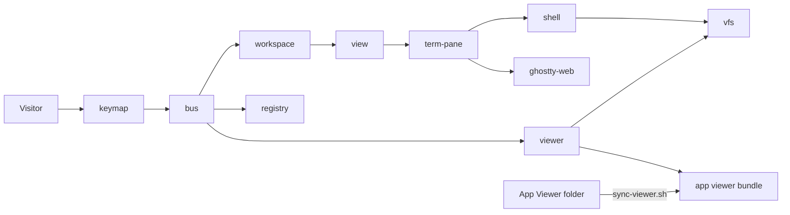

# Module: demo

## Purpose

The demo is a static site that shows the tarn window in a browser: a real terminal emulator per pane, a simulated shell, a scripted `claude` session with the permission card, workspaces, splits, drag-and-drop zones, the viewer and the settings window. It is the storefront before download and the place where a UI step is drawn and approved before it is built in the app ("Demo first", `.claude/CLAUDE.md`). It has no backend, no build step and no network: ES modules and vendored files only.

State of this document: branch `s5-demo`. Plan: `docs/plans/s5-demo.md`; module contracts: `demo/js/CONTRACT.md`.

## Place in the system



Reading: modules talk through the bus (commands and events); each state part has one writer. The demo shares one thing with the app by copy: the viewer bundle. Everything else mirrors an app module by shape, not by code (table below).

## Inputs and outputs

| Direction | What | Where |
|---|---|---|
| In | keys, clicks, drags of the visitor | `keymap.js`, `dnd.js`, `sidebar-drag.js` |
| In | typed shell lines and the scripted `claude` session | `shell/`, `commands/`, `agent-script.js` |
| In | the app viewer bundle (`tarn-viewer.{html,js,css}`, `tarn-mermaid.js`, license notice) | `demo/viewer/`, copied by `tools/sync-viewer.sh` |
| In | stored state `tarn-demo-v1:<part>` in `localStorage` | `storage.js` |
| Out | the page: DOM, terminal canvases, the viewer iframes | `view.js`, `term-pane.js`, `viewer.js` |
| Out | `window.__tarn`, the only way tests read state | `test-contract.js` |
| Out | nothing on the network: every request is same-origin | checks `N19`, `X1`, `E15` |

## How it works

Boot (`main.js`): register state parts, load storage, build the registry, workspaces and layout, create panes, install keys.

State: `state.js` gives `register(part, initial)` once per part and returns the only setter; `read` and `snapshot` return frozen data. Parts: `workspaces` (`workspace.js`), `registry` (`registry.js`), `config` (`config.js`). Other modules send commands on the bus (`bus.cmd`) and listen to events (`bus.on`); a failing command is caught, logged and toasted.

Layout: `layout.js` holds pure tree functions (split, close, move, zones); `workspace.js` is the only writer of the tab and layout state; `view.js` draws it. A pane is created once and moved in the DOM, never rebuilt, so a terminal keeps its screen across splits, undo and tab switches. A tab that is not current is hidden; a hidden tab that holds a viewer keeps its layout (`visibility`) because mermaid measures its diagram while it draws and returns NaN positions in a frame without a box.

Terminal: `term-adapter.js` is the only importer of the engine (ghostty-web). `term-pane.js` starts the simulated shell when the pane first has a size. The shell (`shell/`: line editor, parser, completion) runs commands from `commands/` against `vfs.js`, an in-memory disk seeded by `vfs-seed.js`.

Agent state: `agent-script.js` plays a scripted `claude` session and sends hook events on the bus; `registry.js` applies the transition table of spec section 8 and is the only writer of agent state. The sidebar rows, the tab card and the permission card read it.

Viewer: `viewer.js` hosts the app bundle in an iframe. `viewer-shim.js` stands in for `window.webkit.messageHandlers.tarn`. `viewer-model.js` and `viewer-paths.js` mirror `ViewerModel.swift` and `ViewerPaths.swift`: tabs, preview and pin, dirty text, conflict, save to `vfs`. A frame moved in the DOM reloads and posts `ready`; the model then pushes everything again.

Sync: `tools/sync-viewer.sh` copies the app bundle into `demo/viewer/`, rewrites the meta CSP to allow same-origin files, loads the shim before `tarn-viewer.js`, and maps `tarn-md://file` image paths to `files`. Run it after the app viewer changes.

Time: all timers go through `clock.js`, so a test can freeze and advance time.

Keys: rows are data in `keys/*.js`; `keymap.js` runs in the capture phase and matches by `e.code` with `e.key` as fallback (Cyrillic layouts). Browser-reserved chords get a `Ctrl+Alt+<key>` fallback; Help lists both.

## Built vs planned

| Part | State |
| --- | --- |
| Sidebar and agent states | built (PR #3-#5) |
| Viewer (markdown, mermaid, code, save) | built (PR #3-#5) |
| Cmd+B from the terminal (Ctrl+Alt+B fallback) | built (PR #3): no viewer opens a pane with the tree only, an empty viewer closes, a viewer with files toggles its tree |
| Workspaces, splits, layout | built (PR #3-#5) |
| Settings | built (PR #3-#5) |
| `tarn` CLI (`tarn open`, `tarn ls`, `tarn new`) | planned: the app only has the socket command that opens a file, and a click on a path does the same. The demo keeps the commands to try the idea and prints "planned: not in the app yet" on `tarn --help` and on the first run of each subcommand |

## How the demo mirrors the app

| Area | Demo files | App counterpart |
|---|---|---|
| Core | `main.js`, `bus.js`, `state.js`, `storage.js`, `clock.js`, `config.js` | `ControlSocket.swift`, `TarnSettings.swift` |
| Agent state | `registry.js`, `agent-script.js`, `session-rows.js` | `SessionRegistry.swift` |
| Terminal | `term-adapter.js`, `term-pane.js`, `pane-*.js`, `themes.js` | Ghostty surface |
| Shell | `shell/`, `commands/`, `vfs*.js` | the shell and the disk |
| Layout | `layout.js`, `workspace.js`, `view.js`, `dnd.js`, `frame.js` | Ghostty `SplitTree`, `SidebarModel` |
| Chrome | `chrome.js`, `sidebar*.js`, `tabs.js`, `tabcard.js`, `find.js`, `palette.js`, `toast.js` | `Sidebar.swift`, `TabCardPopover.swift` |
| Viewer | `viewer*.js`, bundle in `viewer/` | `ViewerModel.swift`, `ViewerHost.swift` |
| Settings | `settings*.js`, `demo-reset.js` | `TarnSettings.swift` |
| Keys | `keymap.js`, `keys/` | menu key bindings |

The viewer page is the same code in both; the rest is a second implementation of the same behavior, so a step is first drawn here and then built in Swift. When the app changes behavior, the matching demo file changes in the same PR.

## Files

| Path | Role |
|---|---|
| `demo/index.html`, `demo/css/` | page and styles |
| `demo/js/` | modules above; `CONTRACT.md` lists the contracts |
| `demo/viewer/` | copy of the app viewer bundle (generated, do not edit) |
| `demo/vendor/` | ghostty-web (JS and WASM), fonts; entries in `THIRD_PARTY.md` |
| `demo/test/` | `check_0.py`, `check_a.py`, `check_b.py`, `check_c.py`, `check_e2e.py`, `check_review.py`, `lib.py`, `unit/`, `keys.html` (manual page for reserved browser keys) |
| `tools/sync-viewer.sh` | copies and patches the app viewer bundle |
| `demo/README.md` | run, test, built vs planned |

## Ghostty mechanisms used (ghostty-web)

| Mechanism | Where | Use |
|---|---|---|
| ghostty-web 0.4.0 (`dist/ghostty-web.js`, `ghostty-vt.wasm`): Ghostty's VT core compiled to WASM, unmodified | `demo/vendor/ghostty-web/`, imported only by `demo/js/term-adapter.js` | terminal emulation and rendering in every pane |
| Ghostty option names (`font-size`, `cursor-style`, `window-save-state`, `clipboard-paste-protection`, `copy-on-select`, `macos-option-as-alt`) | `demo/js/config.js` `OPTIONS` | settings use the real keys, so what the visitor sets maps to `ghostty.conf` |
| Ghostty split and sidebar behavior (`SplitTree`, undo window, tab restore) | followed in `layout.js`, `workspace.js` | same results for split, close, undo; not the same code |

The engine has no OSC 133 marks, so the shell stores `cursorRow` at each prompt and jumps with `scrollToRow`.

## Invariants and failure rules

| Rule | Enforced by |
|---|---|
| No request leaves the demo origin | checks `N19`, `X1`, `E15` |
| An agent command (`tarn open`, `tarn new`, `claude`) never moves focus or presses Enter | `check_a`, `check_e2e` |
| The registry is the only writer of agent state; each state part has one writer | `state.register` throws on a second writer; `check_0` |
| A pane instance survives reparent and undo | `check_b` |
| Only `term-adapter.js` imports the engine | review; `CONTRACT.md` |
| Ported code keeps its license header and a `THIRD_PARTY.md` entry | review |
| No page or console errors during a full walk | `N18`, `44`, `E14` |
| `file://` does not work (ES modules, WASM) | known limit; serve with a static server |

Failures: bad stored JSON gives the seed and a toast; blocked storage is tolerated; a failing bus command is caught, logged in `errors` and toasted.

## Tests

| Suite | Pins |
|---|---|
| `check_0.py` | engine, contracts, boot |
| `check_a.py` | terminal, shell, claude script |
| `check_b.py` | layout, workspaces, sidebar, drop zones, tab switches |
| `check_c.py` | viewer, settings, Help |
| `check_e2e.py` | the whole user story, README lists built and planned |
| `check_review.py` | regressions from the code reviews (undo, drag, keys, storage, settings), no personal data in the demo |
| `node --test demo/test/unit` | the shell without a browser |

Run (Chrome installed; under load put `nice -n 10` in front):

```sh
uv run --with playwright python -I demo/test/check_b.py
node --test demo/test/unit
```

Every check runs on the real `index.html`. Tests read state only through `window.__tarn`. Playwright cannot see browser accelerators, so a pass proves our key handler only; a manual pass on real Chrome (full screen, Keyboard Lock), Safari and a Russian layout is part of acceptance.

## Extending it

| Change | Goes to |
|---|---|
| New app feature to show | the demo file of the matching area first, then Swift; update "Built vs planned" in `demo/README.md` and this file |
| New key | a row in `keys/*.js`; `checkRows` rejects duplicates and shell-input chords |
| New shell command | `demo/js/commands/` |
| New setting | `config.js` `OPTIONS`, `settings-data.js` |
| App viewer changed | run `tools/sync-viewer.sh`, then all checks |
| New state part | `state.register` with one writer module |
| New seed file | `vfs-seed.js` |
