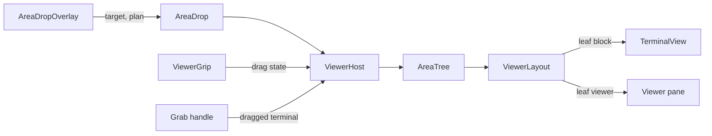

# Module: layout

## Purpose

The layout places any number of viewer panes around the terminal block of one tab, lets the user split, resize, focus and drag them. The terminal block stays Ghostty's own split tree; the layout treats it as one leaf.

Behavior and drop zones: `docs/specs/windows-workspaces.md` section 3a. The viewer itself is in [viewer.md](viewer.md).

## Place in the system

Reading: `ViewerHost` owns one `AreaTree` per window tab and one pane (model and web controller) per viewer leaf. Drops are pure math in `AreaDrop`; the overlay draws and applies them. Source: `ViewerHost.swift`, `Viewer/Area*.swift`, `Viewer/ViewerGrip.swift`.

## Inputs and outputs

| Direction | What | Where |
|---|---|---|
| In | path click or socket open | `ViewerRouter`, `ViewerHost.open` |
| In | menu split and focus actions while a viewer holds the keyboard (right, left, down, up; previous, next, spatial) | `ViewerWebView` to `ViewerModel.onLayout` |
| In | Ghostty split keys with no terminal target | `ViewerRouter.focusNeighbor` to `ViewerHost.focusFromBlock` |
| In | drags: a viewer by its grip, a file tab or tree row from the page, a terminal by Ghostty's grab handle; private pasteboard types `com.daniil4545.tarn.tab`, `.workspace`, `.viewer` (no `Ghostty-Info.plist` entry); terminal drags keep `.ghosttySurfaceId` | `ViewerGripView`, `PageFileDrag`, `DraggingSurfaceKey` |
| In | divider moves and equalize | `ViewerHost.resize`, `equalize` |
| In | Ghostty's menu items Move Divider (Cmd+Ctrl+arrows) and Equalize Splits while a viewer holds the keyboard: the viewer's nearest divider moves 10 points with `SplitTree.resizing`; equalize evens the area and the terminals of the block. Split zoom does nothing from a viewer (user decision 2026-10-26) | `ViewerWebView` actions, `ViewerLayoutCommand.resize`, `.equalize` |
| Out | the layout view | `ViewerLayout` |
| Out | `ViewerSnapshot` (layout JSON, open files of each viewer) for a tombstone; `restore` brings it back | `ViewerHost.snapshot`, `restore` |

## How it works

State: `AreaTree` is Ghostty's `SplitTree<AreaLeaf>`. An `AreaLeaf` is a placeholder view with an id and a kind (`block` or `viewer`); it is never put into a window. A tab starts as the block alone; with no viewer `ViewerLayout` returns the terminal view unchanged.

Open: the first open creates a viewer to the right of the block with 60 percent for the block; later opens use the viewer that has the keyboard, else the one used last. An agent's open never moves focus (see [viewer.md](viewer.md)).

Split from a viewer: the active file opens in a new viewer on the chosen side with half the room. If the file does not open, the new viewer is discarded.

Closing: closing the last file tab closes the viewer. A close with files registers an undo with Ghostty's timeout; undo puts the viewer back beside its old neighbour (or right of the block) and reopens the tabs. A viewer moved elsewhere leaves with no undo.

Drops (`AreaDrop.target`, checked first to last): corner (48 pt), strip (24 pt), viewer tab bar (32 pt) and middle box (15 percent), elsewhere in a pane, the pane itself.
1. Corner or strip of the whole area: the dragged pane takes a half of the area; in a corner of an already split area it takes a quarter of that part.
2. Tab bar or middle of a viewer: the dragged viewer or file goes into that viewer.
3. Elsewhere in a pane: the pane takes the half on the nearest edge, by Ghostty's `TerminalSplitDropZone.calculate`.
4. Over the dragged pane itself: refused, red frame, text "Drop on another pane".
5. A lone terminal dropped at a viewer edge moves the block; for split terminals the overlay is not in the layout while one is dragged (AppKit gives a drag to the registered view under the pointer whatever its `hitTest` says, T-328), so they move among themselves with Ghostty's zones across the whole block, strips and corners included, and a drop over a viewer does nothing.
6. A pointer in the block with no matching zone gives nil: Ghostty's own drop zones work.

A drop shows a line, not a filled frame: 3 pt (`AreaDrop.lineWidth`) in the system accent (`NSColor.controlAccentColor`), centered on the border the new pane will have (`AreaDrop.line`: the inner edge of the space it takes; a drop into a viewer: under its tab bar). A refusal shows a gray plate with the reason and no line. The line and the plate move in one `NSAnimationContext` of `Motion.base`. Terminal onto terminal inside the block stays Ghostty's own zone (`TerminalSplitDropZone`, accent fill 30%): its overlay is drawn inside Ghostty's split view and a layer on top cannot replace it. A file tab moves with its edits (refused if both viewers hold different edited copies); a tree row only opens the file. An emptied source viewer closes. A viewer dropped outside every window opens in a new window (S14a).

Focus: `focusFromBlock` and viewer-to-neighbour moves use `SplitTree.focusTarget`; moving to the block calls `Ghostty.moveFocus` on the focused surface.

Grip: each viewer pane has a three-dot handle on top (`ViewerGripView`) that drags the whole viewer. It follows Ghostty's `drag-handle` setting (auto shows in the top fifth of the pane, always, never). Dots are 0.6 and 1.0 opaque.
Dividers: every split of the area is Ghostty's `SplitView`, unchanged, wrapped in `AreaSplit` (`Viewer/AreaSplit.swift`). `AreaSplit` lays an AppKit strip (`AreaDividerStrip`) over the divider line, `AreaDivider.hitWidth` (14 pt) wide, 3.5 pt before the line and 10.5 pt after it (Ghostty's own strip is 7 pt, centered). The strip lies above both panes, because their AppKit views (web view, terminal) would take the clicks. It covers no more of the first pane than Ghostty's does, since that edge holds the pane's scroll bar. It answers hit tests only for the left button and pointer movement (`StripView.claims`), so the scroll wheel and a right click reach the pane under it. It shows the resize cursor (cursor rect), drags the same ratio through `ViewerHost.resize` with the least pane size of `SplitView`, and equalizes on a double click. Terminal splits keep Ghostty's 7 pt. The terminal drag handle stays Ghostty's 80x12.

A viewer dropped outside every window opens in a new window at the drop point: `ViewerHost.detach` uses Ghostty's `TerminalController.newWindow(_:tree:position:)` (`TerminalController.swift:353`), the path of a terminal pane dragged out. It sets `setFrameTopLeftPoint(position)` and `constrainToScreen()` when the window is presented, so it lands on the screen that holds the point and nothing cascades it back. (The plain `newWindow(_:)` presents first and cascades one turn later, which moved a frame set at once back beside the other windows, on the first screen: the cause of bug 5 in 1.0.0.) Drag coordinates elsewhere are window-local and need no screen math.

## Files

| Path | Role |
|---|---|
| `macos/Sources/Features/Tarn/ViewerHost.swift` | host per window tab, panes, open, split, close with undo, drops, `ViewerRouter` |
| `macos/Sources/Features/Tarn/Viewer/AreaTree.swift` | `AreaLeaf`, tree helpers: open beside, remove, neighbour, slot |
| `macos/Sources/Features/Tarn/Viewer/AreaView.swift` | `ViewerLayout` with Ghostty's `SplitView` per split |
| `macos/Sources/Features/Tarn/Viewer/AreaDrop.swift` | zone math, `AreaPlan`, `AreaPayload`, `placing` |
| `macos/Sources/Features/Tarn/Viewer/AreaDropOverlay.swift` | drop surface, line and refusal plate |
| `macos/Sources/Features/Tarn/Viewer/ViewerGrip.swift` | `ViewerPaneView`, `ViewerGripView` |
| `macos/Sources/Features/Tarn/Viewer/ViewerSnapshot.swift` | layout and files for a tombstone |
| `macos/Sources/Features/Tarn/Viewer/AreaSplit.swift` | `AreaSplit`: `SplitView` plus the wide grab strip; `AreaDivider` math |

## Ghostty mechanisms used

| Mechanism | Where | Use |
|---|---|---|
| `SplitTree` generic over a view | `macos/Sources/Features/Splits/SplitTree.swift:5` (`focusTarget` `:177`, `equalized` `:236`) | layout structure, focus, resize |
| `SplitView` | `Features/Splits/SplitView.swift:8` | dividers |
| `TerminalSplitDropZone` | `Features/Splits/TerminalSplitTreeView.swift:194` | nearest-edge zone inside a pane |
| `DraggingSurfaceKey` | `Ghostty/Surface View/SurfaceDragSource.swift:7` | know a terminal is dragged |
| `SurfaceDragSourceView` drag pattern | `SurfaceDragSource.swift` | grip drag session |
| Grab handle, `drag-handle` setting | `Ghostty/Surface View/SurfaceGrabHandle.swift`, `Ghostty/Ghostty.Config.swift` | grip look and visibility |
| Undo manager and `undoExpiration` | `Features/Terminal/BaseTerminalController.swift:113` | close viewer undo |
| `Ghostty.moveFocus` | `Ghostty/Surface View/SurfaceView.swift:1075` | focus back to a terminal |
| `TerminalController.newWindow` | `Features/Terminal/TerminalController.swift:254` | viewer dropped outside |
| `gotoSplit` | `Ghostty/Ghostty.App.swift:1361` | split keys |

## Insertion points in upstream files

Rows 10 and 12 (see [architecture.md](../architecture.md)); row 17: `Ghostty.App.gotoSplit` joins `isSplit` and `focusTarget` in one guard and, when it fails, returns `ViewerRouter.focusNeighbor`; row 18: `SurfaceGrabHandle` dot opacity 0.6 and 1.0.

## Invariants and failure rules

| Rule | Enforced by |
|---|---|
| The terminal block is one leaf; its terminals stay in Ghostty's tree | `AreaTree`; no own terminal tree |
| The overlay answers hit tests only inside our zones and only during a drag | `AreaDropView`; elsewhere the drop falls to Ghostty's `onDrop` |
| No viewer is left empty after a failed open or move | `discard` in `open`, `dropFile`, `layout` |
| A drop never loses edits: two different edited copies of one file refuse the drop | `canTake`, `canAbsorb` |
| An agent's open never moves focus | as in [viewer.md](viewer.md) |
| Drag state from a page ends with the session | `cancelFileDrag`, `dragEnd` |

Not restored after a relaunch: viewers. Restored by undo of a tab or window: layout and files, not unsaved edits (a close settles them first).

Rejected: an own tree type and viewers inside the terminal tree (its leaves must be `SurfaceView`). Moving the terminal block changes SwiftUI identity and may recreate `TerminalView`; a drop that loses focus is refused. Prior art: no project groups native tabs into named workspaces; cmux `SessionPersistence.swift` (GPL, structure only) shaped the versioned snapshot with safe decode failure.

## Tests

| Suite | Pins |
|---|---|
| `AreaTreeTests` (`macos/Tests/Tarn/AreaTreeTests.swift`) | one block leaf, open beside with shares, remove, snapshot round trip, neighbour by direction, slot of a closed viewer |
| `AreaDropTests` (`AreaDropTests.swift`) | one case per zone row, corner and strip sizes, refusals, lone terminal, file drops, `placing` results, brighter dots |
| `AreaSplitTests` | line position as `SplitView` draws it, drag ratio limits, strip geometry, events the strip takes; hit tests in an `NSHostingView`: the strip takes the left click above the pane views, leaves the pane's scroll bar and the wheel alone (horizontal and stacked splits) |
| `ViewerHostTests` (`ViewerModelTests.swift`) | a page file drag ends with a click or the drag end |
| `ViewerCloseTests` | close questions across several viewers |

## Extending it

| Change | Goes to |
|---|---|
| New drop zone | `AreaDrop.target` and `placing`, plus a case in `AreaDropTests` |
| New draggable thing | `AreaPayload`, the source view, `ViewerHost.drop` |
| New layout command from the page | `ViewerLayoutCommand`, `ViewerWebView` action, `ViewerHost.layout` |
| Restore viewers after relaunch | `ViewerSnapshot` into a coder; hook next to [workspaces.md](workspaces.md) restore |
