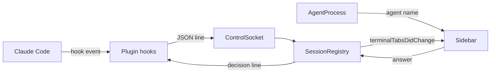
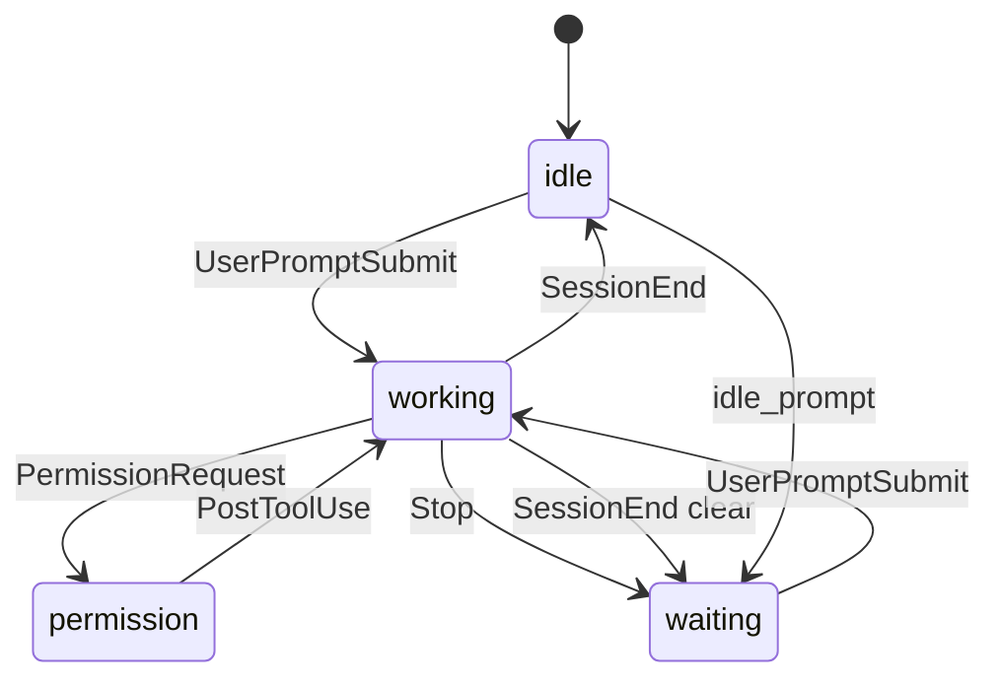

# Module: sessions

## Purpose

The sessions module tracks what each coding agent does in each terminal surface (idle, working, waiting for the user, asking permission) and lets the user answer a permission request from the sidebar card. Inputs are Claude Code hook events and the surface's own signals.

## Place in the system

Reading: the registry is the only writer of session state; `AgentProcess` only names the agent for its icon. Source: `SessionRegistry.swift`, `AgentProcess.swift`, `plugin/hooks/`.

Attention (notifications, jump, `tarn ls` and `notify`) is in [attention.md](attention.md); it adds `agentSessionID`, `note` and `need` to `AgentSession`.

## Inputs and outputs

| Direction | What | Where |
|---|---|---|
| In | hook events: `UserPromptSubmit`, `PermissionRequest`, `PostToolUse`, `PostToolUseFailure`, `Notification`, `Stop`, `StopFailure`, `SessionEnd` | `SessionRegistry.receive` |
| In | surface title, progress report, visible screen text, focus instant | `checkLiveness`, `observeFocus` |
| In | foreground pid of a surface | `AgentProcess.agent(pid:)` |
| In | card click | `SessionRegistry.answer` |
| Out | `terminalTabsDidChange` notification | `update`, `remove` |
| Out | decision line to a waiting permission hook (`hookSpecificOutput` with allow or deny) | `decision(for:input:option:)` |

## How it works

State: `sessions` keyed by surface UUID (memory only; nothing persists across restarts), `pending` (permission hooks that wait, oldest first, per surface), focus observers and `idleSince` marks.

Event flow:
1. The app puts `TARN_SURFACE=<uuid>` in each shell environment.
2. `hook.sh` exits at once without `TARN_SURFACE` or the socket. Otherwise it wraps stdin as `{"version":1,"surface":...,"event":...}`, sends it with `nc -U -w 1` in the background and waits about 40 ms, so events keep order.
3. `receive` drops lines that are not a JSON object with `version` 1, a UUID surface and an event name, and events for unknown surfaces.
4. For `PermissionRequest` with `"reply":true`, the request joins `pending`. A question the card cannot answer (several questions, multi-select) gets an empty reply at once, so Claude Code shows its dialog. With the Permission card module off (or the Sidebar off, which it needs) every request gets the empty reply at once; switching the module off releases the waiting hooks the same way and clears `answerable`, and the card keeps title, folder and state.
5. `PendingAnswer.remaining` drops requests: a finished tool call drops its own; the end of a turn (`UserPromptSubmit`, `StopFailure`, `SessionEnd`, `Stop` without background tasks of the main agent) drops all. A dropped hook gets an empty reply.
6. `AgentSession.handle` applies the transition; `show(waiting:)` forces `permission` with the oldest waiting request and marks it `answerable`.
7. If the session changed: on a state change `since` resets and `seen` is set from focus; the session is stored and the notification posts.

State machine of `AgentSession.handle` (subagent events only raise or clear `permission`; the full table is `docs/spec.md` section 8):

Liveness: Claude Code sends no event on Esc. A 1 s timer checks sessions in `working` or `permission`. Working: no progress report and a title starting with the mark `✳` for 2 s gives `waiting`, seen. Permission: "Interrupted" in the last 12 visible lines for 2 s gives `waiting`. A surface that no longer exists removes its session and answers its pending hooks.

Answer: `answer` sends the decision to the request the card shows. Tool: option 0 allows, other denies with a message. Question: the option label goes in `updatedInput.answers`. With no request left the session returns to `working`.

Agent naming: `AgentProcess.match` accepts `claude`, `codex`, `opencode` exactly or as a prefix followed by a non-alphanumeric. When the kernel name cannot be the command (a bare version such as `2.1.207`, or an interpreter such as `node`), it reads argv through `KERN_PROCARGS2` and takes argv[0] or the script name. Only `claude` has hooks; the others get an icon and a group.

## Files

| Path | Role |
|---|---|
| `macos/Sources/Features/Tarn/SessionRegistry.swift` | `AgentState`, `AgentSession`, `PendingAnswer`, `SessionRegistry` |
| `macos/Sources/Features/Tarn/AgentProcess.swift` | agent names, icons, process and argv reading |
| `plugin/hooks/hooks.json` | registers 8 hooks; timeout 2 s, `PermissionRequest` 3600 s |
| `plugin/hooks/hook.sh` | fire-and-forget forwarder, always exit 0 |
| `plugin/hooks/permission.sh` | forwards `PermissionRequest` and waits for the decision |
| `plugin/.claude-plugin/plugin.json`, `marketplace.json` | plugin `tarn`, installs with `claude plugin install tarn@tarn` |
| `plugin/test/hook_test.py` | hook invariant test |
| `macos/Assets.xcassets/TarnAgent*.imageset` | agent template images |

## Ghostty mechanisms used

| Mechanism | Where | Use |
|---|---|---|
| `foregroundPID` | `macos/Sources/Ghostty/Ghostty.Surface.swift:132` | process of the surface |
| `progressReport`, `focusInstant`, `pwd` | `Ghostty/Surface View/OSSurfaceView.swift:33`, `:43`, `:14` | liveness, seen |
| `cachedVisibleContents` | `Ghostty/Surface View/SurfaceView_AppKit.swift:224` | dialog and "Interrupted" text |
| `surfaceTree` of the controller | `Features/Terminal/BaseTerminalController.swift:49` | find a surface by id |

## Insertion points in upstream files

Row 7 in [architecture.md](../architecture.md): `SurfaceView.swift:659` sets `TARN_SURFACE`. Row 8: image sets for agent icons. Notification posts (rows 3, 5) feed the sidebar, see [sidebar.md](sidebar.md).

## Invariants and failure rules

| Rule | Enforced by |
|---|---|
| The registry is the only writer of session state | `sessions` is `private(set)`; review only |
| `hook.sh` never blocks or fails the agent: exit 0, no output | `exit 0` on every path; `hook_test.py` |
| `permission.sh` waits only while the app holds the connection | connection close ends it; `hook_test.py` |
| Nothing edits `~/.claude/settings.json` | hooks ship as a plugin |
| No key is sent for the user | `answer` writes a hook decision after a click |
| Event bodies are not logged | transitions log old state, new state, event name under subsystem `tarn`, category `registry` |

Failures: no app or socket means the event is lost and the agent is unaffected. Malformed, wrong-version or unknown-surface lines are dropped. Approving a prompt in the terminal gives no event, so `permission` stays until `PostToolUse`. Two agents in one surface are not told apart (not verified). Liveness depends on Claude Code text (`✳`, "Interrupted"); a UI change breaks it silently.

## Tests

| Suite | Pins |
|---|---|
| `AgentSessionTests` (`macos/Tests/Tarn/AgentSessionTests.swift`) | transitions, permission ownership by subagent, background tasks, card allow, deny and question answers, waiting hook lifetime, late prompt, API error, `/clear`, quick answers rule |
| `AgentProcessTests` (`AgentProcessTests.swift`) | name matching, interpreter scripts, versions, argv reading of a live process, unreadable pid, every agent has name and icon; the same file also holds sidebar title tests |
| `plugin/test/hook_test.py` | hook never blocks: no surface, no app, silent app, garbage, 200 KB event |

## Extending it

| Change | Goes to |
|---|---|
| Add or rename an agent | `AgentProcess.names`, `displayNames`, `icons`, a new image set; `AgentProcessTests` |
| Change a transition | `AgentSession.handle`, `docs/spec.md` section 8, `AgentSessionTests` |
| Add a hook event | `plugin/hooks/hooks.json`, `handle` |
| Change quick answers | `SessionRegistry.answer`, `decision`, `AgentViews.swift` |
| Change liveness | `checkLiveness` |
