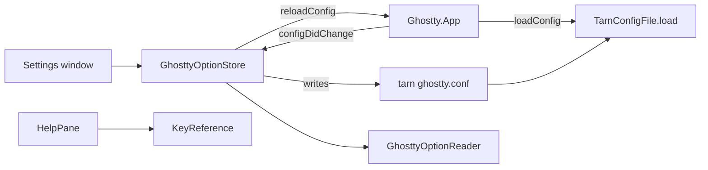

# Module: settings

## Purpose

The settings window (Cmd+,) holds tarn's own settings (the five module switches, row size, file viewer on or off), a short list of Ghostty options and a Help page with the keys in effect. Changed Ghostty options go to a file of ours, `~/.config/tarn/ghostty.conf`, which loads after the user's Ghostty config; the user's own files are never edited.

## Place in the system

Reading: the store writes the file, asks Ghostty to reload, and reads the new effective values back from the config in the change notification. Source: `GhosttyOptionStore.swift`, `TarnConfigFile.swift`, `macos/Sources/Ghostty/Ghostty.Config.swift`.

## Inputs and outputs

| Direction | What | Where |
|---|---|---|
| In | control changes and Reset in the option rows | `GhosttyOptionsPane`, `GhosttyOptionStore.set`, `reset` |
| In | `~/.config/tarn/ghostty.conf` (or under `$XDG_CONFIG_HOME` when absolute) | `TarnConfigFile.read` |
| In | app config in the `ghosttyConfigDidChange` notification (only with `object == nil`) | `GhosttyOptionStore.configDidChange` |
| In | effective values and key triggers of the live config | `GhosttyOptionReader`, `KeyReference.keys` |
| Out | the options file, written atomically | `TarnConfigFile.save` |
| Out | `ghostty.reloadConfig()` after a successful write | store `reload` closure |
| Out | file lines into every config built by the app | `TarnConfigFile.load(into:from:)` |
| Out | module switches in `UserDefaults` (`TarnTabStyle`, `TarnFileViewer`, `TarnModule.*`), row size in `TarnTabRows` | `TarnModules`, `TabRows`, `TarnSettingsView` |
| In | `claude --version`, `~/.claude/plugins/installed_plugins.json`, `SessionRegistry.eventsSeen` | `AgentChecks` |

## How it works

State: the window `TarnSettingsController` (single, 640 by 400, Escape closes) with sections Modules, Tabs, File Viewer, Appearance, Terminal, Windows, Help. `GhosttyOptionStore.shared` holds the file as last read, errors per option key and the last app config. The catalog `GhosttyOption.all` lists 22 options, each with key, control (toggle, choice, theme, number, slider, text), default in file syntax, section, how Ghostty reads it, and when a change applies (live, new windows, restart).

Load order (`Ghostty.Config.loadConfig`):
1. `load_file` if a path is given, else `load_default_files`.
2. CLI args, unless the app runs in Xcode.
3. `load_recursive_files` (the `config-file` includes).
4. The tarn file, only when `tarnFile` is passed. Only `Config.init(at:finalize:)` passes `TarnConfigFile.activeURL()`; `TemporaryConfig` and tests pass nothing.
5. `finalize`.
Scalars: the last line wins, so tarn beats the user's file and includes. A launch with `-e` skips the tarn file, because our lines would land after the command the CLI sets. A missing file loads nothing (Ghostty logs an error for a missing file, so existence is checked first).

Write flow:
1. A control change calls `set` (or `reset`).
2. A number outside its range or a fraction for a whole-number option is reported in the row and not written.
3. The store re-reads the file, changes one key, puts catalog options in catalog order after the header and any hand-written lines, and saves.
4. The save goes through `resolvingSymlinksInPath()`, creates the folder and writes atomically.
5. `reloadConfig()` runs; Ghostty posts the change; the store takes the new config and the rows refresh.

Rules: a control change always writes its line, even when the value equals the Ghostty default; only Reset removes it, so the user's own value never resurfaces. Optional options write an empty value for their default entry. A repeatable option (`font-family`) writes an empty clear line first. Values with line breaks are rejected. Edge spaces, empty values and values wrapped in quotes are quoted; Ghostty strips one pair of quotes and does no escaping.

Display of a row: the value in the file if the control can show it; a raw read-only text with Reset if it cannot (for example `undo-timeout = 7s`); otherwise the effective value from `ghostty_config_get`; for the unreadable options (`theme`, `font-family`, `window-padding-x`) the text "from Ghostty config". Rows say when a change applies; a set option shows "set in tarn" and Reset. The Windows page shows the file text.

Help: `KeyReference.groups` is a fixed list of actions (Ghostty has no call that lists bindings). For each, `keyboardShortcut(for:)` gives the key in effect, else "not bound". Actions bound as performable (undo, redo, clear screen, search) get no trigger from Ghostty, so those rows carry the Ghostty default keys. Viewer keys come from `ViewerWebView.keyTable`, source "tarn".

Theme row (T-151): under the row, `ThemePicker` lists the base themes (the entry `default`, then Catppuccin Latte, Catppuccin Mocha, Atom One Light, Atom One Dark, Gruvbox Light, Gruvbox Dark, Dracula; `ThemeCatalog.baseNames`) with a sample each (background, text, palette red, green, yellow, blue, read from the theme file by `ThemeCatalog.palette(of:)`), then every other installed theme (771 minus 7) with a filter. The filter (case-insensitive, `ThemeCatalog.matching`) narrows the base list too, so "dracula" finds the base entry; "No themes match" shows when nothing fits. The picker is one view for every state of the row, so a pick or Reset keeps the filter and the scroll; the theme names are read once per process. One theme is chosen and written as `theme = <name>`; there is no light and dark pair. The names are the files of `ghostty/themes` in the user's folder and the app bundle, the folders Ghostty reads (`src/config/theme.zig:20`).

Window colors from the theme: `ThemePalette(config:)` reads `background`, `foreground` and `palette` of the live config with `ghostty_config_get`; `ThemeChrome` derives the rest with one rule for every theme (the rule of `demo/js/chrome-theme.js`): sidebar surface = background plus 6% of the text color, divider = background toward black (22% on a light theme, 45% on a dark one), muted text = text 38% toward the background, faint text 55%, accent = the first of blue, bright blue, cyan, magenta with contrast 3:1 against the background, else the text color. Light or dark is the background luminance (WCAG, above 0.4). `window-theme` `auto` and `ghostty` use this; `system`, `light` and `dark` keep the built-in palettes (`ThemeChrome.current` returns nil). The sidebar and the viewer repaint on `ghosttyConfigDidChange`, so a theme change needs no restart.

Modules (T-205, `docs/specs/modules.md`): the first section has one switch per module and an Agents line. `TarnModule` lists Sidebar, File viewer, Workspaces, Permission card, Notifications with title, detail, key and `needs`. `TarnModules.isOn` is the effective state: stored on and every needed module on; only Permission card needs one (Sidebar). Sidebar is the old tab style (`TarnTabStyle`: `sidebar` is on, `top` is off), so the style picker is gone from Tabs; Tabs keeps the row size. A missing key is on; a value of the wrong type counts as on and is logged once (`os_log`, category `settings`); the words `YES` and `NO` of a launch argument count. Every path that draws a module or creates its objects reads the state at that moment. `TarnModuleWatcher` observes `UserDefaults.didChangeNotification` (any writer), compares the effective set with the last one and acts on the difference: native tab bar (`TabStyle.applyToOpenWindows`), freeze of workspaces, release of waiting permission hooks, focus out of a viewer pane that is no longer drawn, menu items (New Workspace, Toggle File Viewer, Jump to Waiting Session are hidden by walking `NSApp.mainMenu` for their actions, so no Ghostty file needs a new hook), then `terminalTabsDidChange` for the sidebars and tab marks. A row whose module needs another is greyed out with "needs Sidebar" and keeps its stored value.

Agents line: Claude Code with its version and three checks, run off the main thread when the pane opens, no network. Found: `claude --version` from `~/.local/bin/claude`, `/opt/homebrew/bin/claude`, `/usr/local/bin/claude`, `~/.claude/local/claude` in turn, else `$SHELL -l -i -c 'claude --version'` killed after 5 s; the version is the line `N.N.N (Claude Code)`. Plugin: `tarn@tarn` under `plugins` in `installed_plugins.json` (format of 2.1.311). Events: the registry received a hook event since tarn started. A failed check shows its hint. No module is gated by the version.

Cmd+W closes the settings window: the menu item Close sends `close:` (and Close Window `closeWindow:`) down the responder chain, and `NSWindow` answers neither; `TarnSettingsController` has both actions, as `AboutController` does.

## Files

| Path | Role |
|---|---|
| `macos/Sources/Features/Tarn/TarnModules.swift` | `TarnModule`, `TarnModules` (effective state, menu items), `TarnModuleWatcher` |
| `macos/Sources/Features/Tarn/ModulesPane.swift`, `AgentChecks.swift` | the Modules pane; the three Claude Code checks |
| `macos/Sources/Features/Tarn/TarnSettings.swift` | `TabStyle`, `TarnSettingsController` (also the `close:` and `closeWindow:` actions), `TarnSettingsView` sections |
| `macos/Sources/Features/Tarn/ThemeColors.swift` | `ThemeColor` (mix, luminance, contrast), `ThemePalette` (theme file and config reading, accent), `ThemeChrome` (derived window colors), `ChromeInk` environment |
| `macos/Sources/Features/Tarn/ThemeCatalog.swift` | theme folders, names, base list, palette from a theme file |
| `macos/Sources/Features/Tarn/ThemePicker.swift` | the base list, the filter and the full list with samples |
| `macos/Sources/Features/Tarn/TarnConfigFile.swift` | file model (entries and verbatim lines), parse, set, remove, text, path, save, `load` |
| `macos/Sources/Features/Tarn/GhosttyOption.swift` | the option catalog |
| `macos/Sources/Features/Tarn/GhosttyOptionReader.swift` | effective value through `ghostty_config_get` |
| `macos/Sources/Features/Tarn/GhosttyOptionStore.swift` | write, reset, display, notification |
| `macos/Sources/Features/Tarn/GhosttyOptionsPane.swift` | one section of rows and controls |
| `macos/Sources/Features/Tarn/KeyReference.swift` | Help rows and key text |
| `macos/Sources/Features/Tarn/HelpPane.swift` | Help view |
| `macos/Sources/Features/Tarn/ViewerWebView.swift` | `keyTable` shared with Help |

## Ghostty mechanisms used

| Mechanism | Where | Use |
|---|---|---|
| Config load sequence | `macos/Sources/Ghostty/Ghostty.Config.swift:61` (`loadConfig`), `:72`, `:81` | place of the tarn file |
| `reloadConfig` | `Ghostty/Ghostty.App.swift:144` | apply after a write |
| `ghosttyConfigDidChange` with `GhosttyConfigChangeKey` | `Ghostty/GhosttyPackage.swift:291`, `Ghostty.App.swift:2450` | read new config |
| `ghostty_config_get` accessors | `Ghostty.Config.swift` (pattern) | effective values |
| `keyboardShortcut(for:)`, `keyList` | `Ghostty.Config.swift`, `Helpers/Extensions/KeyboardShortcut+Extension.swift` | Help keys |
| `ghostty_config_load_file` | core C API | load our file |
| Config errors window | Ghostty's own | a rejected line shows there |

## Insertion points in upstream files

Row 14 of [architecture.md](../architecture.md): `Ghostty.Config.swift`, parameter `tarnFile: URL? = nil` on `loadConfig`, one `TarnConfigFile.load(into:from:)` call after `ghostty_config_load_recursive_files`, and `TarnConfigFile.activeURL()` passed from `init(at:finalize:)`. Row 9 is the menu item "Settings...".

## Invariants and failure rules

| Rule | Enforced by |
|---|---|
| The user's Ghostty files are never edited | the store writes only the tarn file |
| The tarn file beats the user file, includes and themes | test `tarnBeatsTheUserFile`, `...AConfigFileInclude`, `...ATheme` |
| A hand edit (comments, unknown lines) survives a save | verbatim lines; test `commentsAndUnknownLinesSurviveAnEdit` |
| A failed write leaves the old file and no reload | atomic write; row error "Could not save"; test `aFailedWriteReportsInTheRowAndDoesNotReload` |
| Tests and `TemporaryConfig` never read the real file | `tarnFile` defaults to nil |
| A single terminal's config reload is not taken as the app config | `object == nil` check |
| A symlinked file stays a symlink | save resolves the link |

Failures: a rejected line after reload opens Ghostty's configuration errors window and the mark "set in tarn" stays. Limits: CLI flags lose to the tarn file; the three unreadable options show no effective value; `background-blur` with a radius or glass reads as "true".

Catalog choices: `macos-titlebar-style` offers only transparent, native and hidden (`tabs` is removed on purpose). `cursor-style-blink` and `macos-option-as-alt` default to null in Ghostty (the row shows "default (auto)" when unset). `background-opacity` needs a restart, `macos-titlebar-style` applies to new windows, `font-size` does not change a terminal after Cmd+=. Prior art: chlee1001/chostty PR 24 and alxhill/ghostty `ah/config-ui` (both MIT) for the option rows and "set in tarn" with Reset; a side file loaded after the user's config has no analog.

## Tests

All in `macos/Tests/Tarn/`.

| Suite | Pins |
|---|---|
| `TarnConfigFileTests` | round trip, comments kept, header, repeatable keys, line breaks, XDG path, Ghostty reads what we wrote, precedence over user file, include and theme, font-family clear line, reset, empty and missing file, failed write, symlink |
| `GhosttyOptionStoreTests` | set writes and reloads, default value still written, reset removes one line, empty default entry, bad number, catalog order, hand edit kept between writes, failed write, raw display, unreadable options, notification source |
| `GhosttyOptionTests` | unique keys, choice defaults, catalog defaults equal a loaded config, repeatable clear, apply labels, whole numbers |
| `ThemeColorsTests` | hex and mix math, WCAG contrast, theme file parse (comments, bad lines, missing colors), palette from a config, light and dark window colors, accent skips a color below 3:1 and falls back to the text color, the rule over every installed theme, `window-theme` switch, viewer variables |
| `ThemeCatalogTests` | the base list is the seven themes and each is installed, the rest is the others, folders merge and the user's wins, a path is not a theme, XDG folder |
| `TarnModulesTests` | effective state and needs, 1.2.0 keys, wrong types, launch-argument words, menu items hidden, viewer visibility with the user hide, version and plugin parsing |
| `ModulesRegistryTests` | notifications off (no banner, `tarn notify` refused, terminal notifications not suppressed), permission card off (empty reply at once, waiting hook released on switch-off) |
| `SettingsWindowCloseTests` | the settings controller answers `close:` and `closeWindow:` |
| `KeyReferenceTests` | unique ids, each Ghostty action resolves, unbound text, keybind change visible, performable defaults, viewer keys from the table |

## Extending it

| Change | Goes to |
|---|---|
| New Ghostty option in the window | row in `GhosttyOption.all` (key, control, default, applies, help); `GhosttyOptionTests` compares the default with Zig |
| New settings section | `TarnSettingsView.Section` and a pane |
| New key in Help | row in `KeyReference.groups` |
| New viewer key | `ViewerWebView.keyTable` (Help follows) |
| File format or load place | `TarnConfigFile`, `Ghostty.Config.loadConfig`; keep row 14 |
