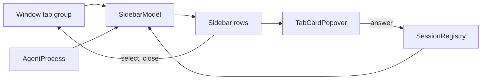

# Module: sidebar

## Purpose

The sidebar replaces the native tab bar with a vertical list of the window's tabs, grouped by project for tabs that run an agent. Each row shows the agent state; a hover card shows the request and answers it.

State of this document: branch `s2-files`. PR #5 rewrites `Sidebar.swift` (workspaces, headers, drag); see [workspaces.md](workspaces.md).

## Place in the system

Reading: one `SidebarModel` per window controller derives `groups`; views only draw them. Source: `Sidebar.swift`, `AgentViews.swift`, `TabCardPopover.swift`.

## Inputs and outputs

| Direction | What | Where |
|---|---|---|
| In | `terminalTabsDidChange` notification | `SidebarModel.init` observer |
| In | 2 s timer, only while the window is visible | `SidebarModel.init` |
| In | `SessionRegistry.sessions` | `SidebarModel.agent(in:)` |
| In | tab style `TarnTabStyle` (`sidebar` default, `top`), sidebar width, collapsed, folded roots in `UserDefaults` | `SidebarLayout`, `Sidebar` |
| Out | tab select, close, new tab, context menu actions | `SidebarModel` |
| Out | quick answer | `AgentQuickActions` calls `SessionRegistry.answer` |
| Out | state dot and logo in the native tab when tabs are at the top | `NativeTabMark` |

## How it works

State: `groups` (derived, published), project root cache `projects` (by `pwd`, never invalidated), card tab id, hovered tab, row anchors for the popover.

Refresh:
1. The notification observer calls `refresh()` now and once on the next run loop turn, because the tab group settles late. The timer covers agent start and exit, which the core does not report.
2. `refresh()` walks the tabs of the window's tab group. For each split it reads `foregroundPID` and asks `AgentProcess.agent`; the first split with an agent decides.
3. Agent found: group section `agents`, key = project root of that surface's `pwd` (nearest parent with `.git`, else the `pwd`). No agent: section `terminals`, empty key.
4. `arrange` orders sections (agents first), then groups by first tab, then tabs by position. A header shows the folder name, or `parent/folder` when two roots share a name.
5. The tab's agent is the non-idle session among its splits that needs the user most (state, then unseen done).
6. A changed list republishes; an open card updates.

Drawing: the expanded sidebar shows a header per agent project (click folds; a folded project still shows its selected tab) and rows with close button on hover, tab color dot, agent logo, title, state dot and shortcut. The collapsed rail shows icons only. A terminals section sits below a divider with no header. Width 120 to 400 (default 200), collapsed 40; the width is stored once a drag ends.

Card: hover on an agent row for 0.5 s, or a force click on any row, opens the one `TabCardPopover`; moving to another agent row slides it. It shows title, project, folder, state, elapsed time and, for a request, its text and the buttons (Allow, Deny; or numbered options up to 9) when the hook waits (`answerable`). After an answer the card stays closed until the pointer leaves the row.

Titles: a shell path title becomes the full working directory with `~`; under an agent a shell title becomes the agent's name and an own title loses its leading spinner mark.

## Files

| Path | Role |
|---|---|
| `macos/Sources/Features/Tarn/Sidebar.swift` | `SidebarModel`, `SidebarLayout`, `Sidebar`, rows, `NativeTabMark`, menu area |
| `macos/Sources/Features/Tarn/AgentViews.swift` | `AgentBadge`, `AgentQuickActions`, `TabCard`, state text |
| `macos/Sources/Features/Tarn/TabCardPopover.swift` | the one popover, 280 pt wide, hover tracking |
| `macos/Sources/Features/Tarn/TarnSettings.swift` | `TabStyle` (read here), settings window, see [settings.md](settings.md) |

## Ghostty mechanisms used

| Mechanism | Where | Use |
|---|---|---|
| Tab group of windows, `tabbedWindows` | `Features/Terminal/TerminalController.swift:600` (`relabelTabs`) | tab order and shortcut labels |
| `keyboardShortcut(for:)` | `Ghostty/Ghostty.Config.swift:114` | shortcut of `goto_tab:N` in a lone tab |
| Tab accessory view stack | `Features/Terminal/Window Styles/TerminalWindow.swift:173` | `NativeTabMark` install |
| `TerminalTabColor` | `Features/Terminal/TerminalTabColor.swift:4` | row color dot |
| Close, close others, close right, move, rename | `TerminalController` actions (`closeTab` at `:1351`, `closeOtherTabs` `:1373`, `closeTabsOnTheRight` `:1408`) | context menu |
| Config background color | `Ghostty/Ghostty.Config.swift:463` | sidebar background |
| Origin | PR #14562 of ghostty-org/ghostty (see `THIRD_PARTY.md`) | vertical tab list |

## Insertion points in upstream files

Rows 1 to 6 and 9 of [architecture.md](../architecture.md): `sidebarModel` property, `SidebarLayout` wrap and initial width, notification posts after relabel and after a tab move, `TerminalWindow` observers, native tab bar hidden while the style is `sidebar`, the menu item "Settings...".

## Invariants and failure rules

| Rule | Enforced by |
|---|---|
| The sidebar never writes session state | views only read `SessionRegistry.sessions` |
| A closed window is not asked for its tabs again (it would rejoin a tab group and stay alive) | `observeWindowClose` clears `window` |
| The selected tab never disappears from a folded project | `Sidebar` row filter |
| Hidden windows do not poll | timer checks `occlusionState` |
| A force click must not also switch tabs | `forceClicked` flag |

Known limits: detection latency up to 2 s on a visible window; hidden windows refresh on notifications only; the project root cache is never invalidated.

## Tests

| Suite | Pins |
|---|---|
| `AgentProcessTests` (`macos/Tests/Tarn/AgentProcessTests.swift`) | `displayTitle` cases, agent groups first and plain tabs last, same folder names show their parent |

Drawing, card behavior and folding have no automated test; checked by running the app.

## Extending it

| Change | Goes to |
|---|---|
| Grouping or order | `SidebarModel.refresh`, `arrange`, `projectRoot`; group key is the full root path |
| Detection triggers | `SidebarModel.init` timer and observer; check idle CPU |
| Row or card content | `Sidebar.swift` rows, `AgentViews.swift` |
| Width or layout | `Sidebar.swift`; keep `Sidebar.occupiedWidth` equal to what the layout takes (used by insertion point 2) |
| Badge colors or texts | `AgentBadge`, `TabCard.stateText` |
