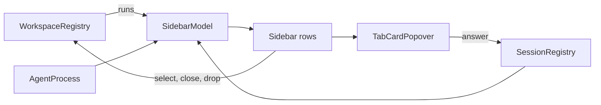

# Module: sidebar

## Purpose

The sidebar replaces the native tab bar with a vertical list of the window's tabs, grouped into workspaces. Each row shows the agent state; each workspace header shows the most urgent state of its tabs; a hover card shows the request and answers it.

Groups are workspaces, see [workspaces.md](workspaces.md).

## Place in the system

Reading: one `SidebarModel` per window controller derives `groups` from the registry's runs; views only draw them and send commands. Source: `Sidebar.swift`, `WorkspaceHeader.swift`, `TabDragSource.swift`, `AgentViews.swift`, `TabCardPopover.swift`.

## Inputs and outputs

| Direction | What | Where |
|---|---|---|
| In | `terminalTabsDidChange` notification | `SidebarModel.init` observer |
| In | 2 s timer, only while the window is visible | `SidebarModel.init` |
| In | `WorkspaceRegistry.runs(for:)` | `SidebarModel.refresh` |
| In | `SessionRegistry.sessions` | `SidebarModel.agent(in:)` |
| In | tab style `TarnTabStyle`, sidebar width and collapsed in `UserDefaults` | `SidebarLayout`, `Sidebar` |
| In | drags of a tab row or a workspace header (private pasteboard types `com.daniil4545.tarn.tab`, `.workspace`) | `TabDragSource.swift`, `SidebarModel.drop` |
| Out | tab select, close, new tab, context menu | `SidebarModel` |
| Out | workspace commands: new tab in, new workspace, rename, delete, fold, move tab, move workspace | `WorkspaceRegistry` |
| Out | quick answer | `AgentQuickActions` calls `SessionRegistry.answer` |
| Out | window subtitle with the workspace name | `WorkspaceTitle.apply` in `refresh` |
| Out | state dot and logo in the native tab when tabs are at the top | `NativeTabMark` |

## How it works

State: `groups` (derived, published; one per workspace with its tabs in tab order, folded or not), `dropSlot` (where a drop in progress would land), card tab id, hovered tab, row anchors.

Refresh:
1. The notification observer calls `refresh()` now and once on the next run loop turn. The timer covers agent start and exit, which the core does not report.
2. `refresh()` first calls `WorkspaceRegistry.sync()` so the runs follow Ghostty's tab order, then sets the window subtitle.
3. For each run it builds the tabs. A tab reads `foregroundPID` of its splits and asks `AgentProcess.agent`; the first split with an agent names the tab's agent and gives the `pwd`. The tab's session is the non-idle one among its splits that needs the user most.
4. A changed list republishes; an open card updates. A header shows the worst session of its tabs (`mostUrgent`: permission, then working, then unseen done).

Drawing: the expanded sidebar shows a header per workspace (name; for a folded workspace the tab count and the worst state dot; a + button opens a tab in it) and rows with close button on hover, tab color dot, agent logo, title, state dot and shortcut. A click on a header folds it; a folded workspace hides its tabs. The collapsed rail shows icons only. Width 120 to 400 (default 200), collapsed 40; the width is stored once a drag ends.

Commands: new tab and new workspace go through the registry (the workspace prompt asks for a name; delete asks with the tab count and names the workspace that takes the tabs). Close Other Tabs and Close Tabs Below act inside the tab's workspace and close as one undoable step, after the viewer's unsaved-edit question and Ghostty's running-process question. "Move to" moves a tab to another workspace.

Drag and drop: a tab dropped on the upper half of a row lands before it, on the lower half before the next row or at the end of the workspace; on a header, at the end of that workspace. A workspace dropped on a header or row lands before that workspace or the next; below the last header, at the end. The slot is pure math (`SidebarModel.dropSlot`). A payload from another window is refused. A tab drag that nobody accepts and that ends outside every window moves the tab to a new window.

Card: hover on an agent row for 0.5 s, or a force click on any row, opens the one `TabCardPopover`. It shows title, workspace name, folder, state, elapsed time and, for a request, its text and buttons when the hook waits (`answerable`). After an answer it stays closed until the pointer leaves the row.

Titles: a shell path title becomes the full working directory with `~`; under an agent a shell title becomes the agent's name and an own title loses its leading spinner mark.

## Files

| Path | Role |
|---|---|
| `macos/Sources/Features/Tarn/Sidebar.swift` | `SidebarModel`, `SidebarLayout`, `Sidebar`, rows, `NativeTabMark`, menus, drop handling |
| `macos/Sources/Features/Tarn/WorkspaceHeader.swift` | header view, drop line, name and delete prompts |
| `macos/Sources/Features/Tarn/TabDragSource.swift` | drag kinds, drop slots and targets, AppKit drag source and interaction view |
| `macos/Sources/Features/Tarn/AgentViews.swift` | `AgentBadge`, `AgentQuickActions`, `TabCard` (shows the workspace name) |
| `macos/Sources/Features/Tarn/TabCardPopover.swift` | the one popover, 280 pt wide, hover tracking |
| `macos/Sources/Features/Tarn/TarnSettings.swift` | `TabStyle`, settings window, see [settings.md](settings.md) |

## Ghostty mechanisms used

| Mechanism | Where | Use |
|---|---|---|
| Tab group of windows, `tabbedWindows` | `macos/Sources/Features/Terminal/TerminalController.swift:600` (`relabelTabs`) | tab order and shortcut labels |
| Config shortcut lookup | `Ghostty/Ghostty.Config.swift` (`keyboardShortcut(for:)`) | shortcut of `goto_tab:N` |
| Tab accessory view stack | `Features/Terminal/Window Styles/TerminalWindow.swift:173` | `NativeTabMark` install |
| `TerminalTabColor` | `Features/Terminal/TerminalTabColor.swift:4` | row color dot |
| Close actions, `confirmClose`, `closeTabImmediately`, undo grouping | `TerminalController` (`closeTab`, `closeTabImmediately`) | context menu, grouped close |
| `move_tab` (through the registry) | `Features/Terminal/BaseTerminalController.swift:1046` | all reordering |
| `SurfaceDragSourceView` pattern | `Ghostty/Surface View/SurfaceDragSource.swift:82` | tab and workspace drag source |
| Origin | PR #14562 of ghostty-org/ghostty (see `THIRD_PARTY.md`) | vertical tab list |

## Insertion points in upstream files

Rows 1 to 6 and 9 of [architecture.md](../architecture.md): `sidebarModel` property, `SidebarLayout` wrap and initial width, notification posts after relabel and tab move, `TerminalWindow` observers, native tab bar hidden while the style is `sidebar`, the menu item "Settings...".

## Invariants and failure rules

| Rule | Enforced by |
|---|---|
| The sidebar never writes session state or tab order | views read; order changes go through `WorkspaceRegistry` and `move_tab` |
| Row N is native tab N, folded or not | by construction in the registry ([workspaces.md](workspaces.md)) |
| A closed window is not asked for its tabs again (it would rejoin a tab group and stay alive) | `observeWindowClose` clears `window` |
| Hidden windows do not poll | timer checks `occlusionState` |
| A force click must not also switch tabs | `forceClicked` flag |
| The last workspace has no delete | menu item disabled with one group |

Known limits: detection latency up to 2 s on a visible window; hidden windows refresh on notifications only. The top tab style shows no workspaces; membership keeps working.

## Tests

| Suite | Pins |
|---|---|
| `SidebarGroupingTests` (`macos/Tests/Tarn/SidebarGroupingTests.swift`) | header shows the most urgent state, unseen done beats seen done, no state without agents, drop slots for tabs and workspaces on rows and headers, unknown targets |
| `AgentProcessTests` | `displayTitle` cases, every agent has name and icon |
| `WorkspaceTitleTests` | subtitle text |

Drawing, card behavior, menus and real drags have no automated test; checked by running the app.

## Extending it

| Change | Goes to |
|---|---|
| Grouping rules | [workspaces.md](workspaces.md); the sidebar only draws `groups` |
| Detection triggers | `SidebarModel.init` timer and observer; check idle CPU |
| Row, header or card content | `Sidebar.swift`, `WorkspaceHeader.swift`, `AgentViews.swift` |
| Drop slots | `SidebarModel.dropSlot` in `TabDragSource.swift` with a case in `SidebarGroupingTests` |
| Width or layout | `Sidebar.swift`; keep `Sidebar.occupiedWidth` equal to what the layout takes (used by insertion point 2) |
