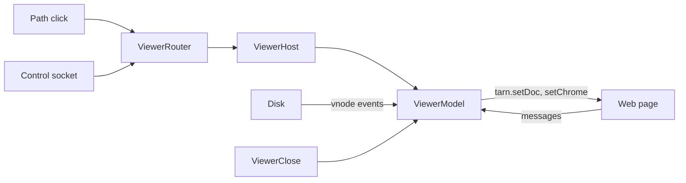

# Module: viewer

## Purpose

The viewer is a pane beside the terminal that shows files the user or an agent points at: markdown rendered (with an editor), other text as highlighted code, with file tabs, a files tree and live reload when the agent rewrites a file. Swift holds all state; a WKWebView only draws it.

A window tab holds any number of viewers around the terminal block; placement, drops and grips are in [layout.md](layout.md). This document covers one viewer.

## Place in the system

Reading: the model is the only owner of tabs, documents and tree; the page is replaceable and holds no truth. Source: `ViewerHost.swift`, `ViewerModel.swift`, `ViewerWebView.swift`.

## Inputs and outputs

| Direction | What | Where |
|---|---|---|
| In | click on a path in terminal output (Ghostty action `open_url`, kind unknown) | `ViewerRouter.handle` |
| In | socket line `{"version":1,"cmd":"open","surface":<uuid>,"path":<absolute>,"line":<n>}` | `ViewerRouter.handleCommand` |
| In | page messages (`ready`, `tab`, `closeTab`, `closePane`, `toggleTree`, `hideTree`, `treeToggle`, `treeOpen`, `edit`, `save`, `task`, `take`, `keep`, `link`, `copy`, `error`, `dragFile`, `dragEnd`) | `ViewerModel.handle` |
| In | Cmd+S, Cmd+E, Cmd+B and the menu action Cmd+W while the pane has focus | `ViewerWebView` |
| In | menu split and focus actions while the pane has focus | `ViewerWebView` to `ViewerModel.onLayout`, handled by [layout.md](layout.md) |
| In | files taken from or dropped into another viewer | `ViewerModel.absorb`, `take`, `release`, `canTake` |
| In | View menu item "Toggle File Viewer", Cmd+B (action `toggleViewer:`, `ViewerHost.toggleFromKey`); in the pane `ViewerWebView.command` takes Cmd+B, Cmd+S, Cmd+E with exact modifiers, and Cmd+E beats Ghostty's selection-for-find. A Ghostty keybind on Cmd+B wins over the menu item, which keeps showing Cmd+B because Ghostty has no action to sync it with | `TerminalController` extension, `ViewerWebView`, `MainMenu.xib` |
| Out | keyboard: Cmd+B opens into the tree, shows into the pane, hides to the terminal; Enter in the tree moves it into the file; a layout change gives the terminal its first responder back and a focus request waits for the web view to join the window (as `Ghostty.moveFocus`) | `ViewerHost`, `ViewerWebController.focus` |
| In | file events (write, delete, rename, extend) on the file and its folder | `FileWatcher` |
| In | close of a tab, window or the app | `ViewerClose` |
| Out | script calls `tarn.setDoc`, `tarn.setChrome`, `tarn.toast`, `tarn.cmd` | `ViewerModel.runScript` |
| Out | file write on Save and on a ticked task box | `ViewerModel.save` |
| Out | `http`, `https`, `mailto` links and system-type files opened through the OS | `ViewerModel.follow` |
| Out | socket reply `{"ok":true}` or `{"ok":false,"error":...}` | `ViewerRouter.handleCommand` |

## How it works

State: `ViewerTabs` (tab list, active index, preview flag, jump token), `ViewerDocument` per open path (text on screen, text on disk, stamp, revision, conflict, missing), `FileTree` (root, unfolded folders), one `FileWatcher` per open file. `ViewerHost` holds the model and the web controller of a window tab, or nothing when no pane is open.

Open flow:
- Which text is a link is Ghostty's matcher (`src/config/url.zig`), not ours: a path with a slash (`docs/a.md`, `./a.md`, `../a.md`, `~/a.md`, `/abs/a.md`, each with an optional `:line`). A bare name from `ls` has no slash and is not a link (user decision 2026-10-25); a relative path with no dot in its name and no `./` is not either. `$VAR/...` is matched but not expanded. Help states the rule (`KeyReference.pathClickRule`). Ghostty's core resolves a relative path against OSC 7 `pwd` when the file exists, else passes the text on.
1. A click reaches `Ghostty.App.openURL`; for kind unknown on a surface it calls `ViewerRouter.handle`, which returns false for URLs, directories, system-type files and a missing file without a pane (upstream opens them).
2. `ViewerPaths.resolve` expands `~/`, absolute and relative paths against the surface's `pwd`, and splits `:line[:column]`. A real file whose name holds a colon wins over the split.
3. `ViewerPaths.classify` returns text, system (allowlist of media, document, archive extensions), directory, special or missing.
4. `ViewerHost.open` uses the viewer that has the keyboard, else the one used last, and creates a viewer beside the terminal block when the tab has none (model, web controller, rule list); then `ViewerModel.open` builds the `ViewerDocument`, arms a `FileWatcher`, opens or activates the tab, unfolds the tree to the file and pushes document and chrome to the page.
5. A click opens a preview tab (replaced by the next open) and focuses the pane. A double click, an edit or a drag pins it.

Socket open: same path, but `focus` is false. The host saves the first responder and restores it at 0 s and 0.15 s; if the user types in the pane, the open adds a pinned background tab and keeps the active one. Binary files (NUL byte or invalid UTF-8 in the first 8 KB) are refused.

Disk change: the watcher throttles 0.3 s and re-arms. The model compares size and mtime first; then `ViewerDocument.diskChanged` decides. Clean document: reload and flash. Dirty document: a conflict banner with Take disk or Keep mine, raised once per disk text. Deleted file: the tab keeps its text and Save writes it again. Over 5 MB or non-UTF-8: a notice instead of text.

Setting: Settings > File Viewer, on by default (`FileViewerSetting`, key `TarnFileViewer`). Off: Cmd+B opens no pane, path clicks go to Ghostty's opener, socket `open` answers "the file viewer is off"; an open pane works until closed.

Save: any text file (markdown and code; Cmd+E opens the editor for both). Re-reads the disk first and refuses to overwrite a changed file. The write is atomic, follows a symlink and keeps the file mode. Ticking a task box writes the marker on its source line; it needs a clean, current document.

Page process: the web content process may die; the controller reloads the page and `ready` makes the model push everything again. Messages built on an older revision than the model's are dropped.

Close: `ViewerClose` is called from the close paths of Ghostty (see insertion points 12 and 13 in [architecture.md](../architecture.md)). It collects dirty paths of all panes of the tab group and shows one sheet (Save, Don't Save, Cancel). Don't Save keeps the edits and lets the repeated close pass once. Closing the last tab closes the viewer and registers an undo that reopens the tabs.

Web side: `viewer-web/src/main.js` renders markdown with markdown-it (html off), code with highlight.js (limit 512 KB), the editor with CodeMirror 6, diagrams with mermaid (layout dagre) loaded on demand. Mermaid runs with `securityLevel: "strict"`. Output is bundled by esbuild into `Viewer/` and committed; the app build needs no node.

Colors (T-151): the page takes the terminal theme. The page CSS already reads `--p-bg`, `--p-bar`, `--p-fg`, `--p-muted`, `--p-line`, `--p-code`, `--p-accent` (`viewer-web/src/viewer.css`), with a dark and a light default palette keyed by `data-theme`. `ViewerWebController` sets these seven properties on the page root with a script (`ViewerColors.script`) from `ThemeChrome` (rule in [settings.md](settings.md); `--p-muted` is the text color faded toward the background, less than 38% where that drops below contrast 4.5:1, as in the demo). The script is a `WKUserScript` at document start, so the first paint and a page reloaded after the web process died already have the colors; on every `ghosttyConfigDidChange` of the app config `ViewerColors.install` replaces the user script and the live page runs it too. The color behind the page (`underPageBackgroundColor`) follows the theme background. With `window-theme` system, light or dark the script removes the properties, the color behind the page returns to the built-in one, and the default palettes show again. `data-theme` (syntax colors, mermaid theme) still follows `ViewerModel.dark`, the background class from `AreaView`. No change in `viewer-web/`, so the bundle is not rebuilt.

## Files

| Path | Role |
|---|---|
| `macos/Sources/Features/Tarn/ViewerModel.swift` | state owner, page message handler, save, follow link, push to page |
| `macos/Sources/Features/Tarn/ViewerHost.swift` | viewers of a window tab: panes, open, close with undo, drops, `ViewerRouter` (see [layout.md](layout.md)) |
| `macos/Sources/Features/Tarn/ViewerTabs.swift` | tab list, preview and pin rules, jump token |
| `macos/Sources/Features/Tarn/ViewerDocument.swift` | text, disk text, conflict, 5 MB cap, `FileStamp`, `FileRead`, `TaskList` |
| `macos/Sources/Features/Tarn/ViewerPaths.swift` | path resolution, file classification, binary test, language hint |
| `macos/Sources/Features/Tarn/ViewerRules.swift` | content rule list, `tarn-md://` asset mapping |
| `macos/Sources/Features/Tarn/ViewerWebView.swift` | `ViewerWebView` (key equivalents), `ViewerWebController` (load, scheme handler, navigation policy, theme colors), `ViewerColors` |
| `macos/Sources/Features/Tarn/ViewerClose.swift` | unsaved-edit question on tab, window and quit |
| `macos/Sources/Features/Tarn/FileTree.swift` | tree rows, 5000-row cap, hides `.git`, `.DS_Store`, `node_modules` |
| `macos/Sources/Features/Tarn/FileWatcher.swift` | vnode sources on file and folder, 0.3 s throttle |
| `macos/Sources/Features/Tarn/Viewer/` | built page: `tarn-viewer.html`, `.css`, `.js`, `tarn-mermaid.js`, license notice |
| `viewer-web/` | sources (`src/main.js`, `viewer.css`, `viewer.html`), `build.mjs`, `licenses.mjs`, README with rebuild steps |

## Ghostty mechanisms used

| Mechanism | Where | Use |
|---|---|---|
| `SplitView` | `macos/Sources/Features/Splits/SplitView.swift:8`; same use in `Ghostty/Surface View/InspectorView.swift:29` | divider between terminal area and pane |
| Undo timeout `undoExpiration` and `registerUndo(expiresAfter:)` | `Features/Terminal/BaseTerminalController.swift:113`, `:561` | undo of "Close Viewer" with Ghostty's timeout |
| `Ghostty.moveFocus` | `Ghostty/Surface View/SurfaceView.swift:1075` | focus back to the terminal when the pane closes |
| `UntrustedURL` | `Helpers/UntrustedURL.swift:6` | policy for a system-type file linked from a document |
| `open_url` action path | `Ghostty/Ghostty.App.swift:808` | path click entry |
| `needsConfirmQuit` flow | `Features/Terminal/TerminalController.swift`, `App/AppDelegate.swift` | Ghostty's own confirmation runs after ours |
| Config colors | `Ghostty/Ghostty.Config.swift` (`backgroundColor`, `splitDividerColor`) | pane theme and divider |

## Insertion points in upstream files

From the table in [architecture.md](../architecture.md): rows 10 (`TerminalController`: `viewerHost`, `ViewerLayout`), 11 (`Ghostty.App.openURL`), 12 (one `ViewerClose.intercept` line in the close functions, `ScriptWindow`, `ScriptTab`), 13 (`AppDelegate.applicationShouldTerminate`) and 17 (`Ghostty.App.gotoSplit`, split keys reach a viewer).

## Invariants and failure rules

| Rule | Enforced by |
|---|---|
| Nothing leaves the machine: every load is blocked except `tarn-md://`; images only under the tree root or the folder of an open file | `ViewerRules.contentRuleListJSON`, `ViewerRules.asset`, page CSP; the rule list must compile before any page loads |
| The page can navigate only to its first URL; links go through the model | `ViewerWebController.decidePolicyFor` |
| An agent's `tarn open` never moves keyboard focus | `ViewerHost.open(focus: false)` restores the responder |
| The agent's version is never overwritten silently | re-read before save; conflict banner |
| A dirty document never turns into a notice or reloads under the user | `ViewerDocument.diskChanged` |
| Every direct close of a window or tab is behind `ViewerClose.intercept` | test `directClosesAreAllReviewed` fails on a new call |
| No leak of the web controller | scheme and message proxies hold it weakly; test `controllerIsFreedWhenNothingHoldsIt` |
| Unsaved edits are not asked on system shutdown or update install | known limit |

Failures: a file that cannot be read gives the toast "Cannot open <name>"; a refused socket open answers with `error`; a failed save keeps the document dirty and shows the reason.

## Tests

| Suite (`macos/Tests/Tarn/ViewerModelTests.swift`) | Pins |
|---|---|
| `ViewerTabsTests` | preview replacement, pin, activation of an open path, jump token, close order, background open |
| `ViewerPathsTests` | path resolution, line split, colon in file names, URL test, classification, binary by content |
| `ViewerClickAndKeyTests` | every slash form (`docs/a.md`, `./`, `../`, `:line[:col]`) opens; refusals name their reason |
| `ViewerDocumentTests` | reload, conflict once, take and keep, own write is not a change, deleted file, notices, task toggle |
| `ViewerRulesTests` | rule list content, compile in WebKit, asset mapping and refusals |
| `FileTreeTests` | folders first, hidden names, unfold on demand |
| `ViewerHostTests` | a page file drag ends with a click or the drag end |
| `ViewerCloseTests` | dirty collection, Save, Don't Save once, all close call sites, tab group reach, sheet text |
| `ViewerWebLifetimeTests` | controller is freed |

Other checks: `node --test viewer-web/licenses.test.mjs` (notice builder); `uv run --with playwright python -I viewer-web/test-mermaid.py` (five diagram types render).

## Extending it

| Change | Goes to |
|---|---|
| New file type to open elsewhere or as text | `ViewerPaths.systemExtensions`, `classify` |
| New page message | `ViewerModel.handle` and `main.js` `post` |
| New data for the page | `pushDocument` or `pushChrome`, and `window.tarn` in `main.js`; rebuild `viewer-web` |
| Pane placement and layout | [layout.md](layout.md) |
| New close path | call `ViewerClose.intercept`, then update the count in `directClosesAreAllReviewed` |
| Bundled library | `viewer-web/package.json`, rebuild, `THIRD_PARTY.md` |
