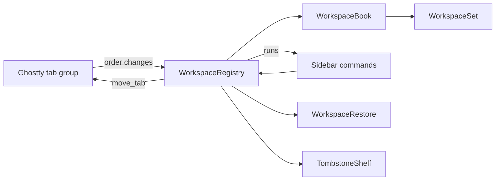

# Module: workspaces

## Purpose

Workspaces group the tabs of one window into named sections of the sidebar (a group the user adds, with a project folder if it is a workspace). A tab may belong to none: ungrouped tabs are rows with no header. The module stores which workspace each tab belongs to, keeps that consistent when Ghostty reorders, closes, restores or merges tabs, and brings a tab back to its workspace on undo.

Behavior, scenarios and decisions D1-D18: `docs/specs/windows-workspaces.md`.

## Place in the system

Reading: Ghostty alone writes tab order; this module writes only membership, names and fold state. `WorkspaceBook` holds the rules without AppKit, `WorkspaceRegistry` maps them onto windows. Source: `Workspace/`.

## Inputs and outputs

| Direction | What | Where |
|---|---|---|
| In | `terminalTabsDidChange`, window became key, window will close | `WorkspaceRegistry.init` observers |
| In | sidebar commands: new tab in a workspace, new group by name or workspace by folder, set or remove folder, rename, delete, fold, move tab, move workspace | `WorkspaceRegistry` methods |
| In | restorable state of a window (key `tarn.workspaces`) | `WorkspaceRestore.decode` |
| In | undo of a closed tab or window | `TombstoneShelf`, Ghostty's undo manager |
| Out | `runs(for:)`: workspaces of a window top to bottom with their tab windows | `SidebarModel.refresh` |
| Out | native moves through Ghostty's `move_tab` action, only for a sidebar move | `moveNatively` |
| Out | window subtitle with the workspace name (empty with the top tab bar) | `WorkspaceTitle.apply` |
| Out | snapshot saved with each window | `WorkspaceRestore.encode` |
| Out | `terminalTabsDidChange` (object: the registry, which its own observer ignores) and a restorable-state refresh for changed sets | `publish`. A publish made while observers run (a redraw must not call `sync`: the sidebar only reads, and asks for a `sync` once, when it gets its window; the cap is a safety net) asks for one more round instead of nesting; at most 3 rounds, then an error is logged |

## How it works

State: `WorkspaceSet` per Ghostty window (id, workspaces, membership `TabKey` to workspace id for grouped tabs only, revision). A set lives while it has a live tab, grouped or not (`WorkspaceBook.remove`). A `TabKey` is a UUID made by us for each tab window and saved in the snapshot. Ghostty alone writes tab order; membership never follows it (`docs/specs/workspace-folder.md` M3). Workspaces are drawn in the order of their first tab and ungrouped tabs stand between them (`WorkspaceSet.runs(order:)`: a block with no workspace is a run of ungrouped tabs, two blocks parted only by a later tab of a drawn workspace are one), so row N is native tab N and Cmd+N lands on row N while each workspace is one run; a native reorder or `window-new-tab-position = end` can split a workspace, and nothing heals it. Workspace order is derived and never stored.

Following Ghostty (`sync`, run on every tab notification):
1. Gone windows leave their set; a workspace with no tab left closes, and a set with no tab left goes.
2. Each tab group follows the set that holds most of its live tabs; ties go to the group with more settled tabs, then to the smallest tab key, so group order does not matter.
3. A tab no rule has placed is new and ungrouped (G1). A tab opened from another tab joins that tab's workspace instead, through `opened` (below); the group is explicit, never guessed from the selection.
4. Sets that changed are published.

Folder (`docs/specs/workspace-folder.md`): a workspace has an optional `folder`, absolute with symlinks resolved. New workspace (Shift+Cmd+T or the sidebar button) opens a folder panel as a sheet; the workspace is named after the folder and its first tab starts there through `TerminalController.newTab(_:from:withBaseConfig:)`. A folder that a workspace of the window already holds selects that workspace's first tab and creates nothing; Cancel creates nothing. The folder is fixed at creation: no menu item changes or removes it. The header tooltip shows the folder (`~` for home) and the tab count. Start directory: Cmd+T and Cmd+D are Ghostty's own, they inherit the focused pane's directory in every workspace (D20 dropped, T-249). The "+" of a header (`newTab(in:from:)`) opens the tab through `TerminalController.newTab(_:from:withBaseConfig:)` with the parent and the inherited tab config taken from the last tab of that workspace; an empty workspace gets Cmd+T. A new workspace opens its tab from the last tab of the window, so it stands at the bottom and splits no workspace (G8); its config is inherited from the selected tab. The sidebar New Tab button is Cmd+T.

New tab (`docs/specs/workspace-folder.md` M1): `AppDelegate.ghosttyNewTab` passes the controller that `TerminalController.newTab` returns to `WorkspaceRegistry.opened(_:from:)` with the window the tab was opened from; the tab takes that tab's workspace and unfolds it, when both windows share a native tab group; from an ungrouped tab it is ungrouped, in the same set (otherwise it stays unplaced and `sync` makes it ungrouped). Cmd+T, the New Tab menu item, the native "+" and the sidebar button all take this path; the header "+" and a new workspace call `opened` themselves.

Sidebar commands: a new workspace is created with its first tab, in one step, after the tab exists; a refused tab creates nothing. Rename refuses a blank name. Delete (`ungroup`) removes the group and leaves its tabs ungrouped where they stand; any group may go, the only one too. The sheet may also close the tabs (the sidebar closes them as one undoable step and the group goes with its last tab). Move tab changes membership (a workspace left empty goes), then makes one `move_tab`; move workspace makes one `move_tab` per tab. `move_tab` acts on the selected tab, so the registry selects the tab, moves, restores the selection and marks these key hops (`KeyHops`) so they do not unfold a folded workspace.

No tab moves by itself: an agent tab stays in the workspace it was opened in, and the sidebar draws no folder mark (D21, D22, D26, D27 dropped, T-249, user decision 2026-10-27).

Selecting a tab in a folded workspace unfolds it (once). A tab opened from a tab of a folded workspace unfolds it.

Windows: a tab dragged to another window is ungrouped there; a tab dropped outside every window starts a new set, ungrouped. Merge All Windows, and the last tab of a window dropped into another window: the set of the first window wins and the other's workspaces are appended whole with their names, its ungrouped tabs stay ungrouped (M4).

Restore: each window saves `{version, setID, revision, tabKey, workspaces[{id, name, collapsed, folder?, tabKeys}]}` as JSON under `tarn.workspaces` (a `manual` key of older snapshots is ignored) beside Ghostty's state. An ungrouped tab is in no `tabKeys`. On decode, a "~" with no folder or with the home folder (the start workspace of older builds) is dropped and its tabs load ungrouped (G13); "No project" and "Default" stay plain groups. Windows with the same `setID` join one set; the higher revision wins. Viewers are not restored after a relaunch.

Undo (tombstone): the tombstone joins Ghostty's undo group instead of a second action in `ExpiringUndoManager`: a second action would register after Ghostty's, sit on top of the stack and need a second Cmd+Z. On `willClose` the registry notes the tab's set, workspace (none for an ungrouped tab) and place, the surface ids and the viewer snapshot. It registers an action in the window's undo manager with Ghostty's `undoExpiration`, in the same group as Ghostty's close undo. Undo runs ours first and only arms the tombstone; Ghostty's action then creates the window; `claimTombstones` matches the new window by surface ids, recreates the set or workspace if gone and restores the viewers. Unclaimed tombstones are dropped and logged. Surface ids come from a cache refreshed on every sync, because closing a whole window empties the surface trees first.

## Files

| Path | Role |
|---|---|
| `macos/Sources/Features/Tarn/Workspace/WorkspaceSet.swift` | `Workspace`, `WorkspaceSet`: create, set folder, rename, fold, ungroup, join, remove, absorb, reconcile, runs |
| `macos/Sources/Features/Tarn/Workspace/WorkspaceBook.swift` | rules without AppKit: set choice, merge, `opened`, closing and reinsert |
| `macos/Sources/Features/Tarn/Workspace/WorkspaceRegistry.swift` | singleton, windows to keys, observers, native moves, sidebar commands, tombstone registration |
| `macos/Sources/Features/Tarn/Workspace/WorkspaceSnapshot.swift` | Codable snapshot, version 1 |
| `macos/Sources/Features/Tarn/Workspace/WorkspaceRestore.swift` | encode and decode under `tarn.workspaces` |
| `macos/Sources/Features/Tarn/Workspace/WorkspaceTombstone.swift` | `WorkspaceTombstone`, `TombstoneToken`, `TombstoneShelf` |
| `macos/Sources/Features/Tarn/Workspace/WorkspaceTitle.swift` | window subtitle |
| `macos/Sources/Features/Tarn/Workspace/KeyHops.swift` | marks key changes caused by our own moves |
| `macos/Sources/Features/Tarn/Workspace/WorkspaceFolder.swift` | pure path rules: standardize, contains, name, display |
| `macos/Sources/Features/Tarn/WorkspaceHeader.swift` | header view and tooltip, drop line, New Group sheet and folder panel, name and delete prompts |
| `macos/Sources/Features/Tarn/TabDragSource.swift` | drag payloads and drop-slot math, see [sidebar.md](sidebar.md) |

## Ghostty mechanisms used

| Mechanism | Where | Use |
|---|---|---|
| Tab = `NSWindow` in an `NSWindowTabGroup`; `newTab` | `macos/Sources/Features/Terminal/TerminalController.swift` (`onMoveTab` `:1585`, `onGotoTab` `:1651`) | order is Ghostty's |
| `move_tab` through `performAction` | `Features/Terminal/BaseTerminalController.swift:1046` | all reordering |
| `ExpiringUndoManager`, `undoExpiration` | `Helpers/ExpiringUndoManager.swift:14`, `BaseTerminalController.swift:113` | tombstone lifetime and undo group |
| `UndoState` reusing `SurfaceView`s | `TerminalController.swift:1039` | match by surface ids |
| Restorable state | `TerminalController.swift:1334` (`willEncodeRestorableState`), `TerminalRestorable.swift:120` (`restoreWindow`) | second coder key |
| `window-save-state` | `TerminalRestorable.swift:142` | restore gate |
| `AgentState` order | `SessionRegistry.swift:6` | worst state per workspace header |

## Insertion points in upstream files

Rows 15 and 16 of [architecture.md](../architecture.md): `WorkspaceRestore.encode` in `TerminalController.willEncodeRestorableState`; `WorkspaceRestore.decode` in `TerminalRestorable.restoreWindow` (`let workspaceCoder = state` before the `guard let state` that shadows it).

## Invariants and failure rules

| Rule | Enforced by |
|---|---|
| Ghostty is the single writer of tab order; we never call `removeWindow` or `addTabbedWindowSafely` to order tabs | review; reordering only through `move_tab` |
| A tab is in one workspace or in none; a tab the table does not name is ungrouped, never lost | `WorkspaceSet.runs(order:)`, `WorkspaceBook.reconcile`, tests `FailureTests` |
| A group deleted leaves its tabs ungrouped, the only one too; a workspace closes with its last tab | `WorkspaceSetTests` |
| Any uncovered case logs one line `workspace: <reason> window=<key> set=<id>` (category `workspace`), leaves the tab ungrouped and never crashes or drops a tab | `WorkspaceBook.note`; a broken snapshot, and the `reconcile` fallback, give one block of ungrouped tabs |
| A second `reconcile` over the same groups changes nothing | `ReconcileTests`, `TargetTests` |
| No timer of ours for undo | tombstone closure expires with Ghostty's undo |
| Own key hops do not change fold state | `KeyHops`, `KeyHopsTests` |

Rejected: a store with its own order and a `reconcile` that rewrites the native order (two writers of order); one tab group per workspace (breaks per-window workspaces and Cmd+N). No undo for workspace operations (rename, delete, move): only closed tabs and windows come back.

## Tests

All in `macos/Tests/Tarn/`; `BookSupport.swift` holds helpers.

| Suite | Pins |
|---|---|
| `WorkspaceFolderTests` | folder path rules (symlink, trailing slash, `F-old`), set and remove folder, folder choice by workspace, snapshot with and without the field |
| `WorkspaceSetTests` | ungroup, the only group deleted, last tab closes workspace, blank names, fold, runs follow tab order, snapshot round trip, rejects and the dropped `manual` key |
| `ReconcileTests` | a native reorder changes no membership, a new window and an unannounced tab are ungrouped, idempotence |
| `UngroupedTests` | an older "~" loads as ungrouped tabs (S50), "No project" and "Default" stay groups, a lone old window keeps its group on merge |
| `TargetTests` | a tab opened from another takes its workspace, from an ungrouped tab it is ungrouped (S42, S53), a last tab leaving drops its workspace (S44), unfold on select, drag out and across windows |
| `MergeTests` | Merge All Windows, reopened tab and window, higher revision wins, restore in any group order |
| `FailureTests` | broken or foreign-version snapshot, missing workspace, vanished window |
| `TombstoneTests` | match by surface ids only after undo, most shared surfaces wins, unclaimed dropped, runs inside Ghostty's undo group, expiry, window and tab undo |
| `WorkspaceTitleTests` | subtitle for a grouped tab, whatever the tab style; the name in the native tab mark; settings text |
| `MoveTabTests` | the native place of Remove from group, Move to and a drop below all rows (S43, S61, S62) |

## Extending it

| Change | Goes to |
|---|---|
| New rule on membership | `WorkspaceSet` (table) or `WorkspaceBook` (rules); add a test beside the case |
| New sidebar command | `WorkspaceRegistry` method, then `SidebarModel` |
| What an undo brings back | `WorkspaceTombstone`, `WorkspaceRegistry.shelve`, `ViewerHost.snapshot` and `restore` |
| Saved format | `WorkspaceSnapshot` (bump `version`; unknown versions are refused and the windows load ungrouped; an older "~" with no folder or the home folder loads as ungrouped tabs) |
