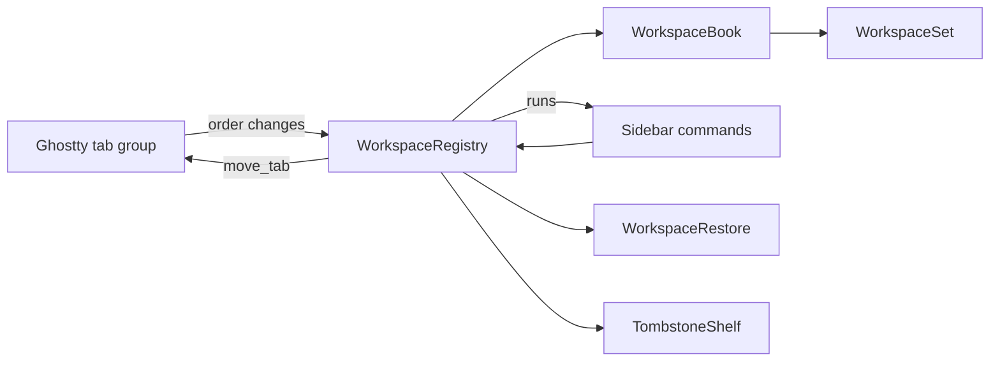

# Module: workspaces

## Purpose

Workspaces group the tabs of one window into named sections of the sidebar ("No project", and one per project folder the user adds). The module stores which workspace each tab belongs to, keeps that consistent when Ghostty reorders, closes, restores or merges tabs, and brings a tab back to its workspace on undo.

Behavior, scenarios and decisions D1-D18: `docs/specs/windows-workspaces.md`.

## Place in the system

Reading: Ghostty alone writes tab order; this module writes only membership, names and fold state. `WorkspaceBook` holds the rules without AppKit, `WorkspaceRegistry` maps them onto windows. Source: `Workspace/`.

## Inputs and outputs

| Direction | What | Where |
|---|---|---|
| In | `terminalTabsDidChange`, window became key, window will close | `WorkspaceRegistry.init` observers |
| In | sidebar commands: new tab in a workspace, new workspace by folder, set or remove folder, rename, delete, fold, move tab, move workspace | `WorkspaceRegistry` methods |
| In | restorable state of a window (key `tarn.workspaces`) | `WorkspaceRestore.decode` |
| In | undo of a closed tab or window | `TombstoneShelf`, Ghostty's undo manager |
| Out | `runs(for:)`: workspaces of a window top to bottom with their tab windows | `SidebarModel.refresh` |
| Out | native moves through Ghostty's `move_tab` action | `moveNatively` |
| Out | window subtitle with the workspace name (empty with the top tab bar) | `WorkspaceTitle.apply` |
| Out | snapshot saved with each window | `WorkspaceRestore.encode` |
| Out | `terminalTabsDidChange` (object: the registry, which its own observer ignores) and a restorable-state refresh for changed sets | `publish`. A publish made while observers run (a redraw must not call `sync`: the sidebar only reads, and asks for a `sync` once, when it gets its window; the cap is a safety net) asks for one more round instead of nesting; at most 3 rounds, then an error is logged |

## How it works

State: `WorkspaceSet` per Ghostty window (id, workspaces, membership `TabKey` to workspace id, revision). A `TabKey` is a UUID made by us for each tab window and saved in the snapshot. A workspace is a contiguous run of the native tab order, so sidebar row N is native tab N and Cmd+N lands on row N. Workspace order is derived from tab order and never stored.

Following Ghostty (`sync`, run on every tab notification):
1. Gone windows leave their set; a workspace with no tab left closes.
2. Each tab group follows the set that holds most of its live tabs; ties go to the group with more settled tabs, then to the smallest tab key, so group order does not matter.
3. A tab with no workspace is new. It joins the target: the workspace the sidebar named (`pendingTarget`, used once, expires after 1 s), else the workspace of the selected tab (`lastSelected`), else the first workspace.
4. Ghostty moves one tab at a time. The mover is the one tab whose removal leaves the others in order; it joins the workspace of its upper neighbour, or of its lower one if first, and when that changes its workspace it is marked manual (D22: placed by hand, never moved by folder). The mover is sought only when the order really changed. If the order is still broken, each tab outside the first run of its workspace joins the workspace above it.
5. A new tab that is not at the end of its run gets one native move there.
6. Sets that changed are published.

Folder (`docs/specs/workspace-folder.md`): a workspace has an optional `folder`, absolute with symlinks resolved. New workspace (Shift+Cmd+T or the sidebar button) opens a folder panel as a sheet; the workspace is named after the folder and its first tab starts there through `TerminalController.newTab(_:from:withBaseConfig:)`. A folder that a workspace of the window already holds selects that workspace's first tab and creates nothing; Cancel creates nothing. The folder is fixed at creation: no menu item changes or removes it. The header tooltip shows the folder (`~` for home) and the tab count. Start directory (D20): a new tab or split in a workspace with a folder starts in the inherited working directory when it lies inside the folder, else in the folder; with inheritance off it starts in the folder. `WorkspaceRegistry.prepare` rewrites the inherited config at two insertion points (architecture.md rows 31 and 32). A tab uses the workspace the new tab will land in (`targetWorkspace`: the pending target of the sidebar's +, else the last selected), so folder and membership agree; a split uses the workspace of its source tab. A workspace without a folder, a folder gone from disk (one log line), the quick terminal and a tab that opens a window (`tabbingMode = .disallowed`) keep the inherited config.

Sidebar commands: new tab and new workspace set the pending target and call Ghostty's `newTab`; a new workspace is empty until its tab joins. Rename refuses a blank name. Delete moves tabs to the workspace above (below for the first); the last workspace is never deleted. Move tab changes membership (a changed workspace marks the tab manual), then makes one `move_tab`; move workspace makes one `move_tab` per tab. `move_tab` acts on the selected tab, so the registry selects the tab, moves, restores the selection and marks these key hops (`KeyHops`) so they do not unfold a folded workspace or change the target.

Workspaces off (T-205, Settings > Modules): `WorkspaceBook.frozen`. The workspaces stay exactly as they are. A tab with no workspace joins the workspace whose folder is the home folder (a regular workspace of the folder model: folder = home directory, name "~", created at the end when missing; a workspace the set already has for that folder takes the tabs, whatever its name; also the first workspace of a new window instead of "No project"); step 4 (repair) and step 5 (native moves) do not run, so a new tab lands where Ghostty puts it and a drag changes only the order. New Workspace (button, menu item, Shift+Cmd+T) is hidden or does nothing; the sidebar is one flat list in native order, and no workspace name shows in the window subtitle or the native tabs. A tab that closes leaves its frozen workspace as usual. On again (`regroupPending`): the next pass skips the repair and makes one native move per misplaced tab so that every workspace is one run, workspaces in the order of first appearance, tabs in native order; membership does not change, "~" stays with the tabs opened while off.

Agent arrival (D21, D26, D27): `sync` looks for an agent in every tab that has no live deciding process (`WorkspaceBook.checkArrival`). Agent pids come from `AgentProcessCache`; the first one found decides, is kept while the process lives (`kill(pid, 0)`, so Ctrl+Z and `fg` start nothing), and its pane's working directory is read once and queued. A pass on the main queue, after the notification and on `windowDidBecomeKey` (not on the registry's own hops), takes each queued tab whose window group is key: `arrival` gives the destination now (deepest folder, then the tab's own workspace, then the upper one; nil for a manual tab, a tab at home or a path no folder holds), then `moveTab(byUser: false)` makes one native move, `arrived` sets the next-tab target and unfolds a collapsed destination, both only for a selected tab; while frozen the deciding pid is still kept but nothing is queued. No focus change, no move across windows, nothing while frozen. The deciding pid rides in the closed-tab record, so undo of a close is not an arrival. A tab with no usable path logs one line and stays. The sidebar draws an orange "!" (wide row: before the folder line; narrow row: before the badge; tooltip "Outside the <workspace> folder") while an agent lives in the tab and its pane's directory is outside the folder of the tab's workspace (`WorkspaceBook.isOutsideFolder`).

Selecting a tab in a folded workspace unfolds it (once). A new tab unfolds its workspace.

Windows: a tab dragged to another window joins that window's target; a tab dropped outside every window starts a new set with "No project". Merge All Windows: the set of the first window wins and the other's workspaces are appended whole with their names; a window that holds only its unrenamed "No project" (or the older "Default") with no folder joins the target instead.

Restore: each window saves `{version, setID, revision, tabKey, workspaces[{id, name, collapsed, folder?, tabKeys}], manual?[tabKey]}` as JSON under `tarn.workspaces` beside Ghostty's state. Windows with the same `setID` join one set; the higher revision wins. Viewers are not restored after a relaunch.

Undo (tombstone): the tombstone joins Ghostty's undo group instead of a second action in `ExpiringUndoManager`: a second action would register after Ghostty's, sit on top of the stack and need a second Cmd+Z. On `willClose` the registry notes the tab's set, workspace and place, the surface ids and the viewer snapshot. It registers an action in the window's undo manager with Ghostty's `undoExpiration`, in the same group as Ghostty's close undo. Undo runs ours first and only arms the tombstone; Ghostty's action then creates the window; `claimTombstones` matches the new window by surface ids, recreates the set or workspace if gone (no empty "No project"), puts the manual mark on the new key and restores the viewers. Unclaimed tombstones are dropped and logged. Surface ids come from a cache refreshed on every sync, because closing a whole window empties the surface trees first.

## Files

| Path | Role |
|---|---|
| `macos/Sources/Features/Tarn/Workspace/WorkspaceSet.swift` | `Workspace`, `WorkspaceSet`: create, set folder, rename, fold, delete, join, remove, absorb, reconcile, runs |
| `macos/Sources/Features/Tarn/Workspace/WorkspaceBook.swift` | rules without AppKit: set choice, merge, target, closing and reinsert |
| `macos/Sources/Features/Tarn/Workspace/WorkspaceRegistry.swift` | singleton, windows to keys, observers, native moves, sidebar commands, tombstone registration |
| `macos/Sources/Features/Tarn/Workspace/WorkspaceSnapshot.swift` | Codable snapshot, version 1 |
| `macos/Sources/Features/Tarn/Workspace/WorkspaceRestore.swift` | encode and decode under `tarn.workspaces` |
| `macos/Sources/Features/Tarn/Workspace/WorkspaceTombstone.swift` | `WorkspaceTombstone`, `TombstoneToken`, `TombstoneShelf` |
| `macos/Sources/Features/Tarn/Workspace/WorkspaceTitle.swift` | window subtitle |
| `macos/Sources/Features/Tarn/Workspace/KeyHops.swift` | marks key changes caused by our own moves |
| `macos/Sources/Features/Tarn/Workspace/WorkspaceFolder.swift` | pure path rules: standardize, contains, start directory, name, display |
| `macos/Sources/Features/Tarn/WorkspaceHeader.swift` | header view and tooltip, drop line, folder panel, name and delete prompts |
| `macos/Sources/Features/Tarn/TabDragSource.swift` | drag payloads and drop-slot math, see [sidebar.md](sidebar.md) |

## Ghostty mechanisms used

| Mechanism | Where | Use |
|---|---|---|
| Tab = `NSWindow` in an `NSWindowTabGroup`; `newTab` | `macos/Sources/Features/Terminal/TerminalController.swift` (`onMoveTab` `:1585`, `onGotoTab` `:1651`) | order is Ghostty's |
| `move_tab` through `performAction` | `Features/Terminal/BaseTerminalController.swift:1046` | all reordering |
| `ExpiringUndoManager`, `undoExpiration` | `Helpers/ExpiringUndoManager.swift:14`, `BaseTerminalController.swift:113` | tombstone lifetime and undo group |
| `UndoState` reusing `SurfaceView`s | `TerminalController.swift:1039` | match by surface ids |
| Restorable state | `TerminalController.swift:1334` (`willEncodeRestorableState`), `TerminalRestorable.swift:120` (`restoreWindow`) | second coder key |
| `window-save-state` | `TerminalRestorable.swift:142` | restore gate |
| `AgentState` order | `SessionRegistry.swift:6` | worst state per workspace header |

## Insertion points in upstream files

Rows 15 and 16 of [architecture.md](../architecture.md): `WorkspaceRestore.encode` in `TerminalController.willEncodeRestorableState`; `WorkspaceRestore.decode` in `TerminalRestorable.restoreWindow` (`let workspaceCoder = state` before the `guard let state` that shadows it).

## Invariants and failure rules

| Rule | Enforced by |
|---|---|
| Ghostty is the single writer of tab order; we never call `removeWindow` or `addTabbedWindowSafely` to order tabs | review; reordering only through `move_tab` |
| Every tab is in exactly one workspace; a tab never ends outside one | `ensureWorkspace`, tests `FailureTests` |
| The last workspace is not deleted; a workspace closes with its last tab | `WorkspaceFolderTests` | folder path rules (symlink, trailing slash, `F-old`), set and remove folder, folder choice by workspace, snapshot with and without the field, plain set with both names |
| `WorkspaceSetTests` |
| Any uncovered case logs one line `workspace: <reason> window=<key> set=<id>` (category `workspace`), puts the tab in the target and never crashes or drops a tab | `WorkspaceBook.note`; a broken snapshot gives one "No project" holding all the window's tabs |
| A second `reconcile` over the same groups changes nothing | `ReconcileTests`, `TargetTests` |
| No timer of ours for undo | tombstone closure expires with Ghostty's undo |
| Own key hops do not change fold state or target | `KeyHops`, `TargetExpiryTests` |

Rejected: a store with its own order and a `reconcile` that rewrites the native order (two writers of order); one tab group per workspace (breaks per-window workspaces and Cmd+N). No undo for workspace operations (rename, delete, move): only closed tabs and windows come back.

## Tests

All in `macos/Tests/Tarn/`; `BookSupport.swift` holds helpers.

| Suite | Pins |
|---|---|
| `WorkspaceFolderTests` | folder path rules (symlink, trailing slash, `F-old`), set and remove folder, folder choice by workspace, snapshot with and without the field, plain set with both names |
| `AgentArrivalTests` | arrival rules (join, home, outside, nested, same folder twice, manual), deciding pid (restart, cd, second agent, job control, undo), queue and destination at move time, unfold, next-tab target, one cache read per pid |
| `StartDirectoryTests` | start directory rule (inside, outside, no folder, folder gone, no inheritance, symlink), folder of a new tab (pending target, selected tab, after a move) and of a split |
| `WorkspaceSetTests` | delete up or down, last workspace kept, last tab closes workspace, blank names, fold, runs follow tab order, snapshot round trip and rejects |
| `ReconcileTests` | foreign moves, native drag, two changes at once, new tab to the end of its run, idempotence |
| `TargetTests` | "No project" on launch, target by selection, pending target used once, new workspace, unfold on select, drag out and across windows, target expiry |
| `MergeTests` | Merge All Windows, reopened tab and window, higher revision wins, restore in any group order |
| `FailureTests` | broken or foreign-version snapshot, missing workspace, vanished window |
| `TombstoneTests` | match by surface ids only after undo, most shared surfaces wins, unclaimed dropped, runs inside Ghostty's undo group, expiry, window and tab undo |
| `WorkspaceTitleTests` | subtitle while Workspaces is on, whatever the tab style; none while off; the name in the native tab mark; settings text |
| `WorkspaceFreezeTests` | frozen: new tab joins the workspace with the home folder (an existing one is reused), a drag changes no membership, closing keeps the rest; on again: regroup in order of first appearance, "~" stays |

## Extending it

| Change | Goes to |
|---|---|
| New rule on membership | `WorkspaceSet` (table) or `WorkspaceBook` (rules); add a test beside the case |
| New sidebar command | `WorkspaceRegistry` method, then `SidebarModel` |
| What an undo brings back | `WorkspaceTombstone`, `WorkspaceRegistry.shelve`, `ViewerHost.snapshot` and `restore` |
| Saved format | `WorkspaceSnapshot` (bump `version`; unknown versions fall to "No project") |
