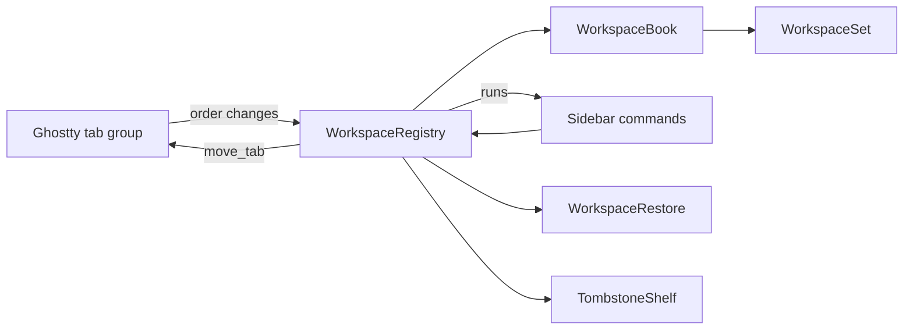

# Module: workspaces

## Purpose

Workspaces group the tabs of one window into named sections of the sidebar (Default, and any the user creates). The module stores which workspace each tab belongs to, keeps that consistent when Ghostty reorders, closes, restores or merges tabs, and brings a tab back to its workspace on undo.

State of this document: branch `s3-windows` (PR #5). Behavior: `docs/plans/windows-workspaces.md`; rules: `docs/plans/s3-windows-contracts.md`.

## Place in the system

Reading: Ghostty alone writes tab order; this module writes only membership, names and fold state. `WorkspaceBook` holds the rules without AppKit, `WorkspaceRegistry` maps them onto windows. Source: `Workspace/`.

## Inputs and outputs

| Direction | What | Where |
|---|---|---|
| In | `terminalTabsDidChange`, window became key, window will close | `WorkspaceRegistry.init` observers |
| In | sidebar commands: new tab in a workspace, new workspace, rename, delete, fold, move tab, move workspace | `WorkspaceRegistry` methods |
| In | restorable state of a window (key `tarn.workspaces`) | `WorkspaceRestore.decode` |
| In | undo of a closed tab or window | `TombstoneShelf`, Ghostty's undo manager |
| Out | `runs(for:)`: workspaces of a window top to bottom with their tab windows | `SidebarModel.refresh` |
| Out | native moves through Ghostty's `move_tab` action | `moveNatively` |
| Out | window subtitle with the workspace name (empty with the top tab bar) | `WorkspaceTitle.apply` |
| Out | snapshot saved with each window | `WorkspaceRestore.encode` |
| Out | `terminalTabsDidChange` and a restorable-state refresh for changed sets | `publish` |

## How it works

State: `WorkspaceSet` per Ghostty window (id, workspaces, membership `TabKey` to workspace id, revision). A `TabKey` is a UUID made by us for each tab window and saved in the snapshot. A workspace is a contiguous run of the native tab order, so sidebar row N is native tab N and Cmd+N lands on row N. Workspace order is derived from tab order and never stored.

Following Ghostty (`sync`, run on every tab notification):
1. Gone windows leave their set; a workspace with no tab left closes.
2. Each tab group follows the set that holds most of its live tabs; ties go to the group with more settled tabs, then to the smallest tab key, so group order does not matter.
3. A tab with no workspace is new. It joins the target: the workspace the sidebar named (`pendingTarget`, used once, expires after 1 s), else the workspace of the selected tab (`lastSelected`), else the first workspace.
4. Ghostty moves one tab at a time. The mover is the one tab whose removal leaves the others in order; it joins the workspace of its upper neighbour, or of its lower one if first. If the order is still broken, each tab outside the first run of its workspace joins the workspace above it.
5. A new tab that is not at the end of its run gets one native move there.
6. Sets that changed are published.

Sidebar commands: new tab and new workspace set the pending target and call Ghostty's `newTab`; a new workspace is empty until its tab joins. Rename refuses a blank name. Delete moves tabs to the workspace above (below for the first); the last workspace is never deleted. Move tab changes membership, then makes one `move_tab`; move workspace makes one `move_tab` per tab. `move_tab` acts on the selected tab, so the registry selects the tab, moves, restores the selection and marks these key hops (`KeyHops`) so they do not unfold a folded workspace or change the target.

Selecting a tab in a folded workspace unfolds it (once). A new tab unfolds its workspace.

Windows: a tab dragged to another window joins that window's target; a tab dropped outside every window starts a new set with Default. Merge All Windows: the set of the first window wins and the other's workspaces are appended whole with their names; a window that holds only its unrenamed Default joins the target instead.

Restore: each window saves `{version, setID, revision, tabKey, workspaces[{id, name, collapsed, tabKeys}]}` as JSON under `tarn.workspaces` beside Ghostty's state. Windows with the same `setID` join one set; the higher revision wins. Viewers are not restored after a relaunch.

Undo (tombstone): on `willClose` the registry notes the tab's set, workspace and place, the surface ids and the viewer snapshot. It registers an action in the window's undo manager with Ghostty's `undoExpiration`, in the same group as Ghostty's close undo. Undo runs ours first and only arms the tombstone; Ghostty's action then creates the window; `claimTombstones` matches the new window by surface ids, recreates the set or workspace if gone (no empty Default) and restores the viewers. Unclaimed tombstones are dropped and logged. Surface ids come from a cache refreshed on every sync, because closing a whole window empties the surface trees first.

## Files

| Path | Role |
|---|---|
| `macos/Sources/Features/Tarn/Workspace/WorkspaceSet.swift` | `Workspace`, `WorkspaceSet`: create, rename, fold, delete, join, remove, absorb, reconcile, runs |
| `macos/Sources/Features/Tarn/Workspace/WorkspaceBook.swift` | rules without AppKit: set choice, merge, target, closing and reinsert |
| `macos/Sources/Features/Tarn/Workspace/WorkspaceRegistry.swift` | singleton, windows to keys, observers, native moves, sidebar commands, tombstone registration |
| `macos/Sources/Features/Tarn/Workspace/WorkspaceSnapshot.swift` | Codable snapshot, version 1 |
| `macos/Sources/Features/Tarn/Workspace/WorkspaceRestore.swift` | encode and decode under `tarn.workspaces` |
| `macos/Sources/Features/Tarn/Workspace/WorkspaceTombstone.swift` | `WorkspaceTombstone`, `TombstoneToken`, `TombstoneShelf` |
| `macos/Sources/Features/Tarn/Workspace/WorkspaceTitle.swift` | window subtitle |
| `macos/Sources/Features/Tarn/Workspace/KeyHops.swift` | marks key changes caused by our own moves |
| `macos/Sources/Features/Tarn/WorkspaceHeader.swift` | header view, drop line, name and delete prompts |
| `macos/Sources/Features/Tarn/TabDragSource.swift` | drag payloads and drop-slot math, see [sidebar.md](sidebar.md) |

## Ghostty mechanisms used

| Mechanism | Where | Use |
|---|---|---|
| Tab = `NSWindow` in an `NSWindowTabGroup`; `newTab` | `macos/Sources/Features/Terminal/TerminalController.swift` (`onMoveTab` `:1585`, `onGotoTab` `:1651`) | order is Ghostty's |
| `move_tab` through `performAction` | `Features/Terminal/BaseTerminalController.swift:1046` | all reordering |
| `ExpiringUndoManager`, `undoExpiration` | `Helpers/ExpiringUndoManager.swift:14`, `BaseTerminalController.swift:113` | tombstone lifetime and undo group |
| `UndoState` reusing `SurfaceView`s | `TerminalController.swift:1039` | match by surface ids |
| Restorable state | `TerminalController.swift:1334` (`willEncodeRestorableState`), `TerminalRestorable.swift:120` (`restoreWindow`) | second coder key |
| `window-save-state` | `TerminalRestorable.swift:142` | restore gate |
| `AgentState` order | `SessionRegistry.swift:6` | worst state per workspace header |

## Insertion points in upstream files

Rows 15 and 16 of [architecture.md](../architecture.md): `WorkspaceRestore.encode` in `TerminalController.willEncodeRestorableState`; `WorkspaceRestore.decode` in `TerminalRestorable.restoreWindow` (`let workspaceCoder = state` before the `guard let state` that shadows it).

## Invariants and failure rules

| Rule | Enforced by |
|---|---|
| Ghostty is the single writer of tab order; we never call `removeWindow` or `addTabbedWindowSafely` to order tabs | review; reordering only through `move_tab` |
| Every tab is in exactly one workspace; a tab never ends outside one | `ensureWorkspace`, tests `FailureTests` |
| The last workspace is not deleted; a workspace closes with its last tab | `WorkspaceSetTests` |
| Any uncovered case logs one line `workspace: <reason> window=<key> set=<id>` (category `workspace`), puts the tab in the target and never crashes or drops a tab | `WorkspaceBook.note`; a broken snapshot gives one Default holding all the window's tabs |
| A second `reconcile` over the same groups changes nothing | `ReconcileTests`, `TargetTests` |
| No timer of ours for undo | tombstone closure expires with Ghostty's undo |
| Own key hops do not change fold state or target | `KeyHops`, `TargetExpiryTests` |

## Tests

All in `macos/Tests/Tarn/`; `BookSupport.swift` holds helpers.

| Suite | Pins |
|---|---|
| `WorkspaceSetTests` | delete up or down, last workspace kept, last tab closes workspace, blank names, fold, runs follow tab order, snapshot round trip and rejects |
| `ReconcileTests` | foreign moves, native drag, two changes at once, new tab to the end of its run, idempotence |
| `TargetTests` | Default on launch, target by selection, pending target used once, new workspace, unfold on select, drag out and across windows, target expiry |
| `MergeTests` | Merge All Windows, reopened tab and window, higher revision wins, restore in any group order |
| `FailureTests` | broken or foreign-version snapshot, missing workspace, vanished window |
| `TombstoneTests` | match by surface ids only after undo, most shared surfaces wins, unclaimed dropped, runs inside Ghostty's undo group, expiry, window and tab undo |
| `WorkspaceTitleTests` | subtitle with the sidebar, none with the top bar, settings text |

## Extending it

| Change | Goes to |
|---|---|
| New rule on membership | `WorkspaceSet` (table) or `WorkspaceBook` (rules); add a test beside the case |
| New sidebar command | `WorkspaceRegistry` method, then `SidebarModel` |
| What an undo brings back | `WorkspaceTombstone`, `WorkspaceRegistry.shelve`, `ViewerHost.snapshot` and `restore` |
| Saved format | `WorkspaceSnapshot` (bump `version`; unknown versions fall to Default) |
