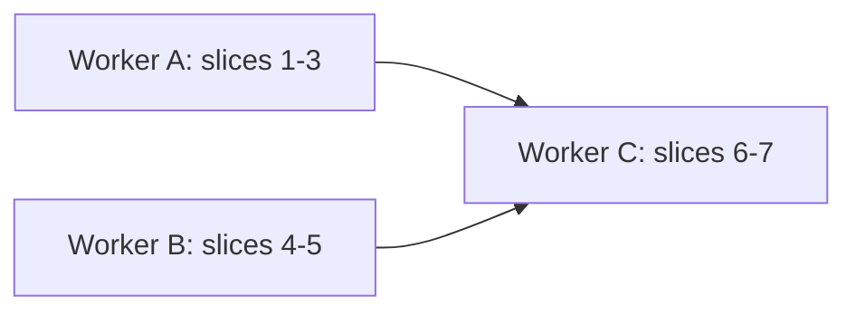

# S3: windows and workspaces, implementation plan

Behavior: `docs/plans/windows-workspaces.md` (D1-D18, S1-S23). Look: `docs/mockups/tarn.html`. Paths below are under `macos/Sources/` unless noted. Nothing was run.

## 1. Architecture

Key fact: a Ghostty tab is its own `NSWindow` plus `TerminalController`; a "window" of the model is an `NSWindowTabGroup` (`Features/Terminal/TerminalController.swift:424-500` `newTab`, `:1342` `closeTab`). Tab order is `tabGroup.windows`; `goto_tab:N` indexes it (`:1631-1682`), `move_tab` re-adds windows (`:1565-1625`). So the plan keeps one invariant: **native tab order = sidebar order flattened workspace by workspace.** Then S11 (cmd+1..9, collapsed counted) and D14 (flat top bar) hold with no change to Ghostty.

| Type (new file) | Role | State lives |
| --- | --- | --- |
| `WorkspaceList<Key: Hashable>` (`Tarn/Workspace/WorkspaceList.swift`) | pure value type: ordered `[Workspace{id, name, collapsed, tabs:[Key]}]`; create, rename, delete (D13), move workspace, move tab, remove tab (returns "workspace closed", D12), flatten | value, no AppKit; unit-tested |
| `WorkspaceSnapshot` (`Tarn/Workspace/WorkspaceSnapshot.swift`) | Codable form: workspaces plus this tab's `tabID: UUID` | encoded with the window |
| `WorkspaceStore` (`Tarn/Workspace/WorkspaceStore.swift`) | `@MainActor`, one per tab group; holds `WorkspaceList<ObjectIdentifier>` keyed by tab `NSWindow`; `reconcile()` adopts new windows (D2, S21), drops closed ones, then reorders the native group to the flattened order | memory |
| `WorkspaceRegistry` (same file set) | `store(for: NSWindow)`: finds the store owning a window of the group, else creates one with `Default` (D1, D10); owns tombstones (slice 6) | memory |
| `SidebarModel` (existing, `Tarn/Sidebar.swift:16`) | keeps per-window tabs and agent state; `refresh()` (`:180`) asks the store for grouping instead of `arrange` | per tab window, as now |
| `AreaTree` (`Tarn/Viewer/AreaTree.swift`) | the tab layout: a `SplitTree<AreaLeaf>` where `AreaLeaf` is an `NSView & Codable & Identifiable` standing for the terminal block or one viewer | per tab, in `ViewerHost` |

Why `SplitTree<AreaLeaf>`: it is generic over any `NSView & Codable & Identifiable` (`Features/Splits/SplitTree.swift:5`). The mockup treats the terminal block as one node of the same tree (`tarn.html:1152-1300`, `findBlock`, `splitNode`). Rendering copies `TerminalSplitSubtreeView` (`TerminalSplitTreeView.swift:50-93`) with `SplitView` (already used by `ViewerLayout`, `Tarn/ViewerHost.swift:88`). Rejected: own tree type; viewers inside the terminal tree (leaves must be `SurfaceView`).

Rejected: membership only on each controller (loses order, fold), a sidecar file (no stable key), one macOS tab group per workspace (breaks D10 and cmd+1..9).

### Persistence and restore (S19)

Ghostty saves one `TerminalRestorableState` per tab window through AppKit (`TerminalController.swift:1325` `willEncodeRestorableState`, `Features/Terminal/TerminalRestorable.swift:60-117`, `restoreWindow` `:120-200`); `window-save-state` gate at `:140`. The Codable state is versioned (`version 7`), so we do not touch it. We add a second key in the same `NSCoder`: JSON of `WorkspaceSnapshot` (all workspaces with ordered `tabID`s, plus this tab's `tabID`). Every tab carries the full table, so any restored tab can seed the store; `reconcile()` rebuilds membership and re-sorts the group (this also covers AppKit not restoring tab order: not verified). Fold state and order are in the table (replaces `@AppStorage` `TarnSidebarFoldedRoots`, `Sidebar.swift:493,613`). Any workspace change calls `invalidateRestorableState()` on the group's windows. Scrollback is not restored (Ghostty). Viewers: see Q6.

### Undo (D7, D12, S15-S18)

Ghostty already undoes closed tabs, windows and splits from `UndoState` (`TerminalController.swift:1028-1095`, `:730-760`, `:880-990`; `BaseTerminalController.swift:515-580`; `undoExpiration` `:112`). No second undo. The store records a tombstone `{surface UUIDs, workspace, index, viewer layout}` per closed tab, expiring after `undoExpiration`. The restored controller reuses the same `SurfaceView`s, so `reconcile()` matches it by UUIDs and returns it to its workspace, recreating a deleted one (D12). A viewer-only close keeps `ViewerHost.closePane` undo (`ViewerHost.swift:58-75`), per viewer.

## 2. Ghostty provides / we add

| Need | Ghostty provides (file:line) | We add |
| --- | --- | --- |
| window, tab, order, close chain | `TerminalController` above; `closeSurface` last-surface to tab to window (`:702-728`) | workspace partition of `tabGroup.windows` |
| tab move | `onMoveTab` `:1565`; `removeWindow`+`addTabbedWindowSafely` | same calls from sidebar drop, then relabel (`:600`, insertion rows 3-4) |
| terminal splits, zoom, equalize | `SplitTree`, `SplitView`, `TerminalSplitTreeView` | nothing for terminals |
| terminal drag | `SurfaceGrabHandle` (`Ghostty/Surface View/SurfaceGrabHandle.swift:5`), `SurfaceDragSource` (`:24`), pasteboard `.ghosttySurfaceId` (`SurfaceView+Transferable.swift:41`), `splitDidDrop` (`BaseTerminalController.swift:965`), `TerminalSplitDropZone` (4 triangles, `TerminalSplitTreeView.swift:194`) | reuse for drops inside the block; area zones of section 3a are new (Ghostty has no corner/strip zones); viewer grip + `.tarnViewer` payload |
| undo of close | `ExpiringUndoManager`, `undoState` | tombstones for membership and viewers |
| restore | `window-save-state`, `TerminalWindowRestoration` | second coder key |
| agent state | `SessionRegistry`, `AgentSession` (`Tarn/SessionRegistry.swift:26,177`) | worst state per workspace (`AgentState` is `Comparable`, `:6`) |

## 3. Insertion points in upstream files (new; append to `docs/architecture.md` section 9)

| # | File | Change | Why |
| --- | --- | --- | --- |
| 12 | `Features/Terminal/TerminalController.swift`, `window(_:willEncodeRestorableState:)` `:1325` | one call `WorkspaceRestore.encode(window, into: state)` | S19 |
| 13 | `Features/Terminal/TerminalRestorable.swift`, `restoreWindow` after `:158` | one call `WorkspaceRestore.decode(state, for: c)` | S19 |
| 14 | `Ghostty-Info.plist` | exported UTTypes `com.daniil4545.tarn.tab`, `.workspace`, `.viewer` (the way `ghosttySurfaceId` is declared) | sidebar and viewer drags; plain text would paste into terminals |
| 15 | `Ghostty/Surface View/SurfaceGrabHandle.swift:74-80` | dot opacity 0.3/0.8 to 0.6/1.0 (D16) | D16 |

Rows 12 and 13 get own commits on upstream merges.

## 4. Slices (3 workers; files owned, no overlap)

| Slice | Owner | Owned files | Content | Unit tests (`macos/Tests/Tarn/`) |
| --- | --- | --- | --- | --- |
| 1 model | A | `Tarn/Workspace/WorkspaceList.swift`, `WorkspaceSnapshot.swift` | pure list ops, D1-D4, D12, D13, flatten order, snapshot codec | `WorkspaceListTests`: delete moves tabs up or down; no delete on last; last tab closes workspace; last workspace reports window close; new tab goes to current workspace end; move tab keeps order; snapshot round-trip; unknown key drops |
| 2 store | A | `Tarn/Workspace/WorkspaceStore.swift`, `WorkspaceRegistry.swift`, `WorkspaceRestore.swift` | reconcile with the tab group, order enforcement, adoption into current workspace (S21), restore seed, rows 12-13 | `WorkspaceStoreTests` with a fake window provider: adopt, foreign tab joins current, restore seeds table, group reorder plan |
| 3 sidebar | A | `Tarn/Sidebar.swift`, new `Tarn/WorkspaceHeader.swift`, `TabDragSource.swift`, `TabCardPopover.swift` (only if card needs the workspace) | replace `GroupKey`/`Section`/`arrange`/`projectRoot` (`Sidebar.swift:35-60,228-260,320-336`) and pins-free rows by workspace headers (+, rename, delete, fold, count and worst state, dot); tab drag between rows and headers (S7, S9, S8 menu `Move to`, `Sidebar.swift:350`); cross-window drop and drop outside windows via `moveTabToNewWindow` (S21); New workspace asks a name (S4); row 14 | `SidebarGroupingTests` (grouping from list, worst state, folded count); drop-slot index math |
| 4 layout | B | `Tarn/ViewerHost.swift`, `ViewerModel.swift`, `ViewerWebView.swift`, new `Tarn/Viewer/AreaTree.swift`, `AreaView.swift` | `ViewerHost` owns many `ViewerModel`s and one `AreaTree`; `ViewerLayout` renders it around `TerminalView`; per-viewer close and undo; `open` picks a viewer (S13) | `AreaTreeTests`: terminal block always exactly one leaf; insert/remove viewer; closing last viewer leaves the block; snapshot round-trip |
| 5 drops | B | new `Tarn/Viewer/AreaDrop.swift`, `ViewerGrip.swift` | pure zone function for 3a (corner 48x48, strip 24 px, tab bar or middle 30%, nearest half, self refused); frame overlay; viewer grip (same dots, D16) with `.tarnViewer` payload; S14a, S14b (lone terminal moves the block; split terminals refused with hint); row 15 | `AreaDropTests`: one case per row of 3a plus corner on unsplit axis falls back to nearest half, red over self, terminals with viewers open |
| 6 undo | C | new `Tarn/Workspace/WorkspaceTombstone.swift` | tombstones keyed by surface UUIDs, expiry by `undoExpiration`; restores workspace (D12) and viewer layout (S16-S18) | `TombstoneTests`: match by UUIDs, expiry, recreate workspace at old index |
| 7 settings, glue | C | `Tarn/TarnSettings.swift` (text "Tabs grouped in workspaces", D14), `docs/architecture.md` section 9 rows, `docs/spec.md` R3/R19/R21/R24 edits only if the main window asks | acceptance run through `docs/mockups/check.py`-style script for the app (manual list below) | none new |

A and B share no file. C starts after both merge.

## 5. Acceptance map

| Scenario | Slice | Check |
| --- | --- | --- |
| S1-S5, S20 | 2, 3 | new tab lands at end of current workspace (Q1); + on header; New workspace; rename (title: Q5) |
| S6-S9 | 1, 3 | list tests, manual drag |
| S11 | 2 | native order = sidebar order; Nth row = `goto_tab:N` |
| S12 | 2 | `workspace(of:)` API; CLI absent (Q3) |
| S14a, S14b | 5 | `AreaDropTests` plus manual drag |
| S15 | 4, 6 | pane close, cmd+Z within `undo-timeout` |
| S16, S17, S18 | 6 | tombstone tests; manual: close last tab of a workspace, cmd+Z; last workspace closes window |
| S19 | 2 | quit and relaunch with 2 workspaces, one folded, reordered tabs |
| S21 | 3 | drag a row to another window and outside |
| S23 | 3 | header dot orange for `permission`; notification: Q2 |

## 6. Risks

| Risk | Effect | Mitigation |
| --- | --- | --- |
| Reorder loops with `terminalTabsDidChange` | jitter | reorder only when order differs |
| AppKit may not restore tab order | wrong order (S19) | table carries order (not verified) |
| Tombstone match needs `UndoState` to reuse `SurfaceView`s (`:1029`) | membership lost | seen in source; fallback current workspace |

## 7. Analogs

Ghostty (MIT): tab group, `SplitTree`, undo, restore, reused as above. Rectangle (MIT): zone idea for 3a. Warp (closed): behavior only. cmux (GPL, structure only): its "workspace" is a sidebar row owning a split layout, with per-window session snapshots; confirms snapshot-per-window, but its workspace is our tab. iTerm2 and Tellurion not read: gap, no commit pinned for any analog.

## 8. Questions (model does not decide)

1. New tab position. D2 says after the workspace's last tab; Ghostty `window-new-tab-position` may say after the current tab. Options: (a) always end of workspace; (b) obey Ghostty setting. Recommend (a).
2. S23 asks for one notification naming workspace and tab; notifications are not on this branch (`architecture.md` section 10). Options: (a) header dot now, notification in the notification stage; (b) build it here. Recommend (a).
3. S12 `tarn new` is not on this branch. Recommend the store API now, CLI later.
4. S5 "window title": options (a) `NSWindow.subtitle` shows the workspace name; (b) title becomes `Workspace - tab` (needs a new insertion point in the title code). Recommend (a).
5. Are rename, delete and move of workspaces undoable? Model covers close only. Recommend no.
6. Are viewers (open files, layout) restored on relaunch? S19 lists only terminals and workspaces. Recommend no; cmd+Z still restores them.
