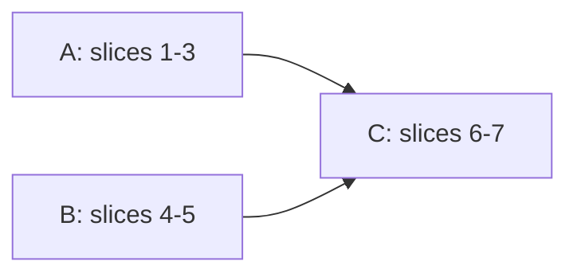

# S3: windows and workspaces, implementation plan

Behavior: `docs/plans/windows-workspaces.md` (D1-D18, S1-S23). Look: `docs/mockups/tarn.html`. Rules, keys, failure handling: `docs/plans/s3-windows-contracts.md` (called "contracts", sections C1-C10). Our code is in `macos/Sources/Features/Tarn/`; tests in `macos/Tests/Tarn/`. Nothing here was run.

## 1. Architecture

A Ghostty tab is its own `NSWindow` and `TerminalController`; a model "window" is an `NSWindowTabGroup` (`Features/Terminal/TerminalController.swift:424,1342`). Ghostty alone writes tab order (`newTab`, `move_tab` `:1565`, native drag, undo `:1050`). We write only which workspace a tab belongs to. A workspace is a contiguous run of the native order, so sidebar row N is native tab N and cmd+N (`:1631`) matches (C1, C3).

| Type (new file) | Role |
| --- | --- |
| `WorkspaceSet` + `Workspace` (`Workspace/WorkspaceSet.swift`) | pure value: workspaces, membership by `TabKey`, revision; create, rename, delete (D13), remove tab (reports "workspace closed", D12), fold |
| `WorkspaceRegistry` (`Workspace/WorkspaceRegistry.swift`) | singleton, `@MainActor`; sets by id, weak window to `TabKey` map, `reconcile` (C3), new-tab target (C4), merge rules (C6) |
| `WorkspaceRestore` (`Workspace/WorkspaceRestore.swift`) | coder key `tarn.workspaces` (C9) |
| `WorkspaceTombstone` (`Workspace/WorkspaceTombstone.swift`) | C7 |
| `SidebarModel` (`Sidebar.swift:16`) | per tab window as now; `refresh()` (`:180`) takes runs from the registry |
| `AreaTree` (`Viewer/AreaTree.swift`) | tab layout: `SplitTree<AreaLeaf>`; `AreaLeaf` is `NSView & Codable & Identifiable`; the terminal block leaf is a placeholder, the block stays SwiftUI `TerminalView` (`ViewerHost.swift:88-101`) |

`SplitTree` is generic over any such view (`Features/Splits/SplitTree.swift:5`); the mockup treats the block as one node (`tarn.html:1152-1300`). Rejected: own tree type; viewers inside the terminal tree (leaves must be `SurfaceView`); a store with its own order and `reconcile` that rewrites the native order (two writers, M1); one tab group per workspace (breaks D10, cmd+N).

Persistence: Ghostty saves one `TerminalRestorableState` per tab (`TerminalController.swift:1325`, `TerminalRestorable.swift:60-200`, gate `:140`). We add a second coder key, no version change (C9). Undo: Ghostty's `UndoState` (`:1028-1095`, `:880-990`) plus our tombstone written on `willClose` (C7). Viewers are not restored after relaunch (Q6 answer).

Risk to check first (before slice 2): that AppKit restores tabs into one group; log `window.tabGroup?.windows.count` after `restoreWindow` `:189`. The design does not depend on it (set id in every coder), but order after restore does.

## 2. Ghostty provides / we add

| Need | Ghostty provides | We add |
| --- | --- | --- |
| tab, close chain, new tab, cmd+N/T/W/1..9 | `TerminalController.swift:424,702,1342,1631` | membership only |
| tab move | `move_tab` action, `performAction` (`BaseTerminalController.swift:1046`) | call it from the sidebar (C5) |
| terminal splits, drag | `SplitTree`, `SplitView`, `SurfaceDragSource`, `.ghosttySurfaceId`, `splitDidDrop` `:967`, `TerminalSplitDropZone` `:194` | reuse the zone math for "elsewhere in a pane"; corners, strips, middle box of 3a are new |
| undo | `ExpiringUndoManager`, `undoExpiration` `:112` | tombstone (membership, viewers) |
| restore | `window-save-state` | second coder key |
| split keys | `goto_split` posts `ghosttyFocusSplit` only when a terminal target exists (`Ghostty.App.swift:1364-1396`) | cross into viewers (point 14) |
| new tab folder | `window-inherit-working-directory` (D15) | none |
| grab handle | `SurfaceGrabHandle.swift:70` | brighter dots (D16, point 15), viewer grip |
| top tab style | native bar (row 6) | none; membership keeps working (D14) |
| agent state | `AgentState` Comparable (`SessionRegistry.swift:6`) | worst state per workspace |

## 3. Insertion points (append to `docs/architecture.md` section 9)

| # | File | Change |
| --- | --- | --- |
| 12 | `macos/Sources/Features/Terminal/TerminalController.swift:1325` | in `willEncodeRestorableState`: `WorkspaceRestore.encode(window, into: state)` |
| 13 | `macos/Sources/Features/Terminal/TerminalRestorable.swift` after `:158` | `WorkspaceRestore.decode(state, for: c)` |
| 14 | `macos/Sources/Ghostty/Ghostty.App.swift:1364` `gotoSplit` | when no terminal target: `ViewerRouter.focusNeighbor(from:direction:)`; true if it moved focus (D8) |
| 15 | `macos/Sources/Ghostty/Surface View/SurfaceGrabHandle.swift:70` | dot opacity 0.3/0.8 to 0.6/1.0 (D16) |

Rows 12 to 15 get own commits on upstream merges. No `Ghostty-Info.plist` change (C10).

## 4. Slices (3 workers, no shared file)

| Slice | Owner | Files owned | Content | Tests |
| --- | --- | --- | --- | --- |
| 1 model | A | `Workspace/WorkspaceSet.swift`, `WorkspaceSnapshot.swift` | D1-D4, D12, D13, snapshot codec | `WorkspaceSetTests`: delete moves tabs up or down; no delete of last; last tab closes workspace; snapshot round-trip |
| 2 registry | A | `Workspace/WorkspaceRegistry.swift`, `WorkspaceRestore.swift`, rows 12-13 | C2-C4, C6, C8, C9 | `ReconcileTests` (C3 cases, cmd+N equals row N), `TargetTests` (pending target, lastSelected, S21), `MergeTests`, `FailureTests` (broken snapshot gives Default with all tabs, log) |
| 3 sidebar | A | `Sidebar.swift`, `WorkspaceHeader.swift`, `TabDragSource.swift`, `AgentViews.swift`, `AgentProcessTests.swift` | replace `GroupKey`, `Group.Section`, `arrange`, `projectRoot` (`Sidebar.swift:35-60,228-260,320-336`); headers (+, rename, delete with count, fold, count and worst state, dot); tab and workspace drag (S7-S9), `Move to`, S21; delete the `GroupKey` and `arrange` tests (`AgentProcessTests.swift:139-160`); card line `tab.project` (`AgentViews.swift:115`) per Q7 | `SidebarGroupingTests`, drop-slot math |
| 4 layout | B | `ViewerHost.swift`, `ViewerModel.swift`, `ViewerWebView.swift`, `Viewer/AreaTree.swift`, `AreaView.swift`, `ViewerRouter` focus (point 14) | many viewers per tab around `TerminalView`; per-viewer close and undo; S13; cmd+D in a viewer opens the file in a new viewer (S14); split keys cross (D8) | `AreaTreeTests`: one block leaf; insert, remove; snapshot round-trip; neighbour lookup |
| 5 drops | B | `Viewer/AreaDrop.swift`, `ViewerGrip.swift`, `SurfaceGrabHandle.swift` (row 15) | 3a zones, frame, viewer grip, S14a, S14b (lone terminal moves the block; split terminals refused); overlay rules C10 | `AreaDropTests`: one case per 3a row, fallback to half when the axis is unsplit, red over self |
| 6 undo | C | `Workspace/WorkspaceTombstone.swift`, plus edits in `WorkspaceRegistry.swift`, `ViewerHost.swift` after A and B merge | C6, C7: S15-S18 | `TombstoneTests`: match by UUIDs, expiry, recreate workspace, no empty Default on window undo |
| 7 glue | C | `TarnSettings.swift`, `Workspace/WorkspaceTitle.swift`, `docs/architecture.md` section 9 | D14 text "Tabs grouped in workspaces"; window subtitle (Q4); insertion rows; `docs/spec.md` R3/R19/R21/R24 only if asked | none |

Each worker builds and tests under the lock of the brief and runs `swiftlint --strict`.

## 5. Acceptance: all scenarios

T = unit test (slice), U = user at acceptance. U steps: U1 launch; U2 create, rename, delete a workspace; U3 drag tabs and headers; U4 viewer drags; U5 close and cmd+Z; U6 quit and relaunch; U7 second window; U8 tab style switch. Each step ends pass or fail.

| S | Check |
| --- | --- |
| S1 | T `TargetTests` Default; U1 |
| S2 | T pending target, lastSelected; U2 |
| S3 | T pending target; U2 (+ on a header) |
| S4 | T new workspace holds one tab; U2 |
| S5 | T rename; U2 sees sidebar and subtitle (Q4) |
| S6 | T delete moves tabs; U2 confirmation shows the count |
| S7, S8, S9 | T drop-slot math, `ReconcileTests`; U3 |
| S11 | T cmd+N equals row N; U3 with a folded workspace |
| S12 | out of this stage (T-141); registry API `workspace(of:)` tested |
| S13 | U4: click a path, viewer in same tab, tree hidden, cmd+B |
| S14 | T `AreaTreeTests`; U4 cmd+D in terminal and in a viewer |
| S14a, S14b | T `AreaDropTests`; U4 |
| S15, S16 | T `TombstoneTests`; U5 |
| S17, S18 | T `TombstoneTests`; U5 |
| S19 | T `WorkspaceSetTests`, `FailureTests`; U6 (viewers not restored, Q6) |
| S20 | T `MergeTests`; U7 |
| S21 | T `TargetTests`; U7 drag a row to another window and outside |
| S22 | U8: flat bar, back to sidebar, workspaces unchanged |
| S23 | T worst state per header; U2 (dot only, Q2) |
| D8 | U4: split keys move across terminal and viewer |

## 6. Risks

| Risk | Mitigation |
| --- | --- |
| `move_tab` needs the tab focused (`TerminalController.swift:1567`): selection hops | restore selection after; if flicker, use the two calls of `onMoveTab` (`:1619`) |
| macOS 26 tab move glitch (`:1593`) | same branch as upstream |
| Moving the terminal block changes SwiftUI identity and may recreate `TerminalView` or lose focus | slice 5 checks focus (U4); fall back to refusing that drop |
| Overlay strips cover Ghostty's `onDrop` | hit-test only inside corner and strip rects (C10) |
| Tombstone needs `UndoState` to reuse `SurfaceView`s (`:1029`) | seen in source; failure rule C8 |
| Subtitle may not show in some titlebar styles | check at U2; else fall back to `name - tab` title (new insertion) |

## 7. Prior art

| Project | File and commit | What we follow |
| --- | --- | --- |
| Ghostty (MIT) | files above, tag base of this branch | reused as listed |
| cmux (GPL, structure only) | `Sources/SessionPersistence.swift` @006f9e7c82961b7b710ba7857d6c11abd93b322f: versioned `SessionSnapshotSchema`, Codable snapshots per window | versioned snapshot with safe decode failure (C9, C8); code not copied. Its workspace is our tab, so the model differs |
| Rectangle (MIT) | not read | zone idea only (user decision) |

Prior art: searched the agent-terminal research notes (landscape.md names forks with left sidebars, no workspace-group model) and cmux; iTerm2, Warp (closed, behavior only) and Tellurion not read. No project found that groups native tabs into named workspaces per window; the user decides.

## 8. Questions

Answered: Q1 end of the current workspace; Q2 header dot only; Q3 `tarn new` is T-141; Q4 `NSWindow.subtitle` if it works with Ghostty titles; Q5 no undo for workspace operations; Q6 viewers not restored.

Decided by the orchestrator (2026-10-25):

- Q7: the hover card shows the workspace name (`AgentViews.swift:115`).
- Q8: Close Other Tabs and Close Tabs Below act within the tab's workspace.
- Q9: cmd+1..9 on a tab inside a collapsed workspace unfolds it and selects the tab.
- Q10: the window title stays Ghostty's; the workspace name goes to `NSWindow.subtitle` (slice 7). The mockup follows later.
- Q11: Ghostty first: the tombstone is registered in Ghostty's `UndoManager`, grouped with Ghostty's own close undo, not a separate timer. A separate timer only if proven impossible, with the proof in this plan (slice 6 does this; the registry only stays ready for it).
