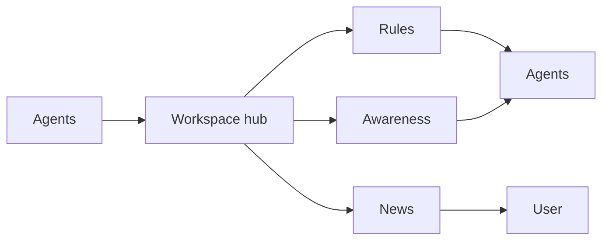

# Roadmap: tarn 2.0 and the ideas after it

Status: product decisions of 2026-10-27, not yet sliced into specs. Each idea becomes a spec in
`docs/specs/` before code. Sources: research of alternatives
(`~/Dev/knowledge/inbox/tarn-alternatives-features-2026-10-27-1005.md`), Claude Code docs
(hooks, settings), tix T-201.

## 1. Philosophy: a calm terminal for agents

Agent terminals grow into cockpits: tiles, live output, browsers, agent teams. tarn goes the other
way: the necessary minimum, each part switchable, so the developer's attention is not scattered.
Agents are autonomous; tarn moves from controlling them to guarding the developer's focus.

1. **The agent calls you.** Questions and reports come to you; nothing asks you to watch agents
   work. No tiles, no live output walls, no agent teams.
2. **The result is read.** Reports, specs and markdown with diagrams sit next to the terminal.
3. **Ghostty at the core.** The core is not modified; a module that is off costs nothing (no UI,
   no background work); speed is proven by a benchmark.
4. **Local only.** No account, cloud, telemetry or built-in model.
5. **Claude Code's own settings stay untouched.** Everything that acts on agents ships in the tarn
   Claude Code plugin; tarn keeps its own rules in its own store (section 5).

Every feature is a module the user can switch off. A module that needs another is greyed out with
"needs X" when that one is off.

Positioning against the field (research 2026-10-27): cmux is a multitasking cockpit, herdr is
infrastructure (server, SSH, plugins), Tellurion is "everything for agents" with toggles, Warp is an
AI platform with an account, Claude Code agent view is a list that cannot answer from the list.
Free spot: calm, reading-first, agent-calls-you.

## 2. Base modules of the current version

| Module | Decision |
|---|---|
| Sidebar | done; no new functions, maybe smoothness |
| Workspaces | not touched now; becomes the hub of section 3 |
| Agent status (Claude Code) | done; codex and opencode later |
| Permission card | make it switchable |
| Notifications, Cmd+U | done |
| File viewer | most important: bring convenience, design and stability to the ideal |
| Layout | functions fine; new look (demo first) |
| CLI | the agent is a full user: controls modules, creates workspaces and windows, opens the viewer |
| Git | new required module: branch and changes in the row; survey how terminals show git |
| Localhost preview | in the viewer (T-104) |
| SSH | survey and design only in 2.0 (R13) |

Work plan of 25 issues by stage: foundation, CLI, git, viewer, layout, sidebar, localhost, inbox,
SSH (draft, waits for publishing).

## 3. Workspace as the hub of a project

A workspace stops being a group of tabs. It collects what its agents do, filters it, compresses it
and gives it to the user. Three layers:

### 3.1 Inbox (issue #33)

One inbox per workspace, opened by a click on the workspace header. Questions with a quick answer,
reports when an agent finishes, working sessions with state. Two views: vertical feed and
horizontal columns. Actions: quick answer, go to session.

### 3.2 News instead of walls of text

Each session produces a lot of text; agents are hard to keep short. The workspace gives a news
digest: who did what, at which stage. tarn has no model of its own, so the sources are:

| Source | Gives |
|---|---|
| Claude Code task events (`TaskCreated`, `TaskCompleted`) | stage, "3 of 5" |
| Plugin skill rule: at the end of a turn the agent writes 1-2 lines with `tarn status` | the news line |
| `last_assistant_message` of `Stop` | fallback text |
| Option: compression by the user's own `claude -p` | real summary; spends quota; open question against principle 4 |

"While you were away": when the user comes back, the workspace shows the news since the last
visit. Part of the hub, not a separate feature.

### 3.3 Rules: trust per workspace and sleep mode

Each workspace has a trust level: **Consult** (the agent asks), **Autonomous** (the agent decides,
forbidden list still holds), **Sleep** (a temporary level for all workspaces: nobody may wait for
the user). Pain it solves: before sleep the user tells every agent "I cannot answer", and a
forgotten session hangs all night.

Mechanism, all through plugin hooks (checked in the Claude Code hooks docs 2026-10-27):

| Situation | Hook | tarn does |
|---|---|---|
| prompt submitted | `UserPromptSubmit` `additionalContext` | adds the level's rule text |
| agent asks a question | `PreToolUse` on `AskUserQuestion`, `deny` with reason | "the user is asleep, decide by the spec" |
| permission request | `PermissionRequest` | allow by the level, deny forbidden actions with a reason |
| agent stops to wait | `Stop`, `decision: block` with reason | sends it back to work; loop guard to verify |

Forbidden in Sleep by default (editable): push to main, deletes outside the repository, paid calls.

### 3.4 Awareness: agents see each other

- Session start: `SessionStart` `additionalContext` gives a short brief of the workspace: who works
  on what, which files.
- Collision radar: `PostToolUse` sees every edited path; when two sessions edit one file, the agent
  gets `additionalContext` "file X is edited by session billing", the user gets one quiet notice.
- Messages between agents arrive as hook context on the next call, so no text is typed into
  another terminal. Claude Code has its own cross-session messaging (`crossSessionInbound` setting):
  survey it before building ours.

### 3.5 Decision log

Agents decide technical questions themselves; each decision is recorded ("decided X because Y") in
the workspace and can be reversed. Rules for it are open; tix already keeps a similar log. This
leads to a wider process concept: modular code, every commit revertible, decisions audited after,
not approved before. tarn is its window: the log in the workspace, revert through the git module.

## 4. Other ideas

| Idea | Note |
|---|---|
| Menu bar mode | tarn state in the macOS menu bar: all fine or someone waits; the window may be closed |
| Quota weather | one gauge: when the subscription limit runs out at the current pace; to check whether Claude Code exposes the limit |
| Focus batching | questions of other workspaces wait and come in a batch; urgent ones pass at once |

## 5. Relation to Claude Code settings

- tarn never writes `~/.claude/settings.json`, `.claude/settings.json` or `.claude/settings.local.json`.
- Everything that acts on agents (state, card, rules, awareness, news) lives in the tarn plugin.
  The user turns the plugin on or off per project with Claude Code's own `enabledPlugins`.
- tarn's levels and lists are stored by tarn, per workspace, and applied by the plugin hooks.
- Claude Code's own permission rules and modes stay in force; tarn adds a layer, it does not
  replace them. Which side wins when both decide: to verify in the permissions docs.

## 6. Not in 2.0

Agent browser (Claude Code has Chrome integration, `claude --chrome`), tiles and live output,
agent teams, subagent panel (R17), codex and opencode state, tix connector (R18).

## 7. Open questions

1. Sleep: loop guard for a blocked `Stop`; which forbidden list by default.
2. News: rely on the skill rule or add `claude -p` compression.
3. Messaging: Claude Code `crossSessionInbound` versus hook context.
4. Decision log: rules, storage, link to tix.
5. Quota: is the limit visible to hooks or the status line.
