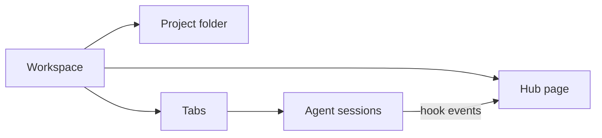

# Vision and roadmap: tarn 2.0

Status: approved direction of 2026-10-27. Each feature is a GitHub issue in milestone
[2.0](https://github.com/daniil4545/tarn/milestone/1); details come with the issue's survey and spec.
After the first 2.0 release the principles move into `docs/spec.md` section 1.

## 1. Vision

A calm terminal for agents, built on Ghostty.

Agents are autonomous now. The bottleneck is the developer's attention: with tens of sessions the
developer keeps switching tabs to look, even when nobody needs them. Agent terminals answer with
cockpits: tiles, live output, browsers, agent teams. tarn goes the other way: the necessary
minimum, each part switchable, and a workspace hub that gathers what the agents do and gives the
developer only what needs them.

2.0 is a prototype: new features are experiments with a clear frame (what it is and is not), kept
or cut by use.

## 2. Principles

1. **The agent calls you.** Questions and reports come to you; nothing asks you to watch agents
   work.
2. **The result is read.** Reports, specs and markdown with diagrams sit next to the terminal.
3. **Ghostty at the core.** The core is not modified; a module that is off costs nothing (no UI,
   no background work); the benchmark proves it.
4. **Local only.** No account, cloud, telemetry or built-in model.
5. **One plugin, no settings.** Everything that acts on agents ships in the tarn Claude Code
   plugin; tarn writes no Claude Code settings file and never passes the user's deny or ask
   rules. Only Sleep mode answers requests the user would otherwise see, and only while it is on.

Every feature is a module the user can switch off; a module that needs another one is greyed out
with "needs X".

## 3. Model

A workspace is a project: a folder, its tabs and the hub page. A tab stays in the workspace
it was opened in, also after `cd`. The sidebar navigates, the hub shows state.

## 4. Plan

| Wave | Issues |
|---|---|
| 1. Foundation | #34 modules, #35 tabs join by folder, #40 CLI survey |
| 2. Base features | #36 git branch, #39 ssh host, #38 localhost, #40 CLI |
| 3. Hub | #33 workspace hub, #41 neighbours, #42 collision radar, #44 permission card module |
| 4. Experiments | #43 Sleep mode, #37 commit graph |
| Any time | #45 viewer polish, #46 layout look, #47 sidebar smoothness |

Estimate: 40-49 PRs.

## 5. Not in 2.0

| Item | Why |
|---|---|
| Tiles, live output walls, agent teams, subagent panel | against principle 1 |
| Agent browser | Claude Code has `claude --chrome` |
| Own messaging between agents | Claude Code has `SendMessage` |
| Git commit, push, diff and PR actions | out of the minimal git |
| Remote agent state over ssh | needs a network channel; host only in 2.0 |
| Per-workspace trust levels, decision log, menu bar | cut to keep the prototype small |
| Codex and opencode state | 2.0 is Claude Code first |
