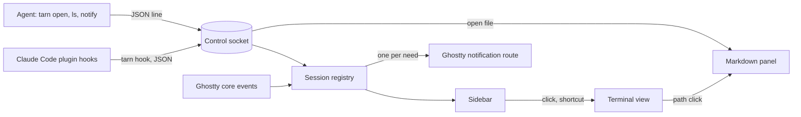

# Spec: tarn, an agent-first terminal

Status: agreed for the first version (S0-S3); the second wave is scoped, not designed.
Canon: this spec; upstream build guides `HACKING.md` and `macos/AGENTS.md`; agent profile `.claude/CLAUDE.md`.

tarn is a fork of [Ghostty](https://github.com/ghostty-org/ghostty) for macOS. It keeps the Ghostty core and app as they are and adds a narrow set of features for working with CLI coding agents. Claude Code is the primary agent; the `tk` task tracker is its companion.

## Contents

1. Goal and scope
2. Architecture
3. Scenarios
4. Data and states
5. Code model
6. Stages
7. Acceptance
8. State model
9. External facts and code sources
10. Requirement traceability
11. Text samples
12. Decisions and open questions
13. Slicing
14. Access and readiness

## 1. Goal and scope

- Goal: one terminal for all work with agents. It must stay as fast and light as Ghostty.
- Result of the first version: the user reads specs and reports as rendered markdown next to the session, sees all Claude Code sessions with their state in a sidebar, and gets one notification when a session needs them.

Principles:

1. **Simplicity.** A part stays only if something breaks without it. Everything outside this section is cut, not hidden behind a setting.
2. **Speed.** Startup, input latency, idle CPU and memory stay at the level of upstream Ghostty built from the same commit. Numbers come from a benchmark, not from impressions.
3. **Reliability.** The Ghostty core is not modified. Our code lives in its own files; upstream files change only at insertion points listed in `docs/architecture.md`.
4. **Lightweight and local.** No account, cloud, telemetry, subscription, built-in AI model or network requests from our code.
5. **Agent-first.** An agent is a full user of the terminal: it opens files, lists sessions and asks for attention by command. Focus and keystrokes stay with the human.

Requirements. "Session data" is the analysis of 683 Claude Code sessions from 2026-09-01 to 2026-10-21.

| ID | Requirement | Wave | Evidence |
| --- | --- | --- | --- |
| R1 | Tabs and a simple split | first, upstream | - |
| R2 | Full-screen TUIs work completely, with mouse and trackpad: Claude Code, `tk` | first, upstream, verify | Warp breaks TUI navigation |
| R5 | Markdown preview panel next to the terminal, mermaid rendered, no network | first | 84% of file paths in answers are markdown |
| R7 | Command completion and history in zsh | first, setup guide | - |
| R9 | Click on a file path in terminal output opens it in the panel; absolute, `~/` and relative paths | first | ~25 complaints about opening files |
| R3 | Sidebar with all sessions: project, branch, state | first | median 5 parallel sessions, peak 16 |
| R8 | Agent CLI `tarn`: `open`, `ls`, `notify` | first | - |
| R10 | Several agents per project shown as separate sessions | first | - |
| R4 | One notification per need; jump to the next session that needs the user by a shortcut or a click | first | 13.5% of replies come after more than 10 min |
| R12 | Editor-like prompt input | first, Claude Code itself, verify | - |
| R6 | File editing in a GUI panel | second | - |
| R15 | `tarn new` and `tarn send`: hand-over between sessions | second | 50+ manual hand-overs |
| R16 | `tarn run`: a command for the user with output back to the agent | second | ~35 pasted outputs |
| R17 | Subagent panel inside a session | second | 14 requests |
| R18 | Tracker connector: the `tk` task of each session in the sidebar | second | `tk` links tasks to session ids |
| R11 | HTML and PDF in the panel | later | 5 PDF paths, HTML opened in a browser |
| R13 | SSH sessions in the sidebar | later | 3-4 mentions |
| R14 | Phone access to waiting sessions, free, outside the home network | later, guide | - |

Out of scope:

- built-in AI agent, AI suggestions, chat with a model;
- account, cloud, settings sync, telemetry, crash reports sent out;
- team features, paid plans, theme or plugin store;
- a full IDE: debugger, project system, extensions;
- session restore after quitting the app: the user keeps the terminal open;
- agents inside tmux in the first version: the surface key does not survive tmux (section 12);
- an agent moving the user's focus;
- Linux and Windows.

## 2. Architecture

Hooks and agent commands enter through one socket; the registry is the only owner of session state; notifications reuse Ghostty's own route.

| Block | Responsibility | Talks to |
| --- | --- | --- |
| Ghostty core and app (upstream) | rendering, input, tabs, splits, core events, notification route | registry via insertion points |
| Control socket | unix socket of the running app; one JSON line per request and per reply | `tarn` CLI, registry, panel |
| `tarn` CLI | thin client inside the app bundle: `hook`, `open`, `ls`, `notify` | control socket |
| Claude Code plugin | ships the hook configuration that calls `tarn hook` | Claude Code |
| Session registry | one record per terminal surface; agent state machine | sidebar, notifications |
| Sidebar | sessions with state; click or shortcut focuses the surface | registry, terminal view |
| Markdown panel | read-only preview of markdown, mermaid included | terminal view, socket |

- Initiator: Claude Code hooks, agent commands and the user. Source of truth for agent state: hook events; for cwd and title: Ghostty core events.
- State owner: session registry, in memory only. External side effects: system notifications through Ghostty.

### 2.1 Fork rules

1. Our Swift code lives in `macos/Sources/Features/Tarn/`, our tests in `macos/Tests/Tarn/`, our make targets in `tarn.mk`. Upstream files change only at insertion points listed in `docs/architecture.md`.
2. `main` carries our work. `upstream/main` is merged in on a schedule; a merge that touches an insertion point gets its own commit.
3. Our docs live in `docs/`, which upstream does not have. Upstream `README.md`, `AGENTS.md` and `Makefile` stay untouched; our agent profile is `.claude/CLAUDE.md`.
4. Where Ghostty already has a function (AppleScript `focus`, `input text`, `new tab`, notification route), our code calls it instead of a port.

### 2.2 Control socket and error rule

1. Path `~/Library/Application Support/tarn/tarn.sock`, mode 0600. On start the app removes a stale socket file and binds anew. Any local process of the user can talk to it: an accepted cost.
2. Request and reply are one JSON line each, with a `version` field. A version mismatch is an error reply.
3. Error rule for every component: the error goes to the log (`os_log`, subsystem `tarn`) with command, surface and reason; the caller gets `{"ok": false, "error": "<text>"}` and the CLI exits with 1; the app never crashes on bad input and state does not change. Exception: `tarn hook` (2.3).

### 2.3 Hook bridge

1. Purpose: turn Claude Code hook events into registry updates without ever slowing the agent.
2. Input: hook JSON on stdin (`session_id`, `cwd`, `hook_event_name`, `notification_type`). Output: one line to the socket.
3. How it works:
   1. The `tarn` plugin for Claude Code registers `tarn hook` for `UserPromptSubmit`, `PostToolUse`, `Notification`, `PermissionRequest`, `Stop`, `StopFailure`, `SessionEnd`.
   2. `tarn hook` reads `TARN_SURFACE`, which the app sets in the environment of each surface.
   3. It sends the event with the surface id and exits.
4. Rules, for any input: exit code 0; nothing on stdout or stderr; the whole run within 100 ms, connect and write included; no `TARN_SURFACE` or no socket means an immediate exit; errors go only to the log. The plugin never edits `~/.claude/settings.json`.

### 2.4 Session registry

1. Purpose: one place that knows every session and its agent state.
2. Input: core events per surface (pwd, title, child exited, surface closed, focus); hook events. Output: session list for the sidebar and `tarn ls`; transitions for notifications.
3. How it works:
   1. A new surface creates a record in state `idle`.
   2. A hook event is matched to its record by surface id; the event moves the record by the table of section 8.
   3. A transition into `permission` or `waiting` raises one notification when the surface is not focused, by Ghostty's own focus rule.
   4. Focusing a surface sets `seen` on its record.
4. Rules: one writer (main actor); an event for an unknown surface is dropped and logged; a repeated event in the same state changes nothing and raises nothing.

### 2.5 Markdown panel

1. Purpose: read a markdown file next to a session without another app.
2. Input: a path from a click, `tarn open` or a shortcut. Output: the rendered file.
3. How it works: markdown is rendered to HTML with highlight and mermaid from vendored assets and shown in WKWebView. When the file changes on disk, the panel re-renders it; the panel is read-only, so there is nothing to lose.
4. Rules: no network: a `WKContentRuleList` blocks every non-file load; raw HTML inside markdown is escaped; links open in the system browser. Files over 5 MB or not UTF-8 get a one-line notice instead of a render.

## 3. Scenarios

| Scenario | Start and steps | Result |
| --- | --- | --- |
| Happy path | 5 sessions run; Claude Code in session 3 asks for permission | sidebar marks session 3 `permission`; one notification names the project; a click focuses session 3 |
| Approval | the user approves in session 3 | `PostToolUse` moves it to `working`; the mark goes away |
| Finished | Claude Code stops; a minute later `idle_prompt` arrives | `Stop` moves it to `waiting` with one notification; `idle_prompt` changes nothing |
| Interrupted | the user presses Esc, no `Stop` arrives | `idle_prompt` later moves the session to `waiting`; the next prompt moves it to `working` |
| Repeat | the same hook event arrives twice | state unchanged, one notification |
| App not running | a hook fires while tarn is closed or Claude runs in another terminal | `tarn hook` exits 0 at once; Claude Code is not slowed |
| App hangs | the socket accepts but the app does not read | `tarn hook` gives up at 100 ms and exits 0 |
| Hooks not installed | the plugin is missing | the session stays `idle` from core events only, never a wrong agent state |
| Bad request | junk JSON or unknown command on the socket | error reply, log line, state unchanged |
| Notifications denied | macOS has not allowed notifications | the sidebar still marks sessions; one log line |
| Remote image | an opened markdown file links an `https://` image | no request leaves the machine; the image shows as a link |
| File rewritten | an agent rewrites a file open in the panel | the panel re-renders it |
| Agent asks for attention | an agent runs `tarn notify "<text>"` | its own session (by `TARN_SURFACE`) gets the note and one notification; the same text again raises nothing; focus does not move; focusing the session clears the note |
| No duplicates | Claude Code also sends its terminal notification for the same need | the terminal notification of a live agent session is suppressed; the user sees one notification |
| Path click | the user clicks `docs/spec.md:12` in agent output | the path resolves against the surface cwd; a markdown file opens in the panel; any other file opens in its default macOS app; a missing file shows a one-line notice |
| Subagent event | a subagent finishes a tool while the main agent waits for permission | events carrying `agent_id` do not change the session state in the first version |

## 4. Data and states

See section 8.

## 5. Code model

- `Session`: `surfaceID` (Ghostty surface UUID, key), `agentSessionID` (Claude Code `session_id`, empty until the first hook and after `SessionEnd`), `cwd`, `project` (git root folder name), `branch` (empty outside git), `state`, `stateSince` (time of entering the current state), `seen` (the user focused the surface since `stateSince`), `failed` (last stop was `StopFailure`), `note` (text from `tarn notify`, cleared on focus).
- `AgentState`: `idle`, `working`, `permission`, `waiting`.

## 6. Stages

See section 13.

## 7. Acceptance

- Command: `make -f tarn.mk check` runs `swiftlint lint --strict` on our folders, `macos/build.nu --action test` and the hook bridge tests. Until it is green, the stage is not done.
- Benchmark: `make -f tarn.mk bench` compares startup, input latency, idle CPU and memory with upstream Ghostty built from the same commit. It runs before a release and does not block a stage; thresholds are set in S0.

| Section 3 rows | Level | How |
| --- | --- | --- |
| Happy path, Approval, Finished, Interrupted, Repeat | unit | registry fed with recorded hook payloads |
| App not running, App hangs, Hooks not installed | unit | `tarn hook` against no socket, a socket that never reads, junk stdin |
| Bad request | unit | socket handler with junk lines |
| Remote image, File rewritten | unit | panel model with the rule list and a file watcher stub |
| Notifications denied, Agent asks for attention, No duplicates | unit | notification gate with a stub center and a recorded OSC notification |
| Path click | unit | path resolver with a cwd and the `path:line:col` forms |
| Subagent event | unit | registry fed with events that carry `agent_id` |
| Look of sidebar and panel, trackpad in TUIs | user | by eye at each stage |

- Not checked: Linux and Windows builds.

## 8. State model

| Event | from `idle` | from `working` | from `permission` | from `waiting` |
| --- | --- | --- | --- | --- |
| `UserPromptSubmit` | `working` | - | `working` | `working` |
| `PostToolUse` | `working` | - | `working` | `working` |
| `Notification` `permission_prompt`, `PermissionRequest` | `permission` | `permission` | - | `permission` |
| `Stop` | `waiting` | `waiting` | `waiting` | - |
| `StopFailure` | `waiting`, `failed` | `waiting`, `failed` | `waiting`, `failed` | `failed` |
| `Notification` `idle_prompt` | `waiting` | `waiting` | - | - |
| `SessionEnd`, child exited | - | `idle` | `idle` | `idle` |

`-` means no change. Every change resets `stateSince` and `seen`; any move to `working` clears `failed`. Events that carry `agent_id` (subagents) are ignored in the first version. A closed surface removes the record. Entity storage: memory; single writer: the registry. Unknown `notification_type` values are logged and ignored.

`tarn notify` is not a state change: it sets `note` on the caller's own record; focusing the surface clears it.

Known limit: Claude Code sends no event when the user approves a permission, so after approving a long command the session shows `permission` until the command ends and `PostToolUse` arrives. Revisit if Claude Code adds an approval event.

Jump order for R4: `waiting` with `failed`, then `permission`, then `waiting` or a non-empty `note`; within a group unseen first, then the oldest `stateSince`. Sessions in `idle` or `working` without a note are skipped.

## 9. External facts and code sources

| System | Fact | Source, date | If not so |
| --- | --- | --- | --- |
| Ghostty build | Zig 0.17.0 minimum; the macOS app builds and tests through `macos/build.nu`, not `zig build` | `build.zig.zon:6`, `macos/AGENTS.md`, 2026-10-21 | S0 pins versions |
| Ghostty churn | 142 commits touched `macos/` in 90 days | `git log --since=2026-07-23 -- macos`, 2026-10-21 | merge schedule changes |
| Ghostty core events | notification, title, pwd, bell, child exited, progress, command finished reach the app | `src/apprt/action.zig:203-333`, `macos/Sources/Ghostty/Ghostty.App.swift:653-780`, checked by review | registry needs its own parsing |
| Ghostty surfaces | each surface has a stable UUID; per-surface environment variables are supported; close is an event | `AppDelegate.swift:969-977`, `SurfaceView.swift:591`, `Ghostty.App.swift:293`, checked by review | surface key changes |
| Ghostty notifications | a notification is bound to a surface, shown only when it is not focused, a click focuses it | `Ghostty.App.swift:551-563,1620-1640`, `AppDelegate.swift:948-955`, checked by review | our own route needed |
| Ghostty AppleScript | `focus`, `input text`, `new tab` with working directory and command | `macos/Ghostty.sdef:86-227` | second wave writes its own |
| Claude Code hooks | every event carries `session_id`, `cwd`, `transcript_path`, `hook_event_name`; `Notification` adds `notification_type`, `message`, `title`; subagent events carry `agent_id`, `agent_type` | code.claude.com/docs/en/hooks, 2026-10-21 | state table changes |
| Claude Code OSC 7501 | state escape sequence is not passed through tmux | code.claude.com/docs/en/terminal-config, 2026-10-21 | hooks stay the only source |
| `tk` | `claim` is `<agent>:<session id>`; `tk list --json` returns `id`, `title`, `project`, `status`, `claim`, `ask` | tracker `docs/spec.md` 2.4; `tk list --json`, 2026-10-21 | second wave changes |

Code sources. Four reference projects were picked from seven MIT agent terminals on libghostty by the same quality signals (GitHub tree, 2026-10-21). Ported code keeps its copyright and an entry in `THIRD_PARTY.md`.

| Project | Tests per file | Files over 40 KB | CI, lint, docs | Contributors |
| --- | --- | --- | --- | --- |
| [agterm](https://github.com/umputun/agterm) | 1.07 | 6% | yes, yes, architecture | 45 |
| [Limpid](https://github.com/nek0der/limpid) | 0.43 | 1.6% | 9 workflows, yes, architecture | 2 |
| [termio](https://github.com/termio-sh/termio) | 0.49 | 13% | 6 workflows, yes, architecture | 11 |
| [Calyx](https://github.com/yuuichieguchi/Calyx) | 1.29 | 4% | yes, no, contributing only | 1 |

Dropped by the same signals: kooky, Vesta, Conterm. cmux (GPL) and Mux0 (copying forbidden) give ideas only.

| Stage | Need | Source | Use |
| --- | --- | --- | --- |
| S1 | markdown to HTML, highlight and mermaid vendored, no CDN | termio `MarkdownHTML.swift` (890 lines) on [swift-markdown](https://github.com/swiftlang/swift-markdown) (Apache-2.0) | port |
| S1 | path parsing `path:line:col` | kooky `TerminalOpenTarget.swift` (228 lines, Foundation only, tested), the one file taken from it | port |
| S1 | socket: newline-delimited JSON, path from the environment | agterm `ControlServer.swift`, `agtermCore` protocol | adapt |
| S2 | agent status from hooks | agterm `AgentStatus.swift` (161 lines); Calyx `AgentStateResolver` to cross-check | adapt to section 8 |
| S2 | hooks shipped as a Claude Code plugin | the `tk` plugin layout | reuse the layout |
| S3 | jump order | Limpid `AttentionState.swift` (`jumpToAttention`) | port, map to section 8 |
| S3 | notification and click route | Ghostty itself | call |

## 10. Requirement traceability

| PRD line | Requirement | Stage | Status |
| --- | --- | --- | --- |
| Tabs and simple split | R1 | S0 | plan |
| TUIs with mouse and trackpad | R2 | S0 | plan |
| zsh completion and history | R7 | S0 | plan |
| Editor-like input | R12 | S0 | plan |
| Markdown preview | R5 | S1 | plan |
| Click on path | R9 | S1 | plan |
| Agent CLI | R8 | S1-S3 | plan |
| Session overview with state | R3 | S2 | plan |
| Several agents per project | R10 | S2 | plan |
| Jump and notifications | R4 | S3 | plan |
| GUI editing, hand-over, command for the user, subagents, tracker | R6, R15-R18 | second wave | scoped |
| HTML and PDF, SSH, phone | R11, R13, R14 | later | moved by session data |

- R3 state. When a session gets `permission_prompt`, then it shows `permission` until `UserPromptSubmit` or `PostToolUse`.
- R4 jump. When one session failed and two wait, then the jump focuses the failed one first, then the unseen waiting one that started waiting earlier.
- R5 no network. When a markdown file links a remote image, then no request leaves the machine.
- R9 path. When the user clicks a relative path in a surface whose cwd is `/a/b`, then the file `/a/b/<path>` opens; a markdown file in the panel, any other in its default app.

## 11. Text samples

- Notification title `<project>`, body `Needs your permission`.
- Notification title `<project>`, body `Waiting for you`.
- Notification title `<project>`, body `Failed, see the session`.
- Notification title `<project>`, body: the text of `tarn notify`.
- `tarn ls` row: `3  tarn  main  permission  2m`; `tarn ls --json` returns the `Session` fields.
- `tarn open` on a missing file: `tarn: no such file: <path>`, exit code 1.

## 12. Decisions and open questions

- Decided: fork Ghostty and add features in its Swift app - trusted core, notarized upstream, small Swift part; rejected: fork kooky (prebuilt engine from a cmux fork, root helper with NOPASSWD sudoers, edits other agents' settings), cmux (GPL and BSL, cloud), agterm, Calyx and other agent terminals (decided to build our own; their MIT code is used per section 9); affects: every upstream merge; revisit if merges cost more than a day a month.
- Decided: the name is `tarn` (a small mountain lake: small, clear, quiet) - no namesakes among terminals and agent tools on GitHub, Homebrew, Product Hunt or the web, checked 2026-10-21; rejected: `lull` (a Product Hunt tool for coding-agent sessions), `wisp` (wispterm), `aerie` (a macOS productivity app). Trademarks and domains not checked.
- Decided: the project is public; everything in the repository is in English. Upstream `AGENTS.md`, `README.md`, `Makefile` stay untouched; our profile is `.claude/CLAUDE.md`.
- Decided: first version in the order core, markdown, sessions, notifications - markdown is what the user uses all the time; the second wave (R6, R15-R18) is designed after the first ships.
- Decided: agent state from Claude Code hooks - hooks carry the session id; rejected: OSC 7501 (blocked by tmux), screen parsing (fragile); revisit if Claude Code adds a terminal-side state API.
- Decided: hooks ship as a Claude Code plugin, like `tk` - nothing edits `~/.claude/settings.json`; rejected: an installer that edits settings (the reason kooky was rejected), a manual guide (no updates).
- Decided: notifications come only from tarn, one per need, through Ghostty's route; terminal notifications (OSC 9, 777) from a surface with a live agent session, that is a record with a non-empty `agentSessionID`, are suppressed - tarn names the project and the need; rejected: Claude Code's own notifications (no context), both (duplicates).
- Decided: "finished" and "waiting for input" are one state `waiting`; `permission` stays separate as urgent - for the user both mean "the session waits for me"; rejected: separate states with a reminder.
- Decided: agents never move focus; `tarn notify` marks the session and notifies; the user jumps - keystrokes never land in the wrong session; rejected: agent focus always or when the app is inactive.
- Decided: agents inside tmux are out of the first version - the shell inside tmux inherits `TARN_SURFACE` from the tmux server, so events would land on the wrong record; revisit with R13 using the client tty as the key.
- Decided: registry in memory, no persistence - the user keeps the terminal open.

Open for the second wave, from the spec review of 2026-10-21 (resolve before designing R6, R15-R18):

1. `tarn send`: a target without bracketed paste executes newlines; the text needs encoding per paste mode (`src/Surface.zig:3431`, `paste.zig:109-113`).
2. Session address in the CLI: `tarn ls` numbers shift; commands need the surface UUID or the Claude session id.
3. `tarn run`: timeout, sudo, large output, parallel calls, where the command runs, whether the user can edit it.
4. `tarn new`: whether the entry prompt is submitted; which `claude` command and permission mode; tab or split.
5. Tracker `ask` versus hook state: `ask` is a field shown in the sidebar, not a state transition; polling `tk` at most once per N seconds; `/clear` changes the session id.
6. Subagent records: closed by the parent's `Stop` when `SubagentStop` never comes; keep the last N.
7. Editor: unsaved edits versus a file changed on disk, deleted file, write errors, binary and large files.

## 13. Slicing

| Stage | Result | Depends on |
| --- | --- | --- |
| S0 core | fork builds from source with `macos/build.nu`; `tarn.mk` with `check` and `bench`; baseline numbers against upstream; R1, R2, R12 verified by eye; zsh guide for R7; `docs/architecture.md` with the insertion point list | - |
| S1 markdown | control socket, `tarn` CLI with `open`, markdown panel with mermaid and the no-network rule, path click (R5, R8 `open`, R9) | S0 |
| S2 sessions | Claude Code plugin with hooks, hook bridge, session registry, sidebar, `tarn ls` (R3, R8 `ls`, R10) | S1 |
| S3 attention | notifications through Ghostty's route, suppression of agent-surface terminal notifications, jump shortcut, `tarn notify` (R4, R8 `notify`) | S2 |
| second wave | design R6, R15-R18 against the open list of section 12 | S3 |
| later | R11, R13, R14 | - |

Implementation starts after the tracker work; tasks are in `tk` under project `tarn`. S1 measures the real token cost of one stage; later estimates use that number.

## 14. Access and readiness

| Need | Who | How | Stages | Check | Ready |
| --- | --- | --- | --- | --- | --- |
| Zig 0.17.0 | agent | install per `HACKING.md` | S0 | `zig version` | no |
| Xcode and macOS SDK | user | installed: Xcode 27.0; upstream guide names Xcode 26 | S0 | `xcodebuild -version` | check in S0 |
| nushell for `macos/build.nu` | agent | Homebrew | S0 | `nu --version` | no |
| swiftlint | agent | Homebrew | S0 | `swiftlint version` | no |
| Claude Code with plugins | user | installed | S2 | `claude --version` | yes |

Readiness for slicing:

- [x] every entity has states, transitions, writer, storage;
- [x] scenarios cover happy path, repeat, temporary and permanent errors, and the no-network rule;
- [x] behavior questions of the first version answered;
- [x] reference projects picked;
- [ ] second-wave questions of section 12, before the second wave.
