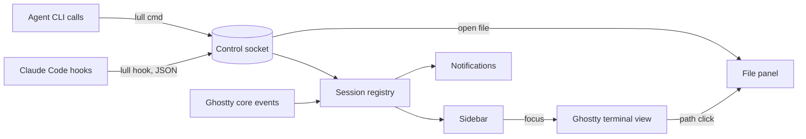

# Spec: lull, an agent-first terminal (working name)

Status: draft
Canon: this spec; upstream build guide `HACKING.md`; upstream agent guide `AGENTS.md`.

lull is a fork of [Ghostty](https://github.com/ghostty-org/ghostty) for macOS. It keeps the Ghostty core and app as they are and adds a narrow set of features for working with CLI coding agents. Claude Code is the primary agent.

## Contents

1. Goal and scope
2. Architecture
3. Scenarios
4. Data and states
5. Code model
6. Stages
7. Acceptance
8. State model
9. External facts and code sources
10. Requirement traceability
11. Text samples
12. Decisions and open questions
13. Slicing
14. Access and readiness

## 1. Goal and scope

- Goal: one terminal for all work with agents: sessions, files, servers, commands. It must stay as fast and light as Ghostty.
- Result: the user runs 5-6 Claude Code sessions in one window, sees which one waits, jumps to it in one action, and reads or edits a spec next to the session without leaving the terminal.

Principles:

1. **Simplicity.** A part stays only if something breaks without it. Everything outside section 1 is cut, not hidden behind a setting.
2. **Speed.** Startup, input latency and memory stay at the level of upstream Ghostty built from the same commit. Numbers come from a benchmark, not from impressions.
3. **Reliability.** The Ghostty core is not modified. Our code lives in its own files; upstream files change only at named insertion points.
4. **Lightweight and local.** No account, cloud, telemetry, subscription or built-in AI model.
5. **Agent-first.** An agent is a full user of the terminal. Everything the user does by mouse, an agent can do by command.

Requirements. M - must, S - should.

| ID | Requirement | Pri. | Comes from |
| --- | --- | --- | --- |
| R1 | Tabs and a simple split | M | upstream |
| R2 | Full-screen TUIs work completely, with mouse and trackpad: Claude Code, `tk` | M | upstream, verify |
| R3 | Sidebar with all sessions: project, branch, agent state (working, waiting, done) | M | new |
| R4 | Jump to a waiting session in one action, also from a system notification | M | new |
| R5 | Markdown preview panel next to the terminal | M | new |
| R6 | File editing in a GUI panel: mouse, selection, save | M | new |
| R7 | Command completion and history in zsh | M | shell setup, documented |
| R8 | Agent control CLI `lull`: list sessions, open a file in the panel, notify, focus a session | M | new |
| R9 | Click on a file path in terminal output opens the file in the panel | S | new |
| R10 | Several agents per project shown as separate sessions | S | new |
| R11 | HTML and PDF in the same panel | S | new |
| R12 | Editor-like prompt input: mouse, selection, multi-line | S | Claude Code itself, verify |
| R13 | SSH sessions in the sidebar, surviving a dropped connection | S | later stage |
| R14 | Phone access to waiting sessions outside the home network, free | S | outside the app, documented |

Out of scope:

- built-in AI agent, AI suggestions, chat with a model;
- account, cloud, settings sync, telemetry, crash reports sent out;
- team features, paid plans, theme or plugin store;
- a full IDE: debugger, project system, extensions;
- session restore after quitting the app: the user keeps the terminal open;
- Linux and Windows.

## 2. Architecture

Hooks and agent commands enter through one socket; the registry is the only owner of session state.

| Block | Responsibility | Talks to |
| --- | --- | --- |
| Ghostty core and app (upstream) | rendering, input, tabs, splits, core events | registry via insertion points |
| Control socket | unix socket of the running app; accepts hook events and agent commands | `lull` CLI, registry, file panel |
| `lull` CLI | thin client: `lull hook`, `lull ls`, `lull open`, `lull notify`, `lull focus` | control socket |
| Session registry | one record per terminal surface; agent state machine | sidebar, notifications |
| Sidebar | list of sessions with state; click or shortcut focuses the surface | registry, terminal view |
| File panel | markdown preview, text editing, HTML and PDF | terminal view, socket |

- Initiator: Claude Code hooks and the user. Source of truth for agent state: hook events; for cwd and title: Ghostty core events.
- State owner: session registry, in memory only. External side effects: system notifications.

### 2.1 Fork rules

1. Our Swift code lives in `macos/Sources/Features/Lull/`. Upstream files change only at insertion points listed in `docs/architecture.md`.
2. `main` carries our work. `upstream/main` is merged in on a schedule; a merge that touches an insertion point gets its own commit.
3. Our docs live in `docs/`, which upstream does not have. Upstream files `README.md` and `AGENTS.md` stay untouched until decision Q1.

### 2.2 Session registry

1. Purpose: one place that knows every session and its agent state.
2. Input: core events per surface (pwd, title, notification, bell, child exited, command finished); hook events with `session_id`, `cwd`, event name. Output: session list for the sidebar and the CLI; state changes for notifications.
3. How it works:
   1. A new surface creates a record in state `idle`.
   2. A hook event is matched to a surface by the surface id passed in the environment of the shell (`LULL_SURFACE`).
   3. The event moves the record through the state machine of section 8.
   4. A transition into `waiting` or `done` raises a notification when the surface is not focused.
4. Rules: one writer (main actor); an event for an unknown surface is dropped and logged; a repeated event in the same state changes nothing.

### 2.3 File panel

1. Purpose: read and edit files next to a session without another app.
2. Input: a path from a click, a `lull open` call or a shortcut. Output: the file shown or saved.
3. How it works: markdown is rendered to HTML and shown in WKWebView; text files open in an NSTextView-based editor; HTML in WKWebView; PDF in PDFKit.
4. Rules: the panel never writes a file the user did not save; a file changed on disk while open is reloaded or flagged, never silently overwritten.

## 3. Scenarios

| Scenario | Start and steps | Result |
| --- | --- | --- |
| Happy path | 5 sessions run; Claude Code in session 3 asks for permission | sidebar marks session 3 `waiting`, notification names the project; click focuses session 3 |
| Repeat | the same hook event arrives twice | state unchanged, one notification |
| Temporary error | the app is not running when a hook fires | `lull hook` exits 0 within 100 ms; Claude Code is not blocked |
| Permanent error | hooks are not installed for a session | the session shows `idle` from core events only, never a wrong agent state |
| File conflict | an agent rewrites a file open in the editor | the panel flags the change and offers reload; unsaved edits are kept |

## 4. Data and states

See section 8.

## 5. Code model

- `Session`: `surfaceID` (Ghostty surface, key), `agentSessionID` (Claude Code `session_id`, empty until the first hook), `cwd`, `project` (git root folder name), `branch` (empty outside git), `state`, `updatedAt`.
- `AgentState`: `idle`, `working`, `waiting`, `done`.

## 6. Stages

See section 13.

## 7. Acceptance

- Command: `make check` in the fork runs upstream `zig build test` filtered to touched areas, our Swift unit tests and `swiftlint lint --strict`. Until it is green, the stage is not done.
- Benchmark: `make bench` compares startup, input latency and memory with upstream Ghostty built from the same commit. Method and thresholds are set in stage S0.
- Test scenarios: section 3 rows run against the registry with recorded hook payloads.
- Not automated: look of the sidebar and panel, trackpad scrolling in TUIs - the user checks by eye at each stage.
- Not checked: Linux and Windows builds.

## 8. State model

| Entity | States and transitions | Frozen | Single writer | Storage |
| --- | --- | --- | --- | --- |
| `Session` | `idle -> working` on prompt submit; `working -> waiting` on permission or idle prompt; `waiting -> working` on next prompt; `working -> done` on stop; any state removed on child exit | `surfaceID` | session registry | memory |

## 9. External facts and code sources

| System | Fact | Source, date | If not so |
| --- | --- | --- | --- |
| Ghostty build | Zig 0.17.0 minimum; Xcode and macOS SDK as named in `HACKING.md` | `build.zig.zon:6`, `HACKING.md:52`, 2026-10-21 | S0 pins versions |
| Ghostty churn | 142 commits touched `macos/` in 90 days | `git log --since=2026-07-23 -- macos`, 2026-10-21 | merge schedule changes |
| Ghostty core events | pwd, title, notification, bell, child exited, progress, command finished reach the app through a C callback | `src/apprt/action.zig`, `macos/Sources/Ghostty/Ghostty.App.swift`, 2026-10-21 | registry needs its own parsing |
| Claude Code hooks | events `UserPromptSubmit`, `Stop`, `Notification` (`permission_prompt`, `idle_prompt`), `PermissionRequest`; JSON carries `session_id`, `cwd` | code.claude.com/docs/en/hooks, 2026-10-21 | state machine changes |
| Claude Code OSC 7501 | state escape sequence is not passed through tmux | code.claude.com/docs/en/terminal-config, 2026-10-21 | hooks stay the only source |

Code sources. Ported code keeps its license header and an entry in `THIRD_PARTY.md`.

| Need | Source | License | Size | Use |
| --- | --- | --- | --- | --- |
| R3, R4 sidebar, agent monitor, inbox | [kooky](https://github.com/iAmCorey/kooky) `Sidebar/`, `AgentMonitor`, `HookServer` | MIT | ~2.8k, 525, 827 lines | reference, port parts |
| R3 hook channel over a unix socket | kooky `HookServer.swift` | MIT | small | reference |
| R5 markdown to HTML | [swift-markdown](https://github.com/swiftlang/swift-markdown); termio `MarkdownHTML.swift`, `MarkdownReaderView.swift` | Apache-2.0; MIT | termio 1672 lines | library plus reference |
| R6 editor | AppKit NSTextView / TextKit 2; termio `Editor/` | system; MIT | termio ~5.1k lines | system first |
| R11 HTML, PDF | WKWebView, PDFKit; termio `FilePreview.swift`, `PreviewWebView.swift` | system; MIT | 276 lines | system first |
| R3, R4 ideas | [Calyx](https://github.com/yuuichieguchi/Calyx) sidebar and approvals inbox | MIT | not measured | read only |

Not taken: cmux (GPL-3.0 and BSL 1.1), the kooky prebuilt engine binary, any code without a license file.

## 10. Requirement traceability

| PRD line | Requirement | Stage | Status |
| --- | --- | --- | --- |
| Tabs and simple split | R1 | S0 | plan |
| TUIs with mouse and trackpad | R2 | S0 | plan |
| Session overview with state | R3 | S1 | plan |
| Jump to waiting session | R4 | S2 | plan |
| Markdown preview | R5 | S3 | plan |
| GUI file editing | R6 | S4 | plan |
| zsh completion and history | R7 | S0 docs | plan |
| Agent-first control | R8 | S1-S3 | plan |
| Click on path | R9 | S3 | plan |
| Several agents per project | R10 | S1 | plan |
| HTML and PDF | R11 | S5 | plan |
| Editor-like input | R12 | S0 verify | plan |
| SSH sessions | R13 | later | plan |
| Phone access | R14 | later docs | plan |

- R3 state. When Claude Code in a session sends `Notification` with `permission_prompt`, then the session shows `waiting` until the next `UserPromptSubmit`.
- R4 jump. When two sessions wait, then the jump shortcut focuses the one that started waiting first.

## 11. Text samples

Draft, to be agreed:

- Notification title `<project>`, body `Needs your permission`.
- Notification title `<project>`, body `Waiting for your input`.
- Notification title `<project>`, body `Done`.
- `lull ls` row: `3  lull  main  waiting  2m`.

## 12. Decisions and open questions

- Decided: fork Ghostty and add features in its Swift app - trusted core, notarized upstream, small Swift part; rejected: fork kooky (prebuilt engine from a cmux fork, root helper with NOPASSWD sudoers, edits other agents' settings), cmux (GPL and BSL, cloud), Calyx and other agent terminals (decided to build our own); affects: every upstream merge; revisit if merges cost more than a day a month.
- Decided: agent state from Claude Code hooks, not screen parsing or OSC 7501 - hooks carry session id and work inside tmux; rejected: OSC 7501 (blocked by tmux), screen parsing (fragile); revisit if Claude Code adds a terminal-side state API.
- Decided: registry in memory, no persistence - the user keeps the terminal open; revisit if restore after quit becomes a need.
- Q1: upstream `AGENTS.md` targets Ghostty contributors and forbids PRs. Replace it in the fork, or keep it and put our agent profile in `.claude/CLAUDE.md`? Recommendation: keep it untouched, profile in `.claude/CLAUDE.md`, to avoid merge conflicts.
- Q2: final project name. `lull` is a working name; the repository can be renamed later.
- Q3: when to make the fork public as a product: now, or at the first release.
- Q4: R8 command set beyond `ls`, `open`, `notify`, `focus` - for example sending keys to a session. Recommendation: start with four commands.

## 13. Slicing

| Stage | Result | Depends on |
| --- | --- | --- |
| S0 | fork builds from source, `make check` and `make bench` baseline, R2 and R12 verified, zsh setup doc for R7 | - |
| S1 | `lull` CLI with `hook` and `ls`, control socket, session registry, sidebar (R3, R8, R10) | S0 |
| S2 | notifications and jump to waiting session (R4), `lull notify`, `lull focus` | S1 |
| S3 | file panel with markdown preview, path click, `lull open` (R5, R9) | S1 |
| S4 | editing in the panel (R6) | S3 |
| S5 | HTML and PDF in the panel (R11) | S3 |
| later | SSH sessions (R13), phone access guide (R14) | S2 |

Tasks are tracked in `tk` under project `lull`. S1 also measures the real token cost of one stage; later estimates use that number.

## 14. Access and readiness

| Need | Who | How | Stages | Check | Ready |
| --- | --- | --- | --- | --- | --- |
| Zig 0.17.0 | agent | install per `HACKING.md` | S0 | `zig version` | no |
| Xcode and macOS SDK | user | installed: Xcode 27.0; upstream guide names Xcode 26 | S0 | `xcodebuild -version` | check in S0 |
| swiftlint | agent | Homebrew | S0 | `swiftlint version` | no |
| Claude Code with hooks | user | installed | S1 | `claude --version` | yes |

Readiness for slicing:

- [x] every entity has states, transitions, writer, storage;
- [x] scenarios: happy path, repeat, temporary and permanent error;
- [ ] Q1-Q4 answered.
