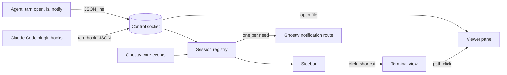

# Spec: tarn, an agent-first terminal

Status: agreed for the first version (S0-S3); the second wave is scoped, not designed. R6 moved to the first wave on 2026-10-25.
Canon: this spec; upstream build guides `HACKING.md` and `macos/AGENTS.md`; agent profile `.claude/CLAUDE.md`.

tarn is a fork of [Ghostty](https://github.com/ghostty-org/ghostty) for macOS. It keeps the Ghostty core and app as they are and adds a narrow set of features for working with CLI coding agents. Claude Code is the primary agent; the `tk` task tracker is its companion.

## Contents

1. Goal and scope
2. Architecture
3. Scenarios
4. Data and states
5. Code model
6. Stages
7. Acceptance
8. State model
9. External facts and code sources
10. Requirement traceability
11. Text samples
12. Decisions and open questions
13. Slicing
14. Access and readiness

## 1. Goal and scope

- Goal: one terminal for all work with agents. It must stay as fast and light as Ghostty.
- Result of the first version: the user reads specs and reports as rendered markdown next to the session, sees all Claude Code sessions with their state in a sidebar, and gets one notification when a session needs them.

Principles:

1. **Simplicity.** A part stays only if something breaks without it; the rest is cut, not hidden behind a setting. The tarn settings window holds only settings of tarn's own features; terminal settings stay in the Ghostty config file.
2. **Speed.** Startup, input latency, idle CPU and memory stay at the level of upstream Ghostty built from the same commit. Numbers come from a benchmark, not from impressions.
3. **Reliability.** The Ghostty core is not modified. Our code lives in its own files; upstream files change only at insertion points listed in `docs/architecture.md`.
4. **Lightweight and local.** No account, cloud, telemetry, subscription, built-in AI model or network requests from our code.
5. **Agent-first.** An agent is a full user of the terminal: it opens files, lists sessions and asks for attention by command. Focus and keystrokes stay with the human.

Requirements. "Session data" is the analysis of 683 Claude Code sessions from 2026-09-01 to 2026-10-21.

| ID | Requirement | Wave | Evidence |
| --- | --- | --- | --- |
| R1 | Tabs and a simple split | first, upstream | - |
| R2 | Full-screen TUIs work completely, with mouse and trackpad: Claude Code, `tk` | first, upstream, verify | Warp breaks TUI navigation |
| R5 | Viewer pane next to the terminal: markdown rendered, mermaid, code view, files tree, no network | first | 84% of file paths in answers are markdown |
| R7 | Command completion and history in zsh | first, setup guide | - |
| R9 | Click on a file path in terminal output opens it in the viewer; absolute, `~/` and relative paths, `path:line` | first | ~25 complaints about opening files |
| R6 | File editing in the viewer pane: one tool for view and edit, file tabs | first (user decision 2026-10-25) | - |
| R3 | Sidebar with all sessions: a tab running claude, codex or opencode sits in its project's group with the agent's icon and state; other tabs sit below a divider; the collapsed sidebar shows icons only | first | median 5 parallel sessions, peak 16 |
| R19 | Pins: tabs pinned at the top of the sidebar, reordered among themselves | first | user request 2026-10-23 |
| R20 | Drag to reorder tabs in the sidebar, as the native tab bar did | first | user request 2026-10-23 |
| R24 | Settings window (cmd+,); tab style: sidebar or native tabs at the top, where an agent tab shows its state dot and logo at the right edge | first | user request 2026-10-25 |
| R8 | Agent CLI `tarn`: `open`, `ls`, `notify` | first | - |
| R10 | Several agents per project shown as separate sessions | first | - |
| R4 | One notification per need; jump to the next session that needs the user by a click | first | 13.5% of replies come after more than 10 min |
| R12 | Editor-like prompt input | first, Claude Code itself, verify | - |
| R15 | `tarn new` and `tarn send`: hand-over between sessions | second | 50+ manual hand-overs |
| R16 | `tarn run`: a command for the user with output back to the agent | second | ~35 pasted outputs |
| R17 | Subagent panel inside a session | second | 14 requests |
| R18 | Tracker connector: the `tk` task of each session in the sidebar | second | `tk` links tasks to session ids |
| R11 | HTML and PDF in the viewer | later | 5 PDF paths, HTML opened in a browser |
| R13 | SSH sessions in the sidebar | later | 3-4 mentions |
| R14 | Phone access to waiting sessions, free, outside the home network | later, guide | - |
| R21 | Custom groups: the user creates a group and puts tabs into it | later | user request 2026-10-23 |
| R22 | Preview of a localhost server an agent starts | later | Tellurion trial 2026-10-23 |
| R23 | State for codex and opencode sessions | later | codex shows no state in the first version |

Out of scope:

- built-in AI agent, AI suggestions, chat with a model;
- account, cloud, settings sync, telemetry, crash reports sent out;
- team features, paid plans, theme or plugin store;
- a full IDE: debugger, project system, extensions;
- session restore after quitting the app: the user keeps the terminal open;
- agents inside tmux in the first version: the surface key does not survive tmux (section 12);
- an agent moving the user's focus;
- Linux and Windows.

## 2. Architecture

Hooks and agent commands enter through one socket; the registry is the only owner of session state; notifications reuse Ghostty's own route.

| Block | Responsibility | Talks to |
| --- | --- | --- |
| Ghostty core and app (upstream) | rendering, input, tabs, splits, core events, notification route | registry via insertion points |
| Control socket | unix socket of the running app; one JSON line per request and per reply | `tarn` CLI, registry, viewer |
| `tarn` CLI | thin client inside the app bundle: `hook`, `open`, `ls`, `notify` | control socket |
| Claude Code plugin | ships the hook configuration that calls `tarn hook` | Claude Code |
| Session registry | one record per terminal surface; agent state machine | sidebar, notifications |
| Sidebar | sessions with state; click or shortcut focuses the surface | registry, terminal view |
| Viewer pane | file tabs, files tree, rendered markdown with mermaid, source editor, code view | terminal view, socket |

- Initiator: Claude Code hooks, agent commands and the user. Source of truth for agent state: hook events; for cwd and title: Ghostty core events.
- State owner: session registry, in memory only. External side effects: system notifications through Ghostty.

### 2.1 Fork rules

1. Our Swift code lives in `macos/Sources/Features/Tarn/`, our tests in `macos/Tests/Tarn/`, our make targets in `tarn.mk`. Upstream files change only at insertion points listed in `docs/architecture.md`.
2. `main` carries our work. `upstream/main` is merged in on a schedule; a merge that touches an insertion point gets its own commit.
3. Our docs live in `docs/`, which upstream does not have. Upstream `README.md`, `AGENTS.md` and `Makefile` stay untouched; our agent profile is `.claude/CLAUDE.md`.
4. Where Ghostty already has a function (AppleScript `focus`, `input text`, `new tab`, notification route), our code calls it instead of a port.

### 2.2 Control socket and error rule

1. Path `~/Library/Application Support/tarn/tarn.sock`, mode 0600. On start the app removes a stale socket file and binds anew. Any local process of the user can talk to it: an accepted cost.
2. Request and reply are one JSON line each, with a `version` field. A version mismatch is an error reply.
3. Error rule for every component: the error goes to the log (`os_log`, subsystem `tarn`) with command, surface and reason; the caller gets `{"ok": false, "error": "<text>"}` and the CLI exits with 1; the app never crashes on bad input and state does not change. Exception: `tarn hook` (2.3).

### 2.3 Hook bridge

1. Purpose: turn Claude Code hook events into registry updates without ever slowing the agent.
2. Input: hook JSON on stdin (`session_id`, `cwd`, `hook_event_name`, `notification_type`). Output: one line to the socket.
3. How it works:
   1. The `tarn` plugin for Claude Code registers `tarn hook` for `UserPromptSubmit`, `PostToolUse`, `Notification`, `PermissionRequest`, `Stop`, `StopFailure`, `SessionEnd`.
   2. `tarn hook` reads `TARN_SURFACE`, which the app sets in the environment of each surface.
   3. It sends the event with the surface id and exits; for `PermissionRequest` see rule 5.
4. Rules, for any input: exit code 0; nothing on stdout or stderr; the whole run within 100 ms, connect and write included; no `TARN_SURFACE` or no socket means an immediate exit; errors go only to the log. The plugin never edits `~/.claude/settings.json`.
5. Exception, `PermissionRequest`: the hook keeps the connection open while the app holds it (hook timeout 1 h) and prints the decision the card writes. No app, a closed connection, Esc or the timeout print nothing, and Claude Code shows its own dialog.

### 2.4 Session registry

1. Purpose: one place that knows every session and its agent state.
2. Input: core events per surface (pwd, title, child exited, surface closed, focus); hook events. Output: session list for the sidebar and `tarn ls`; transitions for notifications.
3. How it works:
   1. A new surface creates a record in state `idle`.
   2. A hook event is matched to its record by surface id; the event moves the record by the table of section 8.
   3. A transition into `permission` or `waiting` raises one notification when the surface is not focused, by Ghostty's own focus rule.
   4. Focusing a surface sets `seen` on its record.
4. Rules: one writer (main actor); an event for an unknown surface is dropped and logged; a repeated event in the same state changes nothing and raises nothing.

### 2.5 Viewer pane

1. Purpose: read and edit a file next to a session without another app.
2. Input: a path from a click (`path`, `path:line`), `tarn open` or the files tree. Output: the file, rendered or as source.
3. How it works: one pane to the right of the terminal area of a window tab (a temporary host until the window layout is decided). Tabs: a file opens as a preview tab (italic) that the next open replaces; a double click, an edit or a drag pins it. The files tree sits on the right of the pane, rooted at the terminal's cwd; it toggles with Cmd+B or the Files button, Esc hides it. Cmd+B is the one pane key, from the terminal and from the pane. It opens and hides, it never closes: with no pane it opens the pane with the tree only (rooted at the terminal's cwd, no file open) and puts the keyboard in the tree; a hidden pane comes back as it was hidden, with the keyboard in it; a shown pane, with files or not, hides whole (tabs, unsaved edits and tree state are kept; closing a window still asks about the edits) and the keyboard goes to the terminal. Cmd+W with the keyboard in the pane closes the pane when no file is open, otherwise the active tab; the last tab closes the pane. The Files button and Esc toggle the tree inside a pane with files; in a pane with no file they hide the pane. Enter on a file in the tree opens it and moves the keyboard into it. A path click shows a hidden pane and focuses it; `tarn open` leaves it hidden and never moves the keyboard. Markdown shows rendered (highlight, mermaid with a per-diagram Source toggle, Copy on code blocks, task checkboxes written back to the file) or as source in an editor (Cmd+E); Cmd+S saves, an edit marks the tab dirty. Other text files show highlighted with line numbers; `path:line` scrolls to the line and marks it. Markdown is rendered from vendored assets in a WKWebView. A file changed on disk is re-rendered with the scroll kept; with unsaved edits the pane shows "The agent changed this file and you have unsaved edits" with "Take the agent version" and "Keep mine".
4. Rules: no network: a `WKContentRuleList` blocks everything except `tarn-md://`, which serves bundled assets and local images of allowed folders; raw HTML inside markdown is escaped; `http(s)` links open in the system browser. Files over 5 MB or not UTF-8 get a one-line notice. The theme follows the terminal background. A path click moves focus to the viewer; `tarn open` never does; it needs an absolute path, answers ok or an error, and opens text files only. Cmd+W closes the active tab, the last tab closes the pane, and Ghostty's undo reopens it. Non-text files open in their default app.

## 3. Scenarios

| Scenario | Start and steps | Result |
| --- | --- | --- |
| Happy path | 5 sessions run; Claude Code in session 3 asks for permission | sidebar marks session 3 `permission`; one notification names the project; a click focuses session 3 |
| Approval | the user approves in session 3 | `PostToolUse` moves it to `working`; the mark goes away |
| Finished | Claude Code stops; a minute later `idle_prompt` arrives | `Stop` moves it to `waiting` with one notification; `idle_prompt` changes nothing |
| Interrupted | the user presses Esc, no `Stop` arrives | `idle_prompt` later moves the session to `waiting`; the next prompt moves it to `working` |
| Repeat | the same hook event arrives twice | state unchanged, one notification |
| App not running | a hook fires while tarn is closed or Claude runs in another terminal | `tarn hook` exits 0 at once; Claude Code is not slowed |
| App hangs | the socket accepts but the app does not read | `tarn hook` gives up at 100 ms and exits 0; a permission hook waits until its timeout |
| Hooks not installed | the plugin is missing | the session stays `idle` from core events only, never a wrong agent state |
| Bad request | junk JSON or unknown command on the socket | error reply, log line, state unchanged |
| Notifications denied | macOS has not allowed notifications | the sidebar still marks sessions; one log line |
| Remote image | an opened markdown file links an `https://` image | no request leaves the machine; the image shows as a link |
| File rewritten | an agent rewrites a file open in the viewer | it re-renders and keeps scroll; with unsaved edits a banner offers the agent version or yours |
| Agent asks for attention | an agent runs `tarn notify "<text>"` | its own session (by `TARN_SURFACE`) gets the note and one notification; the same text again raises nothing; focus does not move; focusing the session clears the note |
| No duplicates | Claude Code also sends its terminal notification for the same need | the terminal notification of a live agent session is suppressed; the user sees one notification |
| Path click | the user clicks `docs/spec.md:12` in agent output | the path resolves against the surface cwd; a text file opens in the viewer; media, document and archive files open in their default macOS app; a missing file shows a one-line notice |
| Subagent event | a subagent finishes a tool while the main agent waits for permission | events carrying `agent_id` do not change the session state in the first version |

## 4. Data and states

See section 8.

## 5. Code model

- `Session`: `surfaceID` (Ghostty surface UUID, key), `agentSessionID` (Claude Code `session_id`, empty until the first hook and after `SessionEnd`), `cwd`, `project` (git root folder name), `branch` (empty outside git), `state`, `stateSince` (time of entering the current state), `seen` (the user focused the surface since `stateSince`), `failed` (last stop was `StopFailure`), `note` (text from `tarn notify`, cleared on focus).
- `AgentState`: `idle`, `working`, `permission`, `waiting`.

## 6. Stages

See section 13.

## 7. Acceptance

- Command: `make -f tarn.mk check` runs `swiftlint lint --strict` on our folders, `macos/build.nu --action test` and the hook bridge tests. Until it is green, the stage is not done.
- Benchmark: `make -f tarn.mk bench` compares startup, input latency, idle CPU and memory with upstream Ghostty built from the same commit. It runs before a release and does not block a stage; thresholds are set in S0.

| Section 3 rows | Level | How |
| --- | --- | --- |
| Happy path, Approval, Finished, Interrupted, Repeat | unit | registry fed with recorded hook payloads |
| App not running, App hangs, Hooks not installed | unit | `tarn hook` against no socket, a socket that never reads, junk stdin |
| Bad request | unit | socket handler with junk lines |
| Remote image, File rewritten | unit | viewer model with the rule list and a file watcher stub |
| Notifications denied, Agent asks for attention, No duplicates | unit | notification gate with a stub center and a recorded OSC notification |
| Path click | unit | path resolver with a cwd and the `path:line:col` forms |
| Subagent event | unit | registry fed with events that carry `agent_id` |
| Look of sidebar and viewer, trackpad in TUIs | user | by eye at each stage |

- Not checked: Linux and Windows builds.

## 8. State model

| Event | from `idle` | from `working` | from `permission` | from `waiting` |
| --- | --- | --- | --- | --- |
| `UserPromptSubmit` | `working` | - | `working` | `working` |
| `PostToolUse`, `PostToolUseFailure` | `working` | - | `working` | `working` |
| `PermissionRequest` | `permission` | `permission` | - | `permission` |
| `Notification` `permission_prompt` | - | `permission`, unless a `PermissionRequest` came this turn | - | - |
| `Stop` without background tasks | `waiting` | `waiting` | `waiting` | - |
| `Stop` with background tasks | `working` | - | `working` | `working` |
| `StopFailure` | `waiting`, `failed` | `waiting`, `failed` | `waiting`, `failed` | `failed` |
| `Notification` `idle_prompt` | `waiting` | - | - | - |
| `SessionEnd` with reason `clear` | `waiting` | `waiting` | `waiting` | - |
| other `SessionEnd`, child exited | - | `idle` | `idle` | `idle` |

`-` means no change. Every change resets `stateSince` and `seen`; any move to `working` clears `failed`. Events that carry `agent_id` (subagents) only raise `permission` through `PermissionRequest` and clear it through `PostToolUse` of the same agent; the rest are ignored. A quick answer is the decision of the waiting permission hook, tied to its own request; without a waiting hook the card shows no buttons. A closed surface removes the record. Entity storage: memory; single writer: the registry. Unknown `notification_type` values are logged and ignored.

Corrections of the hook research of 2026-10-23 (`agent-terminal/docs/research/agent-status-2026-10-23.md`): `PermissionRequest` comes at once while `permission_prompt` comes about 6 s later, so the late one is a duplicate; `idle_prompt` during a turn would repaint a working session; `Stop` with background tasks is not the end of the work; `/clear` ends the session id but the agent keeps waiting in the same surface.

`tarn notify` is not a state change: it sets `note` on the caller's own record; focusing the surface clears it.

Esc: Claude Code sends no event when the user presses Esc. The registry reads the surface instead: `working` with no progress report and a title starting with `✳`, or `permission` with "Interrupted" in the last screen lines, for 2 s in a row, becomes `waiting` marked seen.

Known limit: approving in the terminal sends no event, so the session shows `permission` until `PostToolUse` arrives.

Jump order for R4: `waiting` with `failed`, then `permission`, then `waiting` or a non-empty `note`; within a group unseen first, then the oldest `stateSince`. Sessions in `idle` or `working` without a note are skipped.

## 9. External facts and code sources

| System | Fact | Source, date | If not so |
| --- | --- | --- | --- |
| Ghostty build | Zig 0.17.0 minimum; the macOS app builds and tests through `macos/build.nu`, not `zig build` | `build.zig.zon:6`, `macos/AGENTS.md`, 2026-10-21 | S0 pins versions |
| Ghostty churn | 142 commits touched `macos/` in 90 days | `git log --since=2026-07-23 -- macos`, 2026-10-21 | merge schedule changes |
| Ghostty core events | notification, title, pwd, bell, child exited, progress, command finished reach the app | `src/apprt/action.zig:203-333`, `macos/Sources/Ghostty/Ghostty.App.swift:653-780`, checked by review | registry needs its own parsing |
| Ghostty surfaces | each surface has a stable UUID; per-surface environment variables are supported; close is an event | `AppDelegate.swift:969-977`, `SurfaceView.swift:591`, `Ghostty.App.swift:293`, checked by review | surface key changes |
| Ghostty notifications | a notification is bound to a surface, shown only when it is not focused, a click focuses it | `Ghostty.App.swift:551-563,1620-1640`, `AppDelegate.swift:948-955`, checked by review | our own route needed |
| Ghostty AppleScript | `focus`, `input text`, `new tab` with working directory and command | `macos/Ghostty.sdef:86-227` | second wave writes its own |
| Claude Code hooks | every event carries `session_id`, `cwd`, `transcript_path`, `hook_event_name`; `Notification` adds `notification_type`, `message`, `title`; subagent events carry `agent_id`, `agent_type` | code.claude.com/docs/en/hooks, 2026-10-21 | state table changes |
| Claude Code OSC 7501 | state escape sequence is not passed through tmux | code.claude.com/docs/en/terminal-config, 2026-10-21 | hooks stay the only source |
| `tk` | `claim` is `<agent>:<session id>`; `tk list --json` returns `id`, `title`, `project`, `status`, `claim`, `ask` | tracker `docs/spec.md` 2.4; `tk list --json`, 2026-10-21 | second wave changes |

Code sources. Four reference projects were picked from seven MIT agent terminals on libghostty by the same quality signals (GitHub tree, 2026-10-21). Ported code keeps its copyright and an entry in `THIRD_PARTY.md`.

Picked by tests per file (0.4 to 1.3), few files over 40 KB, CI, lint and architecture docs: agterm, Limpid, termio, Calyx (GitHub tree, 2026-10-21).

Dropped: kooky, Vesta, Conterm. cmux (GPL) and Mux0 (no copying) give ideas only.

| Stage | Need | Source | Use |
| --- | --- | --- | --- |
| S1 | markdown, highlight, mermaid, editor, no CDN | vendored markdown-it, highlight.js, mermaid, CodeMirror 6; MarkEdit-preview and macdown3000 (MIT) as models | vendor, adapt |
| S1 | path parsing `path:line:col` | kooky `TerminalOpenTarget.swift` (228 lines, Foundation only, tested), the one file taken from it | port |
| S1 | socket: newline-delimited JSON, path from the environment | agterm `ControlServer.swift`, `agtermCore` protocol | adapt |
| S2 | agent status from hooks | agterm `AgentStatus.swift` (161 lines); Calyx `AgentStateResolver` to cross-check | adapt to section 8 |
| S2 | hooks shipped as a Claude Code plugin | the `tk` plugin layout | reuse the layout |
| S3 | jump order | Limpid `AttentionState.swift` (`jumpToAttention`) | port, map to section 8 |
| S3 | notification and click route | Ghostty itself | call |

## 10. Requirement traceability

| PRD line | Requirement | Stage | Status |
| --- | --- | --- | --- |
| Tabs and simple split | R1 | S0 | plan |
| TUIs with mouse and trackpad | R2 | S0 | plan |
| zsh completion and history | R7 | S0 | plan |
| Editor-like input | R12 | S0 | plan |
| Viewer pane, editing | R5, R6 | S1, branch `s2-files` | plan |
| Click on path | R9 | S1 | plan |
| Agent CLI | R8 | S1-S3 | plan |
| Session overview with state | R3 | S2 | plan |
| Several agents per project | R10 | S2 | plan |
| Jump and notifications | R4 | S3 | plan |
| hand-over, command for the user, subagents, tracker | R15-R18 | second wave | scoped |
| HTML and PDF, SSH, phone | R11, R13, R14 | later | moved by session data |

- R3 state. When a session gets `permission_prompt`, then it shows `permission` until `UserPromptSubmit` or `PostToolUse`.
- R4 jump. When one session failed and two wait, then the jump focuses the failed one first, then the unseen waiting one that started waiting earlier.
- R5 no network. When a markdown file links a remote image, then no request leaves the machine.
- R9 path. When the user clicks a relative path in a surface whose cwd is `/a/b`, then the file `/a/b/<path>` opens; a text file in the viewer, any other in its default app.

## 11. Text samples

- Notification title `<project>`, body `Needs your permission`.
- Notification title `<project>`, body `Waiting for you`.
- Notification title `<project>`, body `Failed, see the session`.
- Notification title `<project>`, body: the text of `tarn notify`.
- `tarn ls` row: `3  tarn  main  permission  2m`; `tarn ls --json` returns the `Session` fields.
- `tarn open` on a missing file: `tarn: no such file: <path>`, exit code 1.

## 12. Decisions and open questions

- Decided: fork Ghostty and add features in its Swift app - trusted core, notarized upstream, small Swift part; rejected: fork kooky (prebuilt engine from a cmux fork, root helper with NOPASSWD sudoers, edits other agents' settings), cmux (GPL and BSL, cloud), agterm, Calyx and other agent terminals (decided to build our own; their MIT code is used per section 9); affects: every upstream merge; revisit if merges cost more than a day a month.
- Decided: the name is `tarn` (a small mountain lake: small, clear, quiet) - no namesakes among terminals and agent tools on GitHub, Homebrew, Product Hunt or the web, checked 2026-10-21; rejected: `lull`, `wisp`, `aerie` (taken). Trademarks and domains not checked.
- Decided: the project is public; everything in the repository is in English. Upstream `AGENTS.md`, `README.md`, `Makefile` stay untouched; our profile is `.claude/CLAUDE.md`.
- Decided: first version in the order core, markdown, sessions, notifications - markdown is what the user uses all the time; the second wave (R15-R18) is designed after the first ships.
- Decided: agent state from Claude Code hooks - hooks carry the session id; rejected: OSC 7501 (blocked by tmux), screen parsing (fragile); revisit if Claude Code adds a terminal-side state API.
- Decided: hooks ship as a Claude Code plugin, like `tk` - nothing edits `~/.claude/settings.json`; rejected: an installer that edits settings (the reason kooky was rejected), a manual guide (no updates).
- Decided: notifications come only from tarn, one per need, through Ghostty's route; terminal notifications (OSC 9, 777) from a surface with a live agent session, that is a record with a non-empty `agentSessionID`, are suppressed - tarn names the project and the need; rejected: Claude Code's own notifications (no context), both (duplicates).
- Decided: "finished" and "waiting for input" are one state `waiting`; `permission` stays separate as urgent - for the user both mean "the session waits for me".
- Decided: agents never move focus; `tarn notify` marks the session and notifies; the user jumps - keystrokes never land in the wrong session; rejected: agent focus always or when the app is inactive.
- Decided: agents inside tmux are out of the first version - the shell inside tmux inherits `TARN_SURFACE` from the tmux server, so events would land on the wrong record; revisit with R13 using the client tty as the key.
- Decided: registry in memory, no persistence - the user keeps the terminal open.
- Decided: quick answers go back as the permission hook's decision, and the session waits for the user; rejected: key presses matched to the dialog on screen (approved the wrong one with parallel calls), a 30 s wait, the jump shortcut.
- Decided (2026-10-23): the sidebar has layers from top to bottom - pins (R19), custom groups (R21), agent groups, plain tabs below a divider without a header; the first version ships agent groups and plain tabs, the layer list in code takes the rest without a rework.
- Decided (2026-10-23): a tab joins an agent group while the foreground process of any of its splits is `claude`, `codex` or `opencode`, read by process name with an argv fallback for a version-like name or an interpreter (ported from macterm, MIT); it returns to plain tabs when the agent exits; rejected: hooks only (Claude only), staying in the group after exit (groups would not show live agents). Not detected: agents inside tmux or ssh, agents behind a wrapper script. Revisit if Ghostty adds a foreground-process event.
- Decided (2026-10-23): a group is keyed by the full project root (git root, or the folder outside git); the header is the folder name, with its parent folder when two groups share it; rejected: the folder name alone (two `app` projects merged).
- Decided (2026-10-23): agent icons are the monochrome logos from macterm (MIT), tinted like system icons; the logos are their owners' trademarks and only name the running agent.
- Decided (2026-10-23): release tags are `tarn-vX.Y.Z` - the repository also holds upstream `vX.Y.Z` tags.

Open for the second wave, from the spec review of 2026-10-21 (resolve before designing R15-R18):

1. `tarn send`: a target without bracketed paste executes newlines; the text needs encoding per paste mode (`src/Surface.zig:3431`, `paste.zig:109-113`).
2. Session address in the CLI: `tarn ls` numbers shift; commands need the surface UUID or the Claude session id.
3. `tarn run`: timeout, sudo, large output, parallel calls, where the command runs, whether the user can edit it.
4. `tarn new`: whether the entry prompt is submitted; which `claude` command and permission mode; tab or split.
5. Tracker `ask` versus hook state: `ask` is a field shown in the sidebar, not a state transition; polling `tk` at most once per N seconds; `/clear` changes the session id.
6. Subagent records: closed by the parent's `Stop` when `SubagentStop` never comes; keep the last N.
7. Editor, answered in 2.5: unsaved edits versus disk, large and non-UTF-8 files. Still open: deleted file, write errors.

## 13. Slicing

| Stage | Result | Depends on |
| --- | --- | --- |
| S0 core | fork builds from source with `macos/build.nu`; `tarn.mk` with `check` and `bench`; baseline numbers against upstream; R1, R2, R12 verified by eye; zsh guide for R7; `docs/architecture.md` with the insertion point list | - |
| S1 markdown | control socket, `tarn` CLI with `open`, viewer pane with mermaid, editing and the no-network rule, path click (R5, R6, R8 `open`, R9) | S0 |
| S2 sessions | Claude Code plugin with hooks, hook bridge, session registry, sidebar, `tarn ls` (R3, R8 `ls`, R10) | S1 |
| S3 attention | notifications through Ghostty's route, suppression of agent-surface terminal notifications, jump shortcut, `tarn notify` (R4, R8 `notify`) | S2 |
| second wave | design R15-R18 against the open list of section 12 | S3 |
| later | R11, R13, R14 | - |

Implementation starts after the tracker work; tasks are in `tk` under project `tarn`. S1 measures the real token cost of one stage; later estimates use that number.

## 14. Access and readiness

Ready: Zig, Xcode, nushell and swiftlint are installed and the app builds with `macos/build.nu` (since `tarn-v0.0.1`); Claude Code with plugins is installed.

Readiness for slicing:

- [x] every entity has states, transitions, writer, storage;
- [x] scenarios cover happy path, repeat, temporary and permanent errors, and the no-network rule;
- [x] behavior questions of the first version answered;
- [x] reference projects picked;
- [ ] second-wave questions of section 12, before the second wave.
