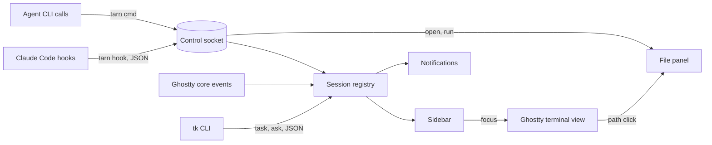

# Spec: tarn, an agent-first terminal

Status: draft
Canon: this spec; upstream build guide `HACKING.md`; upstream agent guide `AGENTS.md`.

tarn is a fork of [Ghostty](https://github.com/ghostty-org/ghostty) for macOS. It keeps the Ghostty core and app as they are and adds a narrow set of features for working with CLI coding agents. Claude Code is the primary agent; the `tk` task tracker is its companion.

## Contents

1. Goal and scope
2. Architecture
3. Scenarios
4. Data and states
5. Code model
6. Stages
7. Acceptance
8. State model
9. External facts and code sources
10. Requirement traceability
11. Text samples
12. Decisions and open questions
13. Slicing
14. Access and readiness

## 1. Goal and scope

- Goal: one terminal for all work with agents: sessions, files, servers, commands. It must stay as fast and light as Ghostty.
- Result: the user runs 5-6 Claude Code sessions in one window, sees which one waits and on which task, jumps to it in one action, reads or edits a spec next to the session, and lets agents hand work over without copy-paste.

Principles:

1. **Simplicity.** A part stays only if something breaks without it. Everything outside section 1 is cut, not hidden behind a setting.
2. **Speed.** Startup, input latency and memory stay at the level of upstream Ghostty built from the same commit. Numbers come from a benchmark, not from impressions.
3. **Reliability.** The Ghostty core is not modified. Our code lives in its own files; upstream files change only at named insertion points.
4. **Lightweight and local.** No account, cloud, telemetry, subscription or built-in AI model.
5. **Agent-first.** An agent is a full user of the terminal. Everything the user does by mouse, an agent can do by command.

Requirements. M - must, S - should, later - out of the first version. "Session data" is the analysis of 683 Claude Code sessions from 2026-09-01 to 2026-10-21.

| ID | Requirement | Pri. | Comes from |
| --- | --- | --- | --- |
| R1 | Tabs and a simple split | M | upstream |
| R2 | Full-screen TUIs work completely, with mouse and trackpad: Claude Code, `tk` | M | upstream, verify |
| R3 | Sidebar with all sessions: project, branch, agent state (working, waiting, done) | M | median 5 parallel sessions, peak 16 |
| R4 | Jump to a waiting session in one action, also from a system notification | M | 13.5% of replies come after more than 10 min |
| R5 | Markdown preview panel next to the terminal, mermaid diagrams rendered | M | 84% of file paths in answers are markdown |
| R6 | File editing in a GUI panel: mouse, selection, save | M | new |
| R7 | Command completion and history in zsh | M | shell setup, documented |
| R8 | Agent control CLI `tarn`: list sessions, open a file in the panel, notify, focus a session | M | new |
| R9 | Click on a file path in terminal output opens the file in the panel; absolute, `~/` and relative paths | S | new |
| R10 | Several agents per project shown as separate sessions | S | new |
| R11 | HTML and PDF in the same panel | later | 5 PDF paths, HTML opened in a browser |
| R12 | Editor-like prompt input: mouse, selection, multi-line | S | Claude Code itself, verify |
| R13 | SSH sessions in the sidebar, surviving a dropped connection | later | 3-4 mentions |
| R14 | Phone access to waiting sessions outside the home network, free | S | outside the app, documented |
| R15 | `tarn new` opens a session in a project with an entry prompt; `tarn send` puts text into another session's input | M | 50+ manual hand-overs |
| R16 | `tarn run` shows a command in a panel, runs it after the user presses Enter, returns the output to the agent | M | ~35 pasted outputs |
| R17 | Subagent panel inside a session: which subagents run and what they do | S | 14 requests |
| R18 | Tracker connector: the sidebar shows the `tk` task of each session; a task `ask` marks the session as waiting; `tk` can focus or start a session | S | `tk` already links tasks to session ids |

Out of scope:

- built-in AI agent, AI suggestions, chat with a model;
- account, cloud, settings sync, telemetry, crash reports sent out;
- team features, paid plans, theme or plugin store;
- a full IDE: debugger, project system, extensions;
- session restore after quitting the app: the user keeps the terminal open;
- Linux and Windows.

## 2. Architecture

Hooks, agent commands and tracker data meet in the registry; it is the only owner of session state.

| Block | Responsibility | Talks to |
| --- | --- | --- |
| Ghostty core and app (upstream) | rendering, input, tabs, splits, core events | registry via insertion points |
| Control socket | unix socket of the running app; one JSON line per request | `tarn` CLI, registry, panels |
| `tarn` CLI | thin client: `hook`, `ls`, `open`, `notify`, `focus`, `new`, `send`, `run` | control socket |
| Session registry | one record per terminal surface; agent state machine | sidebar, notifications |
| Sidebar | sessions with state and task; click or shortcut focuses the surface | registry, terminal view |
| File panel | markdown preview with mermaid, text editing | terminal view, socket |
| Command panel | shows a command from `tarn run`, runs it on Enter, sends output back | socket, terminal view |
| Tracker connector | reads `tk` tasks claimed by each session through the `tk` CLI | `tk`, registry |
| Subagent panel | subagents of the focused session: type, current tool, last answer | registry |

- Initiator: Claude Code hooks, agent commands and the user. Source of truth for agent state: hook events and `tk` asks; for cwd and title: Ghostty core events.
- State owner: session registry, in memory only. External side effects: system notifications.

### 2.1 Fork rules

1. Our Swift code lives in `macos/Sources/Features/Tarn/`. Upstream files change only at insertion points listed in `docs/architecture.md`.
2. `main` carries our work. `upstream/main` is merged in on a schedule; a merge that touches an insertion point gets its own commit.
3. Our docs live in `docs/`, which upstream does not have. Upstream `README.md` and `AGENTS.md` stay untouched; our agent profile is `.claude/CLAUDE.md`.

### 2.2 Session registry

1. Purpose: one place that knows every session and its agent state.
2. Input: core events per surface (pwd, title, notification, bell, child exited, command finished); hook events with `session_id`, `cwd`, event name; `tk` tasks. Output: session list for the sidebar and the CLI; state changes for notifications.
3. How it works:
   1. A new surface creates a record in state `idle`.
   2. A hook event is matched to a surface by the surface id passed in the environment of the shell (`TARN_SURFACE`).
   3. The event moves the record through the state machine of section 8.
   4. A transition into `waiting` or `done` raises a notification when the surface is not focused.
4. Rules: one writer (main actor); an event for an unknown surface is dropped and logged; a repeated event in the same state changes nothing.

### 2.3 File panel

1. Purpose: read and edit files next to a session without another app.
2. Input: a path from a click, a `tarn open` call or a shortcut. Output: the file shown or saved.
3. How it works: markdown is rendered to HTML with mermaid diagrams and shown in WKWebView; text files open in an NSTextView-based editor with syntax highlighting. HTML and PDF come later (R11).
4. Rules: the panel never writes a file the user did not save; a file changed on disk while open is reloaded or flagged, never silently overwritten.

### 2.4 Tracker connector

1. Purpose: show what each session works on and let the tracker and the terminal drive each other.
2. Input: `tk` tasks whose `claim` is `claude:<session_id>`; the same `session_id` arrives in hook events. Output: task id, title, summary and `ask` on the session record.
3. How it works:
   1. On a hook event and on a timer, the connector runs `tk list --json` and keeps tasks with a non-empty `claim`.
   2. A task whose claim matches a session's `agentSessionID` is attached to that session.
   3. A non-empty `ask` moves the session to `waiting` with the ask text.
   4. From the `tk` board, a task opens its session through `tarn focus`, or starts one through `tarn new` with the entry prompt `take T-<n>`.
4. Rules: the connector only reads `tk` through its CLI, never the `~/tasks` files; `tk` missing or failing leaves the sidebar without task lines, nothing else changes. Changes on the `tk` side are tasks of the tracker project.

## 3. Scenarios

| Scenario | Start and steps | Result |
| --- | --- | --- |
| Happy path | 5 sessions run; Claude Code in session 3 asks for permission | sidebar marks session 3 `waiting`, notification names the project; click focuses session 3 |
| Repeat | the same hook event arrives twice | state unchanged, one notification |
| Temporary error | the app is not running when a hook fires | `tarn hook` exits 0 within 100 ms; Claude Code is not blocked |
| Permanent error | hooks are not installed for a session | the session shows `idle` from core events only, never a wrong agent state |
| File conflict | an agent rewrites a file open in the editor | the panel flags the change and offers reload; unsaved edits are kept |
| Hand-over | an agent runs `tarn send <session> "<text>"` | the text appears in the target input; nothing is submitted until the user presses Enter |
| Command for the user | an agent runs `tarn run "<command>"` | the command panel shows it; it runs only on the user's Enter; the agent gets exit code and output |
| Task asks | an agent sets `ask` on its `tk` task | the session shows `waiting` with the ask text, even without a hook event |

## 4. Data and states

See section 8.

## 5. Code model

- `Session`: `surfaceID` (Ghostty surface, key), `agentSessionID` (Claude Code `session_id`, empty until the first hook), `cwd`, `project` (git root folder name), `branch` (empty outside git), `state`, `task` (`tk` id, title and ask; empty without a claim), `updatedAt`.
- `AgentState`: `idle`, `working`, `waiting`, `done`.
- `Subagent`: `agentID` (hook `agent_id`, key within a session), `agentType`, `currentTool` (last `PreToolUse` with this `agent_id`), `lastAnswer` (from `SubagentStop`), `state` (`running`, `done`).

## 6. Stages

See section 13.

## 7. Acceptance

- Command: `make check` in the fork runs upstream `zig build test` filtered to touched areas, our Swift unit tests and `swiftlint lint --strict`. Until it is green, the stage is not done.
- Benchmark: `make bench` compares startup, input latency and memory with upstream Ghostty built from the same commit. Method and thresholds are set in stage S0.
- Test scenarios: section 3 rows run against the registry with recorded hook payloads and a stub `tk`.
- Not automated: look of the sidebar and panels, trackpad scrolling in TUIs - the user checks by eye at each stage.
- Not checked: Linux and Windows builds.

## 8. State model

| Entity | States and transitions | Frozen | Single writer | Storage |
| --- | --- | --- | --- | --- |
| `Subagent` | `running` on `SubagentStart`; `done` on `SubagentStop`; removed with its session | `agentID`, `agentType` | session registry | memory |
| `Session` | `idle -> working` on prompt submit; `working -> waiting` on permission or idle prompt, or a `tk` ask; `waiting -> working` on next prompt; `working -> done` on stop; any state removed on child exit | `surfaceID` | session registry | memory |

## 9. External facts and code sources

| System | Fact | Source, date | If not so |
| --- | --- | --- | --- |
| Ghostty build | Zig 0.17.0 minimum; Xcode and macOS SDK as named in `HACKING.md` | `build.zig.zon:6`, `HACKING.md:52`, 2026-10-21 | S0 pins versions |
| Ghostty churn | 142 commits touched `macos/` in 90 days | `git log --since=2026-07-23 -- macos`, 2026-10-21 | merge schedule changes |
| Ghostty core events | pwd, title, notification, bell, child exited, progress, command finished reach the app through a C callback | `src/apprt/action.zig`, `macos/Sources/Ghostty/Ghostty.App.swift`, 2026-10-21 | registry needs its own parsing |
| Claude Code hooks | events `UserPromptSubmit`, `Stop`, `Notification` (`notification_type` such as `permission_prompt`, `idle_prompt`; `message`, `title`), `PermissionRequest`, `SessionEnd`; every event carries `session_id`, `cwd`, `transcript_path`, `hook_event_name` | code.claude.com/docs/en/hooks, 2026-10-21 | state machine changes |
| Claude Code OSC 7501 | state escape sequence is not passed through tmux | code.claude.com/docs/en/terminal-config, 2026-10-21 | hooks stay the only source |
| `tk` claims | `claim` and `Actor` are `<agent>:<full session id>`, taken from `CLAUDE_CODE_SESSION_ID`; `tk list --json` returns `id`, `title`, `project`, `status`, `claim`, `ask` per task | tracker `docs/spec.md` section 2.4; `tk list --json`, 2026-10-21 | connector needs another join key |
| Claude Code subagent hooks | `SubagentStart` and `SubagentStop` carry `agent_id`, `agent_type`; `SubagentStop` adds `last_assistant_message` and `agent_transcript_path`; any hook fired inside a subagent carries `agent_id` | code.claude.com/docs/en/hooks, 2026-10-21 | R17 needs transcript parsing |

Code sources. Four reference projects were picked from seven MIT agent terminals on libghostty by the same quality signals (GitHub tree, 2026-10-21): tests per source file, share of files over 40 KB, CI, lint, developer docs, contributors. Ported code keeps its copyright and an entry in `THIRD_PARTY.md`.

| Project | Why | Tests per file | Files over 40 KB | CI, lint, docs | Contributors |
| --- | --- | --- | --- | --- | --- |
| [agterm](https://github.com/umputun/agterm) | the only multi-author project; control socket and agent status close to R3, R8 | 1.07 | 6% | yes, yes, architecture | 45 |
| [Limpid](https://github.com/nek0der/limpid) | smallest files, full docs; jump order matches R4 exactly | 0.43 | 1.6% | 9 workflows, yes, architecture | 2 |
| [termio](https://github.com/termio-sh/termio) | markdown and editor for R5, R6 | 0.49 | 13% | 6 workflows, yes, architecture | 11 |
| [Calyx](https://github.com/yuuichieguchi/Calyx) | densest tests; agent state and notification routing | 1.29 | 4% | yes, no, contributing only | 1 |

Dropped by the same signals: kooky (no CI, lint or docs, 10% of files over 40 KB), Vesta (2 test files), Conterm (few tests, no lint or docs). cmux (GPL) and Mux0 (copying forbidden) give ideas only.

| Stage | Need | Source | Use |
| --- | --- | --- | --- |
| S1 | control socket: newline-delimited JSON, socket path and session id from the environment | agterm `ControlServer.swift`, `agtermCore` protocol and dispatcher, `agtermctl` | adapt: decouple from their `AppStore` |
| S1 | agent status from Claude Code hooks, hook installer | agterm `AgentStatus.swift` (161 lines), `AgentHooksInstaller.swift`; Calyx `AgentStateResolver` to cross-check | adapt |
| S2 | jump order: error, needs input, finished; unseen first, then oldest | Limpid `AttentionState.swift` (`jumpToAttention`) | port |
| S2 | notification and click routing to the pane | Calyx `PaneNotificationLedger`, `NotificationClickRouter`; agterm `NotificationManager.swift` | adapt |
| S3 | markdown to HTML with highlight, KaTeX and mermaid vendored, no CDN | termio `MarkdownHTML.swift` on [swift-markdown](https://github.com/swiftlang/swift-markdown) (Apache-2.0) | port |
| S3 | path parsing `path:line:col` | none of the four checked yet; fallback kooky `TerminalOpenTarget.swift` (228 lines, Foundation only, tested) | check first |
| S4 | syntax highlighting in NSTextView | termio `HighlightedTextView` with vendored Highlightr | port |
| S4 | conflict with a file changed on disk | none found | write |
| S5 | text into another session's input | agterm `session.type` (`injectText`) as idea; Enter never sent | write |
| S5 | command for the user with output back to the agent | none found | write |
| S6 | subagent panel | none found | write |

## 10. Requirement traceability

| PRD line | Requirement | Stage | Status |
| --- | --- | --- | --- |
| Tabs and simple split | R1 | S0 | plan |
| TUIs with mouse and trackpad | R2 | S0 | plan |
| Session overview with state | R3 | S1 | plan |
| Jump to waiting session | R4 | S2 | plan |
| Markdown preview | R5 | S3 | plan |
| GUI file editing | R6 | S4 | plan |
| Shell completion and history | R7 | S0 docs | plan |
| Agent-first control | R8 | S1-S3 | plan |
| Click on path | R9 | S3 | plan |
| Several agents per project | R10 | S1 | plan |
| HTML and PDF | R11 | later | moved by session data |
| Editor-like input | R12 | S0 verify | plan |
| SSH sessions | R13 | later | moved by session data |
| Phone access | R14 | later docs | plan |
| Hand-over between sessions | R15 | S5 | plan |
| Command for the user | R16 | S5 | plan |
| Subagent panel | R17 | S6 | plan |
| Tracker connector | R18 | S6 | plan |

- R3 state. When Claude Code in a session sends `Notification` with `permission_prompt`, then the session shows `waiting` until the next `UserPromptSubmit`.
- R4 jump. When two sessions wait, then the jump shortcut focuses the one that started waiting first.
- R15 send. When an agent sends text to a session, then the text stands in that session's input and is not submitted.

## 11. Text samples

Draft, to be agreed:

- Notification title `<project>`, body `Needs your permission`.
- Notification title `<project>`, body `Waiting for your input`.
- Notification title `<project>`, body `Done`.
- `tarn ls` row: `3  tarn  main  waiting  2m  T-22`.

## 12. Decisions and open questions

- Decided: fork Ghostty and add features in its Swift app - trusted core, notarized upstream, small Swift part; rejected: fork kooky (prebuilt engine from a cmux fork, root helper with NOPASSWD sudoers, edits other agents' settings), cmux (GPL and BSL, cloud), agterm, Calyx and other agent terminals (decided to build our own; their MIT code is used per section 9); affects: every upstream merge; revisit if merges cost more than a day a month.
- Decided: agent state from Claude Code hooks, not screen parsing or OSC 7501 - hooks carry session id and work inside tmux; rejected: OSC 7501 (blocked by tmux), screen parsing (fragile); revisit if Claude Code adds a terminal-side state API.
- Decided: registry in memory, no persistence - the user keeps the terminal open; revisit if restore after quit becomes a need.
- Decided: upstream `AGENTS.md` and `README.md` stay untouched, our agent profile is `.claude/CLAUDE.md` - no merge conflicts; rejected: replacing `AGENTS.md` (conflicts on every upstream change).
- Decided: the project is public from the start; everything in the repository is in English.
- Decided: agent commands `new`, `send`, `run` join the CLI (R15, R16) - session data shows 50+ manual hand-overs and ~35 pasted outputs; `send` and `run` never press Enter for the user, so one session cannot act in another without the user; rejected: raw key sending.
- Decided: the tracker connector talks to `tk` only through its CLI and JSON output - two independent projects, `tk` keeps its rule of writes through its core; rejected: reading `~/tasks` files (couples to the file format).
- Decided: HTML, PDF (R11) and SSH (R13) move to later - session data: 5 PDF paths, HTML opened in a browser, 3-4 SSH mentions.
- Decided: the name is `tarn` (a small mountain lake: small, clear, quiet) - no namesakes among terminals and agent tools on GitHub, Homebrew, Product Hunt or the web, checked 2026-10-21; rejected: `lull` (a Product Hunt tool for coding-agent sessions), `wisp` (wispterm, a terminal for agents), `aerie` (a macOS productivity app). Trademarks and domains not checked.
- Decided: tarn starts the login shell, zsh; R7 is a setup guide for zsh-autosuggestions and fzf, no terminal code.

## 13. Slicing

| Stage | Result | Depends on |
| --- | --- | --- |
| S0 | fork builds from source, `make check` and `make bench` baseline, R2 and R12 verified, shell setup doc for R7 | - |
| S1 | `tarn` CLI with `hook` and `ls`, control socket, session registry, sidebar (R3, R8, R10) | S0 |
| S2 | notifications and jump to waiting session (R4), `tarn notify`, `tarn focus` | S1 |
| S3 | file panel with markdown and mermaid preview, path click, `tarn open` (R5, R9) | S1 |
| S4 | editing in the panel (R6) | S3 |
| S5 | `tarn new`, `tarn send`, `tarn run` with the command panel (R15, R16) | S2 |
| S6 | tracker connector (R18), subagent panel (R17) | S2 |
| later | HTML and PDF (R11), SSH sessions (R13), phone access guide (R14) | S3 |

Implementation is on hold while the tracker is in progress; this spec is the input for slicing when work resumes. Tasks go to `tk` under project `tarn`. S1 also measures the real token cost of one stage; later estimates use that number.

## 14. Access and readiness

| Need | Who | How | Stages | Check | Ready |
| --- | --- | --- | --- | --- | --- |
| Zig 0.17.0 | agent | install per `HACKING.md` | S0 | `zig version` | no |
| Xcode and macOS SDK | user | installed: Xcode 27.0; upstream guide names Xcode 26 | S0 | `xcodebuild -version` | check in S0 |
| swiftlint | agent | Homebrew | S0 | `swiftlint version` | no |
| Claude Code with hooks | user | installed | S1 | `claude --version` | yes |
| `tk` with JSON output | user | installed | S6 | `tk list --json` | yes |

Readiness for slicing:

- [x] every entity has states, transitions, writer, storage;
- [x] scenarios: happy path, repeat, temporary and permanent error;
- [x] open questions answered;
- [x] hook events for subagents checked (R17);
- [x] reference projects picked (section 9).
