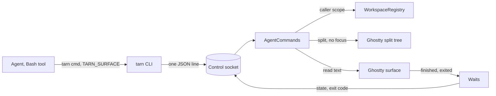

# Agent CLI: commands an agent calls

Canon for the `tarn` commands an agent calls on panes (R15 of `docs/spec.md`), built in 1.x. Rule (`.claude/CLAUDE.md`, analogs first): every behavior names its source; own behavior carries "Prior art: searched where - found what" and a user decision.

## 1. Goal and limits

The agent is a full user of the terminal: it opens files, starts commands next to itself, reads their screens, learns the result and closes what it opened. Focus and keystrokes stay with the human. 

Not: text input into an existing pane (agents use `SendMessage`; no `tarn send`); switching modules; renaming or moving panes and tabs.

## 2. Decided by the user

- U1 (2026-10-27). `tarn run` returns at once with the pane id; `tarn wait <pane>` blocks until the command ends. Rejected: a blocking `run` like Otty `pane run` (the Bash tool timeout cuts the wait while the user has not pressed Enter).
- U2. The CLI stays in the app bundle, on `PATH` in every tarn surface; `tarn skill` prints the skill of the same build (herdr `--skill`, Luvus `skill show`). The plugin carries a stub skill: run `tarn skill`; no `tarn` command means you are not in tarn. Rejected: the CLI in the plugin `bin/` (two `tarn` on `PATH`, versions drift).
- U3. `tarn new` starts any command at once, agents included.
- U4. `wait` on a `new` pane ends when its process exits.
- U5. `new` and `run` open a split in the caller's tab by default, focus unchanged; `--tab` opens an unselected tab right below the caller's row, in its group. An ungrouped caller: `tarn: put this tab in a group first`, exit 1, before creation (2026-10-29).
- U6. A split in a tab with a zoomed pane clears the zoom, as Cmd+D does.
- U7. The agent closes the splits and tabs it opened with `tarn close`, after it has read the result; no closing by itself after `wait`.
- U8. On macOS Ghostty cannot report the exit code of a configured command (`src/Surface.zig:1304-1305`); `wait` on a `new` pane says so (Otty does the same for a pane that cannot report). Rejected: an own wrapper printing OSC 133 marks.
- U9. `close` of the last pane of a tab whose viewer has unsaved edits is refused with `unsaved viewer edits`, code 1; no Save sheet appears on the user's window while the agent got `ok`.

## 3. Model

Every command names its caller by `TARN_SURFACE`; the app resolves the caller's scope (its group; for an ungrouped tab, its own tab) and refuses any pane outside it. A pane id is the UUID of a terminal surface, the same value as `TARN_SURFACE` (Otty `$OTTY_PANE_ID`, herdr `HERDR_PANE_ID`, WezTerm `$WEZTERM_PANE`).

What ends a wait:

| Pane | End event | Source |
| --- | --- | --- |
| shell pane, `run` or plain | Ghostty `command_finished` from OSC 133; a pane that sent OSC 133 counts as integrated whatever the setting | Otty `pane wait` (needs Shell Integration) |
| `new` pane | process exit, `show_child_exited` | kitty `--wait-for-child-to-exit` |
| pane already idle | answers at once | herdr `agent wait`; Otty `pane wait` |
| pane closed during the wait | state `closed` | Luvus `pane_closed` |

Own rule for the `run` pane: its typed command waits for the user's Enter, so the pane looks idle before the command starts; `wait` on a `run` pane waits for the next `command_finished`, not for idle. Prior art: searched Otty, herdr, kitty, WezTerm, Luvus, cctabs - every `run` submits with Enter, none leaves Enter to the user; follows U1. Several waits on one pane are all answered by the same event; a cancelled one (CLI killed) is released when its connection closes (Luvus; kitty `cancel_async`).

## 4. Commands

Common rules, every command except `skill`: request and reply are one JSON line with `version` (herdr). Error: stderr `tarn: <text>`, nothing on stdout, exit 1. No `TARN_SURFACE`: `tarn: not in a tarn tab`. A caller in no window set (quick terminal): `tarn: not in a workspace`. A pane id outside the scope: `tarn: no pane matched: <id>`, exit 4, never a fallback to the selected pane (Otty). `--json` prints the reply object (Otty).

| Command | What it does | Stdout | Source |
| --- | --- | --- | --- |
| `tarn open <path>[:line]` | opens a file in the viewer | nothing | own |
| `tarn notify <text>` | marks the caller and notifies | nothing | own |
| `tarn ls [--json]` | terminal panes of the scope | table | WezTerm `cli list` |
| `tarn new [--right \| --tab [--title T]] [--cwd D] -- <cmd...>` | new pane, command started | pane id | kitty `launch --keep-focus`, WezTerm `split-pane` |
| `tarn run [same options] -- <cmd...>` | new pane with a shell, command typed, not submitted | pane id | herdr `send-text` (non-submitting) |
| `tarn wait <pane> [--timeout S]` | waits for the end | state line | Otty `pane wait` |
| `tarn read <pane> [--lines N]` | screen text | text | herdr `pane read` |
| `tarn close <pane>` | closes a pane | nothing | WezTerm `kill-pane`, herdr `pane close` |
| `tarn module ls [--json]` | modules and switches | table | own |
| `tarn skill` | the skill of this build | markdown | herdr `--skill` |

1. `ls`: header `PANE  TAB  GROUP  TITLE  CWD  PROCESS  BRANCH  STATE`, one row per pane; GROUP is the group name or `-`. `--json`: `{"ok":true,"panes":[{"pane","tab","workspace","group","folder","title","cwd","process","branch","state"}]}`; `workspace` is the group id (empty when ungrouped), `folder` the workspace folder or null. No `host` (R13). `state` is the agent state or `-`. No mark for the caller's own pane (no analog has one).
2. Placement of `new` and `run`: a split below the caller's pane, `--right` to the right, focus unchanged (WezTerm `split-pane`: default bottom; herdr, kitty, Otty: no focus steal). `--tab`: a tab right below the caller's row, in its group, not selected, no creation undo (WezTerm `spawn`, herdr `tab create`, Otty `tab new`).
3. Command: the arguments after `--` are the command line (kitty, WezTerm). Ghostty takes one shell string, so the app joins them with POSIX quoting as Python `shlex.join`. A newline or carriage return is refused, `tarn: command must be one line` (it would press Enter). `--cwd` defaults to the caller pane's cwd; relative paths resolve against the CLI's directory (herdr, Luvus).
4. `new`: the pane runs the command as its process; after exit the last screen stays until a key (Ghostty `wait-after-command`, kitty `--hold`, WezTerm `exit_behavior = "Hold"`). `--title` names the tab and needs `--tab` (`tarn: --title needs --tab`). Prints the pane id (kitty, WezTerm).
5. `run`: the pane starts the user's login shell and gets the line as typed input with no newline (Ghostty `initialInput`); the user reads, edits, presses Enter. Any other control character or DEL is refused, `tarn: command has a control character` (Ctrl+O submits in zsh and bash). Prior art: herdr and Otty `send-text` pass control keys on purpose, none types a command for the user; own rule. A slow zsh rc file does not lose the line (checked on the stand 2026-10-27).
6. `wait`: ends by the table of section 3. No timeout by default (Otty `--timeout-secs`, herdr). The CLI holds the socket connection for the whole wait; the skill tells the agent to run `wait` as a background task. Output `<state>  exit <code>  <duration>`, `--json` `{"state","exit_code","command","duration_ms"}`; states `succeed`, `error` (Otty), `closed` (Luvus). Exit codes (Otty `pane wait`): 0 the end was reported, whatever the command's code; 4 no pane matched; 6 the pane cannot report the code (a `new` pane, U8, `tarn: exit code unknown`; a pane with no OSC 133 integration, `tarn: no shell integration`, answered at once, never a hang); 9 timeout. Output text is not in the reply: the agent calls `read`.
7. `read`: plain text of the last `--lines` lines of screen and scrollback, default 80, no escapes (herdr; kitty `get-text`).
8. `close`: immediate, no confirmation whatever runs (WezTerm, herdr); focus stays; a `--tab` pane closes its tab; a wait on it answers `closed`; U9 applies. Which panes to close is a rule of the skill, not a check (Otty: close only panes it opened, never the one it runs in).
9. `module ls`: `MODULE  STATE`, state `on`, `off` or `unavailable` (needed module off). Read only.
10. `skill`: prints `cli/SKILL.md` of the bundle (first line carries the app version) without the socket.

Skill rules (Otty and herdr skills as models): never move focus or press Enter for the user; watch long work in `tarn new`; a command the user must approve goes into `tarn run` then `tarn wait` as a background task; a server never ends, `read` it; `wait` exit 6: say so, read the pane, do not retry; close only panes you opened, after reading, leave failed commands and servers open; talk to other agents by `SendMessage`; open files with `tarn open`.

## 5. Analogs

Otty `docs.otty.sh` (closed, behavior only); herdr `herdrdev/herdr` 2713feb (Apache-2.0); kitty `kovidgoyal/kitty` 02dd29a (GPL-3.0, behavior only; one handler file per command); WezTerm `wezterm/wezterm` e68a8ec (MIT); Luvus `RizRiyz/luvus` 9cd3ee0 (Apache-2.0); cctabs `generativereality/cctabs` 6fda99c (MIT; `ls --json`, thin skill). Which rule follows which is named inline.

## 6. Boundaries and their tests

App tests in `macos/Tests/Tarn`, run by `make -f tarn.mk check`.

B1 no command changes the active app, key window, selected tab or first responder (app test with the user's pane focused, checked after two run loop ticks; minimized caller and inactive app by hand in the PR). B2 no command writes a newline or Enter into any surface (command line rule in the CLI and the app). B3 no command reaches a pane outside the caller's scope (two groups in one window and one in another). B4 no command writes into an existing pane (none exists). B5 a wrong id never falls back to the selected pane (exit 4). B6 `hook.sh` stays within 100 ms (hook test).

Extending: when and how the agent uses a command lives in `cli/SKILL.md` (an edit, no code, ships with the build). A new command is one handler file in `macos/Sources/Features/Tarn/AgentCommands/`, a row in `AgentCommands.handlers`, a case in `cli/tarn`, a test and a section of the skill.

Open (hand check): how the kernel echo of a typed `run` line looks before a slow prompt. Ghostty hooks used (listed in `docs/architecture.md`): `command_finished`, `show_child_exited`, `surfaceTreeDidChange`; `closeSurface(_:withConfirmation: false)`; `ghostty_surface_read_text` (fresh read, not the 500 ms cache); `initialInput`; `titleOverride`.
