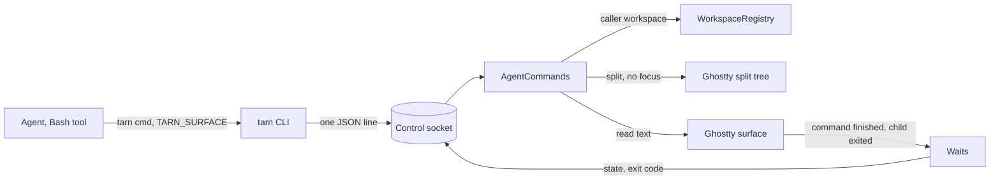

# Agent CLI: commands an agent needs, and a skill

Status: draft 2026-10-27, issue #40, task T-204, after two spec review passes and a survey of analog semantics. Canon for the `tarn` commands an agent calls. Extends `docs/spec.md` 2.2 and 11; closes open questions 2, 3 and 4 of `docs/spec.md` 12. No code yet.

Rule of this spec (`.claude/CLAUDE.md`, behavior comes from analogs): every behavior names its source; own behavior carries "Prior art: searched where - found what" and a user decision.

## Contents

1. Goal and limits
2. Decided by the user
3. Model
4. Commands
5. Ghostty first
6. Analogs and sources
7. Boundaries and their tests
8. Scenarios
9. Open questions
10. Extending and correcting
11. Slicing and dependents

## 1. Goal and limits

The agent is a full user of the terminal. It opens files, starts commands next to itself, reads their screens, learns the result and closes what it opened. Focus and keystrokes stay with the human: no command moves focus or presses Enter for the user (`.claude/CLAUDE.md`, critical invariants).

Evidence of need, from the user's transcripts (lower bounds, `~/Dev/knowledge/inbox/tarn-agent-cli-git-2026-10-27-1136.md`): requests to open a file 179, a new tab or terminal 97, a command typed by hand 81.

Is not:

- Text input into an existing pane. Agents talk to each other through Claude Code `SendMessage`. This replaces `tarn send` of R15 (`docs/spec.md` 1).
- Switching modules on or off.
- Renaming or moving panes and tabs.
- Panes outside the caller's workspace.

## 2. Decided by the user

- U1 (2026-10-27). `tarn run` returns at once with the pane id; `tarn wait <pane>` blocks until the command ends. Rejected: `run` that blocks like Otty `pane run` (the Bash tool timeout cuts the wait while the user has not pressed Enter); no return at all.
- U2. The CLI stays in the app bundle, on `PATH` in every tarn surface (`docs/install.md` 44); `tarn skill` prints the skill of the same build, as herdr `--skill` and Luvus `skill show`. The plugin carries a stub skill: run `tarn skill`; no `tarn` command means you are not in tarn. Rejected: the CLI in the plugin `bin/` (two `tarn` on `PATH`, versions drift).
- U3. `tarn new` starts any command at once, agents included. Rejected: no agents through `new`; `new` equal to `run`.
- U4. `wait` on a `new` pane ends when its process exits.
- U5. `new` and `run` open a split in the caller's tab by default, focus unchanged; `--tab` opens an unselected tab right below the caller's row, in its group. An ungrouped caller or frozen workspaces: `tarn: put this tab in a group first`, exit 1, before creation (user decision 2026-10-29, Q4 c). Rejected: a tab only; a split only.
- U6. A split in a tab with a zoomed pane clears the zoom, as Cmd+D does.
- U7. The agent closes the splits and tabs it opened with `tarn close`, after it has read the result. Rejected: closing by itself after `wait`.
- U8. On macOS Ghostty cannot report the exit code of a configured command (`src/Surface.zig:1304-1305`); `wait` on a `new` pane says so honestly, as Otty does for a pane that cannot report. Rejected: an own wrapper that prints OSC 133 marks (no analog; a program with its own marks may break the pair).
- U9. `close` of the last pane of a tab whose file viewer has unsaved edits is refused with `unsaved viewer edits`, code 1; nothing closes and no sheet appears. Rejected: the Save sheet of Cmd+W on the user's window while the agent already got `ok`.

## 3. Model

Reading: every command names its caller by `TARN_SURFACE`; the app resolves the caller's workspace and refuses any pane outside it; a wait holds its reply until the pane reports an end. Sources: `cli/tarn`, `ControlSocket.swift`, `SurfaceView.swift:659`.

Terms as in `docs/specs/windows-workspaces.md` 1. The CLI addresses panes: a pane id is the UUID of a terminal surface, the same value as `TARN_SURFACE`. Source: Otty `$OTTY_PANE_ID`, herdr `HERDR_PANE_ID`, WezTerm `$WEZTERM_PANE`: the env names the caller's pane.

Entities:

| Entity | Fields | Writer | Lives |
| --- | --- | --- | --- |
| Pane row | pane id, tab id, workspace, title, cwd, process, branch, agent state | built on request from `WorkspaceRegistry`, the surfaces and `SessionRegistry` | while the pane lives |
| Run mark | pane id, kind `new` or `run` | `AgentCommands` on `new` and `run` | until the pane closes |
| Wait | pane id, deadline, held `Reply` | `AgentCommands`, like `PendingAnswer` (`SessionRegistry.swift:220`) | until answered |

What ends a wait:

| Pane | End event | Source |
| --- | --- | --- |
| a shell pane, `run` or plain | Ghostty `command_finished` from OSC 133 shell integration; a pane that sent OSC 133 counts as integrated whatever the setting | Otty `pane wait`: "For an ordinary shell pane it means no command is running, which needs Shell Integration (OSC 133)" |
| a `new` pane | process exit, Ghostty `show_child_exited` | kitty `--wait-for-child-to-exit` |
| a pane already idle | answers at once | herdr: "`agent wait` returns immediately when the current status matches"; Otty `pane wait` "exits 0 as soon as the pane is idle" |
| a pane that closes during the wait | answers with state `closed` | Luvus: pane exit during a wait returns `reason:"pane_closed"` |

Own rule, the `run` pane: its typed command waits for the user's Enter, so the pane looks idle before the command starts. A `wait` on a pane with a run mark of kind `run` therefore waits for the next `command_finished`, not for idle. Prior art: searched Otty, herdr, kitty, WezTerm, Luvus, cctabs - every `run` submits with Enter, none leaves Enter to the user; the rule follows U1.

Several waits on one pane are all answered by the same event; a cancelled one (its CLI killed) is released when its connection closes. Source: Luvus "Cancellation, timeout, and exit release pending wait ownership"; kitty sends `cancel_async` on timeout.

## 4. Commands

Common rules, for every command except `skill`:

- Request and reply are one JSON line each, with `version` (`docs/spec.md` 2.2). Source: herdr "newline-delimited JSON over a local socket".
- Error: stderr `tarn: <text>`, nothing on stdout, exit code 1 (current rule, `cli/tarn`).
- No `TARN_SURFACE`: `tarn: not in a tarn tab`, exit 1. Source: herdr `--current` "errors when HERDR_PANE_ID is unavailable". The caller in no window set (quick terminal): `tarn: not in a workspace`. A caller in a tab that is in no workspace (`docs/specs/workspace-folder.md` G9) has its own tab as its scope.
- A pane id that matches no pane of the caller's scope (its workspace; for a caller in a tab with no workspace, its own tab): `tarn: no pane matched: <id>`, exit 4, never a fallback to the selected pane. Source: Otty "a non-matching selector fails with No pane/tab matched selector (exit 4) rather than falling back to the active one".
- `--json` prints the reply object instead of text. Source: Otty `--json`, current `tarn ls --json`.

| Command | What it does | Stdout | Source |
| --- | --- | --- | --- |
| `tarn open <path> [:line]` | opens a file in the viewer (exists) | nothing | current `cli/tarn` |
| `tarn notify <text>` | marks the caller and notifies (exists) | nothing | current `cli/tarn` |
| `tarn ls [--json]` | terminal panes of the caller's workspace, or of its own tab when the tab has no workspace | table | WezTerm `cli list` |
| `tarn new [--tab] [--right] [--cwd D] [--title T] -- <cmd...>` | new pane with the command started | pane id | kitty `launch --keep-focus`, WezTerm `split-pane` |
| `tarn run [--tab] [--right] [--cwd D] -- <cmd...>` | new pane with a shell, the command typed, not submitted | pane id | herdr `send-text` (non-submitting) |
| `tarn wait <pane> [--timeout S]` | waits for the end of the command | state line | Otty `pane wait`, `pane run --format json` |
| `tarn read <pane> [--lines N]` | screen text of a pane | text | herdr `pane read` |
| `tarn close <pane>` | closes a pane | nothing | WezTerm `kill-pane`, herdr `pane close` |
| `tarn module ls [--json]` | modules and their switches | table | current `ls` form |
| `tarn skill` | the skill of this build | markdown | herdr `--skill`, Luvus `skill show` |

Details:

1. `ls`. A table with a header, one row per terminal pane of the caller's workspace: `PANE  TAB  GROUP  TITLE  CWD  PROCESS  BRANCH  STATE`. `GROUP` is the group name or `-` when ungrouped. `--json`: `{"ok":true,"panes":[{"pane","tab","workspace","group","folder","title","cwd","process","branch","state"}]}`; `group` is the name or null, `folder` is the workspace folder path or null (a plain group has no folder). Form from WezTerm `cli list`: header `WINID TABID PANEID WORKSPACE SIZE TITLE CWD`, `--format json` with `window_id, tab_id, pane_id, workspace, size, title, cwd`. Fields from issue #40 ("folder, process, branch, host, state") without `host`: an ssh tab shows by its title and process, no host parser (`docs/spec.md` R13, #72); `state` is the agent state of `docs/spec.md` 8 or `-`. The caller knows its own pane from `TARN_SURFACE`, no mark in the table (no analog has one). The current `ls` lists agent sessions of all windows without `TARN_SURFACE` (`AttentionCommands.swift:151`); it becomes the caller's workspace and the key `sessions` becomes `panes`. Dependents: section 11.
2. Placement of `new` and `run`. Default: a split below the caller's pane, `--right` to the right, focus unchanged. Sources: WezTerm `split-pane`, "the default is equivalent to `--bottom`"; herdr "pane splitting, leave focus unchanged by default"; kitty `--keep-focus`; Otty "Every pane it opens is opened without stealing focus". Built from Ghostty's split tree without its undo (section 5). A zoomed pane in the caller's tab is unzoomed (U6). `--tab`: a tab right below the caller's row, in its group, not selected (U5), without creation undo. An ungrouped caller or frozen workspaces: `tarn: put this tab in a group first`, exit 1, before creation (Q4 c, user decision 2026-10-29); a minimized window or fullscreen style without tab support of the caller or selected tab: `tarn: window not available`. Sources for `--tab`: WezTerm `spawn`, herdr `tab create`, Otty `tab new`.
3. Command. The arguments after `--` are the command line: the program and its arguments, as kitty does ("Any command line arguments are assumed to be the command line used to run in the new window"; several commands need an explicit `sh -c "a && b"`) and WezTerm (`--` ends the options). Ghostty takes one shell string, so the app joins the arguments with POSIX quoting by the rules of Python `shlex.join`: an argument is quoted only when it has a character outside the safe set. A newline or a carriage return in an argument is refused, `tarn: command must be one line`: it would press Enter (B2). `--cwd` defaults to the cwd of the caller's pane, relative paths resolve against the CLI's current directory. Source: herdr "new terminals follow ... the source pane", "the CLI expands relative --cwd"; Luvus "Relative paths resolve against the CLI caller's current directory".
4. `new`. The pane runs the command as its process. After exit the last screen stays until a key press: Ghostty turns on `wait-after-command` for any configured command (`src/apprt/embedded.zig:568-573`). Source: kitty `--hold`, WezTerm `exit_behavior = "Hold"`. `--title` names the tab through Ghostty's `titleOverride` for `new` and `run` and needs `--tab`; otherwise `tarn: --title needs --tab`, exit 1. Sources: Otty `tab new --title` (Otty splits take no title); kitty `--title`. Prints the pane id. Source: kitty "Prints out the id of the newly opened window", WezTerm "Outputs the pane-id".
5. `run`. The pane starts the user's login shell and gets the line as typed input with no newline (Ghostty `initialInput`). The user reads it, may edit it, presses Enter. Typed text reaches the line editor as keys, so any other control character or DEL is refused too, `tarn: command has a control character` (Ctrl+O submits in zsh and bash, B2). Prior art: herdr and Otty `send-text` pass control keys on purpose, none types a command for the user; own rule, pending the user's decision. Prints the pane id. Source: herdr `send-text`, "non-submitting"; Otty `send-text`, "Nothing is appended automatically".
6. `wait`. Ends by the table of section 3. No timeout by default; `--timeout S` sets one. Source: Otty `--timeout-secs` "0 = forever", herdr "wait indefinitely when --timeout is omitted". The CLI holds the socket connection for the whole wait, not `TARN_TIMEOUT` (`cli/tarn:83`); the skill tells the agent to run `wait` as a background task. Output: `<state>  exit <code>  <duration>`, `--json` `{"state","exit_code","command","duration_ms"}`. Source: Otty `pane run --format json` `{ "state": "succeed", "exit_code": 0, "command": "./deploy.sh", "duration_ms": 1234 }`. States: `succeed`, `error` (Otty), `closed` (Luvus `pane_closed`). Exit codes of `tarn wait`, all from Otty `pane wait`: 0 the end was reported, whatever the command's code; 4 no pane matched; 6 the pane cannot report the code (a `new` pane on macOS, U8, with `tarn: exit code unknown`; a pane where Ghostty injects no OSC 133 integration (`shell-integration = none`, or a shell it does not inject for: `src/termio/shell_integration.zig:43-167`) and that sent no OSC 133 yet, with `tarn: no shell integration`, at once and not after a hang, as Otty: "the wait exits immediately and says so rather than hanging"); 9 timeout, `tarn: timeout`. Output is not part of the reply: the agent calls `read`. Source: Otty `pane run` "reports its process state ... not its output".
7. `read`. Plain text of the last `--lines` lines of the screen and scrollback, default 80, ANSI stripped. Source: herdr `pane read --lines N`, recent default 80, "ANSI escapes are stripped by default"; kitty `get-text` "By default, only plain text is returned".
8. `close`. Closes the pane immediately, with no confirmation, whatever runs in it; the last pane of a tab with unsaved viewer edits is refused (U9). Source: WezTerm `kill-pane` "Immediately and without prompting"; herdr "CLI/API closes remain immediate". Ghostty: `closeSurface(_:withConfirmation: false)` (`BaseTerminalController.swift:458-480`), focus stays where it was (`removeSurfaceNode`, `:516-535`); the pane of a `--tab` tab closes the tab. A wait on that pane answers `closed`. Which panes to close is a rule of the skill, not a check in the app. Source: Otty "The skill is instructed to close only panes it opened itself, and never the one it is running in".
9. `module ls`. One row per module of #34: `MODULE  STATE`, state `on`, `off` or `unavailable`. Read only. Before #34: `tarn: no modules in this build`.
10. `skill`. Prints the skill file of the bundle without the socket. Source `cli/SKILL.md`; the build phase that installs `cli/tarn` (`macos/Ghostty.xcodeproj/project.pbxproj:413-423`) also installs it as `Contents/Resources/tarn/SKILL.md`. The first line carries the app version. Source: herdr "the release-matched copy bundled with that binary".

Skill rules (Otty skill and herdr skill as models):

- You never move focus and never press Enter for the user; no command does.
- Watch long work in `tarn new`; a command the user must approve goes into `tarn run`, then `tarn wait` as a background task; tell the user which pane waits.
- A server never ends: do not `wait` on it, `read` it.
- `wait` exit 6: say so to the user verbatim, read the pane, do not sleep and retry (Otty skill rule).
- Close only panes you opened, never your own, after you have read the result; leave a failed command's pane and a server open until the user says.
- To talk to another agent use `SendMessage`, never a pane.
- Asking the user to open a file is wrong: `tarn open`.

## 5. Ghostty first

| Need | Ghostty has | Where | Our part |
| --- | --- | --- | --- |
| split without focus | `SplitTree.inserting`; `surfaceTree` published property; `newSplit` moves focus and `replaceSurfaceTree` always registers undo | `BaseTerminalController.swift:49-52`, `282-316`, `540-582` | insert, assign the tree, give the first responder back with `Ghostty.moveFocus` (a tree change drops it, `SurfaceView.swift:1067-1070`) |
| tab in a workspace | `WorkspaceRegistry.newTab(in:from:)`, Ghostty `newTab` | `WorkspaceRegistry.swift:269-274`, `TerminalController.swift:424` | O1, T-206 |
| command, cwd, env | `SurfaceConfiguration.command`, `workingDirectory`, `environmentVariables`; `wait-after-command` for commands | `SurfaceView.swift:581-591`, `src/apprt/embedded.zig:568-573` | fill the configuration |
| typed, not submitted input | `SurfaceConfiguration.initialInput` | `SurfaceView.swift:594` | the line without a newline |
| end of a shell command | `command_finished` with exit code | `src/Surface.zig:1194-1222`, `Ghostty.App.swift:773-774` | insertion point at `773`, before the `notify-on-command-finish` guard (default `never`, `src/config/Config.zig:1214`) |
| end of a `new` process | `show_child_exited` | `Ghostty.App.swift:1877-1891` | insertion point before the guard at `1888` |
| pane closed | `surfaceTreeDidChange` | `BaseTerminalController.swift:336` | insertion point that answers waits |
| close without alert | `closeSurface(_:withConfirmation:)` | `BaseTerminalController.swift:458-480` | call with `false` |
| screen text | `ghostty_surface_read_text`; `cachedScreenContents` (500 ms cache) | `include/ghostty.h:1239`, `SurfaceView_AppKit.swift:223` | a fresh read of the last N lines |
| tab title | `titleOverride` | `BaseTerminalController.swift:105` | set it for `--tab --title` |

The three insertion points go into `docs/architecture.md`, boundary with Ghostty, with the PR that adds them.

## 6. Analogs and sources

| Project | Licence | Source of |
| --- | --- | --- |
| Otty `docs.otty.sh` | closed, behavior only | no fallback and exit 4; `pane wait` exit codes 0, 6, 9; wait without timeout; state JSON; close rule of the skill; "opened without stealing focus" |
| herdr `herdrdev/herdr` 2713feb | Apache-2.0 | newline JSON socket; focus unchanged on split; non-submitting `send-text`; `read --lines`, default 80, ANSI stripped; immediate close; `--skill` |
| kitty `kovidgoyal/kitty` 02dd29a | GPL-3.0, behavior only | argv command line; `--keep-focus`; `--hold`; `--wait-for-child-to-exit`; prints the id |
| WezTerm `wezterm/wezterm` e68a8ec | MIT | `cli list` table and JSON; `split-pane` default bottom, `--right`; `kill-pane` without prompting |
| Luvus `RizRiyz/luvus` 9cd3ee0 | Apache-2.0 | `pane_closed` during a wait; release of cancelled waits; relative `--cwd`; `skill show` |
| cctabs `generativereality/cctabs` 6fda99c | MIT | `ls --json`; thin skill with references |
| Python `shlex.join` | PSF | quoting of the command line |

Reports of task T-204: `recon-cctabs.md`, `recon-others.md`, `recon-semantics.md`, `spec-review.md`; the earlier survey in `~/Dev/knowledge/inbox/tarn-agent-cli-git-2026-10-27-1136.md`.

## 7. Boundaries and their tests

What the CLI never does, for any input. App tests live in `macos/Tests/Tarn`, run by `make -f tarn.mk check`.

| Boundary | Test |
| --- | --- |
| B1. No command changes the active app, the key window, the selected tab or the first responder | app test with the user's pane focused: every command, all four checked after two run loop ticks; with another app active and a minimized caller window: a manual check at acceptance, written in the PR |
| B2. No command writes a newline or Enter into any surface | unit test of the command line rule in the CLI and in the app |
| B3. No command reaches a pane outside the caller's workspace; a caller in a tab with no workspace reaches only the panes of its own tab | two workspaces in one window and one in a second window (D10) |
| B4. No command writes into an existing pane | there is no command for it; the socket refuses unknown commands |
| B5. A wrong id never falls back to the selected pane | test with a missing id: exit 4 |
| B6. `hook.sh` stays within 100 ms | the hook test is unchanged |

## 8. Scenarios

1. Open a file. `tarn open docs/report.md`; the viewer shows it; the user keeps typing in the agent pane.
2. Dev server. `tarn new --tab --title web -- npm run dev`; a row `web` appears under the agent's row; the agent reads `tarn read <id> --lines 30` for the port and leaves the tab open.
3. Tests next to the agent. `tarn new -- npm test` opens a split below; `tarn wait <id>` exits 6 on macOS, `tarn: exit code unknown`; the agent reads the pane, sees the failures, tells the user and leaves the split open.
4. Approved command. `tarn run -- sudo make install`; a split shows the typed command; the agent runs `tarn wait <id>` as a background task and tells the user. The user presses Enter and types the password. `wait` prints `succeed  exit 0  12.4s`; the agent reads the pane and closes it.
5. User refuses. The user closes the split: `wait` prints `closed`; the agent does not retry.
6. Neighbour agent. `tarn new --tab -- claude 'review PR 51'`; the new session shows in the sidebar; the agents talk through `SendMessage`.
7. Outside tarn. In iTerm the stub skill runs `tarn skill`, the command is missing, the agent does nothing more.

## 9. Open questions

- O1. `--tab` without selection. Ghostty `newTab` changes focus on several paths: `parent.deminiaturize` (`TerminalController.swift:456`), an alert sheet in non-native fullscreen (`438-446`), `tabGroup.selectedWindow` (`493`), `showWindowSafely` (`502`), `NSApp.activate` on the next tick (`510-520`); placement under the caller needs T-206. The `--tab` PR first runs a spike with tarn inactive and with the caller's window minimized. If B1 cannot hold without editing Ghostty logic, the user decides.
- O2. `initialInput` and a slow zsh rc file: whether the typed line survives until the prompt. O2 checked: 2026-10-27 on the stand with `/bin/zsh`, an rc with `sleep 2` first, alone and followed by the user's rc (zsh-autosuggestions, fzf-tab, zsh-syntax-highlighting, starship); `tarn run -- sh -c ...` did not run for 6-7 s, `wait --timeout 3` exited 9, one Enter ran the line intact and `wait` answered `succeed  exit 0`. The screen was not read: how the kernel echo of the typeahead looks before the prompt is for the hand check.

## 10. Extending and correcting

The user watches what agents do in use and corrects it (user decision 2026-10-27). Two levers:

- When and how the agent uses a command lives in one file, `cli/SKILL.md`. A correction of the agent's behavior is an edit of that file, no code; it ships with the next build (U2).
- What a command does lives in one handler file per command, as kitty keeps one file per remote command (`kitty/rc/launch.py`, `close_window.py`, `get_text.py`, commit 02dd29a). A new command is one handler file in `macos/Sources/Features/Tarn/AgentCommands/`, one row in the dispatch table of `AgentCommands`, one case in `cli/tarn`, one test and one section of the skill.

What an agent did is visible without new logging: every call is a Bash tool call in the agent's transcript; refusals go to `os_log` by the error rule of `docs/spec.md` 2.2.

## 11. Slicing and dependents

Each PR into `dev`, under 400 lines of code, in this order:

| PR | Content | Depends on |
| --- | --- | --- |
| 1 | `AgentCommands` skeleton, caller and workspace check, `ls` on panes, exit 4, B3, B5; demo `ls` | none |
| 2 | `new` as a split, command line rule, B1, B2; demo split | 1 |
| 3 | waits, end and close insertion points, `wait` in the app and the CLI | 2 |
| 4 | `run` as a split, O2 test | 3 |
| 5 | `read` and `close` | 1 |
| 6 | `skill`, the plugin stub skill, `module ls` | 1, #34 for real rows |
| 7 | `--tab` for `new` and `run`, O1 spike | 2, T-206 |

Change with the PR that changes the behavior: `docs/spec.md` R15 (no `send`), 2 component table, 11 `ls` row, 12 questions 2-4 closed; `docs/modules/control-socket.md`, `docs/modules/attention.md` 29, 33; `docs/architecture.md` insertion points; `cli/tarn` usage lines 5, 17 and error text at 93; `cli/test/cli_test.py`; `macos/Tests/Tarn/AttentionCommandsTests.swift`; `demo/js/commands/tarn.js`, `demo/js/session-rows.js`, `demo/test/check_a.py`; the #41 spec, which reads `ls`.
