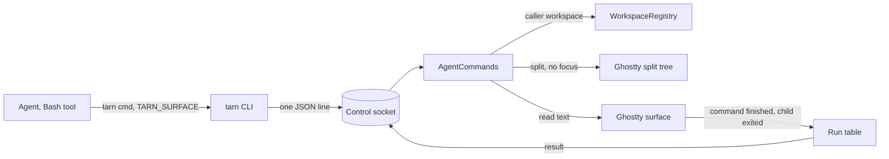
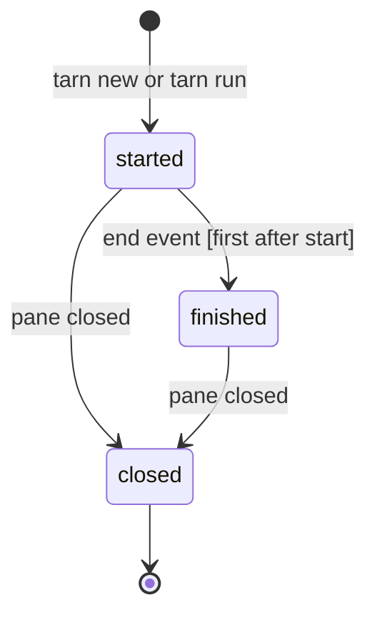

# Agent CLI: commands an agent needs, and a skill

Status: draft 2026-10-27, issue #40, task T-204, after spec review pass 1. Canon for the `tarn` commands an agent calls. Extends `docs/spec.md` 2.2 and 11; closes open questions 2, 3 and 4 of `docs/spec.md` 12. No code yet.

## Contents

1. Goal and limits
2. Decided by the user
3. Model
4. Commands
5. Ghostty first
6. Prior art
7. Boundaries and their tests
8. Scenarios
9. Decisions
10. Open questions
11. Slicing and dependents

## 1. Goal and limits

The agent is a full user of the terminal. It opens files, starts commands next to itself, reads their screens and learns the result. Focus and keystrokes stay with the human: no command moves focus or presses Enter for the user (`.claude/CLAUDE.md`, critical invariants).

Evidence of need, from the user's transcripts (lower bounds, `~/Dev/knowledge/inbox/tarn-agent-cli-git-2026-10-27-1136.md`): requests to open a file 179, a new tab or terminal 97, a command typed by hand 81.

Is not:

- Text input into an existing pane. Agents talk to each other through Claude Code `SendMessage`. This replaces `tarn send` of R15 (`docs/spec.md` 1).
- Switching modules on or off.
- Closing, renaming or moving panes and tabs.
- Panes outside the caller's workspace.

## 2. Decided by the user

- U1 (2026-10-27). `tarn run` returns at once with the pane id; `tarn wait <pane>` blocks until the command ends and prints the exit code and the tail of the output. Rejected: `run` that blocks (the Bash tool timeout cuts the wait while the user has not pressed Enter yet); no return at all (the agent cannot know when the command ended).
- U2 (2026-10-27). The CLI stays in the app bundle, already on `PATH` in every tarn surface (`docs/install.md` 44). `tarn skill` prints the skill bundled in the same build. The plugin carries a short skill that only says: run `tarn skill`; no `tarn` command means you are not in tarn, do nothing. Rejected: the CLI in the plugin `bin/` (two `tarn` on `PATH`; plugin and app versions drift, and the socket protocol breaks).
- U3 (2026-10-27). `tarn new` starts any command at once, agents included (`tarn new -- claude "do X"`). The command is the process of the pane; nobody presses Enter. Rejected: no agents through `new` (one more rule, an extra keypress for every neighbour agent); `new` equal to `run` (a dev server would wait for the user, against #43 sleep mode).
- U4 (2026-10-27). `wait` on a `new` pane ends when its process exits. Rejected: `wait` only for `run` (the agent would poll the screen for `npm test`).
- U5 (2026-10-27). `new` and `run` open a split in the caller's tab by default, focus stays where it is; `--tab` opens a tab right below the caller's row in the sidebar. Rejected: a tab only (Ghostty `newTab` selects the tab and activates the app, O1); a split only (a long server takes the agent's space for good).

- U6 (2026-10-27). A split in a tab with a zoomed pane clears the zoom, as Cmd+D does. Rejected: refusing with `tarn: tab is zoomed` (the agent could not start anything in that tab before `--tab`).

## 3. Model

Reading: every command names its caller by `TARN_SURFACE`; the app resolves the caller's workspace and refuses any pane outside it; a run stores its result when the command ends, and `wait` reads it. Sources: `cli/tarn`, `ControlSocket.swift`, `SurfaceView.swift:659`.

Terms as in `docs/specs/windows-workspaces.md` 1. The CLI addresses panes, not tabs: a pane id is the UUID of a terminal surface, the same value as `TARN_SURFACE`. The CLI accepts any unique prefix of at least 4 hex characters. The caller is the pane the agent runs in; its workspace is the workspace of the tab that holds that pane.

Entities:

| Entity | Fields | Writer | Lives |
| --- | --- | --- | --- |
| Pane row | id, tab title, cwd, process, agent, state, branch, host | built on request from `WorkspaceRegistry` (panes) and `SessionRegistry` (agent state) | while the pane lives |
| Run | pane id, kind `new` or `run`, owner pane, command line, state, result | `AgentCommands`; the result only by the end handler | until its pane closes |
| Result | exit code or unknown, duration, tail at the end | end handler | with its run |
| Waiter | run, deadline, held `Reply` | `AgentCommands`, like `PendingAnswer` (`SessionRegistry.swift:220`) | until answered |

Run state:

End event: Ghostty `command_finished` of the pane for both kinds. For kind `run` it comes from the shell integration marks of the user's shell. For kind `new` it comes from marks our wrapper prints around the command (4.4), because on macOS Ghostty runs a command through `/usr/bin/login` and its exit code detection does not work there (`src/Surface.zig:1304-1305`). Ghostty `show_child_exited` without an end event before it gives the result `exit ?` (U4: the process exit ends the wait). Inside Ghostty `start_command` exists (`src/Surface.zig:1194`) but is not an app action, so the app cannot tell "typed" from "running". Only the first end event after start counts; later commands the user runs in that pane do not change the result. Runs live in memory: after an app restart a pane may come back with the same UUID, and `wait` on it answers `tarn: no such run`.

Pane close: the end handler learns it from `surfaceTreeDidChange` of the pane's controller (`BaseTerminalController.swift:336`), the insertion point that also serves `--tab`. A run whose pane closes before its end event becomes `closed`. A finished run keeps its result after the pane closes, until its first answer or 10 minutes: a `new` pane closes on the user's key press, often before the agent asks.

`wait` rules: a finished run answers at once with its result; a started run holds the reply until the end event, the deadline or the pane close; a new `wait` on the same run replaces a held one, which is closed without an answer (its CLI may be dead: a killed background task); `wait` after the answer returns the same result again. A pane moved to another workspace during `wait` keeps its run: the workspace check is done when the command arrives.

## 4. Commands

Common rules, for every command except `skill`:

- Request and reply are one JSON line each, with `version`, as in `docs/spec.md` 2.2. Reply keys: `ok`, `error`, plus the command's own keys.
- Error: stderr `tarn: <text>`, nothing on stdout, exit code 1 (current rule, `cli/tarn`). Usage errors and unknown options are errors too.
- No `TARN_SURFACE`: `tarn: not in a tarn tab`. The caller in no workspace (quick terminal, `SessionRegistry.swift:501`): `tarn: not in a workspace`.
- A pane id that matches nothing in the caller's workspace: `tarn: no such pane: <id>`; matches two: `tarn: ambiguous pane: <id>`. Never a fallback to the selected pane.
- Anything unexpected in the app: a log line with command, caller and reason (as `AttentionCommands.swift:126`) and an error reply; state does not change.
- `--json` prints the reply object instead of text, where the command has a text form.

| Command | What it does | Stdout | Exit |
| --- | --- | --- | --- |
| `tarn open <path> [:line]` | opens a file in the viewer (exists) | nothing | 0, 1 |
| `tarn notify <text>` | marks the caller and notifies (exists) | nothing | 0, 1 |
| `tarn ls [--json]` | terminal panes of the caller's workspace | rows | 0, 1 |
| `tarn new [--tab] [--cwd D] [--title T] -- <cmd...>` | new pane with the command started | pane id | 0, 1 |
| `tarn run [--tab] [--cwd D] -- <cmd...>` | new pane with a shell, the command typed, not submitted | pane id | 0, 1 |
| `tarn wait <pane> [--timeout S] [--lines N]` | result of the run in that pane | exit line, tail | 0, 1, 2, 3 |
| `tarn read <pane> [--lines N]` | screen text of a pane | text | 0, 1 |
| `tarn module ls [--json]` | modules and their switches | rows | 0, 1 |
| `tarn skill` | the skill of this build | markdown | 0, 1 |

Details:

1. `ls`. One row per terminal pane of the caller's workspace, plain shells included: `<id8>  <tab title>  <cwd>  <process>  <branch>  <state>`, `-` for an empty field, `*` before the caller's row. `--json`: `{"ok":true,"panes":[...],"self":"<uuid>"}`, the row fields per pane. `host` stays empty until #39. The current `ls` lists agent sessions of all windows without `TARN_SURFACE` (`AttentionCommands.swift:151`, `cli/tarn:109-118`); it becomes the caller's workspace only, needs `TARN_SURFACE`, and the JSON key `sessions` becomes `panes`. Dependents: section 11.
2. Placement of `new` and `run`. Default: a split to the right of the caller's pane, inside the caller's tab, built from Ghostty's split tree (section 5). The new tree is assigned without Ghostty's undo, so the user's Cmd+Z never removes an agent's pane. A change of the split tree drops the first responder in SwiftUI (`SurfaceView.swift:1067-1070`, `BaseTerminalController.swift:530-535`), so the layer gives it back to the pane that held it before, as Ghostty's own close path does. A zoomed pane in the caller's tab is unzoomed, as with Cmd+D (`SplitTree.swift:125-130`, U6); focus stays. `--tab`: a tab in the caller's workspace, right below the caller's row, not selected; it needs T-206 (move a tab without focus) and ships after it. With `--tab`, a minimized window or non-native fullscreen of the caller is refused with `tarn: window not available` instead of Ghostty's deminiaturize or alert.
3. Command line. Exactly one argument after `--` is taken as a shell line as written (`tarn run -- 'make && make install'`). Two or more are joined by spaces; an argument with a character outside `A-Za-z0-9_./=:,+@%-` is put in POSIX single quotes, `'` inside written as `'\''`. So `tarn new -- claude "do X"` runs `claude 'do X'`, and the user approves `git commit -m 'fix bug'`, a line a human reads. The CLI and the app both refuse a newline, a carriage return, a tab or any other control character: `tarn: command must be one line`. `--cwd` defaults to `$PWD` of the CLI, as `open` does (`cli/tarn:105`).
4. `new`. On macOS Ghostty runs a configured command as `/usr/bin/login -flp <user> /bin/bash --noprofile --norc -c "exec -l <command>"` (`src/termio/Exec.zig:1933-1962`), so a raw line would lose everything after `&&` or a `cd`. The layer therefore passes one wrapper as the command: the user's login shell with `-l -c` and the quoted script `printf '\033]133;C\007'; <line>; printf '\033]133;D;%d\007' $?`. The login shell gives the user's `PATH`; the two marks are OSC 133 C and D, which Ghostty turns into `command_finished` with the exit code (`src/Surface.zig:1194-1222`). Ghostty turns on `wait-after-command` for any configured command (`src/apprt/embedded.zig:568-573`), so after exit the last screen stays until the user presses a key. `--title` sets Ghostty's `titleOverride` on the tab (`BaseTerminalController.swift:105`) and needs `--tab`; without it: `tarn: --title needs --tab`. Prints the pane id.
5. `run`. The pane starts the user's login shell and gets the line as typed input without a newline (Ghostty `initialInput`). The user reads it, may edit it, and presses Enter. Prints the pane id. The skill tells the agent to tell the user what waits in that pane.
6. `wait`. Rules in section 3. `--timeout` default 600 s, max 3600 s; the CLI waits for the socket `--timeout` plus 5 s, not `TARN_TIMEOUT` (`cli/tarn:83`). Output: `exit <code>  <duration>`, `exit ?` when Ghostty does not know the code (`-1`, `src/apprt/action.zig:1023`), then the tail: the last `--lines` lines of the pane read at the end event (default 50, max 2000). Exit codes of `tarn` itself: 0 the run ended, whatever its code; 2 deadline, `tarn: timeout`, reply field `"timeout":true`; 3 the pane closed before the end, `tarn: pane closed`, reply field `"closed":true`; 1 any other error. The app quitting during `wait` closes the connection: `tarn: no answer from tarn`, exit 1. Only the owner pane waits on a run: `tarn: not your run`. A `run` pane whose shell has no Ghostty shell integration never reports the end; `wait` hits the deadline, and the skill says so.
7. `read`. Plain text of the last `--lines` lines, screen and scrollback, default 100, max 2000, trailing spaces trimmed. The caller's own pane is allowed. Fresh read, not Ghostty's 500 ms cache.
8. `module ls`. One row per module of #34: `<name>  on|off|unavailable`. Read only. Before #34 lands: `tarn: no modules in this build`.
9. `skill`. Prints the skill file of the app bundle without the socket, so it works while the app starts. Source `cli/SKILL.md`; the existing build phase that installs `cli/tarn` into `Contents/MacOS` (`macos/Ghostty.xcodeproj/project.pbxproj:413-423`) also installs it as `Contents/Resources/tarn/SKILL.md`. The first line carries the app version. Up to 8 KB: one page of rules, then one example per command.

Text samples:

- `tarn ls`: `* 3f2a91c0  tarn  ~/Dev/tarn  claude  main  working`
- `tarn wait 3f2a`: `exit 0  12.4s`, then the tail
- `tarn run -- "$(printf 'a\nb')"`: `tarn: command must be one line`

Skill content, the rules part:

- You never move focus and never press Enter for the user; no command does.
- Watch long work in `tarn new`; a command the user must approve goes into `tarn run`, then `tarn wait` as a background task, and you tell the user which pane waits.
- A server never ends: do not `wait` on it, `read` it.
- Do not poll `tarn read` for a result; use `tarn wait`.
- To talk to another agent use `SendMessage`, never a pane.
- Asking the user to open a file is wrong: `tarn open`.

## 5. Ghostty first

| Need | Ghostty has | Where | Our part |
| --- | --- | --- | --- |
| split without focus | `SplitTree.inserting`; `surfaceTree` is a published property whose `didSet` updates controllers; `newSplit` moves focus and `replaceSurfaceTree` always registers undo | `BaseTerminalController.swift:49-52`, `282-316`, `540-582` | insert, assign the tree, give the first responder back with `Ghostty.moveFocus` |
| pane closed | `surfaceTreeDidChange` | `BaseTerminalController.swift:336` | insertion point that tells the run table |
| tab in a workspace | `WorkspaceRegistry.newTab(in:from:)` with a pending target, Ghostty `newTab` | `WorkspaceRegistry.swift:269-274`, `TerminalController.swift:424` | O1, T-206 |
| command of a pane | `SurfaceConfiguration.command`, `workingDirectory`, `environmentVariables`; `wait-after-command` on for commands | `SurfaceView.swift:581-591`, `src/apprt/embedded.zig:568-573` | fill the configuration |
| typed, not submitted input | `SurfaceConfiguration.initialInput` | `SurfaceView.swift:594` | the line without a newline |
| end of a `run` command | action `command_finished` with exit code | `src/Surface.zig:1198-1222`, `Ghostty.App.swift:773-774` | insertion point in the dispatch at `773`, before the `notify-on-command-finish` guard (default `never`, `src/config/Config.zig:1214`) |
| end of a `new` process | our wrapper's OSC 133 marks, then `command_finished`; `show_child_exited` as the fallback | `Ghostty.App.swift:1877-1891` | insertion point before the guard at `1888`, which drops exits with `timetime_ms` 0 |
| screen text | `ghostty_surface_read_text`; `cachedScreenContents` | `include/ghostty.h:1239`, `SurfaceView_AppKit.swift:223` | a fresh read of the last N lines |
| tab title | `titleOverride` | `BaseTerminalController.swift:105` | set it for `--tab --title` |
| caller identity | env per surface | `SurfaceView.swift:659` (`TARN_SURFACE`, ours) | none |

The three insertion points go into `docs/architecture.md`, boundary with Ghostty, with the PR that adds them.

## 6. Prior art

| Project | Licence | Takes | Leaves |
| --- | --- | --- | --- |
| cctabs `generativereality/cctabs` 6fda99c | MIT | `ls --json` with self, unknown option is an error, thin skill | Tabby only; binary on npm apart from the skill; `send` into other tabs; `new -B` activates the tab, then returns focus |
| Otty `docs.otty.sh` | closed | `pane run` + `wait` instead of polling; no fallback to the active element; panes "opened without stealing focus" | `send-keys` with Enter |
| Luvus (ex-bohay) `RizRiyz/luvus` 9cd3ee0 | Apache-2.0 | `skill show` prints the version-matched skill of the binary; `pane split --no-focus`; JSON result or error | `agent keys`; no-focus as an option instead of the rule |
| herdr | Apache-2.0 | `herdr --skill`, release-matched copy | input into other panes |
| cmux | GPL-3.0, BSL | `read-screen`, `notify` | `send` into the focused terminal |

Reports of task T-204: `recon-cctabs.md`, `recon-others.md`, `spec-review.md`; the earlier survey in `~/Dev/knowledge/inbox/tarn-agent-cli-git-2026-10-27-1136.md`.

## 7. Boundaries and their tests

What the CLI never does, for any input. Each line gets a test; app tests live in `macos/Tests/Tarn`, run by `make -f tarn.mk check`.

| Boundary | Test |
| --- | --- |
| B1. No command changes the active app, the key window, the selected tab or the first responder | app test with the user's pane focused: run every command, check all four after two run loop ticks (the first responder drops a tick later); with another app active and with a minimized caller window: a manual check by the user at acceptance, written in the PR |
| B2. No command writes a newline, Enter or a control character into any surface | unit test of the command line rule in the CLI and in the app, with `\n`, `\r`, `\t` |
| B3. No command reaches a pane outside the caller's workspace | two workspaces in one window and one in a second window (D10): `ls`, `read`, `wait` see only their own |
| B4. No command writes into an existing pane | there is no command for it; the socket refuses unknown commands |
| B5. A wrong id never falls back to the selected pane | test with a missing and an ambiguous prefix |
| B6. `hook.sh` stays within 100 ms | the hook test is unchanged |

## 8. Scenarios

1. Open a file. The agent wrote a report. `tarn open docs/report.md`; the viewer shows it; the user keeps typing in the agent pane.
2. Dev server. `tarn new --tab --title web -- npm run dev`; a row `web` appears under the agent's row; the agent reads `tarn read <id> --lines 30` for the port.
3. Tests next to the agent. `tarn new -- npm test` opens a split; `tarn wait <id>` returns `exit 1` and the failures; the screen stays until the user presses a key.
4. Approved command. `tarn run -- sudo make install` prints `3f2a`; a split shows the typed command next to the agent; the agent calls `tarn wait 3f2a` as a background task and tells the user. The user reads, presses Enter, types the password. `wait` returns `exit 0` and the tail.
5. User edits the command before Enter. `wait` returns the result of what ran.
6. User refuses. The user closes the split: `wait` exits 3, `tarn: pane closed`; the agent does not retry.
7. User is away. `wait` hits 600 s: exit 2. The agent waits again or asks.
8. Neighbour agent. `tarn new --tab -- claude "review PR 51"`; the new session shows in the sidebar with its state; the agents talk through `SendMessage`.
9. Outside tarn. In iTerm the plugin skill runs `tarn skill`, the command is missing, the agent does nothing more.

## 9. Decisions

- Name `open` stays; the draft `view` is dropped: `open` is in `docs/spec.md` 11 already, two names for one action cost more.
- Address by pane UUID prefix, not by row number: rows shift (`docs/spec.md` 12, question 2). Rejected: Claude session id (absent for plain panes, changes on `/clear`); tab id (a tab holds several panes, and `TARN_SURFACE` names a pane).
- Scope is the caller's workspace (issue #40). Rejected: all panes (cctabs `scrollback`). Affects #41 neighbours, which reads the same rows.
- Only the owner pane waits on a run. Rejected: anyone waits on any pane (a second agent would follow the first one's approval).
- The result is kept at the end event. Rejected: the tail read at `wait` time (a later command of the user would replace it).
- Exit codes 0, 1, 2 timeout, 3 closed. Rejected: forwarding the command's exit code (it collides with 1).
- Split to the right, as Cmd+D. Revisit if users ask for down.
- Skill up to 8 KB: cctabs ships 36 KB plus 13 references, and every session pays for it. Revisit if agents misuse a command twice.

## 10. Open questions

- O1. `--tab` without selection. Ghostty `newTab` changes focus on several paths: `parent.deminiaturize` (`TerminalController.swift:456`), an alert sheet in non-native fullscreen (`438-446`), `tabGroup.selectedWindow` (`493`), `showWindowSafely` (`502`), `NSApp.activate` on the next tick (`510-520`); placing the tab under the caller adds `moveNatively` (`WorkspaceRegistry.swift:97-104`, `259-261`), which T-206 replaces. The `--tab` PR first runs a spike with tarn inactive and with the caller's window minimized: create, then restore selection, key window and activation. If B1 cannot hold without editing Ghostty logic, the user decides.
- O2. The tail is the last N lines of the pane, not the exact output; it may include the prompt. Selecting by shell integration marks is not checked.
- O3. `initialInput` and a slow zsh rc file: whether the typed line survives until the prompt is not checked; the `run` PR tests it with the user's zsh.
- O4. The wrapper marks of 4.4 when the command itself is a full-screen program or another agent that prints its own OSC 133: whether Ghostty pairs our D with our C is not checked; the `new` PR tests it with `claude`.

## 11. Slicing and dependents

Each PR into `dev`, under 400 lines of code, in this order:

| PR | Content | Depends on |
| --- | --- | --- |
| 1 | `AgentCommands` skeleton, caller and workspace check, `ls` on panes, id prefix, B3, B5; demo `ls` | none |
| 2 | `new` as a split, wrapper, command line rule, B1, B2; demo split | 1 |
| 3 | run table, end and close insertion points, `wait` in the app and the CLI, O4 test | 2 |
| 4 | `run` as a split, O3 test | 3 |
| 5 | `read` | 1 |
| 6 | `skill`, the plugin stub skill, `module ls` | 1, #34 for real rows |
| 7 | `--tab` for `new` and `run`, O1 spike | 2, T-206 |

Change with the PR that changes the behavior: `docs/spec.md` R15 (no `send`), 2 component table, 11 `ls` row, 12 questions 2-4 closed; `docs/modules/control-socket.md`, `docs/modules/attention.md` 29, 33; `docs/architecture.md` insertion points; `cli/tarn` usage lines 5, 17 and error text at 93; `cli/test/cli_test.py`; `macos/Tests/Tarn/AttentionCommandsTests.swift`; `demo/js/commands/tarn.js`, `demo/js/session-rows.js`, `demo/test/check_a.py`; the #41 spec, which reads `ls`.
