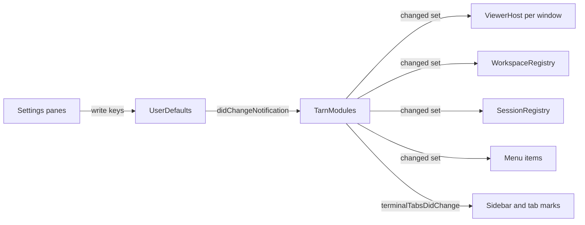

# Modules: registry and switches

Issue #34, task T-205. Every tarn feature is a module the user switches on or off in Settings > Modules.

## 1. Terms

| Term | Meaning |
|---|---|
| Module | a tarn feature with one switch: sidebar, file viewer, workspaces, permission card, notifications |
| Stored state | the value of the switch in UserDefaults |
| Effective state | stored state on and every module it needs effectively on |
| Needs | a module works only while another module is on; shown as "needs X" |
| Frozen workspace | a workspace that existed when Workspaces was switched off; kept unchanged until it is switched on |

## 2. Decided by the user (2026-10-27)

1. Modules: Sidebar, File viewer, Workspaces, Permission card, Notifications. Several viewer panes around the terminal are part of the file viewer, not a module.
2. Only the permission card needs another module, the sidebar. Workspaces work without the sidebar: with tabs at the top, each tab carries the name of its workspace.
3. A switch applies at once, with no restart, as the File viewer and tab style switches do today.
4. An off module shows no UI and does not react to events. Light observers (the control socket, the session registry) may keep running; zero cost is not required.
5. State lives in UserDefaults, like the current switches.
6. Workspaces off imitates a tarn with no workspaces: windows and tabs behave as if workspaces did not exist. The current workspaces are frozen, tabs of frozen workspaces stay visible, new work goes to a workspace with the home folder as its folder, named "~" (an existing workspace with that folder takes it). On again the frozen workspaces come back and "~" stays.
7. Claude Code: the Modules section shows one agent line, Claude Code, with its version and checks that tarn works with it; no module is gated by the version. Other agents (Codex, pi, OpenCode) come when tarn supports them.
8. One PR into `dev`.
9. Benchmark: all modules off against all on goes into the report, with no threshold.
10. `docs/spec.md` principle 1 gets an exception: features of section 1 may be switched off in Settings > Modules; features outside it are still cut.

Not in scope: a plugin system for third parties, presets, Ghostty's own terminal splits.

## 3. Prior art

| Source | What we take |
|---|---|
| Tellurion `26620ed` (AGPL, behavior and structure only, no code) `macos/Sources/Features/Setup/ExtremeSettings.swift:8-241`, `SettingsWindow.swift:149-177` | one enum of features with title and detail; a UserDefaults Bool per feature, on by default; one `isOn` guard read at the point of use; a per-feature teardown on switch-off; a Features list of switches with a detail line |
| Stats `69efd1c` (MIT) `Kit/module/module.swift:206,219` | `enable()` and `disable()` per module |
| tarn `FileViewerSetting` (`TarnSettings.swift:84`), `TabStyle.applyToOpenWindows` (`:35`), `TerminalController.all` (`ViewerClose.swift:93`) | read-at-call-time getter; a push over open windows after a change |

Tellurion has no dependencies between features; "needs X" is ours. Upstream Ghostty has no registry of app features: `.ghosttyConfigDidChange` covers Ghostty config keys only (`Ghostty.App.swift:2433`).

## 4. Rules

1. **Off keeps state.** Switching off never deletes user state: viewer tabs, unsaved edits, viewer areas and workspaces stay in memory and in restore data. On again draws the state as it is.
2. **One read path.** Every path that draws a module's UI or creates its objects reads the effective state at that moment: commands, clicks, socket commands, restore, undo, reopen, detach, drop. A path added later follows the same rule.
3. **Off gives the agent its own behavior back.** Where tarn replaces something Claude Code does itself (the permission dialog, its terminal notifications), an off module stops replacing it.
4. **Any writer.** Owners observe `UserDefaults.didChangeNotification`, compare the effective set with the last one and act on the difference.
5. **Unexpected input.** A key with a value of the wrong type counts as its default (on). A failed agent check shows its hint. Both are logged with `os_log`, category `settings`; nothing crashes.

## 5. Modules

| Module | Key | Needs | Off: what the user sees |
|---|---|---|---|
| Sidebar | `TarnTabStyle` (kept: on = `sidebar`, off = `top`, saved values survive) | none | the native tab bar at the top, as in Ghostty: today's "Tabs at the top" style with agent marks in native tabs, plus the workspace name while Workspaces is on |
| File viewer | `TarnFileViewer` (kept) | none | viewer panes are not drawn; their tabs, areas and unsaved edits stay and come back when the module is on; Cmd+B does nothing, a path click goes to the system opener (today's behavior), `tarn open` answers "the file viewer is off in Settings" (today's text); the sidebar Toggle File Viewer button and the menu item are hidden |
| Workspaces | `TarnModule.workspaces` | none | one flat list with no headers; all tabs visible, in today's order; the registry stops grouping and moving tabs, so a new tab lands where Ghostty puts it and a drag only changes order; new tabs join the workspace "~"; New Workspace (button, menu item, Shift+Cmd+T) is hidden or does nothing; no workspace name in the window subtitle or native tabs. On again: frozen workspaces come back with their tabs that still exist, "~" holds the tabs opened while off, and the registry regroups the tabs |
| Permission card | `TarnModule.permissionCard` | Sidebar | the hover card has no Allow, Deny or answer buttons (title, folder and state stay); a `PermissionRequest`, pending or new, gets an empty reply at once, the path a question with no options takes today (`SessionRegistry.swift:277`), so Claude Code shows its own dialog |
| Notifications | `TarnModule.notifications` | none | no new banners (delivered ones stay in Notification Center); Cmd+U does nothing and its menu item is hidden; `tarn notify` answers "notifications are off in Settings"; Claude Code's own terminal notifications (OSC 9 and 777) are no longer suppressed (`Attention.suppresses`) |

All keys default to on. While Sidebar is off, Permission card keeps its stored state, its switch is greyed out with "needs Sidebar" and it behaves as off.

Workspaces with Sidebar off: each native tab reads the tab title (Ghostty's), then the workspace name, then the agent state dot (user decision 2026-10-27). The name sits in our tab mark `NativeTabMark` (`Sidebar.swift:1131`) after the title; there is no insertion point and Ghostty's title logic is not edited. The window subtitle shows the workspace as with the sidebar, and New Workspace works.

The tab style picker moves from Settings > Tabs to the Sidebar row; Tabs keeps the row size. The session registry and the control socket run whatever the switches are; they hold no UI.

## 6. Settings > Modules

```
+-------------------------------------------------------------+
| Modules                                                     |
|                                                             |
|  Sidebar                                            [off]   |
|  Tabs in workspaces with agent state, on the left.          |
|  File viewer                                        [on ]   |
|  Files, markdown and code next to the terminal.             |
|  Workspaces                                         [on ]   |
|  Tab groups per project.                                    |
|  Permission card                                    [---]   |
|  Allow or deny from the sidebar card.        needs Sidebar  |
|  Notifications                                      [on ]   |
|  A banner when an agent needs you; Cmd+U jumps to it.       |
|                                                             |
|  Agents                                                     |
|  Claude Code 2.1.311     [v] found  [v] plugin  [v] events  |
+-------------------------------------------------------------+
```

- A new section `modules` in `TarnSettingsView.Section` (`TarnSettings.swift:147`), first in the list, grouped `Form` like the other panes. The File Viewer pane keeps its switch on the same key.
- The agent line runs its checks off the main thread when the pane opens; no network:
  1. found: `claude --version` from the first of `~/.local/bin/claude`, `/opt/homebrew/bin/claude`, `/usr/local/bin/claude`, `~/.claude/local/claude`; none of them: `$SHELL -l -i -c 'claude --version'`, killed after 5 s (measured 1.5 to 3.4 s on the user's Mac). The version is the line matching `^\d+\.\d+\.\d+ \(Claude Code\)`. No match: "Claude Code not found".
  2. plugin: `~/.claude/plugins/installed_plugins.json` has the key `tarn@tarn` under `plugins` (format seen on 2.1.311, read only). Missing: "install the tarn plugin" with the command from `docs/install.md`.
  3. events: the session registry received a hook event since tarn started. None yet: "no events yet, start a Claude Code session in tarn".

## 7. Code model



- `TarnModule: String, CaseIterable`: title, detail, key, `needs`. `TarnModules.isOn(_:)` returns the effective state.
- Sidebar: `TabStyle` stays the store; `TabStyle.applyToOpenWindows` stays the apply path.
- File viewer: a pane is drawn when `!hidden && isOn(.viewer)`, so the user's Cmd+B hide (`ViewerHost.hidden`, `ViewerHost.swift:22`) stays its own state.
- Workspaces: off sets a frozen flag in `WorkspaceRegistry`; `sync` (`WorkspaceRegistry.swift:90-108`) then assigns new tabs to the workspace whose folder is the home folder and moves nothing (that workspace is a regular workspace of the folder model, `docs/specs/workspace-folder.md`: folder = home directory, named "~"; a set that already has a workspace with that folder, whatever its name, gets the new tabs: one folder, one workspace); on clears the flag and runs `sync`. The workspaces themselves are the frozen state. `WorkspaceTitle` (`Workspace/WorkspaceTitle.swift:7`) and `NativeTabMark` show the name when the module is on, whatever the tab style.
- Permission card: `SessionRegistry.closePending` (`SessionRegistry.swift:452-471`) gives the empty reply.
- Menu items (New Workspace, Toggle File Viewer, Jump to waiting session) are hidden from our code by walking `NSApp.mainMenu` for their actions at the first `SidebarModel` and on each change; no new insertion point in Ghostty files.

## 8. Steps

1. Demo: the Modules section, the greyed row, the agent line, Workspaces off and workspace names in top tabs in `demo/`; the user approves the look.
2. App code, tests, texts and docs in one PR into `dev`.

## 9. Texts and docs to update

`TarnSettings.swift:28-29` (`TabStyle.detail`), `:82-83` and `:259-260` ("an open pane stays"); the Tabs pane without the style picker; `docs/modules/{settings,sidebar,viewer,workspaces,attention,sessions}.md`; `docs/architecture.md` key table (`:113-115`); `demo/README.md:17`; `docs/spec.md` principle 1 (decision 10).

## 10. Acceptance

1. Each switch applies at once in every open window, with no restart; the File Viewer pane switch does the same.
2. Off: the module draws none of the UI of section 5 and reacts to none of its events, including after Cmd+B, undo of a closed tab, restore at start and reopen of a closed viewer. On again: viewer tabs, areas and unsaved edits are as before.
3. Sidebar off greys out Permission card with "needs Sidebar", its stored value survives; Workspaces stay on and each native tab shows its workspace name. Saved `TarnTabStyle` and `TarnFileViewer` values from 1.2.0 keep working.
4. Workspaces off, then: Cmd+T, a drag, closing a tab, Shift+Cmd+T. The list stays flat and no tab moves by itself. On again: the frozen workspaces with their surviving tabs and "~" with the new ones.
5. Permission card off: Claude Code shows its own permission dialog at once; no request hangs.
6. The pane shows the Claude Code version and three checks, each with its hint when it fails.
7. Unit tests: effective state and needs; empty reply on switch-off; viewer visibility with the user hide; workspaces freeze, "~" and regroup on again; workspace name in the tab mark with tabs at the top. Demo checks walk the Modules section.
8. Manual run by the user on the release build: rows 1 to 5 with a live Claude Code session.
9. `docs/bench.md` gains all modules off against all on; the bench turns modules off by launch arguments (`-TarnModule.workspaces NO`, `-TarnTabStyle top` and the like, the UserDefaults argument domain), so the user's settings are not written.
10. Texts and docs of section 9 match the new behavior.
