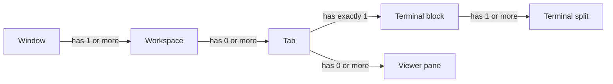
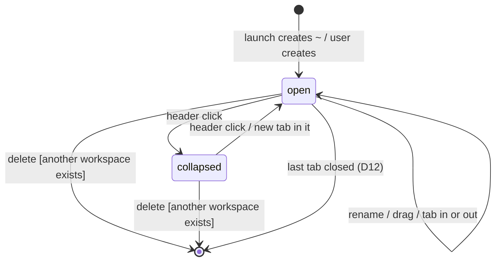

# Windows and workspaces: model and user scenarios

Status: agreed 2026-10-25, built in `tarn-v1.0.0`. Canon for window, workspace and layout behavior. Replaces R3 grouping by project and R21; R19 pins are removed (D17); R20 drag applies inside a workspace. The browser demo `demo/` follows this file.

## 1. Terms

| Term | Meaning | Who owns it |
| --- | --- | --- |
| window | a macOS window of tarn | Ghostty (`TerminalController`) |
| workspace | a named group of tabs in the sidebar | tarn |
| tab | one sidebar row: one layout of panes | Ghostty native tab, shown as a row |
| pane | a terminal split or a viewer inside a tab | terminals: Ghostty `SplitTree`; viewers: tarn |
| terminal block | all terminal splits of a tab, one Ghostty split tree | Ghostty |

Every tab sits in exactly one workspace; a tab never exists outside one.

## 2. Decided by the user

- D1 (2026-10-25; changed 2026-10-27, T-245, user decision). On launch there is a workspace `~` with no folder, the same `~` that Workspaces off creates; its tabs and splits open where Ghostty opens them (T-249, user decision 2026-10-27, `docs/plans/workspace-thin-layer.md`) (`docs/modules/workspaces.md`). Before T-245 it was `No project` (and `Default` before `docs/specs/workspace-folder.md` D24); restored sets keep their saved name. It is shown in the sidebar with its header, with one tab open.
- D2. A new tab opens in the current workspace, the one that holds the selected tab.
- D3. Creating a workspace asks for a folder; its name is the folder's last component (`docs/specs/workspace-folder.md` D19). A folder another workspace of the window already holds selects that workspace.
- D4. There is always at least one workspace; without one no terminal tab opens.
- D5. The header is shown always, even with one workspace (the "hide the only workspace" rule is cancelled).
- D6. Workspaces are collapsible groups, several open at once, reordered by drag; collapsed shows the tab count and the most urgent agent state.
- D7. Cmd+W closes the focused pane; on the last pane of a tab it closes the tab; on the last tab it closes the window, as in Ghostty (D12). Cmd+Z within 5 s brings it back (Ghostty `undo-timeout`).
- D8. Panes: terminals form one Ghostty split tree; viewers sit beside it; Ghostty's split keys move across both. The terminal grab handle is Ghostty's three dots on hover.
- D9. Ghostty first: windows, tabs, splits, undo, restore and menus come from Ghostty; tarn adds the workspace layer and the viewer.
- D10. Each window has its own workspaces; cmd+N opens a window with `~` (D1). Matches Ghostty, where tabs and restore are per window. The same name may appear in two windows.
- D11. No folder rule: a tab goes where it was opened (D2); an agent's tab goes to the workspace of the agent's own tab (S12).
- D12. Closing the last tab of a workspace closes the workspace; if it was the last one, the window closes as in Ghostty, and the next window starts with `~` (D1). Cmd+Z within 5 s brings back the tab and its workspace.
- D13. `~` (and a restored `No project`) is an ordinary workspace: rename, delete, reorder. Deleting a workspace moves its tabs to the one above, or below if it is first. D4 holds by having no delete on the last workspace.

## 3. Workspace lifecycle

The last workspace has no delete action (D4); closing its last tab closes the window (D12).

## 3a. Drop zones (Rectangle-style, user decision 2026-10-25)

While a file tab, a viewer or a terminal is dragged, a frame shows the space it will take; the frame slides between zones. Checked first to last:

| Pointer | Frame and result |
| --- | --- |
| corner of the tab area, 48x48 px | the area is split in two across that corner: the quarter, made by halving that half; otherwise the nearest half of the area |
| 24 px strip at an edge of the tab area | that half of the whole area: the pane goes beside everything |
| a viewer's tab bar or the middle box (30% of its size) | the whole viewer: the file or viewer goes into it |
| elsewhere in a pane | the half of that pane on the nearest edge |
| over the dragged pane itself | red frame, refused |

Panes only split in two, so a quarter needs an area already split on that axis. Rectangle uses a 5 px edge because the screen edge stops the pointer; inside a window it does not, hence 24 px. The top edge gives the top half, not a full window (zoom is Ghostty's cmd+shift+enter); no thirds. Terminals: inside the block they use the pane zones; a lone terminal moves the whole block in area zones; split terminals get a red frame in area zones when viewers are open, except where a strip or a corner lies over the block: there it is a terminal's edge and Ghostty's pane zones work (T-178).

## 4. User scenarios

| # | Start and steps | Result |
| --- | --- | --- |
| S1 | first launch | one window; one ungrouped tab (stage 1a still draws it under a `~` header); focus in its terminal; the tab starts in the home folder (Ghostty `working-directory`) |
| S2 | cmd+T or + at the sidebar top | a tab in the current workspace, after its last tab, focused |
| S3 | + on a workspace header | a tab in that workspace; the workspace unfolds |
| S4 | New workspace (sidebar button or Shift+Cmd+T), choose a folder in the panel | a workspace named after the folder at the end of the list with one new tab in it, started in the folder and focused, so no workspace is ever empty; Cancel creates nothing |
| S5 | rename from the header menu | name changes in the sidebar and the window title |
| S6 | delete a workspace with tabs | confirmation names the count; tabs move to the workspace above, or below if it is first (D13) |
| S7 | drag a tab onto a header or between rows | the tab moves there; order is kept after a restart |
| S8 | right click a tab, Move to | same as S7 without drag |
| S9 | drag a workspace header | a line shows the gap; the group moves there |
| S11 | cmd+1..9 | the Nth tab down the sidebar, collapsed workspaces counted |
| S12 | agent runs `tarn new` | a tab in the workspace of the agent's own tab; focus does not move |
| S13 | click a path in agent output | the file opens in a viewer of the same tab; tree hidden; cmd+B shows it |
| S14 | cmd+D, cmd+shift+D | Ghostty split in the terminal block; in a viewer: the file in a new viewer |
| S14a | drag a viewer by its three dots (same handle as a terminal) | to the middle of another viewer: that viewer takes all its files; to an edge of a viewer or of the terminal block: the viewer moves there with its files and tree; onto itself: refused; outside every window: a new window |
| S14b | drag a terminal by its three dots to a viewer edge | a lone terminal: the terminal block moves to that edge (for example below the viewer); split terminals: refused with a hint to drag the viewer to the block edge, since they are one Ghostty split tree |
| S15 | cmd+W on a pane | the pane closes; cmd+Z within 5 s brings it back |
| S16 | cmd+W on the last pane of a tab | the tab closes with its viewers; cmd+Z within 5 s brings it back |
| S17 | close the last tab of a workspace | the workspace closes; cmd+Z within 5 s brings both back (D12) |
| S18 | close the last tab of the last workspace (cmd+W on its last pane included) | the window closes as in Ghostty; the next window starts with one ungrouped tab (D12) |
| S19 | quit and launch again | windows, tabs, splits and cwd come back (Ghostty `window-save-state`); workspaces, their order, folding and tab membership come back with them; scrollback does not |
| S20 | cmd+N, a second window | a window with its own ungrouped tab, whatever group the source tab was in (D10, T-255) |
| S21 | drag a tab out to another window | Ghostty moves it; it joins the group of the tab above it where it is dropped (ungrouped among ungrouped tabs); dropped outside every window it opens a new window with an ungrouped tab (D10, G5a) |
| S22 | settings: tabs at the top | a flat tab bar, no workspaces or agent state; back to the sidebar style shows the workspaces as they were (D14) |
| S23 | an agent in a collapsed workspace asks for permission | the header dot turns orange; one notification names the workspace and the tab |

## 5. Further decisions

- D14. Tabs at the top: a flat native tab bar of the window's tabs, no workspaces and no agent state there; workspaces keep working and show again with the sidebar style. R24 changes accordingly; the settings text says "Tabs grouped in workspaces".
- D15. A new tab starts in the focused tab's folder (Ghostty `window-inherit-working-directory`).
- D16. The grab handle dots are brighter than Ghostty's (0.6 near, 1.0 on hover); the terminal's handle needs a new insertion point in `SurfaceGrabHandle.swift`.
- D17. No tab pins: workspaces group tabs, order is set by drag; no close protection.
- D18. The settings window writes Ghostty options to its own file `~/.config/tarn/ghostty.conf`, loaded after the user's config (`ghostty_config_load_file`, `Ghostty.Config.swift:69`); the user's file is never edited. A value set there is marked "set in tarn" with Reset; everything else stays in Ghostty Config.
