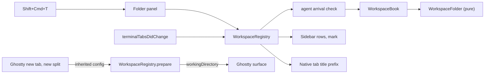

# Spec: workspace by project folder

Status: agreed (mockups approved by the user 2026-10-27; a workspace header's tooltip names its folder)
Task: T-203, issue #35
Canon: `docs/specs/windows-workspaces.md` (D1-D18, S1-S23), `docs/modules/workspaces.md`,
`docs/modules/sidebar.md`, research `~/Dev/knowledge/inbox/tarn-workspace-membership-2026-10-27-1134.md`
(outside the repository).

## 1. Goal and scope

- Goal: a workspace is a project folder. Tabs opened in it start in that folder, and an agent
  started in a project's folder lands in that project's workspace. The user stops forgetting `cd`.
- Result: Shift+Cmd+T asks for a folder and opens a workspace named after it; Cmd+T, the
  sidebar's + and splits in that workspace start in the folder; `claude` started in a folder of
  another workspace moves its tab there; with tabs at the top each tab reads "tarn · zsh".
- In scope: folder on a workspace; new workspace by folder; working directory of new tabs and
  splits; agent tabs join by folder; manual choice wins; "outside folder" mark in the sidebar;
  workspace prefix in native tab titles; restore of all of it.
- Out of scope: moves on `cd`; moves between windows (T-142); a list of recent folders in the
  folder dialog (a separate idea); opening a folder from Finder or `tarn open` into its workspace;
  ssh host detection; any behaviour change in a window that has only the folderless workspace
  (its name is the one change, D24).

## 2. Architecture



| Block | Responsibility | Talks to |
|---|---|---|
| `WorkspaceFolder` | pure path rules: standardize, contains, deepest match, working directory of a new surface | none |
| `Workspace`, `WorkspaceSet` | folder per workspace; manual marks per tab | `WorkspaceBook` |
| `WorkspaceBook` | where a new surface starts; where an arriving agent goes | `WorkspaceSet`, `WorkspaceFolder` |
| `WorkspaceRegistry` | applies the book to windows: config of new surfaces, agent arrival, native moves | AppKit, Ghostty `move_tab`, `AgentProcessCache` |
| `WorkspacePrompt` | folder panel for a new workspace | `WorkspaceRegistry` |
| `WorkspaceTabLabel` | native tab title with the workspace prefix | `TerminalWindow.attributedTitle` |
| Sidebar row | "outside folder" mark | `SidebarModel` |

- Initiator: the user (new workspace, new tab, split, move) and Ghostty (title and tab
  notifications that reveal an agent). Source of truth: `WorkspaceSet` per window set; the
  working directory of a surface is Ghostty's (`SurfaceView.workingDirectory`).
- Owner of state: `WorkspaceBook`. Side effects: Ghostty `move_tab`, the working directory of
  new surfaces, restorable state `tarn.workspaces`.

What Ghostty already has (Ghostty first), at `origin/dev` 449a20547:

| Need | Ghostty | Where |
|---|---|---|
| start directory of a new tab | inherited config with `workingDirectory` passed to `TerminalController.newTab(_:from:withBaseConfig:)` | `macos/Sources/Ghostty/Ghostty.App.swift:996`, `macos/Sources/App/AppDelegate.swift:798-810` |
| start directory of a split | inherited config passed to `newSplit(at:direction:baseConfig:)` | `Ghostty.App.swift:1024`, `macos/Sources/Features/Terminal/BaseTerminalController.swift:282` |
| inheritance switch | `window-inherit-working-directory`, default true | `src/config/Config.zig:2089` |
| working directory of a pane | `SurfaceView.pwd` (OSC 7); our extension `workingDirectory` adds the foreground process cwd | `macos/Sources/Ghostty/Surface View/OSSurfaceView.swift:14`, `macos/Sources/Features/Tarn/ViewerPaths.swift:5-7` |
| start directory field | `SurfaceConfiguration.workingDirectory` | `macos/Sources/Ghostty/Surface View/SurfaceView.swift:581` |
| native tab title | `TerminalWindow.title` sets `tab.attributedTitle` from `attributedTitle` | `macos/Sources/Features/Terminal/Window Styles/TerminalWindow.swift:398-445` |
| reordering tabs | `move_tab` action, already used by `WorkspaceRegistry.moveNatively` | `macos/Sources/Features/Tarn/Workspace/WorkspaceRegistry.swift:252` |

Our code fills only the rule of which directory and which workspace. Insertion points (one call,
no logic), all listed in `docs/architecture.md` by the stage that adds them:

- `AppDelegate.ghosttyNewTab` (`AppDelegate.swift:806-809`): the config goes through `WorkspaceRegistry.prepare`.
- `BaseTerminalController.ghosttyDidNewSplit` (`BaseTerminalController.swift:672-687`): the same.
- Every Ghostty write of `tab.attributedTitle` (`TerminalWindow.swift:402`, `:414`,
  `TitlebarTabsVenturaTerminalWindow.swift:60`, `:67`) becomes `WorkspaceTabLabel.apply(to: self)`.

`QuickTerminalController` also listens to new tab and split (`:87`, `:314`); `prepare` returns
its config unchanged. `AppDelegate.newTab` with no window (`:1027-1031`) bypasses the insertion
point: accepted limit, it opens a new window that has no folder anyway.

Prior art: research `tarn-workspace-membership-2026-10-27` (cmux, herdr, aya, WezTerm). cmux and
herdr give a workspace a folder at creation (`--cwd`) and new panes inherit it; behaviour only,
cmux is AGPL. Claude desktop and VS Code open a project as a folder (user's reference, 1A). No
analog found for "agent joins by folder" or a tab-title prefix: searched the same research and
the analog base; both are ours, kept to pure functions.

Decisions:

- D19. A workspace has an optional folder; the user picks it in a folder panel when creating a
  workspace, and the name is the folder's last component (user, 1A: "as Claude and VS Code do").
  Dropped: name first, folder later (forgotten like `cd`). Affects: every new-workspace path.
  Model change: yes.
- D20. A new tab or split in a workspace with a folder starts in the inherited working directory
  when it lies inside the folder, else in the folder (user, 2B). Dropped: always the folder root
  (loses the subfolder). Affects: Ghostty's `window-inherit-working-directory` is overridden only
  in workspaces with a folder. Model change: yes.
- D21. When a tab becomes an agent tab, it joins the workspace of this window whose folder holds
  the agent's working directory, deepest folder first. No such workspace: the tab stays and its
  row carries an "outside folder" mark, only when its own workspace has a folder (agent, 3B).
  Dropped: create a workspace per unknown folder (junk workspaces such as "self-projects").
  Model change: yes.
- D22. A tab the user placed by hand never moves by folder. The mark is set only when the
  workspace of the tab changes, and only by `moveTab` (sidebar move or drag) or by the mover
  branch of sync rule 4 (one native reorder by the user). Not by: a reorder inside the same
  workspace, the fallback repair of rule 4, deleting a workspace, merging windows, an arrival
  move, a tab opened with the sidebar's +. The mark is saved, survives undo of a close (Cmd+Z)
  and a merge of windows. Model change: yes.
- D23. The search stays inside the tab's window set. Dropped: moving a tab to another window
  (T-142 has no decision on tab order writers). Model change: no.
- D24. The folderless workspace of a new set is named "No project" instead of "Default"; there
  every Ghostty behaviour is kept (cwd inheritance, titles, no mark). Model change: yes.
- D25. With tabs at the top and two or more workspaces in the set, a native tab title is
  "<workspace> · <Ghostty title>", the workspace part dimmed (user, 2026-10-27). One workspace:
  Ghostty's title alone. This makes D21 moves visible in both tab styles. Model change: yes.
- D26. The arrival check runs on the registry's tab notifications (title changes post them)
  and on agent session updates; no new timer. The tab keeps the pid of the agent that decided
  (any pane). The check runs only when the tab has no live deciding pid; then the first agent
  pid found decides and is kept. So a second agent in another pane (S19), the sidebar's choice
  of pane, and Ctrl+Z, `cd`, `fg` in the shell (S33) never start a check. Accepted limit: an agent
  that neither sets a title nor sends hooks is seen at the next tab notification. Bearing
  assumption, checked first in stage 3: claude, codex and opencode each cause a tab
  notification after `exec` (debug log of the foreground `comm` on each sync, 3 starts each).
  Model change: no.
- D27. An arrival move never takes focus. It waits while the tab's window group is not key and
  runs when it becomes key (`windowDidBecomeKey`, except the registry's own hops) or on the next
  sync; it runs on the main queue after the notification that revealed it, one pass for all
  waiting tabs. The queue keeps the agent's path; the destination is computed by `arrival` at
  the moment of the move, so a deleted workspace or a changed folder is never a stale target.
  Accepted: moving a tab that is not selected in the key window selects it for an instant
  (`moveNatively`) and gives the selection back. A moved selected tab updates the target of
  the next new tab (`lastSelected`), and a collapsed destination unfolds as for a new tab.
  Model change: no.

Canon decisions this spec replaces (the stage named edits `docs/specs/windows-workspaces.md`):

| Canon | Now | New text | Stage |
|---|---|---|---|
| D3 and S4: a new workspace asks for a name | D19 | a new workspace asks for a folder; the name is the folder's last component | 1 |
| D1, D10, D12, D13, S1, S18, S20: `Default` | D24 | a new set's folderless workspace is "No project"; restored names are kept | 1 |
| D15: new tabs inherit the working directory | D20 | inherit, except in a workspace with a folder (D20) | 2 |
| D11: no folder rule | D21, D22 | an agent tab joins by folder unless placed by hand | 3 |
| D14 and S22: no workspaces with tabs at the top | D25 | with two or more workspaces, native titles carry the workspace prefix | 4 |

## 3. Scenarios

A folder `F` = `~/Dev/self-projects/tarn`; `P` = `~/Dev/self-projects`.

| ID | Scenario | Start and steps | Result and the fact checked | Risk | Tier |
|---|---|---|---|---|---|
| S1 | New workspace by folder | Shift+Cmd+T, pick `F` | workspace "tarn" with folder `F`, one new tab; the tab's surface config has `workingDirectory == F` | | fast |
| S2 | Panel cancelled | Shift+Cmd+T, Cancel | no workspace, no tab | | fast |
| S3 | Folder already bound | pick `F` while "tarn" has `F` in this window | Q1: no new workspace, the first tab of "tarn" is selected | | fast |
| S4 | Cmd+T inside the folder | selected tab in "tarn" at `F/macos`, Cmd+T | new tab starts at `F/macos` | | fast |
| S5 | Cmd+T outside the folder | selected tab in "tarn" at `P`, Cmd+T | new tab starts at `F` (the user's case) | | fast |
| S6 | + on another workspace | selected tab in "No project" at `P`, + on "tarn" | new tab in "tarn" starts at `F` | | fast |
| S7 | Split | Cmd+D in a "tarn" tab at `P` | new pane starts at `F`; at `F/docs` it starts at `F/docs` | | fast |
| S8 | No folder | Cmd+T, split in "No project" or an old workspace | inherited config untouched | | fast |
| S9 | Folder gone | `F` deleted, Cmd+T in "tarn" | inherited config untouched, one log line | | fast |
| S10 | No inheritance | `window-inherit-working-directory = false`, Cmd+T in "tarn" | new tab starts at `F` | | fast |
| S11 | Agent joins | tab in "No project" at `F/macos`, `claude` starts | tab moves to the end of "tarn" with one native move; not marked manual | | fast |
| S12 | Agent at home | tab in "tarn" at `F`, agent starts | no move | | fast |
| S13 | Agent outside any folder | tab in "tarn" at `P`, agent starts | no move; the row shows the mark; in "No project" no mark | | fast |
| S14 | Nested folders | "dev" at `~/Dev`, "tarn" at `~/Dev/self-projects/tarn`, agent at `F/macos` | tab joins "tarn" | | fast |
| S15 | Same folder twice | after Merge All Windows two workspaces hold `F` | a tab already in one of them stays; else it joins the upper one | | fast |
| S16 | Manual wins | user drags the tab from "tarn" to "notes", later an agent starts at `F` | no move; after relaunch still no move | | fast |
| S17 | Agent restarts | agent exits, starts again in the same unmarked tab at `F` while the tab sits elsewhere | the check runs again and the tab moves | | fast |
| S18 | `cd` after join | agent tab in "tarn", user runs `cd ~/notes` in it later | no move; the wide row shows `~/notes` | | fast |
| S19 | Split tab with agents | agent in pane 2 at `F` starts first; a second agent in pane 1 at `P` starts later | the first decides; the second start does not move the tab | | fast |
| S20 | Folder in another window | only window B has "tarn"; agent starts at `F` in window A | no move | | fast |
| S21 | Restore | relaunch with folders and manual marks; also a snapshot saved before this task | folders and marks come back; an old snapshot decodes with no folder and no marks | | fast |
| S22 | No folder change | header menu of any workspace | no Set Folder or Remove Folder: the folder is fixed at creation (Q3) | | fast |
| S23 | Tab prefix | tabs at the top, set with "No project" and "tarn" | "tarn · zsh"; with one workspace the plain title; switching to the sidebar style drops the prefix | | fast |
| S24 | Prefix survives | tabs at the top, title font change or fullscreen | prefix kept | | live |
| S25 | Rename | rename "tarn" to "core" with tabs at the top | titles read "core · ..." | | fast |
| S26 | Path forms | folder picked through a symlink, a trailing slash, `F-old` next to `F` | matched by standardized resolved path on component boundaries; `F-old` is not inside `F` | | fast |
| S27 | Unexpected | agent tab with no working directory, a folder that is not absolute, a tab key not in the set | no move, one log line with tab and value, no crash | | fast |
| S28 | Background window | agent starts at `F` in window A while window B is key | no move and no focus change; the move runs when A becomes key | | fast |
| S29 | Cmd+T after a move | selected tab moved from "No project" to "tarn" by arrival, Cmd+T | new tab joins "tarn" and starts per D20 from `F` | | fast |
| S30 | Undo of a close | manual tab with `claude` at `F` in "notes" closed, Cmd+Z | back in "notes", still manual, no arrival | | fast |
| S31 | Marks only on workspace change | reorder inside "No project"; fallback repair after restore; delete; merge | no tab marked manual | | fast |
| S32 | Collapsed destination | "tarn" collapsed, selected tab arrives there | "tarn" unfolds, the row stays selected | | fast |
| S33 | Job control | Ctrl+Z on `claude`, `cd ~/notes`, `fg` | same pid: no check, no move | | fast |
| S34 | Tabs give a window | `macos-titlebar-style = hidden` (`tabbingMode = .disallowed`), Cmd+T in "tarn" | the new window gets the inherited config unchanged | | fast |
| S35 | Prefix writers | tabs at the top: rename, a second workspace appears, an arrival move, style switch | every native title of the set is rewritten at once | | fast |
| - | Acceptance by hand | the user creates "tarn" by folder, opens Cmd+T from `P`, starts `claude`, tries tabs at the top | as S1, S5, S11, S23 on the built app | | live |

Limits (what the code never does):

- R1: never moves a tab between windows.
- R2: never moves a tab marked manual.
- R3: never changes the membership of a tab that is not an agent tab because of a folder.
- R4: never moves a tab because its working directory changed after the agent started.
- R5: never changes the start directory of a surface in a workspace without a folder.
- R6: never writes the user's Ghostty config.

## 4. Data and states

| Entity | Change | Owner | Key or invariant |
|---|---|---|---|
| `Workspace.folder` | new, `String?` | `WorkspaceSet` | absolute, standardized, symlinks resolved; nil for "No project" and old workspaces |
| `WorkspaceSet.manual` | new, `Set<TabKey>` | `WorkspaceSet` | only members (`makeSet` drops keys not in `members`); removed with the tab; `absorb` unites both sets' marks; `ClosedTab` carries it and `reinsert` puts it on the new key |
| `WorkspaceBook.isPlain` | changed | `WorkspaceBook` | plain: one workspace named "No project" or "Default" with no folder |
| `WorkspaceSnapshot.Entry.folder` | new optional field | `WorkspaceRestore` | missing in old snapshots decodes as nil; version stays 1 |
| `WorkspaceSnapshot.manual` | new optional field `[TabKey]` | `WorkspaceRestore` | missing decodes as empty |
| deciding agent pid per tab | new, runtime | `WorkspaceRegistry` | not saved; set by the first agent pid found when none lives; cleared when that process ends; `ClosedTab` carries it so undo is not an arrival |
| pending arrivals | new, runtime | `WorkspaceRegistry` | tab key and the agent's path; destination computed at move time; dropped when the tab closes or is marked manual |

- Input: the folder panel; Ghostty's inherited `SurfaceConfiguration`; `SurfaceView.workingDirectory`
  and `AgentProcessCache` per pane.
- Transitions: a tab with no live deciding pid and an agent pid in a pane fires the check once
  and keeps that pid; while it lives no other agent fires a check.
  `unmarked -> manual` on a user move that changes the workspace (D22); there is no way back
  except closing the tab without undo.
- Cost (T-106): agent pids come from `AgentProcessCache`, at most one read per pid per run-loop
  turn; the working directory is read only when a new pid appears; a test counts
  `AgentProcessCache.misses`.
- Repeat: the check on a tab whose agent is already known does nothing; a second notification for
  the same start finds the tab at home (S12).

## 5. Code model

```swift
/// Pure path rules of D20, D21 and S26.
enum WorkspaceFolder {
    /// Absolute, standardized, symlinks resolved; nil for a relative or empty path.
    static func standardized(_ path: String) -> String?
    /// True when `path` is `folder` or lies below it, on path component boundaries.
    static func contains(_ folder: String, _ path: String) -> Bool
    /// D20: where a new surface starts. `inherited` inside `folder` stays; anything else, or nil,
    /// gives `folder`. `folder == nil` or a missing folder returns `inherited` unchanged.
    static func startDirectory(inherited: String?, folder: String?, exists: (String) -> Bool) -> String?
    /// D21, S14, S15: the workspace for an agent at `path`; the deepest folder wins, then the
    /// current workspace, then the upper one. Nil: stay.
    static func home(for path: String, in runs: [WorkspaceSet.Run], current: Workspace.ID?) -> Workspace.ID?
}

struct Workspace {
    var folder: String?          // D19; nil: no project
}

extension WorkspaceSet {
    mutating func create(name: String, folder: String?) -> Workspace.ID?
    mutating func markManual(_ tab: TabKey)     // D22
    func isManual(_ tab: TabKey) -> Bool
}

extension WorkspaceBook {
    /// The folder of the workspace a new surface lands in. A tab: the same `targetWorkspace` the
    /// membership rule uses (pending target, last selected, ...) for the window's `order`, with
    /// no selected tab as the membership pass sees the new one, so they agree. A split: the
    /// workspace of `tab`; the pending target is not read. S29 needs `lastSelected` updated by
    /// the arrival move (D27), so its test goes with stage 3.
    func folderForNewSurface(from tab: TabKey, order: [TabKey], split: Bool) -> String?
    /// D21: the workspace `tab` must join because its agent started at `path`; nil to stay.
    func arrival(of tab: TabKey, at path: String) -> Workspace.ID?
    /// D21 mark: the agent of `tab` is outside its workspace's folder.
    func isOutsideFolder(_ tab: TabKey, at path: String) -> Bool
}

extension WorkspaceRegistry {
    /// Insertion points: `AppDelegate.ghosttyNewTab` and the `ghosttyNewSplit` handler of
    /// `BaseTerminalController` pass the inherited config through here.
    func prepare(_ config: Ghostty.SurfaceConfiguration?, from window: NSWindow, split: Bool) -> Ghostty.SurfaceConfiguration?
    func createWorkspace(folder: String, from window: NSWindow) -> Bool
    // moveTab and the mover branch of sync rule 4 mark the tab manual, only on a workspace
    // change (D22); the arrival move, fallback repair, delete and absorb do not.
}

/// D25.
enum WorkspaceTabLabel {
    static func title(_ title: String, workspace: String?, workspaces: Int, style: TabStyle) -> NSAttributedString
    /// Writes `tab.attributedTitle` of `window`. Without a prefix it writes exactly Ghostty's
    /// `attributedTitle`, nil included, so one-workspace windows look as in Ghostty. With a
    /// prefix: Ghostty's font and colour when set, the system title font otherwise. Called by
    /// Ghostty's former write sites and by tarn on every `publish`, rename and tab style change
    /// for all windows of the set.
    @MainActor static func apply(to window: NSWindow)
}
```

- `prepare`: reads the target workspace through the book, calls `startDirectory`, writes
  `config.workingDirectory`. Unchanged: a nil config (app target), a window that is not a
  `TerminalController`, and a new tab that will open a new window (the parent's `tabbingMode`
  is `.disallowed`, as with `macos-titlebar-style = hidden`), since that window has no folder (R5).
- Arrival check in `sync`: for each tab with no live deciding pid, the agent pids of its panes
  from `AgentProcessCache`; the first one found decides: read that pane's working directory and
  queue the path. A pass on the main queue (also from `windowDidBecomeKey`) runs the queued
  entries whose window group is key: `arrival` gives the destination now, then:
  join, one native move to the end of the run through `moveTab`'s path without the manual mark,
  update `lastSelected` when the tab is selected, unfold the destination.
- The mark: on every sidebar refresh, from the working directory of the agent pane, only while
  the agent pid lives; gone with the agent.

Sidebar mark (D21), wide and narrow rows:

```
wide row                            narrow row
+-------------------------------+   +---------------------------+
| (o) Claude Code   [cc]        |   | (o) Claude Code   ! [cc]  |
|     ! ~/Dev/self-projects 3m  |   +---------------------------+
+-------------------------------+   ! orange, tooltip:
  folder line orange with "!"        "Outside the tarn folder"
```

Top tab bar (D25):

```
| tarn · zsh  (o) | tarn · Claude Code (o)[cc] | No project · zsh |
  ^^^^ dimmed
```

## 6. Stages

| Stage | Checkable result | Depends on | Excludes | Check |
|---|---|---|---|---|
| 0. Demo | the mark (section 5 sketch) and the top tab prefix drawn in `demo/`; the user approves the look | none | app code | demo checks |
| 1. Folder on a workspace | Shift+Cmd+T opens a folder panel; the folder in the header tooltip; folders saved and restored; "No project"; the first tab of a new workspace starts in its folder | none | start directory of other tabs, arrival, manual marks (stage 3, their only writer) | unit S1-S3, S21 (folders), S22, S26 |
| 2. Start directory | new tabs and splits start per D20 | 1 | arrival | unit S4-S10, S34 |
| 3. Agent arrival | probe of D26 first; agent tabs join by folder; manual marks saved and restored, manual wins; sidebar mark | 1 | top tab prefix | unit S11-S21 (marks), S27-S33 |
| 4. Tab prefix | native titles with the prefix when tabs are at the top | 1 | | unit S23, S25, S35; live S24 |

Each stage is one PR to `dev` under 400 lines of code; docs (`docs/modules/workspaces.md`,
`docs/specs/windows-workspaces.md` decisions, `docs/architecture.md` insertion points) go with
the stage that changes them.

## 7. Acceptance

- Command: `make -f tarn.mk check`, green, with tests tagged `spec: docs/specs/workspace-folder.md S<n>`.
- Scenario: the line "Acceptance by hand" of section 3 on a build of the branch.
- Not automated: the folder panel, the look of the mark and of the dimmed prefix, S24 (AppKit
  resets title fonts on fullscreen); the user checks them by hand on the build.
- Not checked: agents other than claude, codex, opencode; ssh tabs.

## Questions

Answered by the user's rule (2026-10-27): take the behaviour of VS Code and Claude desktop.

- Q1. Picking a folder a workspace of this window already has selects that workspace (VS Code
  brings the window of an open folder forward). Scenario S3.
- Q2. No new folderless workspace: "No project" is the folderless one, as VS Code's empty
  window; Claude desktop always runs a session in a folder. Cancel in the panel creates nothing
  (S2); old workspaces without a folder stay as they are.
- Q3 (user decision 2026-10-27, replaces Set Folder... and Remove Folder): the folder is fixed at
  creation, as a Claude desktop session's. A running shell cannot be moved without typing into
  it, so a changed folder would leave open tabs in the old one; VS Code reloads the window and
  closes its terminals instead. Another folder: Shift+Cmd+T and drag the tabs. A workspace without
  a folder ("No project", restored "Default") stays without one.
