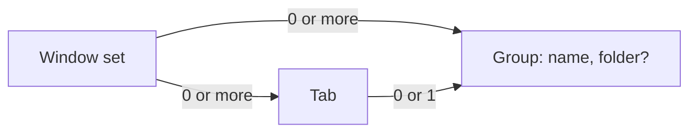

# Spec: tab groups and workspaces

Status: "explicit membership" model, review pass 1 applied, Q4 open (user decisions 2026-10-28, evening); replaces the
"ungrouped run last" model of the same day and the thin layer of T-249
Task: T-266 (survey T-262)
Canon: `docs/specs/windows-workspaces.md` (D1-D18), `docs/modules/workspaces.md`,
`docs/modules/sidebar.md`, `docs/specs/modules.md` section 5, `docs/specs/agent-cli.md` 4.1.

## 1. Goal and scope

- Goal: a group is a plain optional tab group, as in Warp. A group with a project folder is a
  workspace. It keeps tabs together for the user and tells an agent where it works (`tarn ls`).
- The two rules behind every decision below (user decisions 2026-10-28): "order is not worth
  rebuilding the system for: do the simple thing, no crutches, clean code", and "putting a tab
  into a group is explicit".
- In scope: ungrouped tabs; group or workspace at creation; where a new tab goes; the sidebar
  commands that change membership; delete with an option to close the tabs; the group in
  `tarn ls`; restore of an old "~".
- Out of scope (separate tickets): git state in a header, a tab in a new worktree, saved
  workspace commands, environment per workspace, pin, colour, an agent summary in the header.
  Never: a tab changes group by itself (folder, agent, `cd`, a native drag); a tab moves between
  windows by our code (T-142).

## 2. Model



A tab belongs to its window's set and to at most one group. Membership is a table `tab -> group`
that only explicit actions write (M1-M4). Ghostty keeps the tab order; our code asks for a
`move_tab` only for a user's sidebar command (R2). A group lives while it has a tab: every
writer of membership (`remove`, `join`, `leave`) drops a group it leaves empty (G6).

Membership (source: user decision 2026-10-28, "explicit"; Warp "Move to group", "Remove from
group", docs.warp.dev/terminal/windows/tabs):

- M1. A new tab takes the group of the tab it was opened from: Cmd+T, the window's New Tab menu
  item, the native "+" and the sidebar's New Tab button (all reach `AppDelegate.ghosttyNewTab`;
  the button calls `controller.newTab(nil)`, as Cmd+T), the "+" of a header (G3). `opened` acts
  only when the new window is in the native tab group of its source; otherwise the tab is
  ungrouped (a refused tab, `macos-titlebar-style = hidden`, a parent that is no
  `TerminalController`). A tab `sync` already saw still gets the source's group from `opened`.
  Every other new tab is ungrouped: the first tab of a window, a tab dragged out of a window of
  two or more tabs, a tab made by AppleScript, Services, an App Intent, a dock drop, New Tab
  while Settings is key (`AppDelegate.newTab`) or the redo of a closed tab.
- M2. Membership changes only by a sidebar command: drag a row onto a group or below all rows,
  "Move to <group>", "Remove from group", "Delete group…". Undo of a closed tab brings it back
  as it was: to its group, recreated when gone, or ungrouped, with its viewers either way (the
  tombstone covers every tab, `ClosedTab.workspace` is optional). Group commands themselves
  (delete, rename, move) have no undo, as today (`docs/modules/workspaces.md`).
- M3. A native reorder (tabs at the top, Ghostty's `move_tab` keys) changes order only. No mover
  rule, no repair, no guess.
- M4. Merge All Windows keeps the group of every tab: the other set's groups join whole, its
  ungrouped tabs stay ungrouped. The last tab of a window dropped into another window is the
  same merge (the code tells them apart by "all live tabs of the set came", and that is true
  for both): its group comes with it. So a tab torn out to its own window and dropped back
  keeps its group. Two workspaces on one folder after a merge are accepted, as today.

Sidebar drawing (user decision 2026-10-28): walk the native order; the first tab of a group
draws its header and every tab of that group, in native order, indented; a later tab of a group
already drawn is skipped; an ungrouped tab is a row with no header and no indent. So groups
stand in the order of their first tab, ungrouped rows anywhere between them. This is
`WorkspaceSet.runs(order:)` as it is on `dev`, plus runs without a group.

Row number and Cmd+1..9. Cmd+N is Ghostty's `goto_tab:N`, the native index. With the sidebar
style there is no native bar; a row shows the shortcut of its native index (`Sidebar.swift`
`positions`, as today). Row N and Cmd+N agree while each group is one run of the native order.
Our commands keep that (G3, G5, G8): each puts the tab where its row is drawn, with at most one
`move_tab` that the user's own action causes. The order can still split a group, and then a row
shows a shortcut out of sequence, after: Cmd+T or "+" with `window-new-tab-position = end`
(accepted, user decision 2026-10-28, Q1 a), a user's `move_tab` key, an undo whose neighbours moved meanwhile, a native drag made with
tabs at the top. Our code does not heal it (M3, R2). Rejected: drawing in native order with a
header per run (a split group shows two headers); healing moves (two writers of order, the
1a branch needed deferred moves, a settle rule and a move counter).

Decisions (each names its source):

- G1. A group is optional; a new window starts with one ungrouped tab, no "~". Source: Warp, tabs
  live outside groups until put in one. Dropped: the start workspace "~" (D24 of the old model).
- G2. Shift+Cmd+T, the header button and "+ New group" ask for a Group (a name) or a Workspace
  (a project folder, named after its last component). A folder another workspace of the window
  has selects that workspace. Source: Warp for the named group, Claude Code desktop for the
  folder (code.claude.com/docs/en/desktop). The app shows the macOS folder panel; the demo takes
  a typed path.
- G3. The "+" of a header opens a tab from the group's last tab, with Ghostty's `newTab(from:)`:
  with `window-new-tab-position = current` (default) it stands at the end of the group. A
  workspace passes its folder as the working directory; a plain group inherits from that last
  tab as Cmd+T would. Source: Ghostty `windowNewTabPosition` (`TerminalController.swift:474`),
  Claude Code desktop (a session runs in its project folder), user decision 2026-10-28.
  Replaces `sourceTab` (cmux rule of D20).
- G4. Cmd+T and Cmd+D are Ghostty's: the tab stands where Ghostty puts it, in the group of the
  tab it opened from (M1); the start folder is Ghostty's inheritance.
- G5. Sidebar commands, one user action each (user decision 2026-10-28):
  - drag a row to a slot: the slot's owner, one `move_tab` to the slot. A slot is a gap between
    two rows of one block (a group or a run of ungrouped rows), the end of a block, or the tail
    below all rows (ungrouped), as in `demo/js/sidebar-drag.js` `tabSlot`;
  - "Move to <group>": join, one `move_tab` after the group's last tab;
  - "Remove from group": leave, one `move_tab` after the group's last tab (none when it is
    last); both through today's `moveTab(_:to:before:)` and `destination`, with no group for
    Remove;
  - drag a header: one `move_tab` per tab, as today; the slots are the gaps before each block,
    ungrouped runs included (`moveWorkspace` lays out every run, so ungrouped tabs keep their
    place).
  Why the move: membership without it would draw the row away from its native place, and every
  row between would show a shortcut out of sequence (section 2). Prior art: searched Warp docs,
  tmux, WezTerm for a group membership command without a move; none has groups over a native
  order, so this is ours.
- G6. The last tab leaving a group removes the group. Source: user decision 2026-10-28; today's
  rule for a workspace.
- G7. "Delete group…" asks, with "Also close its N tabs" unchecked by default. Unchecked: the
  tabs become ungrouped where they stand, nothing moves. Checked: they close through
  `Sidebar.close([Tab])`, one confirmation and the undo it gives today. The only group of a
  window can be deleted. Source: Warp "Ungroup tabs"; checkbox: user decision 2026-10-28 (2b).
- G8. A new group's first tab opens from the last tab of the window: the group stands at the
  bottom, whatever `window-new-tab-position` is, and splits no group (user decision 2026-10-28,
  Q2 a). A workspace's tab starts in its folder; a plain group's tab inherits from the selected
  tab, as Cmd+T would (its config is passed, only the parent is the last tab).
- G9. The agent scope (`AgentScope`, used by `tarn ls`, `new`, `run`, `wait`, `read`, `close`)
  is the caller's group; for an ungrouped caller, its own tab. Outside the scope: "no pane
  matched", exit 4. `tarn ls` adds GROUP after TAB (`-` when ungrouped); JSON keeps `workspace`
  (the group id, empty when ungrouped) and adds `group` and `folder`. A caller in no window set
  keeps `tarn: not in a workspace`. Source: Tellurion, cmux (behaviour only, AGPL); user
  decision 2026-10-28 (3a, 4). The ungrouped-caller filter ships with PR 3, so the default tab
  never answers `not in a workspace`. `tarn new/run --tab` (U5 of `docs/specs/agent-cli.md`)
  is open: Q4.
- G10. The folder of a workspace is fixed at creation; a plain group never gets one.
- G11. Workspaces off (Settings > Modules): the sidebar is one flat list in native order; a new
  tab is ungrouped (M1 does not apply); groups keep their tabs and come back when it is on
  again. No regroup moves: on again draws by membership (section 2).
- G12. With tabs at the top, a grouped tab carries its group name after the title; an ungrouped
  one carries none. The window subtitle names the group of the selected tab, none when ungrouped.
- G13. Restore: an ungrouped tab is in no `tabKeys` list. In an older snapshot, a "~" without a
  folder or with the home folder is dropped and its tabs are ungrouped where they stand. "No
  project" and "Default" stay plain groups. An older build reading a new snapshot puts the
  ungrouped tabs into its target, as it does with any tab without a workspace.

What Ghostty already has (at `origin/dev` 6906121a8): the tab order and `move_tab`
(`BaseTerminalController.swift:1046`); `window-new-tab-position` (`TerminalController.swift:474`);
`newTab(_:from:withBaseConfig:)` (`TerminalController.swift:424`) that returns the controller;
`tab-inherit-working-directory` and `SurfaceConfiguration.workingDirectory`. Ghostty has no
groups (issue #1598 closed). Our code adds the membership table, the sidebar commands and one
insertion point (user decision 2026-10-28, Q3 a; a new row of `docs/architecture.md` with
PR 2): in `AppDelegate.ghosttyNewTab`, the controller that `TerminalController.newTab` returns
goes to `WorkspaceRegistry.opened(_:from:)`. An observer of
`ghosttyNewTab` is not enough: it runs after AppDelegate's on one launch path and before it on
another (found on the stand in T-266-model), and a one-tab window seen alone before AppKit tabs
it in looks like a merge.

Canon this spec replaces (each edited with the PR that changes the behaviour):

| Canon | Replaced by |
|---|---|
| `docs/specs/windows-workspaces.md` D1, D4, D5, D10, D12, D13, the life diagram, S1, S6, S18, S20, S21 | G1, G6-G8, G13 |
| `docs/specs/modules.md` 2 item 6, 5, 7, 10 | G11, G12 |
| `docs/modules/workspaces.md`: "~", target, `sourceTab`, repair, step 5 moves, regroup, delete, a tab from another window | M1-M4, G3-G8 |
| `docs/modules/sidebar.md` "the last workspace has no delete" | G7 |
| `docs/specs/agent-cli.md` 4.1 `ls` columns and JSON; U5 `--tab` (after Q4) | G9 |
| `docs/architecture.md` insertion point table | new row for `ghosttyNewTab` (PR 2) |

The general fallback stays: an unforeseen state is logged as `workspace: <reason>` and the tab
is ungrouped.

## 3. Scenarios

`F` = `~/Dev/self-projects/tarn`, `P` = `~/Dev/self-projects`. Tests are tagged
`spec: docs/specs/workspace-folder.md S<n>`. Gaps in the numbers are scenarios of the old model.

| ID | Scenario | Start and steps | Result and the fact checked | Tier |
|---|---|---|---|---|
| S1 | New workspace by folder | Shift+Cmd+T, Workspace, pick `F` | workspace "tarn" at the bottom, one tab with `workingDirectory == F` | fast |
| S2 | Cancelled | Shift+Cmd+T, Cancel | no group, no tab | fast |
| S3 | Folder already bound | pick `F` while "tarn" has `F` | nothing created, the first tab of "tarn" selected | fast |
| S4 | Cmd+T, Cmd+D | selected tab in "tarn" at `F/macos`; again with `macos-titlebar-style = hidden` | new tab right after it, in "tarn", at `F/macos`, the split too; hidden: Cmd+T opens a new window whose tab is ungrouped (M1) | stand |
| S6 | "+" of a header | "+" on "tarn", then on plain group "notes" | each a tab at the end of its group; "tarn" in `F`, "notes" where its last tab is | fast |
| S11 | Agent tab stays | ungrouped tab at `F/macos`, `claude` starts | stays ungrouped | live |
| S21 | Restore | relaunch with groups, folders, ungrouped tabs; an old snapshot; one with `manual` | all come back; old decodes; `manual` ignored | fast |
| S22 | No folder change | header menu | no Set or Remove Folder | fast |
| S23 | Top tab mark | tabs at the top, a tab in "tarn", an ungrouped tab | "tarn" after the first title, none on the second | fast |
| S26 | Path forms | symlink, trailing slash, `F-old` next to `F` | matched by resolved path on component boundaries | fast |
| S40 | New window | Cmd+N | one ungrouped tab, no header | fast |
| S41 | New plain group | Shift+Cmd+T, Group, "notes" | "notes" at the bottom, one tab | stand |
| S42 | Cmd+T ungrouped | Cmd+T in an ungrouped tab | a new ungrouped tab right after it | fast |
| S43 | Move out and in | drag a row of "tarn" below all rows; onto "notes"; "Remove from group" | ungrouped; in "notes"; ungrouped. One `move_tab` each | fast |
| S44 | Last tab leaves | move or close the only tab of "notes" | "notes" gone; Cmd+Z of the close brings it back | fast |
| S45 | Delete, keep tabs | "Delete group…" on "tarn" (2 tabs), unchecked | both ungrouped where they stood, no `move_tab` | fast |
| S46 | Delete, close tabs | "Delete group…" on "notes", checked | "notes" and its tabs closed after one confirmation; undo as for several tabs | fast |
| S48 | `tarn ls` in a group | agent pane in "tarn" | rows of "tarn" only, GROUP "tarn"; JSON `group`, `folder` | fast |
| S49 | `tarn ls` ungrouped | agent in an ungrouped tab, two other ungrouped tabs | its own tab only, GROUP `-` | fast |
| S50 | Old "~" restored | snapshot with "tarn" and "~" (home folder) | "tarn" stays; the "~" tabs ungrouped in place | fast |
| S51 | Workspaces off and on | off: Cmd+T, a drag; on again | off: flat, new tab ungrouped, membership kept; on: groups drawn by membership, no `move_tab` | fast |
| S53 | Tab from another window | window 1 has two or more tabs; drop one between two tabs of "tarn" in window 2 | ungrouped (M1); "tarn" drawn as one group, the row after it | fast |
| S54 | Merge All Windows | two windows with groups and ungrouped tabs | every tab keeps its group; no `move_tab` | fast |
| S55 | Cmd+T with `end` | `window-new-tab-position = end`, Cmd+T in "tarn" (not last) | the tab is in "tarn", drawn at its end; its shortcut is out of sequence (accepted, Q1) | fast |
| S56 | Delete the only group | one group, unchecked | its tabs ungrouped, no header | fast |
| S57 | Agent scope ungrouped | ungrouped caller; `wait`, `read`, `close` on another ungrouped tab | exit 4 for each | fast |
| S58 | Drag leaves the sidebar | drag a row over the terminal, release | gap closes, nothing moves (T-235) | fast |
| S60 | Native drag | tabs at the top: drag a tab of "tarn" between two tabs of "notes" | still in "tarn"; order changed, no membership change (M3) | fast |
| S61 | Remove from the middle | "Remove from group" on the 2nd of 3 tabs of "tarn" | ungrouped, one `move_tab` after the 3rd; rows match Cmd+1..9 | fast |
| S62 | Move to | "Move to notes" on a tab of "tarn" | in "notes" at its end, one `move_tab`; rows match Cmd+1..9 | fast |
| S63 | Undo returns the group | close a tab of "tarn", Cmd+Z | back in "tarn"; with "tarn" gone, "tarn" comes back | fast |
| S64 | Undo of an ungrouped tab | close an ungrouped tab with a viewer open, Cmd+Z | back ungrouped, the viewer in place (M2) | fast |
| S65 | Last tab of a window back | tear the only tab of "tarn" out to its own window, drop it back into window 1 | in "tarn" again: a merge (M4) | fast |
| - | Acceptance by hand | Cmd+N, workspace and group, Cmd+T and "+", move out and in, delete both ways, `tarn ls`, relaunch | as above; agent on the stand per PR, user once on the dev build after PR 6 | live |

Limits (what the code never does):

- R1: never moves a tab between windows.
- R2: never makes a `move_tab` the user's action did not cause (G5 lists every one).
- R3: never changes a group because of a folder, an agent, `cd` or a native reorder.
- R5: never changes the start folder Ghostty gives Cmd+T or Cmd+D; only a workspace's first tab
  and its "+" pass the folder.
- R6: never writes the user's Ghostty config.
- R7: never lets an agent command reach a pane outside its scope (G9).

## 4. Data and states

| Entity | Change | Owner | Key or invariant |
|---|---|---|---|
| `WorkspaceSet.members` | holds grouped tabs only; an ungrouped tab is in the set (`WorkspaceBook.setOf`), not in `members` | `WorkspaceSet` | a group in `workspaces` has a tab (G6) |
| set lifetime | lives while it has a live tab, not while it has a group | `WorkspaceBook.remove` | a set with only ungrouped tabs is kept |
| `Workspace.folder` | unchanged | `WorkspaceSet` | absolute, standardized; nil for a plain group |
| `WorkspaceSnapshot` | ungrouped tabs are in no `tabKeys`; version stays 1 | `WorkspaceRestore` | old "~" dropped on decode (G13) |
| `WorkspaceBook.ClosedTab.workspace` | optional | `WorkspaceBook` | nil: the tab was ungrouped; a tombstone for every tab (M2) |
| `PaneRow.group`, `PaneRow.folder` | new | `AgentCommands` | empty when ungrouped |

A tab is ungrouped or grouped; only M1 and M2 change it.

## 5. Code model

```swift
extension WorkspaceBook {
    /// M1: the tab Ghostty just opened from `source` takes its group.
    mutating func opened(_ tab: TabKey, from source: TabKey)
}

extension WorkspaceSet {
    mutating func join(_ tab: TabKey, to group: Workspace.ID)   // M2; drops the group it empties (G6)
    mutating func leave(_ tab: TabKey)                          // M2: ungrouped; drops an emptied group
    mutating func ungroup(_ id: Workspace.ID)                   // G7: tabs stay in place
    func runs(order: [TabKey]) -> [Run]                         // Run.workspace: Workspace?
}

extension WorkspaceRegistry {
    func opened(_ controller: TerminalController?, from window: NSWindow)   // insertion point
    func newTab(in group: Workspace.ID, from window: NSWindow)              // G3
    func moveTab(_ window: NSWindow, to group: Workspace.ID?, before: NSWindow?)  // G5, today's, nil: Remove
}
```

`WorkspaceBook.reconcile` keeps three jobs: drop closed tabs, pick the set of each native group
(`winningSets`, unchanged), merge whole sets (M4). A tab it has not seen is ungrouped. It
returns no native moves. `AgentScope` exists (`AgentCommands.swift:40`); only its filter
changes.

## 6. Stages: small PRs

Each PR goes to `dev` alone, under 250 lines of code (tests not counted), and edits the canon
whose behaviour it changes. Sizes are estimates from `origin/dev` 6906121a8.

| PR | Checkable result | Deletes | Adds | Code size | Check |
|---|---|---|---|---|---|
| 0. Demo | explicit model drawn in `demo/` | | | demo only | demo checks |
| 1. Ghostty owns order | no `move_tab` from `sync`; a native reorder changes order only (M3); "+" opens from the group's last tab; a new group or workspace opens from the window's last tab (G8); the sidebar New Tab button is Cmd+T; on again does not regroup | `Outcome.reorders` and the move loop in `sync`, `Reorder`, the end-of-run step of `WorkspaceSet.reconcile`, `repair` (mover and second branch), `isContiguous`, `seenOrder`, `regroup`, `regroupPending`, the key-window fix in `setFrozen`, `sourceTab`, the button's `newTab(in:)` branch | `newTab(in:)` and `openWorkspace` parents | -165 / +20 | unit S6, S51, S60; stand S4, S41, also with tabs at the top |
| 2. Explicit new tab | M1 by the insertion point; no pending target; `join` drops an emptied group | `pendingTarget`, `setPendingTarget`, `clearPendingTarget`, `expirePendingTarget`, `lastSelected`, `targetWorkspace`, `removeEmpty(keeping:)` | insertion point (2 lines) and its `docs/architecture.md` row, `opened(_:from:)` with the same-tab-group check, new group and workspace place their own tab; unannounced tabs still join "~" | -55 / +45 | unit S42, S44, S53; stand S4 (both styles) |
| 3. Ungrouped tabs | M1 complete, G1, G11, G13; rows without header, group rows indented; tombstone for every tab; agent scope of an ungrouped caller (own tab only) | `makeHome`, `isHome`, `homeName`, `ensureWorkspace`, `reconcileFrozen`, `isPlain`, `defaultName`, `legacyDefaultName`, `makeDefault`, the "~" home-folder rule of `makeSet` | optional group in `Run` and `ClosedTab`, set lifetime by tabs, sidebar draw of ungrouped rows, snapshot decode of "~", scope filter (about 15 lines) | -70 / +140 | unit S11, S21, S40, S49, S50, S51, S54, S57, S64, S65; stand |
| 4. Menus and marks | "Move to" and "Remove from group" (G5), slots of ungrouped blocks and the tail, header drag over ungrouped runs, `NativeTabMark` and subtitle skip ungrouped | `delete` heir logic | `leave`, `moveTab` with no group, slot math | -25 / +80 | unit S23, S43, S61, S62; stand |
| 5. Group or workspace, delete | dialog (G2), delete with checkbox (G7), only group deletable, T-235 and T-236 | the "last workspace kept" rule | dialog, `ungroup`, close path | -15 / +150 | unit S1-S3, S22, S26, S41, S44-S46, S56, S58; stand |
| 6. Agent columns | GROUP column, JSON `group` and `folder`, `--tab` per Q4 | | `PaneRow.group`, `folder`, CLI column | +100 | unit S48; CLI test; stand |

PR 1 is deletion and PR 2 nearly so; both keep "~", so `dev` never shows a half-done state.
Repair and regroup go in one PR: without repair, on again would regroup by moves, and without
regroup, repair would rewrite membership after a drag made while off. Accepted between PR 1 and
PR 3: a tab dragged in from another window joins the target where it is dropped, without a
move, and may split a group until PR 3 makes it ungrouped. PR 1 to PR 5 do not depend on Q4;
PR 6 and its CLI test wait for the user's answer.

## 7. Acceptance

- Command: `make -f tarn.mk check`, green, with the tests tagged by scenario.
- Scenario: "Acceptance by hand" of section 3 on one dev build after PR 6.
- Not automated: the folder panel, the look of the dialogs.

## 8. Questions

Closed (user decisions 2026-10-28, option a each): Q1, `end` puts the tab at the window end in
its group, no move; Q2, a new group stands at the bottom (G8); Q3, the insertion point in
`AppDelegate.ghosttyNewTab`.

Open, blocks PR 6 only:

- Q4. `tarn new/run --tab` (U5 of `docs/specs/agent-cli.md`: "opens a tab right below the
  caller's row", built on `newTab(in:from:)`, which G3 now puts at the group's end). For an
  ungrouped caller the new tab is ungrouped, outside its scope (G9), so `tarn new --tab`, then
  `tarn read` ends with exit 4. Options:
  - a) `--tab` goes the Cmd+T path (Ghostty's `newTab` from the caller's window, then `opened`):
    right below the caller's row, in its group; an ungrouped caller's scope also holds the tabs
    it opened with `--tab` (a new state to keep);
  - b) the scope of an ungrouped caller is every ungrouped tab of its window (as Tellurion;
    reverses 3a);
  - c) `--tab` from an ungrouped caller is refused: "put this tab in a group first".
