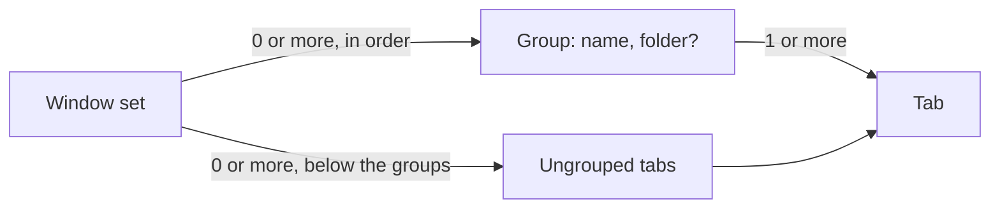

# Spec: tab groups and workspaces

Status: agreed (user decisions 2026-10-28, demo approved the same day); replaces the workspace-by-folder
model of T-203 and the thin layer of T-249 (`docs/plans/workspace-thin-layer.md`)
Task: T-266 (survey T-262)
Canon: `docs/specs/windows-workspaces.md` (D1-D18, S1-S23), `docs/modules/workspaces.md`,
`docs/modules/sidebar.md`, `docs/specs/modules.md` section 5, `docs/specs/agent-cli.md` 4.1.
Survey: T-262 report (Warp, Tellurion, Claude Code desktop, Codex, cmux, WezTerm, Wave, Kitty,
iTerm2, Ghostty, tmux, Zellij), outside the repository.

## 1. Goal and scope

- Goal: a group is a plain optional tab group, as in Warp. A group with a project folder is
  a workspace. A group helps the user keep tabs together. It also gives an agent the context
  of where it works: `tarn ls` lists the panes and agents of its own group.
- Result: a new window has one ungrouped tab and no group. Shift+Cmd+T creates a group by name
  or a workspace by folder. Tabs move freely in and out of groups. An agent in a group sees
  that group in `tarn ls`.
- In scope: ungrouped tabs; the two kinds of group at creation; where "+" and Cmd+T put a tab
  and where it starts; delete with an option to close the tabs; the group in `tarn ls`;
  restore of an old "~".
- Out of scope (separate tickets after this core, user decision 2026-10-28): git state in a
  header, a tab in a new worktree, a warning for two agents in one worktree, saved workspace
  commands, a changes view, environment per workspace, pin, colour, an agent summary in the
  header, what each agent works on. Never: a tab moves by itself (by folder, agent or `cd`),
  moves between windows (T-142).

## 2. Model



One entity in code: a group with an optional folder. The UI calls a group with a folder a
workspace (user decision 2026-10-28). Ungrouped tabs are kept as one hidden group per set:
no header, never renamed, folded or deleted. Its id is the set's id, which is the only mark of it
(`WorkspaceSet.isUngrouped`), and a second one cannot be added (`WorkspaceSet.add` refuses a
known id); its stored name is "~", so an
older build rolls back to its start workspace. Every place that lists groups skips it (section 5).

Two invariants and their writers:

- I1. At most one ungrouped group per set. Writer: `ungroupedID()`, the only place that makes
  it. `absorb` (Merge All Windows) puts the other set's ungrouped tabs into it; every merge goes
  through `absorb`, the `isPlain` branch goes. One exception: a window of one ungrouped tab. The book sees a new tab alone in its window before it is tabbed; Ghostty has selected it by the pass that sees it in a group (`TerminalController.swift:493`, stand), so a selected one-tab window is a new tab and takes the target (G4, S55), an unselected one is a merged window and goes through `absorb` (tests `MergeTests`, order of the app); `reinsert`
  (undo of a close) maps a closed ungrouped group to it, `makeSet` (restore) merges every entry
  taken as ungrouped. `ensureWorkspace`, `reconcileFrozen`, `makeHome` and `makeDefault` go.
- I2. The ungrouped run is last. A tab of a group standing below an ungrouped tab is a break,
  like a split run. A user's move is healed by the mover rule of `repair`: the moved tab joins
  the group of its upper neighbour (user decision 2026-10-28, B1: the only tab of a group dragged
  past the ungrouped tabs becomes ungrouped and its group goes). When two neighbours swap, both
  fit the mover rule; the mover is the selected tab (AppKit selects the native tab being
  dragged; checked on the stand before the code of stage 1a), else the tab of a group. Restore,
  Merge All Windows and Workspaces on again skip `repair`, as `regroup` does today, and call
  `settleUngrouped`: native moves put the ungrouped tabs after the groups, membership unchanged.
  The same moves heal any break the mover rule leaves (an undone tab that Ghostty put back among
  the ungrouped tabs). The second branch of `repair` never moves a tab into or out of the
  ungrouped group.

Decisions (each names its source):

- G1. A group is optional. A new window starts with one ungrouped tab; there is no "~" any more.
  Source: Warp, tabs live outside groups until put in one; "Ungroup tabs" returns them
  (docs.warp.dev/terminal/windows/tabs). Dropped: the start workspace "~" (D24 of the old model).
- G2. Shift+Cmd+T, the header button and "+ New group" ask for a Group (a name) or a Workspace
  (a project folder; named after its last component, the name can be changed). The group comes
  with one new tab, above the ungrouped tabs. A folder another workspace of the window has
  selects that workspace (Q1 of the old model, VS Code). Source: Warp for the named group,
  Claude Code desktop for the project folder, a session works in the folder picked before the
  first message (code.claude.com/docs/en/desktop). The app shows the macOS
  folder panel; the demo takes a typed path.
- G3. The "+" in a header adds a tab at the end of that group. It starts in the folder of a
  workspace; in a plain group, where Cmd+T would start (Ghostty). Source: Claude Code desktop,
  a session runs in its project folder; Ghostty `tab-inherit-working-directory`. User
  decision 2026-10-28 (2a). Replaces D20's "inherit from the last tab of the workspace" (cmux).
- G4. Cmd+T in a grouped tab adds a tab right after it, in the same group, in its folder
  (Ghostty). Cmd+T in an ungrouped tab adds an ungrouped tab. Cmd+D stays in its tab (Ghostty).
  The new-tab button at the top of the sidebar is Cmd+T (demo). The group is the one of the tab
  selected when Cmd+T was pressed. A fresh tab without a pending target (the sidebar's "+" and a
  new group set one, Cmd+T does not) stays where Ghostty put it when it touches the run of that
  group; otherwise it goes to the end of the run. So with the default
  `window-new-tab-position = current` it stands right after its source, with `end` at the end of
  the group. Source: user decision 2026-10-28 (1a). Prior art: Warp's docs do not
  say where a plain new tab lands next to a group (survey gap).
- G5. A tab moves freely: drag onto a group or among its rows; drag below all rows or "Remove
  from group" makes it ungrouped; "Move to <group>" in the tab menu. "Remove from group" and
  "Move to" put the tab at the end of the target run; the sidebar tail is a drop slot of the
  ungrouped run even when it is empty. A drag that leaves the sidebar closes the gap; a release
  outside it moves nothing (user decision 2026-10-28, T-235). Source: Warp "Move to group",
  "Remove from group".
- G5a. A native tab dragged in from another window joins the group of the tab above it where it
  is dropped, or of the tab below when it is first; among ungrouped tabs it is ungrouped (user
  decision 2026-10-28, B2; the mover rule of `repair`). It is known as an arrival because the
  book closed it in another set in the same pass. An arrival with no neighbour (a tab dropped
  outside every window, a new window set) is ungrouped. Price of the one-tab rule: a whole one-tab
  window dropped into another window is selected, so it goes as Cmd+T into the group of `lastSelected`
  (the mover rule inside another group's run). Merge All Windows has no drop place and
  is not an arrival (I1).
- G6. The last tab leaving a group removes the group; Cmd+Z of a closed tab brings it back.
  Source: user decision 2026-10-28 (1a); it is today's rule for a workspace.
- G7. "Delete group…" asks for confirmation with "Also close its N tabs", unchecked by default.
  Unchecked: the tabs become ungrouped, moved natively before the first ungrouped tab. Checked:
  they close through `Sidebar.close([Tab])`, one confirmation and the undo it gives today. The only
  group of a window can be deleted too; its tabs become the ungrouped tabs. Source: Warp "Ungroup" keeps the
  tabs ("Ungroup tabs"); the checkbox is the user's decision 2026-10-28 (2b). Replaces D13 (tabs go to the
  neighbour workspace).
- G8. Groups stand above the ungrouped tabs (I2). The first tab of a new group goes before the
  first ungrouped tab; a group header dropped at the tail lands after the last group. Source:
  user decision 2026-10-28 (3); Warp mixes groups and tabs.
- G9. The agent scope (`AgentScope`, used by `tarn ls`, `new`, `run`, `wait`, `read`, `close`)
  is the caller's group; for an ungrouped caller, its own tab (user decision 2026-10-28, B3:
  one rule for every command). A pane outside the scope is "no pane matched", exit 4, as today
  (B3 of `docs/specs/agent-cli.md`). `tarn ls` adds a GROUP column after TAB (`-` when
  ungrouped); JSON keeps `workspace` (the group id, empty when ungrouped) and adds `group` (the
  name, empty when ungrouped) and `folder` (empty for a plain group). A caller in no window set
  (quick terminal) keeps the refusal `tarn: not in a workspace`. Source:
  Tellurion groups the tabs of one repository with a live agent summary, cmux shows agent state
  per workspace (README of each, behaviour only, both AGPL); the scope rule is the user's
  decision 2026-10-28 (3a, 4: "it sees more context where it works").
- G10. The folder of a workspace is fixed at creation (Q3 of the old model, Claude Code desktop).
  A plain group never gets a folder later.
- G11. Workspaces off (Settings > Modules): every tab is listed flat; new tabs are ungrouped
  (was: join "~"); groups are frozen and come back when it is on again, the ungrouped run last
  (I2).
- G12. With tabs at the top, a grouped tab carries its group name after the title; an
  ungrouped tab carries none (replaces "two or more workspaces" of `docs/specs/modules.md` 5).
  The window subtitle names the group of the selected tab, none for an ungrouped one.
- G13. Restore: the snapshot entry of the ungrouped group carries `ungrouped: true` and the
  name "~". In a snapshot without the key, a "~" without a folder or with the
  home folder becomes the ungrouped tabs, and its tabs are moved natively after the groups. A
  plain group the user named "~" in such a snapshot is taken as ungrouped too (`isHome` already
  treats it as the start workspace). Restored "No project" and "Default" stay plain groups.

What Ghostty already has, unchanged from T-249 (at `origin/dev` 449a20547): the start
directory of a new tab and split comes from the inherited config
(`macos/Sources/Ghostty/Ghostty.App.swift:996`, `:1024`); `window-inherit-working-directory`
and `tab-inherit-working-directory` (`src/config/Config.zig:2089`, `:2094`); `window-new-tab-position`; `SurfaceConfiguration.workingDirectory`
(`macos/Sources/Ghostty/Surface View/SurfaceView.swift:581`); native tab order by `move_tab`.
Ghostty has no groups (issue #1598 closed). Our code adds only the group of a tab, the folder of
a workspace's first tab and of its "+", and the agent scope. No new insertion point.

Canon this spec replaces (each edited with the stage that changes the behaviour):

| Canon | Replaced by |
|---|---|
| `docs/specs/windows-workspaces.md` D1, D4 (always a workspace), D5 (header always), D10 and D12 (new window with "~"), D13 (delete moves tabs to a neighbour), the life diagram, S1, S6, S18, S20, S21 | G1, G6-G8, G13 |
| `docs/specs/modules.md` 2 item 6, 5 (new tabs join "~", name with two or more workspaces), 7, 10 | G11, G12 |
| `docs/modules/workspaces.md` lines on "~", the fallback "first workspace", `sourceTab`, delete, a tab from another window | G3-G8, G5a, I1, I2 |
| `docs/modules/sidebar.md` "the last workspace has no delete" | G7 |
| `docs/specs/agent-cli.md` 4.1 `ls` columns and JSON, B3 wording | G9 |
| this spec's old D19-D25 and Q1-Q3 | G2, G3, G10, G12, G13 |

The general fallback stays (`docs/modules/workspaces.md`): an unforeseen state is logged as
`workspace: <reason>` and the tab goes to its target, now the ungrouped run instead of "~".

## 3. Scenarios

A folder `F` = `~/Dev/self-projects/tarn`; `P` = `~/Dev/self-projects`. Tests are tagged
`spec: docs/specs/workspace-folder.md S<n>`.

| ID | Scenario | Start and steps | Result and the fact checked | Tier |
|---|---|---|---|---|
| S1 | New workspace by folder | Shift+Cmd+T, Workspace, pick `F` | workspace "tarn" with folder `F` above the ungrouped tabs, one new tab whose config has `workingDirectory == F` | fast |
| S2 | Cancelled | Shift+Cmd+T, Cancel (dialog or folder panel) | no group, no tab | fast |
| S3 | Folder already bound | pick `F` while "tarn" has `F` | no new workspace, the first tab of "tarn" is selected | fast |
| S4 | Cmd+T, Cmd+D | selected tab in "tarn" at `F/macos` | the new tab is right after it in "tarn" (unit test of `reconcile`), started at `F/macos`, the split too (stand) | fast, live |
| S6 | "+" of a header | selected ungrouped tab at `P`; "+" on "tarn", then on plain group "notes" | "tarn": a tab at its end in `F`; "notes": a tab at its end in `P` | fast |
| S11 | Agent tab stays | ungrouped tab at `F/macos`, `claude` starts | the tab stays ungrouped, no mark | live |
| S21 | Restore | relaunch with groups and folders; a snapshot saved before folders; one with the `manual` key | groups, folders and the ungrouped tabs come back; old snapshots decode; `manual` ignored | fast |
| S22 | No folder change | header menu of any group | no Set Folder or Remove Folder | fast |
| S23 | Top tab mark | tabs at the top, a tab in "tarn" and an ungrouped tab | "tarn" after the title of the first, no mark on the second | fast |
| S26 | Path forms | folder picked through a symlink, a trailing slash, `F-old` next to `F` | matched by standardized resolved path on component boundaries | fast |
| S40 | New window | Cmd+N | one ungrouped tab, no group header | fast |
| S41 | New plain group | Shift+Cmd+T, Group, name "notes" | group "notes" without folder above the ungrouped tabs, one tab started where Cmd+T would | fast |
| S42 | Cmd+T ungrouped | Cmd+T in an ungrouped tab | a new ungrouped tab | fast |
| S43 | Move out and in | drag a tab of "tarn" below all rows; then onto "notes"; then "Remove from group" | ungrouped; in "notes"; ungrouped. No tab moves by itself | fast |
| S44 | Last tab leaves | move or close the only tab of "notes" | "notes" is gone; Cmd+Z of the close brings it back with the tab | fast |
| S45 | Delete, keep tabs | "Delete group…" on "tarn" (2 tabs), checkbox off | "tarn" gone, both tabs ungrouped at the top of the ungrouped list, still open | fast |
| S46 | Delete, close tabs | "Delete group…" on "notes", checkbox on | "notes" and its tabs closed after one confirmation; undo as for several tabs closed from the sidebar | fast |
| S47 | Groups stay above | drag a group header below the ungrouped tabs; create a group while ungrouped tabs exist | the header lands after the last group; the new group stands above the ungrouped tabs | fast |
| S48 | `tarn ls` in a group | agent pane in "tarn" | rows of "tarn" only, GROUP "tarn"; JSON `group` "tarn", `folder` `F` | fast |
| S49 | `tarn ls` ungrouped | agent pane in an ungrouped tab, two other ungrouped tabs | rows of its own tab only, GROUP `-` | fast |
| S50 | Old "~" restored | snapshot with workspaces "tarn" and "~" (home folder) | "tarn" stays a group; the "~" tabs are ungrouped below it | fast |
| S52 | Native drag past ungrouped | tabs at the top: drag the only tab of "notes" after the ungrouped tabs; also with one ungrouped tab (a swap of neighbours) | it is ungrouped, "notes" is gone, the other tab stays ungrouped (B1) | fast, live |
| S53 | Tab from another window | drop a native tab of window 1 between two tabs of "tarn" in window 2; another among ungrouped tabs | first in "tarn", second ungrouped (B2) | fast |
| S54 | Merge All Windows | two windows, each with a group and ungrouped tabs; also a window of groups only with a window of ungrouped tabs only | one ungrouped run, last, holding all ungrouped tabs; every group above; no tab changes group | fast |
| S55 | Cmd+T with `end` | `window-new-tab-position = end`, Cmd+T in "tarn" while ungrouped tabs exist | the tab is in "tarn", at its end | fast |
| S56 | Delete the only group | one group, no ungrouped tab; Delete, checkbox off | the tabs are ungrouped, no header | fast |
| S57 | Agent scope ungrouped | ungrouped caller; `tarn wait`, `read`, `close` on a pane of another ungrouped tab | exit 4 "no pane matched" for each (B3) | fast |
| S58 | Drag leaves the sidebar | drag a row out over the terminal, release | the gap closes when the pointer leaves; nothing moves (T-235) | fast |
| S59 | Undo after the ungrouped run went | close the last ungrouped tab, "Remove from group" another, Cmd+Z | one ungrouped run with both tabs (I1) | fast |
| S51 | Workspaces off and on | off: Cmd+T, a drag; on again | off: flat list, new tab ungrouped, membership kept; on: groups as before, the new tab ungrouped | fast |
| - | Acceptance by hand | Cmd+N, a workspace by folder, a plain group, Cmd+T and "+", move out and in, delete both ways, `tarn ls` in and out of a group, relaunch | as S1, S4, S6, S40-S49; the agent on the stand per PR, the user once on the dev build after stage 3 | live |

Limits (what the code never does):

- R1: never moves a tab between windows.
- R3: never changes the group of a tab because of a folder, an agent or `cd`.
- R5: never changes the start directory Ghostty gives Cmd+T or Cmd+D; only the first tab of a
  workspace and its "+" pass the folder.
- R6: never writes the user's Ghostty config.
- R7: never lets an agent command reach a pane outside its scope (G9).

## 4. Data and states

| Entity | Change | Owner | Key or invariant |
|---|---|---|---|
| ungrouped group | new rule, no field: `WorkspaceSet.isUngrouped` is `workspace.id == set.id` | `WorkspaceSet` | at most one (I1); run last (I2); name "~", never shown |
| `Workspace.folder` | unchanged | `WorkspaceSet` | absolute, standardized; nil for plain groups and the ungrouped set |
| `WorkspaceSnapshot.Entry.ungrouped` | new optional field | `WorkspaceRestore` | missing: a "~" without folder or with the home folder is ungrouped (G13); several merge into one (I1); version stays 1 |
| `PaneRow.group`, `PaneRow.folder` | new | `AgentCommands` | empty for an ungrouped pane; `PaneRow.workspace` keeps the set's id (a nil one still means the quick terminal), only the JSON `workspace` is empty |

Transitions of a tab: ungrouped and grouped, only by the user (G4-G7); a group lives while it
has a tab (G6) or until deleted (G7).

## 5. Code model

```swift
struct Workspace {
    var folder: String?           // G10; nil: a plain group
}

extension WorkspaceSet {
    /// The ungrouped group (id == set id), made when missing; the only maker (I1).
    mutating func ungroupedID() -> Workspace.ID
    func isUngrouped(_ workspace: Workspace) -> Bool
    /// G7: the tabs become ungrouped; returns the native moves that put them before the
    /// first ungrouped tab.
    mutating func ungroup(_ id: Workspace.ID, order: [TabKey]) -> [Reorder]
    /// I2: the native moves that put the ungrouped run last; membership unchanged.
    func settleUngrouped(order: [TabKey]) -> [Reorder]
}

extension WorkspaceRegistry {
    /// G3: the workspace folder, else Cmd+T's config; the tab goes to the end of the group.
    func newTab(in workspace: Workspace.ID, from window: NSWindow)
    func createWorkspace(named name: String, from window: NSWindow) -> Bool   // G2, kept entry point
    func createWorkspace(folder: String, from window: NSWindow) -> Bool
}
```

`reconcile` keeps a fresh tab without a pending target where Ghostty put it when it touches its
target run (G4), applies the mover rule to an arrival from another window (G5a), puts a new
group's first tab before the first ungrouped tab (G8) and counts a group tab below an ungrouped
tab as a break (I2). `isPlain` and its merge branch go (I1); a one-tab window is a merge or a new tab by its selection, as in I1. `sourceTab` (the cmux rule of
D20) goes. `WorkspaceBook.targetWorkspace` falls back to the ungrouped group instead of the
first workspace.

Places that list groups or show a group's name, all of which skip the ungrouped group or name
none: sidebar headers (`Sidebar.swift`), the tab menu "Move to" and "Remove
from group", the header menu and the delete dialog, `NativeTabMark` (counts groups, not runs),
the window subtitle (`WorkspaceTitle.swift`), `TabDragSource` drop slots (the tail is the
ungrouped run), `tarn ls` GROUP and JSON, the snapshot.

## 6. Stages

| Stage | Checkable result | Excludes | Check |
|---|---|---|---|
| 0. Demo | drawn in `demo/`, approved 2026-10-28 | app code | demo checks |
| 1a. Model | I1, I2, G4, G5a, G8 placement, G13 restore, Merge, frozen; the ungrouped group still drawn with a "~" header, so `dev` is never half done; T-255 (Cmd+N in `~`) | sidebar look, dialogs | unit S4, S11, S21, S42, S50-S55, S59; stand |
| 1b. Sidebar | no header for ungrouped tabs, rows below the groups; menus, drop slots, `NativeTabMark`, subtitle skip it; S40, S23 | dialogs | unit and stand |
| 2. Group or workspace | dialog, "+" (G3), "Remove from group", delete with the checkbox; T-235 and T-236 (drag tests) | agent scope | unit S1-S3, S6, S22, S26, S41, S43-S47, S56, S58; stand |
| 3. Agent scope | G9 for every agent command | | unit S48, S49, S57; CLI test; stand |

Each stage is one PR to `dev` under 400 lines of code; `docs/modules/workspaces.md`,
`docs/specs/windows-workspaces.md` and `docs/specs/agent-cli.md` change with the stage that
changes the behaviour they describe.

## 7. Acceptance

- Command: `make -f tarn.mk check`, green, with the tests tagged by scenario.
- Scenario: "Acceptance by hand" of section 3 on one dev build after stage 3.
- Not automated: the folder panel, the look of the dialogs.
