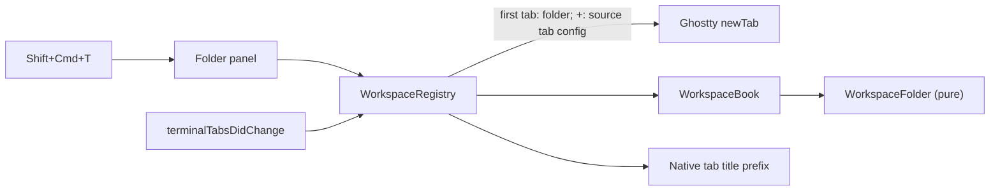

# Spec: workspace by project folder

Status: agreed (mockups approved by the user 2026-10-27; a workspace header's tooltip names its folder);
narrowed 2026-10-27 by T-249 (`docs/plans/workspace-thin-layer.md`): workspaces are a thin layer over Ghostty
Task: T-203, issue #35
Canon: `docs/specs/windows-workspaces.md` (D1-D18, S1-S23), `docs/modules/workspaces.md`,
`docs/modules/sidebar.md`, research `~/Dev/knowledge/inbox/tarn-workspace-membership-2026-10-27-1134.md`
(outside the repository).

## 1. Goal and scope

- Goal: a workspace is a project folder. The first tab of a workspace starts in its folder; after
  that every tab and split opens where Ghostty opens it. The user stops forgetting `cd`.
- Result: Shift+Cmd+T asks for a folder and opens a workspace named after it, its first tab in
  the folder; the sidebar's + opens a tab in the folder of a tab of that workspace; with tabs at
  the top each tab reads "tarn · zsh".
- In scope: folder on a workspace; new workspace by folder; the source of a "+" tab; workspace
  prefix in native tab titles; restore of all of it.
- Out of scope: any move of a tab by itself (by folder, by agent, on `cd`); moves between windows
  (T-142); a list of recent folders in the folder dialog (a separate idea); opening a folder from
  Finder or `tarn open` into its workspace; ssh host detection.

## 2. Architecture



| Block | Responsibility | Talks to |
|---|---|---|
| `WorkspaceFolder` | pure path rules: standardize, contains, name, display | none |
| `Workspace`, `WorkspaceSet` | folder per workspace | `WorkspaceBook` |
| `WorkspaceBook` | the source tab of a "+" tab | `WorkspaceSet` |
| `WorkspaceRegistry` | applies the book to windows: first tab of a folder workspace, "+", native moves | AppKit, Ghostty `newTab`, `move_tab` |
| `WorkspacePrompt` | folder panel for a new workspace | `WorkspaceRegistry` |
| `WorkspaceTabLabel` | native tab title with the workspace prefix | `TerminalWindow.attributedTitle` |

- Initiator: the user (new workspace, new tab, move). Source of truth: `WorkspaceSet` per window
  set; the working directory of a surface is Ghostty's (`SurfaceView.workingDirectory`).
- Owner of state: `WorkspaceBook`. Side effects: Ghostty `newTab` and `move_tab`, restorable
  state `tarn.workspaces`.

What Ghostty already has (Ghostty first), at `origin/dev` 449a20547:

| Need | Ghostty | Where |
|---|---|---|
| start directory of a new tab | inherited config with `workingDirectory` passed to `TerminalController.newTab(_:from:withBaseConfig:)` | `macos/Sources/Ghostty/Ghostty.App.swift:996`, `macos/Sources/App/AppDelegate.swift:798-810` |
| start directory of a split | inherited config passed to `newSplit(at:direction:baseConfig:)` | `Ghostty.App.swift:1024`, `macos/Sources/Features/Terminal/BaseTerminalController.swift:282` |
| inheritance switch | `window-inherit-working-directory`, default true | `src/config/Config.zig:2089` |
| working directory of a pane | `SurfaceView.pwd` (OSC 7); our extension `workingDirectory` adds the foreground process cwd | `macos/Sources/Ghostty/Surface View/OSSurfaceView.swift:14`, `macos/Sources/Features/Tarn/ViewerPaths.swift:5-7` |
| start directory field | `SurfaceConfiguration.workingDirectory` | `macos/Sources/Ghostty/Surface View/SurfaceView.swift:581` |
| native tab title | `TerminalWindow.title` sets `tab.attributedTitle` from `attributedTitle` | `macos/Sources/Features/Terminal/Window Styles/TerminalWindow.swift:398-445` |
| reordering tabs | `move_tab` action, already used by `WorkspaceRegistry.moveNatively` | `macos/Sources/Features/Tarn/Workspace/WorkspaceRegistry.swift` |

Our code fills only the folder of a workspace's first tab and the source of a "+" tab. Insertion
points (one call, no logic), all listed in `docs/architecture.md`:

- Every Ghostty write of `tab.attributedTitle` (`TerminalWindow.swift:402`, `:414`,
  `TitlebarTabsVenturaTerminalWindow.swift:60`, `:67`) becomes `WorkspaceTabLabel.apply(to: self)`.

Cmd+T and Cmd+D go through Ghostty untouched since D20 was dropped (T-249).

Prior art: research `tarn-workspace-membership-2026-10-27` (cmux, herdr, aya, WezTerm). cmux and
herdr give a workspace a folder at creation (`--cwd`) and new panes inherit it; behaviour only,
cmux is AGPL. Claude desktop and VS Code open a project as a folder (user's reference, 1A). No
analog moves a tab between groups by itself (survey of T-249), so D21, D22, D26 and D27 went.
No analog found for a tab-title prefix: searched the same research and the analog base; it is
ours, kept to pure functions.

Decisions:

- D19. A workspace has an optional folder; the user picks it in a folder panel when creating a
  workspace, and the name is the folder's last component (user, 1A: "as Claude and VS Code do").
  Dropped: name first, folder later (forgotten like `cd`). Affects: every new-workspace path.
  Model change: yes.
- D20. Dropped 2026-10-27 (T-249, user decision: workspaces are a thin layer over Ghostty,
  `docs/plans/workspace-thin-layer.md`). A new tab or split starts where Ghostty starts it, in
  the inherited working directory, in every workspace; no analog overrides the focused pane for a
  split, and cmux and WezTerm inherit for a tab. The "+" of a workspace header inherits from the
  selected tab of that workspace, else its last tab; an empty workspace gets Cmd+T's config
  (cmux, `Sources/TabManager.swift:2014-2048`). The folder is used only for the first tab of a
  workspace created from it. Model change: yes.
- D21, D22, D26, D27. Dropped 2026-10-27 (T-249, same user decision): an agent tab no longer
  joins the workspace of its folder, there are no manual marks and no "outside folder" mark. A
  tab stays in the workspace it was opened in until the user moves it; no analog moves a tab by
  itself. Snapshots saved with the old `manual` key restore, the key is ignored.
- D23. Nothing crosses the tab's window set. Dropped: moving a tab to another window (T-142 has
  no decision on tab order writers). Model change: no.
- D24. The folderless workspace of a new set is named "No project" instead of "Default"; there
  every Ghostty behaviour is kept (cwd inheritance, titles). Model change: yes.
  Renamed 2026-10-27 (T-245, user decision): a new set starts with the workspace "~", the "~" of
  Workspaces off (`docs/modules/workspaces.md`). "~" has no folder (T-249, user decision
  2026-10-27): its tabs and splits open where Ghostty opens them; a "~" saved with the home
  folder loads without it. Restored sets keep their saved names ("No project", "Default").
- D25. With tabs at the top and two or more workspaces in the set, a native tab title is
  "<workspace> · <Ghostty title>", the workspace part dimmed (user, 2026-10-27). One workspace:
  Ghostty's title alone. It shows the workspace of a native tab. Model change: yes.
  Superseded for the order by the modules decision (2026-10-27, `docs/specs/modules.md` section 5): the
  name stands after the title in our tab mark, no insertion point; the name shows when Workspaces is on and the set has two or more workspaces (D25's condition kept).

Canon decisions this spec replaces (the stage named edits `docs/specs/windows-workspaces.md`):

| Canon | Now | New text | Stage |
|---|---|---|---|
| D3 and S4: a new workspace asks for a name | D19 | a new workspace asks for a folder; the name is the folder's last component | 1 |
| D1, D10, D12, D13, S1, S18, S20: `Default` | D24 | a new set starts with "~" (no folder; T-245, T-249, was "No project"); restored names are kept | 1 |
| D14 and S22: no workspaces with tabs at the top | D25 | with two or more workspaces, native titles carry the workspace prefix | 4 |

D11 (no folder rule) and D15 (new tabs inherit the working directory) stand again since T-249.

## 3. Scenarios

A folder `F` = `~/Dev/self-projects/tarn`; `P` = `~/Dev/self-projects`.

| ID | Scenario | Start and steps | Result and the fact checked | Risk | Tier |
|---|---|---|---|---|---|
| S1 | New workspace by folder | Shift+Cmd+T, pick `F` | workspace "tarn" with folder `F`, one new tab; the tab's surface config has `workingDirectory == F` | | fast |
| S2 | Panel cancelled | Shift+Cmd+T, Cancel | no workspace, no tab | | fast |
| S3 | Folder already bound | pick `F` while "tarn" has `F` in this window | Q1: no new workspace, the first tab of "tarn" is selected | | fast |
| S4 | Cmd+T, Cmd+D | selected tab in "tarn" at `P` or `F/macos` | the new tab or pane starts at the same folder, Ghostty's inheritance (D20 dropped) | stand: Cmd+T and Cmd+D through Ghostty actions | live |
| S6 | + on another workspace | selected tab in "~" at `P`, "tarn" has tabs, last at `F/docs`, + on "tarn" | new tab in "tarn" starts at `F/docs`; + on an empty workspace behaves as Cmd+T | NewTabSourceTests | fast |
| S11 | Agent tab stays | tab in "~" at `F/macos`, `claude` starts | the tab stays in "~", no mark on its row (D21 dropped) | stand | live |
| S21 | Restore | relaunch with folders; also a snapshot saved before folders and one saved with the old `manual` key | folders come back; an old snapshot decodes with no folder; the `manual` key is ignored | | fast |
| S22 | No folder change | header menu of any workspace | no Set Folder or Remove Folder: the folder is fixed at creation (Q3) | | fast |
| S23 | Tab prefix | tabs at the top, set with "No project" and "tarn" | "tarn · zsh"; with one workspace the plain title; switching to the sidebar style drops the prefix | | fast |
| S24 | Prefix survives | tabs at the top, title font change or fullscreen | prefix kept | | live |
| S25 | Rename | rename "tarn" to "core" with tabs at the top | titles read "core · ..." | | fast |
| S26 | Path forms | folder picked through a symlink, a trailing slash, `F-old` next to `F` | matched by standardized resolved path on component boundaries; `F-old` is not inside `F` | | fast |
| S35 | Prefix writers | tabs at the top: rename, a second workspace appears, a sidebar move, style switch | every native title of the set is rewritten at once | | fast |
| - | Acceptance by hand | the user creates "tarn" by folder, opens Cmd+T from `P`, starts `claude`, tries tabs at the top | as S1, S4, S11, S23 on the built app | | live |

Dropped with D20 (T-249): S5, S7-S10, S34. Dropped with D21, D22, D26, D27 (T-249): S12-S20,
S27-S33.

Limits (what the code never does):

- R1: never moves a tab between windows.
- R3: never changes the membership of a tab because of a folder or an agent.
- R5: never changes the start directory Ghostty gives Cmd+T or Cmd+D; only the first tab of a
  workspace created from a folder and the "+" of a header pass their own config (D19, D20).
- R6: never writes the user's Ghostty config.

## 4. Data and states

| Entity | Change | Owner | Key or invariant |
|---|---|---|---|
| `Workspace.folder` | new, `String?` | `WorkspaceSet` | absolute, standardized, symlinks resolved; nil for "~", a restored "No project" and old workspaces |
| `WorkspaceBook.isPlain` | changed | `WorkspaceBook` | plain: one unrenamed "~", "No project" or "Default" with no folder |
| `WorkspaceSnapshot.Entry.folder` | new optional field | `WorkspaceRestore` | missing in old snapshots decodes as nil; version stays 1 |

- Input: the folder panel; Ghostty's inherited `SurfaceConfiguration`.
- Transitions: none of its own; membership changes only by the rules of
  `docs/modules/workspaces.md` (new tab, sidebar move, native reorder, delete, merge).

## 5. Code model

```swift
/// Pure path rules of D19 and S26.
enum WorkspaceFolder {
    /// Absolute, standardized, symlinks resolved; nil for a relative or empty path.
    static func standardized(_ path: String) -> String?
    /// True when `path` is `folder` or lies below it, on path component boundaries.
    static func contains(_ folder: String, _ path: String) -> Bool
}

struct Workspace {
    var folder: String?          // D19; nil: no project
}

extension WorkspaceSet {
    mutating func create(name: String, folder: String?) -> Workspace.ID?
}

extension WorkspaceBook {
    /// The tab a "+" tab of `workspace` inherits from: `selected` when it is in `workspace`, else
    /// its last tab in `order`; nil for an empty workspace (D20, cmux).
    func sourceTab(for workspace: Workspace.ID, order: [TabKey], selected: TabKey) -> TabKey?
}

extension WorkspaceRegistry {
    /// "+": Ghostty's tab config inherited from `sourceTab`, else Cmd+T.
    func newTab(in workspace: Workspace.ID, from window: NSWindow)
    func createWorkspace(folder: String, from window: NSWindow) -> Bool
}

/// D25.
enum WorkspaceTabLabel {
    static func title(_ title: String, workspace: String?, workspaces: Int, style: TabStyle) -> NSAttributedString
    /// Writes `tab.attributedTitle` of `window`. Without a prefix it writes exactly Ghostty's
    /// `attributedTitle`, nil included, so one-workspace windows look as in Ghostty. With a
    /// prefix: Ghostty's font and colour when set, the system title font otherwise. Called by
    /// Ghostty's former write sites and by tarn on every `publish`, rename and tab style change
    /// for all windows of the set.
    @MainActor static func apply(to window: NSWindow)
}
```

Top tab bar (D25):

```
| tarn · zsh  (o) | tarn · Claude Code (o)[cc] | No project · zsh |
  ^^^^ dimmed
```

## 6. Stages

| Stage | Checkable result | Depends on | Excludes | Check |
|---|---|---|---|---|
| 0. Demo | the top tab prefix drawn in `demo/`; the user approves the look | none | app code | demo checks |
| 1. Folder on a workspace | Shift+Cmd+T opens a folder panel; the folder in the header tooltip; folders saved and restored; the first tab of a new workspace starts in its folder | none | | unit S1-S3, S21, S22, S26 |
| 2. Start directory | built, then dropped with D20 (T-249): Ghostty inherits; "+" inherits from a tab of its workspace | 1 | | unit S6 (`NewTabSourceTests`) |
| 3. Agent arrival | built, then dropped with D21, D22, D26, D27 (T-249) | 1 | | live S11 |
| 4. Tab prefix | native titles with the prefix when tabs are at the top | 1 | | unit S23, S25, S35; live S24 |

Each stage is one PR to `dev` under 400 lines of code; docs (`docs/modules/workspaces.md`,
`docs/specs/windows-workspaces.md` decisions, `docs/architecture.md` insertion points) go with
the stage that changes them.

## 7. Acceptance

- Command: `make -f tarn.mk check`, green, with tests tagged `spec: docs/specs/workspace-folder.md S<n>`.
- Scenario: the line "Acceptance by hand" of section 3 on a build of the branch.
- Not automated: the folder panel, the look of the dimmed prefix, S24 (AppKit resets title fonts
  on fullscreen); the user checks them by hand on the build.

## Questions

Answered by the user's rule (2026-10-27): take the behaviour of VS Code and Claude desktop.

- Q1. Picking a folder a workspace of this window already has selects that workspace (VS Code
  brings the window of an open folder forward). Scenario S3.
- Q2. No new folderless workspace: "No project" was the folderless one (since T-245 a new set starts with "~", D24), as VS Code's empty
  window; Claude desktop always runs a session in a folder. Cancel in the panel creates nothing
  (S2); old workspaces without a folder stay as they are.
- Q3 (user decision 2026-10-27, replaces Set Folder... and Remove Folder): the folder is fixed at
  creation, as a Claude desktop session's. A running shell cannot be moved without typing into
  it, so a changed folder would leave open tabs in the old one; VS Code reloads the window and
  closes its terminals instead. Another folder: Shift+Cmd+T and drag the tabs. A workspace without
  a folder (a restored "No project" or "Default") stays without one.
